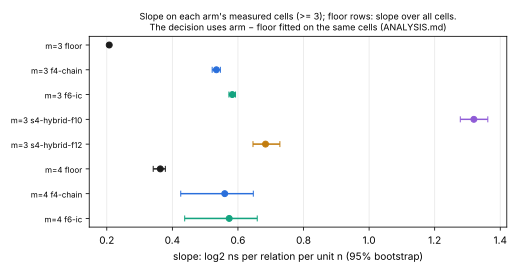
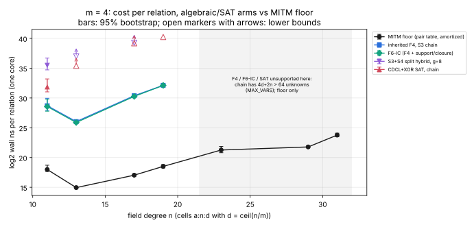

# Algebraic and SAT decomposition for m ≥ 3 against the meet-in-the-middle floor (stage diagnostic)

**Question.** Is there a decomposition method whose cost per **relation**
grows more slowly in `n` than the generic meet-in-the-middle floor? The
setting is binary Koblitz curves with a subspace factor base, `m = 3` or
`m = 4` summands. The candidates solve the summation-polynomial system on
`V^m` by Weil descent to `F₂` followed by Gröbner or SAT, rather than by
pair-table probing.

**Answer on the measured range: no.** Every arm with enough finished cells
grows faster than the floor; the remaining arms are undetermined under the
frozen rule.
- **Grows faster than the floor** (95% interval of the slope difference
  entirely above 0, at least 3 measured cells): F4 on the S₃ chain and
  F6-IC, at `m = 3` and at `m = 4`. Also the unsplit-S₄ hybrids at `m = 3`.
- **Undetermined** (fewer than 3 finished cells): SAT at both `m`, and the
  S₃+S₄ split hybrid at `m = 4`. These arms censor so early that the frozen
  rule cannot fit a slope. Their recorded lower bounds sit 10⁶–10⁷ times
  above the floor (tables below).

This was the predicted negative result. The conditional end-to-end ecbench
comparison (PROTOCOL.md §7) was therefore **not run**.

**Classification.** This is a stage diagnostic: decomposition cost per
relation, on one core, at isolation level L0. It makes no end-to-end,
`vs_rho` or exponent claim (AGENTS.md §8).

**Files.**
- Protocol: [`PROTOCOL.md`](PROTOCOL.md), frozen in commit `76e88621e`
  before the claim grid.
- Instrument: [`examples/ic_algebraic_floor/`](../../examples/ic_algebraic_floor/).
- Analysis: [`ANALYSIS.json`](ANALYSIS.json) / [`ANALYSIS.md`](ANALYSIS.md)
  and [`cells.csv`](cells.csv), all written by `ic_algebraic_floor analyze`.
- Report PDF: [`REPORT.pdf`](REPORT.pdf), from `REPORT.typ`.
- Run report: [`reports/run-20261014T1854Z/`](reports/run-20261014T1854Z/).
- Raw records: `runs/m3/`, `runs/m4/` and `runs-m{3,4}.log`.
- Pilot (not claim data): `pilot/`.

## What was compared

- **Cells.** The curve at each `n` is the Koblitz curve with the smaller
  cofactor. The factor base is `V = span(1, z, …, z^{d−1})` with
  `d = ⌈n/m⌉`, both signs.
  - `m = 3`: n = 13, 17, 19, 23, 29, 31.
  - `m = 4`: n = 11, 13, 17, 19, 23, 29, 31.
- **Targets.** Each cell has a pool of seeded uniform targets `[k]G`: 2,048
  at `m = 3` and 1,024 at `m = 4`.
  - The floor decides all of them, which fixes `p = P(decomposable)` and the
    floor's cost.
  - Each algebraic arm decides the same 6 decomposable and 6
    non-decomposable targets.
  - Each algebraic solve runs in its own child process on one thread, under
    a 120 s wall budget and a 4 GiB address-space cap.

| arm | what |
|---|---|
| `floor-mitm` | `PairSumTable` scan to the first witness (`m = 3`: `|F|` probes, `m = 4`: `|F|²`). Its cost per relation includes the table build spread over the `|F|` relations a solve needs. |
| `f4-chain` | `groebner_decompose`, inherited F4, S₃ chain (`md + (m−2)n` unknowns); the repository's default oracle |
| `f6-ic` | `groebner_decompose_f6_ic`: inherited F4 plus factor-base support pruning and group closure |
| `sat` | `sat_decompose_with`: native CDCL+XOR on the chain, non-lifting models blocked |
| `s4-hybrid-f10`, `-f12` | unsplit `S₄` (`3d` unknowns), F4 after guessing all but 10 or 12 unknowns |
| `s22-hybrid-g8` | `S₃+S₄` split (`4d+n` unknowns), `g = 8` |

**Cost per relation:** `C = (p·c_yes + (1−p)·c_no)/p`, in wall-clock ns.
**Slope:** OLS of `log₂ C` on `n`. **Intervals:** 2,000-replicate bootstrap.

## Results

### Exactness

- **Algebraic arms against the floor.** Every finished verdict of every arm
  agreed with the floor's ground truth: 0 disagreements and 0 bad witnesses
  in `ANALYSIS.json`.
- **Floor against exhaustive enumeration.** On every cell with n ≤ 23, the
  floor's decomposition sets on the 12 arm targets equal those of exhaustive
  enumeration (`pdp_split::exhaustive_decompositions`): 12/12 per cell.
  Enumeration exceeded its 5·10⁶ cap at n = 29 and 31.

### m = 3: log₂ wall ns per relation, with 95% intervals

| n | d | p | floor | f4-chain | f6-ic | s4-hybrid-f12 | sat |
|--:|--:|--:|--:|--:|--:|--:|--:|
| 13 | 5 | 0.494 | 14.47 | 23.56 [23.35, 23.77] | **22.71** [22.55, 22.86] | 30.12 | 30.21 |
| 17 | 6 | 0.274 | 14.40 | 26.12 | **25.60** | 32.77 | ≥ 37.73 |
| 19 | 7 | 0.404 | 14.76 | 27.28 | **26.38** | 34.24 | ≥ 37.53 |
| 23 | 8 | 0.247 | 15.47 | 29.55 | **28.83** | ≥ 38.64 | ≥ 38.82 (stopped) |
| 29 | 10 | 0.279 | 17.38 | **32.66** [32.49, 32.85] | 32.68 | ≥ 38.81 (stopped) | not run |
| 31 | 11 | 0.479 | 17.82 | 33.08 | **33.04** [32.89, 33.17] | not run | not run |

The cheapest algebraic arm against the floor is 303× at n = 13 (F6-IC) and
3.8·10⁴× at n = 31.


### Slopes and verdicts

Slopes are in log₂ ns per relation per unit of `n`; Δ is arm minus floor,
fitted on the same cells.

| m | arm | measured cells | arm slope [95%] | floor slope on the same cells | Δ 95% | verdict |
|---|---|--:|--:|--:|--:|---|
| 3 | floor (all 6 cells) | 6 | 0.207 [0.204, 0.211] | — | — | — |
| 3 | f4-chain | 6 | 0.534 | 0.207 | [0.315, 0.338] | grows faster |
| 3 | f6-ic | 6 | 0.583 | 0.207 | [0.366, 0.384] | grows faster |
| 3 | s4-hybrid-f12 | 3 (n ≤ 19) | 0.684 | 0.040 | [0.608, 0.687] | grows faster |
| 3 | s4-hybrid-f10 | 3 (n ≤ 19) | 1.320 | 0.040 | [1.240, 1.321] | grows faster |
| 3 | sat | 1 | — | — | — | undetermined |
| 4 | floor (all 7 cells) | 7 | 0.363 [0.342, 0.379] | — | — | — |
| 4 | f4-chain | 4 (n ≤ 19) | 0.560 | 0.156 | [0.342, 0.453] | grows faster |
| 4 | f6-ic | 4 (n ≤ 19) | 0.573 | 0.156 | [0.354, 0.469] | grows faster |
| 4 | sat, s22-hybrid-g8 | 1 | — | — | — | undetermined |





### Sensitivity (post-hoc, not part of the frozen rule)

Written by the same analyzer under [`sensitivity/`](sensitivity/). No
verdict changes.

- **Online floor** (no table-build term). Floor slopes are 0.289 at `m = 3`
  and 0.412 at `m = 4`. Δ for F4 on the chain is [0.233, 0.257] at `m = 3`
  and [0.239, 0.296] at `m = 4`; every Δ stays above 0.
- **Dropping the degenerate `m = 4`, n = 11 cell** (`|F| = 3`,
  `p = 0.009`). On n = 13, 17 and 19, F4 on the chain has slope 1.02 with
  Δ [0.41, 0.48], and F6-IC has Δ [0.42, 0.50].

## Where solvers time out or cannot run

- **SAT, `m = 3`.** Through n = 19 it decides every decomposable target, but
  its refutations censor at 120 s from n = 17 on: 3 of 6 at n = 17, and 6 of
  6 at n = 19. At n = 23 all of its first 4 targets censored, including the 2
  decomposable ones, and the cell stopped.
- **SAT, `m = 4`.** It censors from n = 13 and stopped at n = 19.
- **Unsplit S₄ hybrids, `m = 3`.** Finished through n = 19. At n = 23 the
  f10 hybrid hit the budget on 6 of 12 targets and the f12 hybrid on 7 of
  12; both stopped at n = 29.
- **S₃+S₄ split hybrid, `m = 4`.** Censored on all non-decomposable targets
  from n = 13, and stopped at n = 17.
- **F4 and F6-IC, `m = 4`, n ≥ 23: unsupported.** The chain system has
  `4d + 2n > 64` Boolean unknowns, and the library's Boolean polynomial type
  is capped at 64 (`koblitz_groebner::MAX_VARS`). This is an implementation
  limit, not a cost or a mathematical obstruction. It is recorded in
  [`problems/binary-boolean-system-64-variable-cap.md`](../../problems/binary-boolean-system-64-variable-cap.md).
  Only the floor ran on those cells.

## Reading (interpretation, labelled as such)

- **On F4 and F6-IC.** These are the strongest algebraic decomposers in the
  repository. On the S₃ chain, their cost per relation grows about
  2^{0.53n}–2^{0.58n} on n = 13…31, while the pair-table floor grows about
  2^{0.21n} amortized (2^{0.29n} online) on the same cells. The gap widens
  with `n`, from 3·10² to 4·10⁴.
- **What would be needed.** A method would have to grow more slowly than
  the `|F|` probes per target that the floor pays. That means its per-target
  solve would have to grow more slowly than about 2^{n/3}. Nothing here
  comes close.
- **Consistency with earlier studies.** This matches
  `research/pdp_root_finder_20261012/` (no slope below a floor) and the SAT
  survey (SAT behaves as an enumerator). It adds what those lacked: a
  binary-field, per-relation slope fit for the Gröbner arms on the same
  cells as the floor.
- **On the hybrids.** Guessing helps the unsplit S₄ system at small `n`, and
  keeping 12 free unknowns beats keeping 10. Both still grow faster than the
  chain-F4 arms.
- **Lower bounds and fits.** Lower-bound cells are never used as costs. The
  SAT arms' lower bounds already put them above F4.

## Limits

- **Small fields.** n ≤ 31 for `m = 3`, and ≤ 19 for the algebraic `m = 4`
  arms. Slopes are fitted over a range, not proved asymptotically. "Faster
  than the floor" is a statement about n = 13…31 with this implementation.
- **Isolation and units.**
  - L0 isolation: a shared 4-vCPU container, with the two grids running
    concurrently. Wall time is descriptive.
  - Each arm's counted unit is recorded in `ANALYSIS.md`: word XORs for the
    Gröbner arms, conflicts for SAT, group additions for the floor. The units
    are not interconvertible, so the cross-arm comparison is in wall time.
- **Sample sizes.** 12 targets per algebraic (arm, cell), and one seed. The
  `m = 4`, n = 11 cell is degenerate, with `|F| = 3`.
- **Base and solver scope.**
  - Only the standard (non-Frobenius-invariant) subspace base was tested.
  - Symmetrized-variable (FPPR) systems were tested only through the unsplit
    S₄ hybrid.
  - The unsplit `m = 4` system was not tested: the repository has no
    symbolic binary `S₅`.
  - No external solvers (msolve, CryptoMiniSat, Kissat) were available on
    this host.

## Requirements status

| requirement | status |
|---|---|
| Survey what was measured already | done (see PROTOCOL.md §1 and the reading above) |
| Freeze protocol before claim data | done: commit `76e88621e`, before the claim run at 18:54Z |
| `m = 3` cost per relation against the floor, n = 13…31, exactness against enumeration | done: 6 cells; exact on every finished verdict; floor equal to exhaustive enumeration on n ≤ 23 |
| `m = 4` if feasible | partial: n = 11–19 measured; n ≥ 23 unsupported (64-variable cap, problem record) |
| Slopes with intervals, timeouts, verdict | done |
| End-to-end ecbench comparison | not triggered: no arm beat the floor (§7) |
| Report, graph, PDF; `benchmarks/` entry | done |

## Reproduce

```sh
./research/ic_m3_algebraic_vs_mitm_20261014/run_grid.sh     # writes runs/ (must not exist), ~1.5 h on 4 vCPU
B=target/release/examples/ic_algebraic_floor
S=research/ic_m3_algebraic_vs_mitm_20261014
$B analyze --dir $S/runs/m3,$S/runs/m4 --out $S/ANALYSIS.json
$B analyze --dir $S/runs/m3,$S/runs/m4 --floor online --out $S/sensitivity/online-floor/ANALYSIS.json
$B analyze --dir $S/runs/m4 --exclude-n 11 --out $S/sensitivity/m4-without-n11/ANALYSIS.json
python figures/plot.py $S      # layout only (matplotlib), reads cells.csv and ANALYSIS.json
```

## Dashboard panels checked

These were checked and left unchanged: `docs/index-calculus-scoreboard.html`,
`docs/ic/progress-timeline.json` and `docs/ic-leaderboard.html`. This study
adds no ecbench session, no measured IC/rho ratio and no ledger row. Its
figures are stage diagnostics.
