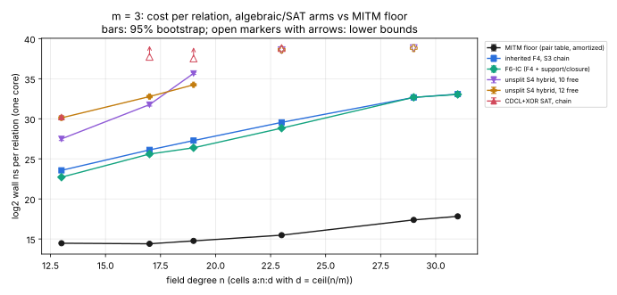

# Run report: claim grid 2026-10-14T18:54Z (descriptive)

This report describes one run and records observations only. The verdicts
and their reading are in the study [README](../../README.md).

**Command.**
[`run_grid.sh`](../../run_grid.sh): `ic_algebraic_floor run` for `m = 3`
and for `m = 4`, run concurrently. Flags follow PROTOCOL.md §2–§5.

**Code.**
- Instrument and protocol: commit `76e88621e`.
- Grid runner: commit `ef4434914`.
- Analysis: `ic_algebraic_floor analyze`. After the run its display was
  amended so that unsupported cells print `—`, and the post-hoc
  `--floor` / `--exclude-n` switches were added. No estimator or decision
  rule changed.

**Host and isolation.**
- Claude Code cloud container: Intel Xeon @ 2.10 GHz, 4 vCPU, Linux
  6.18.44, rustc 1.97.0.
- Isolation level L0: shared, unpinned, with the two grids concurrent.
- Algebraic solves ran one per child process with `RAYON_NUM_THREADS=1`.

**Time.** 18:54Z to 20:26Z UTC.

**Workload.**
- Seed 20261014.
- Pools of 2,048 targets (`m = 3`) and 1,024 (`m = 4`).
- 6 decomposable and 6 non-decomposable targets per algebraic (arm, cell).
- Per target: 120 s wall and 4 GiB address space.
- Early stop after 4 leading censored targets.

## Solves requested and completed

Counts are per arm, over all cells. Verdict meanings:
- `yes`: decomposed, witness checked.
- `no`: refuted.
- `none`: no verdict (budget spent, or unresolved branch).
- `timeout`: killed at budget + 15 s.
- `none` at `m = 4` for F4 and F6-IC: unsupported cells (64-variable cap).

There were no crashes and no disagreements with ground truth.

| m | arm | yes | no | none | timeout |
|---|---|--:|--:|--:|--:|
| 3 | f4-chain | 36 | 36 | 0 | 0 |
| 3 | f6-ic | 36 | 36 | 0 | 0 |
| 3 | s4-hybrid-f10 | 24 | 18 | 6 | 4 |
| 3 | s4-hybrid-f12 | 23 | 18 | 7 | 4 |
| 3 | sat | 18 | 9 | 13 | 0 |
| 4 | f4-chain | 24 | 24 | 3 (unsupported) | 0 |
| 4 | f6-ic | 24 | 24 | 3 (unsupported) | 0 |
| 4 | s22-hybrid-g8 | 12 | 6 | 10 | 0 |
| 4 | sat | 15 | 11 | 14 | 0 |

## Early stops and skips

These are from `runs-m3.log` and `runs-m4.log`.

**`m = 3`**
- `sat` stopped at n = 23, and was skipped at n = 29 and 31.
- `s4-hybrid-f10` and `s4-hybrid-f12` stopped at n = 29, and were skipped
  at n = 31.

**`m = 4`**
- `s22-hybrid-g8` stopped at n = 17.
- `sat` stopped at n = 19.
- `f4-chain` and `f6-ic` were unsupported at n = 23, 29 and 31.

## Measured values

All values are in log₂ wall ns per relation (one core), taken from
[`../../ANALYSIS.md`](../../ANALYSIS.md), which also lists the per-cell
95% intervals and counted units.

The floor, against field degree n:
- `m = 3`: 14.47, 14.40, 14.76, 15.47, 17.38, 17.82 (n = 13 → 31).
- `m = 4`: 17.99, 14.95, 17.04, 18.51, 21.27, 21.78, 23.77 (n = 11 → 31).

Exactness: the floor equals exhaustive enumeration on 12 of 12 targets on
every cell with n ≤ 23.

## Raw records

- `../../runs/m3/` and `../../runs/m4/`: one `truth-*.json` per cell (pool
  rows, floor timings, exhaustive checks, selected targets), and one
  `arm-*.jsonl` per (arm, cell).
- `../../runs-m3.log` and `../../runs-m4.log`: the orchestrators' logs.
