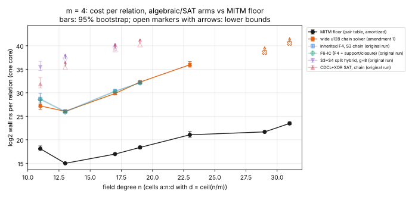

# Run report: amendment 1 grid 2026-10-15T00:24Z (descriptive)

This report describes one run and records observations only. The verdict
and its reading are in the study [README](../../README.md#amendment-1-m--4-with-the-wide-u128-solver).

**Command.**
[`run_grid_amendment1.sh`](../../run_grid_amendment1.sh), which runs
`ic_algebraic_floor run --m 4 --arms wide-chain` on the seven `m = 4` cells.
The rules are those of [`AMENDMENT_1.md`](../../AMENDMENT_1.md) (frozen in
commit `882598e55`).

**Host.**
- Claude Code cloud container: Intel Xeon @ 2.10 GHz, 4 vCPU, rustc 1.97.0.
- Isolation level L0: shared and unpinned, but the only grid running.
- One thread per solve.

**Time.** 00:24Z to 01:05Z UTC.

**Workload.**
- Seed 20261014 and a 1,024-target pool. These are the same targets as
  `runs/m4/`.
- 6 decomposable and 6 non-decomposable targets per cell.
- Per target: 120 s and 4 GiB.

## Solves

**Totals over 84 solves.**
- 40 `yes` and 30 `no`, every one agreeing with the floor's ground truth.
- 14 `timeout`, killed at budget + 15 s: 7 at n = 29 and 7 at n = 31.

**Censoring at n = 29 and 31.**
- Every non-decomposable target timed out.
- One decomposable target also timed out at each of n = 29 and 31.
- At n = 31 a further decomposable target returned `yes`, but only after
  130 s. That is past the budget, so the analysis counts it as censored:
  8 of 12 at n = 31, against 7 of 12 at n = 29.
- No crashes, unsupported cells or early stops.

**Exactness.** The floor equals exhaustive enumeration on 12 of 12 targets
on every cell with n ≤ 23.

## Recorded values

Values are log₂ wall ns per relation, with 95% bootstrap intervals, taken
from [`../../amendment-1/ANALYSIS.md`](../../amendment-1/ANALYSIS.md).

| n | d | p | floor | wide-chain |
|--:|--:|--:|--:|--:|
| 11 | 3 | 0.009 | 18.09 | 27.20 [26.45, 28.42] |
| 13 | 4 | 0.562 | 14.99 | 26.05 [25.81, 26.27] |
| 17 | 5 | 0.181 | 16.96 | 29.85 [29.62, 30.10] |
| 19 | 5 | 0.093 | 18.37 | 32.27 [31.99, 32.59] |
| 23 | 6 | 0.026 | 21.06 | 35.96 [35.45, 36.63] |
| 29 | 8 | 0.281 | 21.68 | ≥ 38.58 (lower bound) |
| 31 | 8 | 0.082 | 23.48 | ≥ 40.52 (lower bound) |

## Raw records

- `../../runs/m4-wide/`: one `truth-*.json` per cell, and one
  `arm-wide-chain-*.jsonl` per cell.
- `../../runs-m4-wide.log`: the orchestrator's log.
