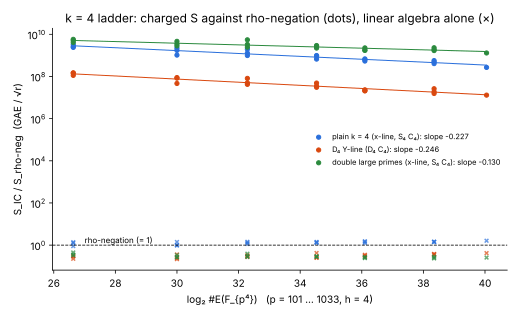
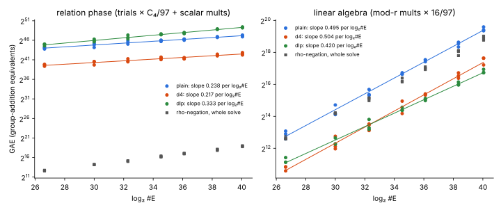

# Item 1: the E(F_{p⁴}) ladder, with plain, D₄ and double-large-prime arms

IC next-10 campaign, item 1 (`reports/Index calculus leads next steps.md`,
"### 1."). 2026-10-14. The protocol, [`PROTOCOL.md`](PROTOCOL.md), was frozen
before any data.

**Verdict: NEGATIVE for a crossover with rho at any reachable size.** The two
kill criteria split:

- The **plain arm's constant-factor lead is killed** on these curves. Its
  linear-algebra constant against rho-negation is 1.44, above the 0.9 kill
  line.
- The **double-large-prime (DLP) arm's asymptotic lead survives**. DLP changes
  the exponent and not only the constant. Its linear algebra (LA) grows as
  #E^0.420 against the plain arm's #E^0.495, and its whole cost as #E^0.333.
  Both are below the 0.45 kill line.
- But DLP is 1.8–4.5× dearer than plain at every measured size, and the gap
  widens. It overtakes plain only at an extrapolated #E ≈ 2^219.
- The **D₄ arm is the cheapest** arm at every size, 20–28× below plain. Its
  extrapolated handover with rho-negation is 2^126 (fitted exponent) to 2^137
  (theoretical exponent 1/4).

Every one of the 84 IC logarithms verified (21 curves × 4 IC arms), and all 672 rho walks. The null
control (`dlp-null`, the DLP code path with F' = F) reproduced `plain`
exactly on all 21 curves. The positive control (the real D₄ Macaulay solver)
matched the oracle on 6 of 6 targets.

## What ran

Two artefacts:

1. **The ladder.** `examples/ic_next10_01_fp4_ladder.rs`, `ladder`
   subcommand.
   - Sizes: 7 sizes, p ∈ {101, 181, 269, 397, 521, 769, 1033}, that is
     log₂ #E = 26.6 to 40.1. Three curves per size (seeds 1–3): 21 curves.
   - Each curve has one planted target, the same for every arm.
   - Arms: `plain`, `d4`, `dlp` and `dlp-null`. Rho ran 16 times unfolded
     (`rho4_folded(None)`) and 16 times negation-folded (`rho4_folded(Negation)`)
     on every curve.
   - Raw data: [`raw/ladder.jsonl`](raw/ladder.jsonl), one row per curve.
   - Fits: [`raw/summary.json`](raw/summary.json), computed in Rust
     (`analyze` subcommand). Python only plots.
2. **ecbench.** E(F_{p⁴}) is now an ecbench curve kind (`fp4_translation`),
   with a method `ic.k4_gaudry`. The generic `rho.negation` and `rho.plain`
   run on E(F_{p⁴}) through a `CountedGroup` implementation.
   - Session `ECBS1hf49e5346dc2b`: 4 curves (p = 101, 181, 269, 397, seed 1)
     × 3 planted targets × 5 arms = 60 runs. All 60 verified by the runner.
   - Audit: `ecbench verify --replay 12` gave "audit OK: 60 records,
     60 verified, 12 replays reproduced, 0 problems". The receipt is
     `ecbench/session-20261014-fp4.audit.json`, SHA-256
     `7f39ce78c4b9d0c141c8a3c24e9ba5b7ed6e732b341a0ea23df2ba4ccb4d5e8d`.
   - Isolation level L0 (`--cpus none`, busy host). These are operation
     counts only; no wall-time statement is made.

### The unit and the one modelling step

S is GAE / √r, ecbench's unit. One E(F_{p⁴}) addition is 97 F_p
multiplications; the field measured exactly 97.0 on every curve.

Decompositions come from an exact enumeration oracle:

1. A table of x(±P_i ± P_j ± P_k) is built once per base.
2. Each trial probes it with R − s·P_l.
3. Hits are recovered through the pair table.

The oracle returns the decomposition set the algebraic solvers return. Each
trial is charged the algebraic solve's measured per-trial cost:

- **C₄(S₄) = 1.213·10¹² F_p multiplications** (§11.17), for the plain and
  DLP arms;
- **C₄(D₄) = 2.54·10¹⁰**, for the D₄ arm. This item's positive control
  re-measured it at 2.543·10¹⁰ (6 solves, 2.538–2.548·10¹⁰).

Running the solver itself on every trial was out of budget. One S₄ solve
takes 25 min and 3.7 GB; one D₄ solve took 34–49 s single-threaded here, and
the ladder ran 700,701 oracle trials.

In ecbench the oracle's own table and probe work is recorded as
`*_uncharged`. The harness therefore flags every IC record as a lower bound
("diagnostic only"). LA is charged 16 F_p multiplications per multiplication
mod r (§11.16).

## Results

### Per size

Means over 3 curves. Measured values: trials, the LA ratio and S. The ratios
are derived from them.

| p | log₂ #E | log₂ r | S rho | S rho-neg | plain: S / rho-neg | plain: LA / rho-neg | D₄: S / rho-neg | D₄: LA / rho-neg | DLP: S / rho-neg | DLP: LA / rho-neg | plain ÷ D₄ | DLP ÷ plain |
|--:|--:|--:|--:|--:|--:|--:|--:|--:|--:|--:|--:|--:|
| 101 | 26.6 | 24.6 | 1.85 | 1.26 | 2.76·10⁹ | 1.17 | 1.35·10⁸ | 0.27 | 5.00·10⁹ | 0.38 | 20.3 | 1.82 |
| 181 | 30.0 | 28.0 | 1.51 | 1.14 | 1.66·10⁹ | 1.12 | 7.28·10⁷ | 0.27 | 3.65·10⁹ | 0.29 | 22.7 | 2.21 |
| 269 | 32.3 | 30.3 | 1.29 | 0.96 | 1.41·10⁹ | 1.29 | 5.78·10⁷ | 0.30 | 3.73·10⁹ | 0.32 | 24.5 | 2.64 |
| 397 | 34.5 | 32.5 | 1.22 | 0.99 | 8.57·10⁸ | 1.34 | 3.82·10⁷ | 0.31 | 2.60·10⁹ | 0.29 | 22.3 | 3.05 |
| 521 | 36.1 | 34.1 | 1.15 | 0.97 | 6.16·10⁸ | 1.40 | 2.18·10⁷ | 0.32 | 1.92·10⁹ | 0.26 | 28.2 | 3.11 |
| 769 | 38.3 | 36.3 | 1.25 | 0.88 | 4.87·10⁸ | 1.43 | 2.03·10⁷ | 0.37 | 1.95·10⁹ | 0.26 | 24.2 | 4.01 |
| 1033 | 40.1 | 38.1 | 1.31 | 0.91 | 3.24·10⁸ | 1.47 | 1.36·10⁷ | 0.38 | 1.44·10⁹ | 0.24 | 24.1 | 4.45 |

Columns at p = 1033 were plain 551, D₄ 262 and DLP small base 114. Trials at
p = 1033 were plain 12,525, D₄ 24,830 and DLP 55,718.





### Fitted exponents in #E

OLS of log₂(cost) against log₂ #E over 21 curves, with 95% bootstrap
intervals over curves.

| arm | relation phase | linear algebra | whole charged cost | S / S_rho-neg | LA / rho-neg, pooled at log₂ r ≥ 34 |
|:--|:--|:--|:--|:--|:--|
| plain | 0.238 [0.212, 0.261] | 0.495 [0.476, 0.519] | 0.238 [0.212, 0.262] | −0.227 [−0.257, −0.198] | 1.436 |
| D₄ | 0.217 [0.191, 0.246] | 0.504 [0.483, 0.530] | 0.217 [0.192, 0.247] | −0.247 [−0.278, −0.214] | 0.357 |
| DLP | 0.333 [0.313, 0.353] | 0.420 [0.405, 0.440] | 0.333 [0.313, 0.353] | −0.131 [−0.157, −0.106] | 0.251 |
| rho-negation (whole solve) | — | — | 0.464 [0.453, 0.476] | — | — |

Theory predicts:

- plain and D₄: relations at #E^{1/4}, LA at #E^{1/2};
- DLP: both phases at #E^{3/8};
- rho: #E^{1/2}.

Rho's measured 0.464 sits below 1/2 because its fixed set-up weighs more at
small r.

### Against the kill criteria

| criterion (report, unchanged) | measured | outcome |
|:--|:--|:--|
| plain: slope of S_IC / S_rho shallower than −0.12 | −0.227 [−0.257, −0.198] | passes |
| plain: in-unit LA constant against rho-negation above 0.9 | **1.44** at log₂ r ≥ 34; 1.32 ± 0.04 pooled over all 21 curves | **killed** on these curves: plain never crosses rho-negation |
| DLP: fitted cost exponent in #E ≥ 0.45 | whole cost 0.333 [0.313, 0.353]; LA 0.420 [0.405, 0.440] | **passes**: the asymptotic lead stands |

### The crossover trend (extrapolation, not measurement)

Model:

- rho-negation at its large-size S (0.924 ± 0.080, 9 curves with
  log₂ r ≥ 34) times √(#E/4);
- each IC relation phase on its own fitted power law;
- the plain and D₄ LA at its pooled large-size ratio, since it is N² ∝ √#E;
- DLP's LA on its own fitted law.

In the sensitivity column the relation phase is anchored at p = 1033 and
carried at the theoretical exponent instead of the fitted one.

| arm | IC ≤ rho-negation from (fitted) | anchored at theory exponent | ratio at 2^128 | ratio at 2^160 | ratio at 2^256 |
|:--|--:|--:|--:|--:|--:|
| plain | never (LA alone is 1.44× rho-neg) | never | 38 | 1.54 | 1.44 |
| D₄ | **2^125.8** | **2^137.3** | 0.77 | 0.36 | 0.36 |
| DLP | 2^222.5 | 2^283.3 | 5.5·10⁴ | 1.4·10³ | 0.021 |
| DLP below plain | 2^219.4 | — | — | — | — |

The anchored D₄ handover, 2^137.3, matches `gaudry_quartic_d4_20261013`'s
model prediction for h = 4 (2^137.4–2^138.5). This time it comes from
measured trial counts rather than the derived rate. The fitted 2^125.8 is
lower because the measured trial exponent is 0.217, below 1/4. Its 95% interval, [0.191, 0.246], just excludes 1/4, so the anchored
figure is the conservative one.

### Does double-large-prime change the exponent?

**Yes, and only asymptotically.**

- **What moves.** The LA exponent falls from 0.495 (plain) to 0.420. That is
  above theory's 3/8 because of merge fill-in, as at k = 3 (§11.7: 0.56
  against 4/9). The whole-method exponent falls from plain's asymptotic 1/2
  to max(0.333, 0.420). Both are below rho's 1/2, so DLP has a real slope win
  over rho.
- **What it costs.** It buys this with a steeper relation phase: 0.333
  against 0.238. At every size measured, and up to the extrapolated 2^219,
  the relation phase is the entire cost. DLP's LA share at 2^160 is
  2·10⁻⁷. So at reachable sizes DLP raises the measured exponent and the
  constant.
- **When it would pay.** It beats plain only once plain's LA dominates
  (2^219), and beats rho-negation only past 2^222 (fitted) or 2^283
  (anchored at 3/8).
- **Ladder versus asymptote.** The exponent change is genuine, but the
  ladder's measurable consequence runs the other way.

### Census (H4): D₄ forces h ≥ 4

[`raw/census.jsonl`](raw/census.jsonl):

- **What was searched.** 30 instance searches (p = 101, 181, 269, 10 seeds
  each). Each examined up to about 2,000 candidate curves of the D₄
  construction for one with h = 2. The minimum h found was **4 in all 30**.
  Every one of the 21 ladder curves also has h = 4, as did all 8 curves of
  E18 (§9.3).
- **Why it is structural.** The construction makes f'(x₀) = c² with
  c ∈ F_p. That is the norm, from L = K(e₂) down to K, of x₀ − e₂. Over a
  finite field, the norm L*/L*² → K*/K*² is an isomorphism. So x₀ − e₂ is a
  square in L, the 2-descent image of T is trivial, and T ∈ 2E(K). Hence
  4 | #E.
- **What it costs.** The report's "h ≤ 2" is unattainable for the D₄ arm.
  The cofactor costs √h against rho on every arm run on these curves; plain
  included, which is why plain's LA constant is 1.44 here. E18 measured
  0.733 for plain on prime-order curves.
- **j = 0.** The report also asked about j = 0 with p ≡ 1 (mod 3).
  f'(x₀) = 3x₀² = c² with c ∈ F_p forces x₀ ∈ F_{p²}. Then b = −x₀³ ∈ F_{p²}:
  a subfield curve. So on a non-subfield curve the ψ fold and the D₄ Y-line
  cannot coexist. This is derived, not measured.

### Controls

- **Positive control: the D₄ solver against the oracle.**
  [`raw/d4_control.jsonl`](raw/d4_control.jsonl). The real
  `gaudry_quartic_d4::solve_d4` (Macaulay degree 14) ran on ladder curve
  p = 269, seed 1, on 3 planted and 3 uniform targets.
  - All 6 closed with quotient dimension 512.
  - Its decomposition sets equal the oracle's on 6 of 6: 8, 8 and 8 on the
    planted targets, 0 on the uniform ones.
  - C₄ = 2.538–2.548·10¹⁰.
  - The planned second control curve, at the largest p, was not run (time).
    C₄ does not depend on p.
- **Fit pipeline.** The plain relation phase fits 0.238 [0.212, 0.261]
  against the expected 1/4.
- **Null control.** `dlp-null` equals `plain` in trials, relations and LA
  counts on 21 of 21 curves.

### ecbench session (in-harness reproduction, 4 sizes)

`ecbench compare`, paired cluster bootstrap over 12 workloads, operations
only. The harness labels every IC ratio "diagnostic only (unpriced work)".

| B / A | ratio | 95% interval |
|:--|--:|:--|
| ic-k4-plain / rho-neg | 2.71·10⁹ | [1.76·10⁹, 3.92·10⁹] |
| ic-k4-d4 / rho-neg | 1.48·10⁸ | [9.0·10⁷, 2.17·10⁸] |
| ic-k4-dlp / rho-neg | 6.25·10⁹ | [4.34·10⁹, 8.83·10⁹] |
| ic-k4-d4 / ic-k4-plain | 0.0548 | [0.048, 0.061] |
| ic-k4-dlp / ic-k4-plain | 2.31 | [2.10, 2.62]; per curve 2.01, 2.09, 2.75, 3.18 rising with p |
| rho-plain / rho-neg | 1.92 | [1.25, 2.80] (one walk per target) |

These agree with the ladder at the same sizes:

- D₄ ÷ plain is about 0.04–0.05 in both;
- DLP ÷ plain rises with p in both.

Full tables are in [`ecbench/compare.txt`](ecbench/compare.txt).

## Deviations from the protocol

1. **Cofactor.** The protocol asked for h ≤ 2. Every curve has h = 4, which
   is structural (the census above).
2. **Stretch size.** p = 1301 was not attempted: the time budget ran out.
   The largest size is p = 1033, log₂ #E = 40.1.
3. **Positive control.** It ran on one curve (p = 269), not two.
4. **The LA term in the handover model.** For plain and D₄ the LA term uses
   the pooled large-size ratio, not its fitted power law. The fitted LA
   exponents, 0.495 and 0.504, differ from rho's fitted 0.464 only because
   of rho's set-up at small r. Extrapolating that 0.03 gap over 200 bits
   would be an artefact. This choice was made after a first look at the
   data. The first analysis pass used the fitted-law version, which put plain
   at ratio 0.73 at 2^256.
5. **Degenerate D₄ targets.** These are the 1 in 20 of the D₄ README with
   quotient dimension 517. They are not modelled: the oracle decomposes
   them, while the solver would waste the trial. This biases D₄'s trial count
   low by at most about 5%.
6. **Not run.** Plain on prime-order curves (h = 1) was not run here. Its LA
   constant against rho-negation is E18's 0.733 ± 0.036, which passes the
   0.9 line.
7. **Isolation.** The ecbench session ran at L0 with `--allow-busy`. Ten
   experiments shared 4 cores, with load 17–24. No wall time is used
   anywhere.

## Reproduce

```sh
cargo build --release --example ic_next10_01_fp4_ladder --bin ecbench
./run_ladder.sh   # 21 curves, RAYON_NUM_THREADS=1, prlimit 2 GB; about 100 min on a loaded 4-core host
B=target/release/examples/ic_next10_01_fp4_ladder
$B control --p 269 --seed 1 --planted 3 --uniform 3 --json raw/d4_control.jsonl
for p in 101 181 269; do $B census --p $p --curves 10 --json raw/census.jsonl; done
$B analyze --in raw/ladder.jsonl --out raw/summary.json
python3 -I plot.py
target/release/ecbench run --wait --allow-busy --cpus none --spec ecbench/spec-fp4-ladder.json --out ecbench/session-20261014-fp4
target/release/ecbench verify --dir ecbench/session-20261014-fp4 --replay 12 --out ecbench/session-20261014-fp4.audit.json
target/release/ecbench compare --dir ecbench/session-20261014-fp4 --a rho-neg --b ic-k4-d4
```

Source commit 1bb8e17ad plus this item's uncommitted edits (listed below).
Host: Claude Code cloud container, 4 vCPU, 15 GiB, shared by ten experiments.
Conductor's control plane was unreachable (`conductor check` refused), so
there is no task card.

## Code touched

- New: `examples/ic_next10_01_fp4_ladder.rs` (ladder, control, census,
  analyze).
- New: `src/cryptanalysis/ecbench/fp4.rs`, which holds:
  - `Fp4Instance` and its point encoding, four 16-bit limbs per coordinate;
  - `Fp4Group: CountedGroup`;
  - the oracle;
  - `solve_k4`;
  - one unit test.
- Edited, additively:
  - `src/cryptanalysis/ecbench/mod.rs`: `pub mod fp4`.
  - `src/cryptanalysis/ecbench/workload.rs`: `CurveSpec::Fp4Translation`
    and `Instance::Fp4`, with their match arms. Public targets are refused
    on fp4.
  - `src/cryptanalysis/ecbench/methods.rs`: the `ic.k4_gaudry` registry
    entry and `K4_PARAMS`, `solve_fp4` dispatch, and the generic rho, BSGS
    and kangaroo on `Fp4Group`. This changes the IC1 candidate hash, as
    every `methods.rs` edit does.
