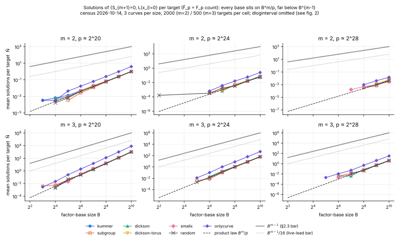
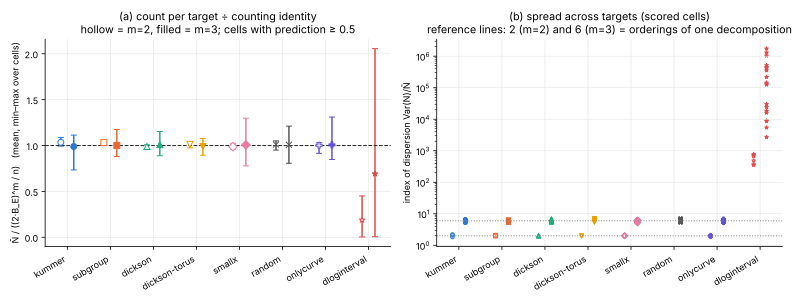

# Item 2: solution-count census for algebraic factor bases on prime fields

IC next-10 campaign, 2026-10-14. Design: `reports/Index calculus leads next steps.md` "### 2.".
Falsifier source: `RESEARCH_PRIME_FIELD_BREAKTHROUGH_PROGRAM.md` §2.3 and §4 item 2. Protocol,
frozen before data: [`PROTOCOL.md`](PROTOCOL.md).

## Verdict: NEGATIVE

None of the algebraic factor bases (PKM Kummer coset, multiplicative subgroup, Dickson split,
Dickson torus, small-x interval) changes the number of solutions of the combined system
`{S_{m+1}(x_1..x_m, x_R) = 0, L(x_1) = … = L(x_m) = 0}`. Each family follows the counting
identity `N̄ ≈ (2·B_E)^m / n` exactly as a random base of the same size does. Pooled over all
172 scored cells, the ratio to the random control is 0.93 to 1.03 for every family. Every base,
random ones included, sits 10^3 to 10^6 below the B^{m−1} bar of §2.3, so that bar does not
separate structured bases from random ones.

How the kill criterion reads:

- **Kill clause** ("within a factor of 2 … of the random-membership control"): it holds pooled
  per family and in 166 of 172 scored cells. The literal per-cell form fails in **6 of 172 cells**.
  All six have N̄_random between 1.3 and 3.1 at m = 3, t = 7–8. Three fall above 2 and three below
  0.5. In each one N̄ / ((2B_E)^m/n) is between 0.73 and 1.06, so these six are sampling noise
  in B_E (how many base abscissae land on the curve) and in the counts, not structure. This is a
  deviation from the frozen per-cell reading, and it is reported here, not hidden.
- **Live-lead clause** ("below B^{m−1}/16 at two consecutive t"): every structured cell meets it
  (172/172), and so does every random-control cell (324/324). The largest N̄/B^{m−1} in the whole
  census is 0.0078, from the positive control `onlycurve`. As the protocol fixed in advance, this
  clause does not discriminate, so it is not scored as a lead.
- Both positive controls read as predicted, so the instrument can see an effect:
  `onlycurve` gives 3.92× random at m = 2 (predicted 4) and 7.83× at m = 3 (predicted 8).
  `dloginterval` has an index of dispersion of 10^2.6 to 10^6.3, where every other arm sits near
  2 (m = 2) or 6 (m = 3).

**Scope of the conclusion.** The census settles §2.3's question as posed. The solution count of
the combined system is the number of decompositions. Over the algebraic closure it equals the
F_p count, because every L in scope splits. It is fixed by counting, not by the algebra of L.
So it is never near B^{m−1}, and it cannot be the mechanism that kills or rescues an algebraic
base. The B^{m−1} cost lives one step earlier. The partial system with one membership equation
dropped has exactly B^{m−1}·2^{m−1} solutions (validated below). That is the solution set an
enumerating solver walks, and the census says nothing about whether a Gröbner solver must
materialise it. That question is the solving degree, item 3. This census therefore **does not
by itself justify dropping item 3**. The kill criterion's "drop item 3" rests on the premise that
the full-system count could exceed B^{m−1}. That premise is false for every split base, structured
or random. The coordinator should weigh this.

## What was run

| arm | V (B = 2^t) | role |
|---|---|---|
| `kummer` | g·μ_B | PKM tower base |
| `subgroup` | μ_B (x^B = 1) | structured |
| `dickson` | {w + w⁻¹ : w ∈ u·μ_B}, u ∈ F_p^* | structured, split case |
| `dickson-torus` | same, u, μ_B in the norm-1 torus of F_{p²}, B ∣ p+1 | structured, own primes |
| `smallx` | {1..B} | structured (§2.1) |
| `random` | seeded random B-subset of F_p | null control |
| `onlycurve` | random B-subset of curve abscissae | positive control (mean ×2^m) |
| `dloginterval` | x(kG), k = 1..B | positive control (spread) |

- **Curves.** 18 prime-order curves (`data/curves.csv`, seeded PARI search). For p ≈ 2^20, 2^24 and
  2^28 there are three with p ≡ 1 (mod 2^11) and three with p ≡ −1 (mod 2^11). The torus primes
  carry `dickson-torus`, `smallx`, `random` and the controls.
- **Cells.** m ∈ {2, 3}, t = 2..10 (B = 4..1024). Targets are uniform random points with x_R ∉ V,
  shared by every arm on a curve: 2000 per cell at m = 2 and 500 at m = 3.
- **Instrument.** `examples/ic_next10_02_solution_count.rs` (Rust, single thread) counts distinct
  ordered x-tuples in V^m with S_{m+1} = 0 through the group law. The 95% intervals are bootstrap
  intervals over targets. The census took 18 min of wall time (18:07–18:25 UTC) on the shared machine.
- **Scoring.** A cell is scored when N̄_random ≥ 0.5. Below that the count is too small for 2000 or
  500 targets.

## Results



*Figure 1.* Mean solutions per target against B, averaged over the three curves of each size.
Dashed: the product law B^m/p. Solid grey: B^{m−1}. Dotted: B^{m−1}/16. Every arm lies on the
product law. `onlycurve` lies 2^m above it, as it should, because it has twice as many curve points.



*Figure 2.* (a) N̄ / ((2B_E)^m/n), the mean and the min–max over cells whose prediction is ≥ 0.5.
(b) Index of dispersion Var(N)/N̄ in scored cells. The levels 2 and 6 are the orderings of one
decomposition (each x-tuple is counted with its m! permutations).

### Pooled over scored cells (`data/ratios.csv`)

| arm | m | scored cells | ΣN̄ / ΣN̄_random | geo-mean N̄/N̄_random | N̄/((2B_E)^m/n), mean | dispersion (random) |
|---|---|---:|---:|---:|---:|---:|
| kummer | 2 | 3 | 0.969 | 0.968 | 1.035 | 2.03 (1.99) |
| kummer | 3 | 26 | 0.929 | 0.998 | 0.989 | 5.94 (5.87) |
| subgroup | 2 | 3 | 0.966 | 0.968 | 1.032 | 2.03 (1.99) |
| subgroup | 3 | 26 | 0.929 | 0.976 | 1.001 | 5.79 (5.87) |
| dickson | 2 | 3 | 1.001 | 1.001 | 0.989 | 1.99 (1.99) |
| dickson | 3 | 26 | 1.026 | 1.003 | 1.010 | 6.01 (5.87) |
| dickson-torus | 2 | 3 | 0.990 | 0.991 | 1.013 | 1.98 (2.01) |
| dickson-torus | 3 | 25 | 0.988 | 1.051 | 0.990 | 6.07 (6.08) |
| smallx | 2 | 6 | 0.951 | 0.952 | 0.987 | 2.01 (2.00) |
| smallx | 3 | 51 | 0.968 | 1.024 | 1.007 | 5.82 (5.97) |
| onlycurve (+ctrl) | 2 | 6 | 3.925 | 3.933 | 1.003 | 1.97 |
| onlycurve (+ctrl) | 3 | 51 | 7.826 | 8.062 | 1.007 | 5.89 |
| dloginterval (+ctrl) | 2 | 6 | 0.685 | 0.554 | 0.189 | 564 |
| dloginterval (+ctrl) | 3 | 51 | 2.075 | — | 0.693 | 3.5·10^5 |

The fraction of base abscissae on the curve (t ≥ 6, all curves) is 0.4960 to 0.5038 for every
structured family. The random control reads 0.4997.

### Largest size, t = 10 (B = 1024), m = 3, mean over three curves

| p | kummer | subgroup | dickson | dickson-torus | smallx | random | B^{m−1} |
|---|---:|---:|---:|---:|---:|---:|---:|
| 2^20 | 989 | 989 | 1108 | 972 | 992 | 1031 | 1 048 576 |
| 2^24 | 70.2 | 64.6 | 62.6 | 67.1 | 59.6 | 64.6 | 1 048 576 |
| 2^28 | 3.83 | 4.13 | 3.75 | 3.78 | 4.15 | 4.03 | 1 048 576 |

The random column averages six curves, the split and the torus primes. N̄/((2B_E)^m/n) is between
0.974 and 1.026 for every structured entry. The census was limited by its 3-hour budget, not by
the machine. B = 1024 at m = 3 needs about 16 MB for the pair table and about 1 s per curve and arm.

### Validation: the enumeration is the F̄_p solution count

Small curves `data/curves_validation.csv` (p = 4289 split, p = 4159 torus), 10 targets.

1. **Group-law census = direct polynomial grid count.** PARI evaluates S₃, and S₄ = Res_U, on all of
   V^m with no group law (`scripts/validate.gp`, `scripts/compare_grid.sh`). The histograms match in
   63/63 cells at p = 4289 and 45/45 at p = 4159 (m = 2 up to t = 6, m = 3 up to t = 5).
   Twist-type abscissae therefore add no solutions for targets with x_R ∉ V.
2. **msolve ideal count = grid count** (degree of the eliminating polynomial of the `-P 1`
   parametrization, targets 0–4): 471/471 systems match (271 at p = 4289, 200 at p = 4159; every arm; m = 2 with t ≤ 6, m = 3 with t ≤ 4; 0 failures). For a split L the F̄_p count therefore equals the grid count. msolve finds no solutions outside V^m.
3. **Partial system (one L dropped) = B^{m−1}·2^{m−1}.** 389/389 completed systems match
   (for example 2B = 128 at m = 2, t = 6, and 4B² = 256 at m = 3, t = 3). 23 of the m = 3, t = 3
   partial systems segfaulted after 30–40 s. They had reached at most 178 MB resident, so they hit
   the 1.5 GB address-space limit, not the 700 MB resident cap. They are recorded as `fail_rc139`
   and are not counted.
4. **Non-split random L** (a random monic L of degree B, roots mostly outside F_p), full system:
   0 solutions over F̄_p in all 80 systems (m = 2 with t ≤ 6, m = 3 with t ≤ 4, 5 targets × 2 curves). A non-split membership polynomial does not add solutions from extension fields at these sizes.

## Deviations from the protocol

- **Per-cell kill reading.** It fails in 6/172 cells, all low-count. See the verdict for the
  reading actually used and why.
- **Targets.** 2000 (m = 2) and 500 (m = 3) per cell, not the 20 the report names. This only
  tightens the intervals.
- **msolve validation primes.** These are p ≈ 2^12, not the 2^20 the protocol named. At p ≈ 2^20
  every msolve-feasible cell (B ≤ 64 at m = 2, B ≤ 16 at m = 3) has expected count ≪ 1, so the
  check would compare zeros. The census curves were not changed.
- **msolve memory cap.** msolve reserves about 1 GB of virtual memory at start and segfaults under
  `prlimit --as=700MB` even for a 2-variable system. The 700 MB cap was therefore enforced on
  resident memory by polling (`scripts/rsscap.sh`, address space ≤ 1.5 GB). Peak RSS is recorded
  for every run.
- **Isogeny towers.** Isogeny towers and t > 10 were not run. Dickson "depth ≤ 6" from the report
  is covered by t ≤ 10.
- **Smoke run.** One run on the first 20-bit curve, t = 6–10, before the full census, to check the
  instrument. Its output was not kept and it did not change the protocol.
- **Python.** Python is used only for the figures (`figures/plot.py`, layout of recorded values).
  All counts come from Rust, PARI or msolve, and the ratios come from awk (`scripts/summarize.sh`).

## Files

- `PROTOCOL.md`: the frozen protocol.
- `data/curves.csv`, `data/curves_validation.csv`: the curves. Their generators are
  `scripts/curves.gp` and `scripts/curves_small.gp`.
- `data/census.csv`: raw census output. It has one row per curve × arm × m × t, with the full
  histogram of per-target counts.
- `data/ratios.csv`: derived ratios (`scripts/summarize.sh`).
- `data/validation/p{4289,4159}/`: the bases, targets, Rust counts, gp grid counts, msolve inputs
  and the parsed msolve counts (the raw outputs were dropped for size; `scripts/run_msolve.sh` regenerates them), and the comparison CSVs.
- `figures/`: `fig1_count_vs_B.{svg,png}`, `fig2_ratio_dispersion.{svg,png}` and `plot.py`.
- `REPORT.pdf`: this README rendered.
- Instrument: `examples/ic_next10_02_solution_count.rs`.

## Reproduce

```sh
cd /home/user/crypto
cargo build --release --example ic_next10_02_solution_count
D=research/ic_next10_20261014/02-solution-count
gp -q $D/scripts/curves.gp </dev/null          # -> data/curves.csv rows (prefix header bits,sign,p,a,b,n)
$D/scripts/run_census.sh                        # -> data/census.csv (all 18 curves)
$D/scripts/summarize.sh                         # -> data/ratios.csv
# validation (per small curve; shown for p = 4289)
target/release/examples/ic_next10_02_solution_count --p 4289 --a 2475 --b 2969 --n 4243 --tmin 2 --tmax 6 \
  --targets2 10 --targets3 10 --seed 4289 --dump-bases $D/data/validation/p4289 --dump-targets 10 \
  > $D/data/validation/p4289/rust_counts.csv
(cd $D/data/validation/p4289 && echo 'P=4289;A=2475;B=2969;DIR=".";TMAX2=6;TMAX3=5;NT=10;MS=4;MS2=6;read("../../../scripts/validate.gp");' | gp -q -s 400M)
$D/scripts/compare_grid.sh $D/data/validation/p4289
$D/scripts/run_msolve.sh $D/data/validation/p4289 && $D/scripts/compare_msolve.sh $D/data/validation/p4289
python3 -I $D/figures/plot.py
```

The census started at 20261014T1807Z on commit 7f2c1cd26 (shared 4-core host, other campaign
items running at the same time, no isolation). This is a count, not a timing measurement, so it
gets no `benchmarks/` row.
