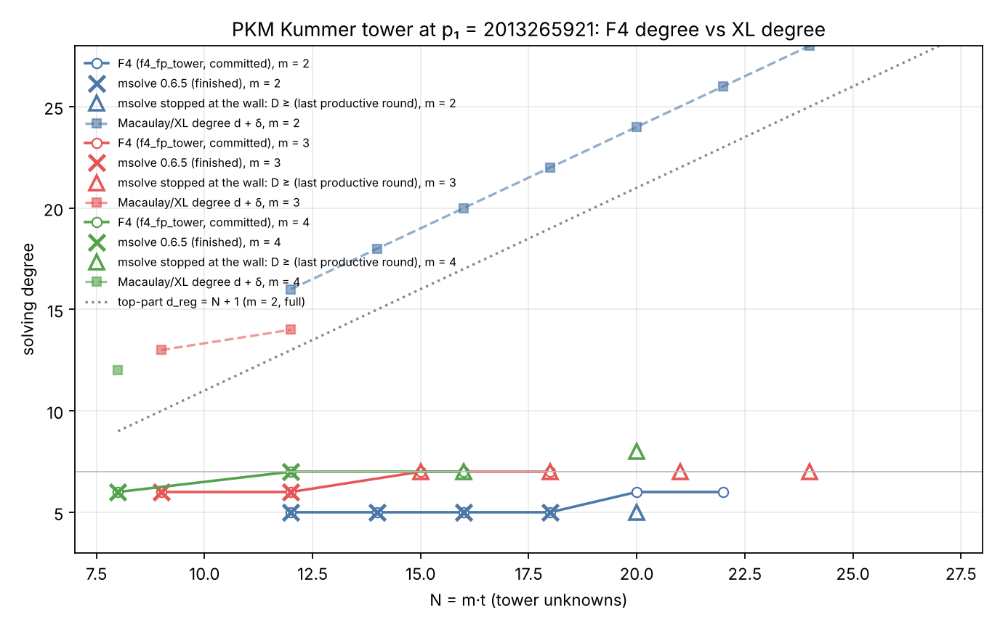

# Item 3: the PKM tower's solving degree past the memory wall

**Verdict: NEGATIVE for the `m = 4` plateau, INCONCLUSIVE for `m = 3`, and the
`d + δ` conflict is resolved.**

- **The plateau at 7 does not hold at `m = 4`.** At `m = 4`, `N = 20`, on
  **both targets**, msolve 0.6.5 completes **three productive degree-8 F4
  rounds**, adding 1,241, 2,507 and 3,578 basis elements. It then hits the
  5 GB cap. The two traces are identical.
  - msolve takes pairs of the lowest degree first, so it reaches degree 8
    only after every pair of degree ≤ 7 has been reduced. The degree-7 closure
    therefore does not contain `1`, and **`D ≥ 8` at `m = 4`, `N = 20`**.
  - The `m = 4` line now reads `D = 6, 7, 7, ≥ 8` at `N = 8, 12, 16, 20`. The
    first two are msolve's, matching `f4_fp_tower`. The value at 16 is
    `f4_fp_tower`'s; msolve reached 49 rounds there with no degree above 7
    before the memory cap.
  - Under the note's rule for a stopped run ("a productive step at degree 8
    or more"), this reads **H0: growth resumes**. It is about one degree per
    eight tower unknowns over `N = 12–20`.
  - **Caveat:** the `D ≥ 8` is msolve's, on the raw presentation.
    `f4_fp_tower` (reduced presentation) has not run `N = 20`, which needs more
    than 14 GB. The two engines agree on every one of the 16 control systems
    both finished.
- **`m = 3` stays inconclusive.** At `N = 18`, 21 and 24 msolve completes one
  productive degree-7 step (`D ≥ 7`). It is stopped by the 45-minute wall
  inside the second degree-7 step, at 2.6 GB, before any degree-8 round.
  - The design's kill test, `D ≥ 8` at `N = 21` and `≥ 9` at `N = 24`, can be
    evaluated neither way.
- **Positive control: passed.** msolve matches the committed `D` and verdict
  on all 16 control systems it finished:
  - `m = 2`, `N = 12–18`: `D = 5` (8 of 8);
  - `m = 3`, `N = 9, 12`: `D = 6` (4 of 4);
  - `m = 4`, `N = 8`: `D = 6`; `N = 12`: `D = 7` (4 of 4).
  - At `m = 3`, `N = 15` it reaches a productive degree-7 step (`D ≥ 7`,
    committed 7) before the time cap.
- **Where the wall falls.**
  - **`m = 4`: memory.** All three `m = 4` jobs ended with a segmentation
    fault (exit 139) on allocation, at `VmPeak` 4.86–4.87 GB of the 5 GB cap
    (resident 3.7 GB):
    - `N = 16` at round 50, a degree-7 round with 31,902 pairs;
    - `N = 20` at round 22, the fourth degree-8 round, with 13,262 pairs, on
      both targets.
  - **`m = 3`: time.** The host ran at a load of 22–25 on 4 cores, so a
    single-threaded job got about 19% of a core. `N = 15`, 18 and 21 were
    stopped at 45 minutes (`N = 24` by the operator at 27 minutes), each
    inside the second degree-7 step. Their peak resident memory was
    1.5–2.6 GB.
- **The `d + δ` conflict is resolved.**
  - For the `m = 2` full presentation, Proposition 2 is an equality. `δ = N`
    exactly at `N = 12–26`: the inverse `1/S̄` has every one of its `2^N`
    square-free coefficients non-zero, and its weight histogram is exactly
    `C(N, k)`. So the Macaulay/XL degree is `D_XL = N + 4`, from 16 at
    `N = 12` to 30 at `N = 26`, while F4 needs 5–6.
  - A direct Macaulay rank computation confirms `D_XL = 16` at `N = 12`. It
    gives `D_XL = 13` at `m = 3`, `N = 9` (F4: 6), `≥ 14` at `m = 3`,
    `N = 12` (F4: 6), and 12 at `m = 4`, `N = 8` (F4: 6).
  - The bound is real and tight, but it bounds XL only, which never reuses a
    reduced row at a lower degree. F4 escapes it through degree falls.
  - So the conflict is not evidence for a plateau. The `m = 4`, `N = 20`
    result shows that F4's degree does rise, far more slowly than `N`.
  - The Hilbert-series predictors fail as the note's §3.4 says they must:
    - the top-part ideal of the full presentation has series `(1+t)^N`, so
      `d_reg = N + 1`;
    - the chain presentation is positive-dimensional at infinity and has no
      `d_reg`;
    - the homogenised generators' affine Hilbert function reaches 0 only at
      `D_XL`.

    None predicts `D` at any `N ≤ 18`, so none is used beyond.
- **A structural observation: level windows.** msolve's F4 trace at `m = 3`
  is identical round for round at `N = 18`, 21 and 24 through the first
  degree-7 step: selected pairs, rows, new elements and zero reductions. At
  `N = 21` and 24 the columns match too. That step adds 2,354 elements at
  every one of these sizes, and so did `f4_fp_tower`'s step 19 at `N = 18`.
  - At `m = 4`, the two `N = 20` targets have identical traces.
  - F4's work up to the first top-degree step therefore does not depend on
    `t` once `t` is large enough. What grows with `N` is the phase after it:
    - at `m = 3`, two degree-7 steps at `N = 15` and six at `N = 18`;
    - at `m = 4`, 38 degree-7 steps at `N = 16`, against 5 degree-7 rounds
      followed by degree 8 at `N = 20`.

## 1. Setup

- **Systems.** These are the Kummer tower systems at
  `p₁ = 2013265921 = 15·2^27 + 1`, chain presentation for `m ≥ 3`, in the raw
  presentation (as written, not reduced modulo the tower).
  - The committed systems are from
    `research/magma_f4_comparison_20261013/scripts/`.
  - The new sizes were drawn by `examples/pkm_tower_pilot.rs` with round 2/7's
    flags (`--random 2 --planted 0`, same seed). The run was stopped at once
    with `--max-nnz 1000`, and the systems were exported with
    `--export-magma-rows`.
  - **Identity check:** the draw at `N = 18` (`m = 3`) and `N = 16` (`m = 4`)
    gives the committed targets. The polynomials are byte-identical to the
    committed exports; only the comment line with the row's own verdict
    differs.
- **Conversion and analysis.** `examples/ic_next10_03_pkm_degree.rs` (new;
  Rust) does four jobs:
  - `convert` turns Magma into msolve's format, keeping the variable order;
  - `delta` computes `δ` by a 2-D number-theoretic transform on
    `(Z/2^t)^2`;
  - `macaulay` computes the exact XL degree and affine Hilbert function in the
    tower quotient. No row is ever reused at a lower degree;
  - `top` computes the top-degree parts modulo `y²`, and the Hilbert function
    of that ideal when it is monomial.
- **msolve.** Every run used `msolve -t 1 -v 2`, `nice`, `prlimit --as=5e9`
  and `timeout 2700`.
  - `run.sh` samples peak `VmHWM`/`VmPeak` from `/proc` every second.
  - `parse.sh` reads the `-v 2` round table. `D_msolve` is the largest round
    degree. `D_last_productive` is the largest degree of a completed round
    that added basis elements; this is the lower bound for a stopped run (note
    §16.1).

## 2. Results

### 2.1 msolve against the committed F4 degree

| m | N | targets | committed `D_f4` (`f4_fp_tower`) | msolve | verdict match | peak RSS | wall (s) |
|--:|--:|--:|--:|:--|:--|--:|--:|
| 2 | 12 | 2 | 5 | 5, 5 | yes (`[-1]`) | 6 MB | 1 |
| 2 | 14 | 2 | 5 | 5, 5 | yes | 6 MB | 1 |
| 2 | 16 | 2 | 5 | 5, 5 | yes | 43 MB | 6–7 |
| 2 | 18 | 2 | 5 | 5, 5 | yes | 171 MB | 45–116 |
| 2 | 20 | 1 | 6 | stopped at 45 min in a degree-6 step (`D ≥ 5` productive; degree 6 reached) | — | 681 MB | 2701 |
| 3 | 9 | 2 | 6 | 6, 6 | yes | 6 MB | 1 |
| 3 | 12 | 2 | 6 | 6, 6 | yes | 100 MB | 36 |
| 3 | 15 | 1 | 7 | stopped at 45 min in the 2nd degree-7 step: `D ≥ 7` | — | 1.47 GB | 2701 |
| 4 | 8 | 2 | 6 | 6, 6 | yes | 6 MB | 2–3 |
| 4 | 12 | 2 | 7 | 7, 7 | yes | 477 MB | 595–1242 |
| 4 | 16 | 1 | 7 | 5 GB cap at round 50, 37 degree-7 rounds, none above 7: `D ≥ 7` | — | 3.76 GB | 2327 |

Every finished control agrees in `D` and in verdict: 16 systems, with 16
`[-1]` (no solution) verdicts. msolve's sequence of round degrees
has the same shape as `f4_fp_tower`'s: it climbs to the plateau degree, then
falls and finds `1` at a lower degree.

**Instrument check at `p₁`.** The note warns that msolve 0.6.5 failed a
known-answer battery above `2^16` in another project. On these systems, at
`p₁ ≈ 2^31`, all 16 verdicts agree with the committed rows, and those rows
were verified against exhaustive search. The linear-algebra variants `-l 2`
(default), `-l 42` and `-l 44` give identical round tables at `m = 3`,
`N = 12` (`runs_l42/`).

### 2.2 The new sizes (and `N = 16` at `m = 4`)

| m | N | target | how it ended | rounds | degree sequence (run lengths) | `D` lower bound | largest matrix | peak RSS | VmPeak |
|--:|--:|--:|:--|--:|:--|--:|:--|--:|--:|
| 3 | 18 | 0 | 45-min wall, 2nd degree-7 step | 23 | 4³ 5⁴ 6 5³ 6⁸ 7 6² 7 | 7 | 170,436 × 184,453 | 2.58 GB | 3.66 GB |
| 3 | 21 | 0 | 45-min wall, 2nd degree-7 step | 22 | same as 18 through round 20 | 7 | 170,445 × 194,842 | 2.58 GB | 3.66 GB |
| 3 | 24 | 0 | stopped by the operator at 27 min (memory budget), 2nd degree-7 step | 22 | same as 21 through round 21 | 7 | 170,445 × 194,887 | 2.59 GB | 3.67 GB |
| 4 | 16 | 0 | **5 GB cap** (segfault on allocation), round 50 | 49 | 4³ 5⁵ 6⁴ 7³⁷ | 7 | 118,846 × 167,176 | 3.76 GB | 4.86 GB |
| 4 | 20 | 0 | **5 GB cap**, round 22 (4th degree-8 round) | 21 | 4³ 5⁴ 6⁴ 7⁵ 8 7 8 7 8 | **8** | 213,684 × 320,433 | 3.71 GB | 4.87 GB |
| 4 | 20 | 1 | **5 GB cap**, round 22 | 21 | identical to target 0 | **8** | 213,684 × 320,433 | 3.70 GB | 4.86 GB |

- **The degree-8 rounds at `m = 4`, `N = 20`.** Each round's `(sel, pairs, rows × cols, new, zero)` is
  `(4432, 10966, 78739 × 134970, 1241, 3193)`,
  `(9955, 25599, 151098 × 236724, 2507, 7448)` and
  `(13412, 51333, 213684 × 320433, 3578, 9868)`. Each is followed by a short
  degree-7 round on the new elements' pairs.
- **The committed `f4_fp_tower` run at `m = 4`, `N = 16`** has degree run
  lengths `4² 5⁵ 6⁴ 7³⁸ 6⁴`, and refutes at 7. msolve at `N = 16` followed
  the same shape for 49 rounds (37 degree-7 rounds) before the cap.
- **Timing at `m = 3`.** The first degree-7 step took 2,024 s wall and 384 s
  CPU at `N = 18`, and 2,041 s wall and 396 s CPU at `N = 21`. The committed
  `f4_fp_tower` run at `N = 18` needed six degree-7 steps and 176 minutes on
  four unloaded threads.

### 2.3 The trace is independent of `t` up to the first degree-7 step

The `(deg, sel, pairs, rows, cols, new, zero)` rows of `logs/trace_*.txt`:

- `N = 18` and `N = 21` agree on rounds 1–19 in every field, `cols`
  included. In round 20, the first degree-7 step, they agree in every field but
  `cols` (101,390 against 101,435), and both add 2,354 elements with 18,321
  zero reductions. They diverge after that.
- `N = 21` and `N = 24` agree on all 21 rounds **in every field, `cols`
  included**.
- `N = 15` agrees with them in every field through round 7. From round 8 on
  its `sel`, `pairs` and `new` stay within a few units, while `rows` and
  `cols` are smaller: 7% fewer rows and 19% fewer columns in the first
  degree-7 step. That step adds 2,352 elements against 2,354.

### 2.4 XL degree, `δ`, and the Hilbert series

| m | N | `D_XL` (method) | `D_F4` | gap |
|--:|--:|:--|--:|--:|
| 2 | 12 | 16 (NTT `δ = 12`; Macaulay rank: 16) | 5 | 11 |
| 2 | 14 | 18 | 5 | 13 |
| 2 | 16 | 20 | 5 | 15 |
| 2 | 18 | 22 | 5 | 17 |
| 2 | 20 | 24 | 6 | 18 |
| 2 | 22 | 26 | 6 | 20 |
| 2 | 24 | 28 | — | — |
| 2 | 26 | 30 | — | — |
| 3 | 9 | 13 (Macaulay rank, both targets) | 6 | 7 |
| 3 | 12 | ≥ 14 (Macaulay rank; `1 ∉` span at `D = 13`, 40-min cap) | 6 | ≥ 8 |
| 4 | 8 | 12 (Macaulay rank, both targets) | 6 | 6 |

- **`m = 2`.** On every target `S̄` has no zero on the grid (`σ = 0`). The
  coefficients of `1/S̄`, counted by weight, are exactly `C(N, k)` for every
  `k`, so the inverse is fully dense and `δ = N`.
- **Proposition 2 is an equality here.** `NF(I_(D)) = S̄·R_{≤D−4}`, so
  `D_XL = 4 + δ = N + 4` exactly. The direct Macaulay rank at `N = 12`
  reproduces it independently: 1 enters at `D = 16`.
- **The gap grows by one per unit of `N`** at `m = 2`, from 11 to 20. This
  supports H-XL as the protocol fixed it.
- **The affine Hilbert function of the homogenised generators** at `m = 2`,
  `N = 12` is `#sqfree(≤D) − #sqfree(≤D−4)` up to `D = 15`, then 0 at 16
  (`logs/macaulay_*m2_t6*.json`). At `m = 3`, `N = 9` it is still 577 when 1
  enters at `D = 13`.
- **The top-part (degree-of-regularity) series** (`top`):
  - `m = 2`: `top(S) ∈ (y²)`, so the series is `(1+t)^12` and `d_reg = 13`
    at `N = 12`;
  - `m = 3`: the surviving top form is `c·y0_0·y1_0·u0²`. The Hilbert function
    stabilises at 384, the ideal has dimension 1 at infinity, and there is no
    `d_reg`;
  - `m = 4`: the top ideal is not monomial (it has `u0²u1² + …`) and is also
    positive-dimensional.

  No Hilbert-series quantity reproduces `D_F4` at any `N ≤ 18`. By the
  protocol's rule, none is trusted beyond.

**How this resolves the conflict.**
- The `d + δ` bound concerns the Macaulay space `I_(D)`: combinations
  `Σ h_k f_k` with every `deg(h_k f_k) ≤ D`.
- F4 at step degree `D` builds rows `m·g` with `deg(m·g) ≤ D`, where `g` can
  be a *previously reduced* element whose representation in the `f_k` has a
  much higher degree (a degree fall).
- For Kummer towers the falls are everywhere: `y_j·y_j = y_{j+1}` is a carry,
  and §2.3 shows F4 re-deriving the same low window of the tower at every
  `t`. F4's degree is therefore bounded by the *last fall degree*, not by
  `d + δ`.
- The two numbers measure different algorithms. Their gap is now measured
  (11 → 20 at `m = 2`), and the conflict is not evidence against the plateau.
- It is not evidence for the plateau either. A fall-based argument still has
  to show that the degree-7 phase closes without degree 8 as `t` grows, and
  that is what §2.2's wall left open.

## 3. Where the wall falls

This host gave each job a 5 GB address-space cap and 45 minutes of wall time,
and ran at a load of 22–25 on 4 cores, about 19% of a core per job.

- **`m = 4`: the memory wall** sits between `N = 12`, which finishes at
  0.48 GB resident and 1.54 GB address space, and `N = 16`.
  - `N = 16` ran out of the 5 GB address space at round 50, a degree-7 round
    with 31,902 pairs, after 37 degree-7 rounds.
  - `N = 20` ran out at round 22, the fourth degree-8 round with 13,262 pairs,
    on both targets.
  - Every failure was a segmentation fault on allocation: `VmPeak` reached
    4.86–4.87 GB of 5.0 GB, and resident memory 3.7 GB.
- **`m = 3`: the time wall** sits between `N = 12`, which finishes in 36 s,
  and `N = 15`, stopped at 45 minutes.
  - Every run at `N = 15–24` was inside its second degree-7 step when it was
    stopped, at 1.5–2.6 GB resident.
  - At `m = 3` the memory wall was not reached, so where it falls is not
    known.
- **For comparison, the previous wall.** `f4_fp_tower` needed 13 GB at
  `m = 3`, `N = 18`, and 8.1 GB at `m = 4`, `N = 16`.

## 4. Deviations from the protocol

1. **The prime.** `p₁ ≈ 2^31` is used, not the design text's "`p ≈ 2^24`",
   because the plateau was measured at `p₁`. This was declared in
   `PROTOCOL.md`.
2. **Controls dropped.** Two control replicates were started and then aborted
   by the operator to free the job slots: `m = 2`, `N = 20` target 1 and
   `m = 3`, `N = 15` target 1. They are kept as `logs/aborted_*.log` and
   `progress.txt` records them; neither is used. The `m = 2`, `N = 22`
   controls were never started.
3. **Concurrency.** Up to four jobs of this item ran at once, each under its
   own 5 GB cap. At about 19:53 UTC their summed resident memory reached
   about 6.9 GB, and the host had 2.5 GB available. The `N = 24` run was
   stopped (exit 143) to bring the total down. Its trace up to that point is
   kept and used only as a lower bound.
6. **Kill criterion at `m = 4`.** The design states its kill criterion for
   `m = 3`. The `m = 4` reading (H0 from a productive degree-8 step) applies
   the note's §16.1 rule for stopped runs to the `m = 4` line. That line mixes
   engines: `N = 16` is `f4_fp_tower`'s, and `N = 20` is msolve's.
4. **Arm PL (planted systems) was not run.** The instrument check rests on 16
   agreeing verdicts and degrees instead.
5. **Exhaustive verification.** None was needed for new verdicts, because no
   new system finished.

## 5. Reproduce

```bash
cargo build --release --example pkm_tower_pilot --example ic_next10_03_pkm_degree
cd research/ic_next10_20261014/03-pkm-degree
B=../../../target/release/examples/pkm_tower_pilot
X=../../../target/release/examples/ic_next10_03_pkm_degree
# draw the new sizes (stopped at once) and export them
$B --engine tower --p 2013265921 --kinds kummer --controls tower --planted 0 --random 2 \
   --ladder-t none --budget 60 --max-nnz 1000 --m 3 --t-min 7 --max-t-m3 7 --out gen/m3_t7.jsonl
$B --export-magma-rows gen/m3_t7.jsonl --export-dir gen/magma
$X convert gen/magma/pkm_kummer_p2013265921_m3_t7_x221026520.magma systems/pkm_kummer_p2013265921_m3_t7_x221026520.ms
./run.sh pkm_kummer_p2013265921_m3_t7_x221026520       # msolve -t 1 -v 2, 5 GB, 45 min
./parse.sh > results.csv
$X delta gen/magma/pkm_kummer_p2013265921_m2_t12_x1002906059.magma    # D_XL = N + 4
$X macaulay ../../magma_f4_comparison_20261013/scripts/pkm_kummer_p2013265921_m3_t3_x388393539.magma 40
$X top ../../magma_f4_comparison_20261013/scripts/pkm_kummer_p2013265921_m3_t3_x388393539.magma
python3 -I plot.py
```

## 6. Files

- `PROTOCOL.md`: the protocol, frozen before any data.
- `results.csv`: one row per msolve run.
- `xl.csv`: `D_XL` per system.
- `f4_committed.csv`: the committed `f4_fp_tower` degrees.
- `run.sh`, `parse.sh`, `plot.py`.
- `progress.txt`: the run log, with exits; `124` is the 45-minute cap.
- `runs/`: msolve's `-v 2` logs, outputs and memory samples.
- `runs_l42/`: the linear-algebra-variant check.
- `logs/`: traces, `δ` (`delta_m2.jsonl`), Macaulay and top-part output, and
  the conversion index.
- `systems/`: msolve inputs.
- `gen/`: the stopped draws and their Magma exports.
- `degree_vs_N.svg` and `degree_vs_N.png`: the graph.
- `README.pdf`: this report.


