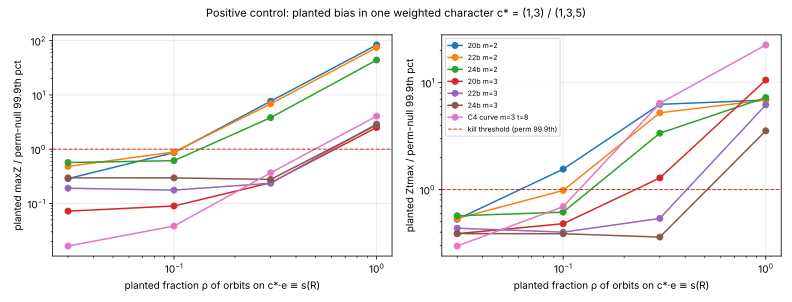

IC next-10 campaign, item 4 (`reports/Index calculus leads next steps.md`,
"### 4."). Frozen protocol: [`PROTOCOL.md`](PROTOCOL.md). Run 2026-10-14
(UTC 18:05–20:40) on the shared 4-core campaign host, single-threaded jobs
under `nice` and `prlimit --as=700MB`; no isolation (load average 12–25 from
the other nine items).

## Verdict: NEGATIVE

**C2's sparse-spectrum mechanism is closed on these toy cells by the report's kill criterion.**
In 31 cells (3 primes × 2 arities × 5 curves, plus the C4 curve at `t = 8`),
no character's normalised coefficient on PKM's Kummer tower is above the
permutation null's 99.9th percentile. This holds for the frozen statistic
`Z` and for the type-standardised `Zt`. No cell exceeds on the C4 family
`(1,…,1)·N/2^k` or on the marginal either. The top-100 mass `M100` is inside
the null band in every cell. Three cells have a top-k mass statistic just outside the [0.1, 99.9]
band; in two of the three the crossing is on the *flat* side, and
none survives the pre-registered 2,000-permutation replay at
`p < 0.05/31` (table below). The tower is also ordinary against the
random-factor-base null: across the 31 cells, the smallest rank p of `Zt`
among 100 random bases is 0.020. The positive control, a planted bias in
one weighted character, is detected at `ρ = 1` in every (size, m) group, with
`Zt` 3.6–23× over threshold, and down to `ρ = 0.1`–`0.3` where there are
enough cross-pairs.

Scope: this closes the family on toy tower bases only, with `p ≤ 2^24`,
`m ∈ {2, 3}` and `N = 2^7, 2^8, 2^11`. The statistic is the
target-conditioned second moment of each character (does `c·e mod N`
concentrate among one target's decompositions?). Each weighted linear form
`Σ c_i e_i mod 2^k` is one character or a cyclic family of characters, and
all of them were tested at once.


*Figure 1.* The largest normalised Fourier coefficient over all canonical
character classes, per cell (diamond), against 200 permutation nulls (grey)
and 100 random-factor-base nulls (orange); the red bar is the kill threshold
(perm-null 99.9th percentile). Top: frozen `Z`; bottom: type-standardised
`Zt`. Log scale. Data: `summary.csv`, `raw/`.



*Figure 2.* Positive control: the planted coefficient divided by the cell's
kill threshold, against the planted fraction `ρ` (curve 0 of each group;
`c* = (1,3)` for `m = 2`, `(1,3,5)` for `m = 3`). Above 1 means detected.

## What was measured

**Object.** On the tower `V = μ_N`, `N = 2^t`, each base abscissa is `ζ^e`.
For a target abscissa `x(R)`, the x-only decomposition indicator
`f_R(e_1..e_m)` is 1 when some signs give `±P_1 ± … ± P_m = ±R`. It is
`S_m`-symmetric, so it is a union of orbits, one per unordered exponent
multiset. The Rust enumerator
[`examples/ic_next10_04_kummer_fourier.rs`](../../../examples/ic_next10_04_kummer_fourier.rs)
sums **every** multiset of `m` signed base points, excluding pairs `P, −P`.
Every target's decomposition set is therefore exact, and no target is
sampled.

**Why the unconditional spectrum is uninformative.** With exhaustive
enumeration, the multiset of all decomposition tuples over all targets is
exactly the set of all base `m`-multisets. Its DFT depends only on which
labels are on the curve, which is the "marginal" statistic. Information about
the target lives in the *conditioned* spectrum:

`Â(c) = Σ_R Σ_{O≠O'⊂Z_R} f̂_O(c)·conj f̂_O'(c)`, with `f̂_O(c) = Σ_{σ∈S_m} ω^{−c·σ(e_O)}`,

which is large exactly when `c·e mod N` is predictable among one target's
decompositions. It is computed for all `N^m` characters with one FFT of the
`S_m`-symmetrised cross-pair difference histogram
([`analysis/spectrum.py`](analysis/spectrum.py)).

- `Z(c) = Â(c) / (|Stab(c)|·m!·sqrt(2P))` (×√2 for real characters), where `P`
  is the number of cross-orbit pairs. This is the frozen normalisation.
- `Zt(c)`: `Z` standardised by the mean and sd of its zero-pattern type
  (1, 2 or 3 nonzero coordinates) in the same spectrum. See Deviations.
- Statistics over the canonical classes (up to `S_m` and `c ↦ −c`):
  `max|Z|`, `max|Zt|`, the C4 family, the top-k mass `M_k = Σ top-k Z² / Σ Z²`
  for `k = 1, 10, 100`, and the marginal.

**Arms.** These are as frozen. The tower is the observed arm. The
permutation null applies a uniform random bijection of `Z/N` to the labels
(200 per cell). The random-factor-base null uses `N` distinct uniform
abscissas of `F_p^*`, labelled at random, with the same curve and the same
enumeration (100 per cell). The positive control is a planted bias.

## Results

`P` is the number of cross-orbit pairs. "≥2-orbit targets" counts targets
with at least two decompositions, which are the only targets that carry
information. Each threshold is the perm-null 99.9th percentile of 200
values. `p_perm` is the tower's empirical upper-tail p against the 200
permutation nulls. `p_rand` is the same against the 100 random bases.

| cell | p | a | b | t | ≥2-orbit targets | P | max\|Z\| / thr | max\|Zt\| / thr | p_perm(Zt) | p_rand(Zt) | C4 \|Zt\| / thr |
|---|--:|--:|--:|--:|--:|--:|--:|--:|--:|--:|--:|
| 20b m2 c0 | 1073153 | 695127 | 574028 | 11 | 310386 | 1011053 | 8.68 / 17.07 | 7.93 / 9.30 | 0.090 | 0.059 | 1.83 / 5.03 |
| 20b m2 c1 | 1073153 | 845548 | 665124 | 11 | 308391 | 993279 | 13.76 / 16.81 | 6.90 / 9.33 | 0.458 | 0.485 | 3.10 / 4.47 |
| 20b m2 c2 | 1073153 | 984741 | 114008 | 11 | 336737 | 1208084 | 6.98 / 15.55 | 6.15 / 8.81 | 0.920 | 0.921 | 2.40 / 5.67 |
| 20b m2 c3 | 1073153 | 77234 | 48628 | 11 | 307653 | 987941 | 10.78 / 15.37 | 6.33 / 9.17 | 0.801 | 0.802 | 1.83 / 4.38 |
| 20b m2 c4 | 1073153 | 453603 | 187312 | 11 | 302219 | 958023 | 9.94 / 19.82 | 6.04 / 9.92 | 0.910 | 0.960 | 1.59 / 5.13 |
| 22b m2 c0 | 4206593 | 1014557 | 3130927 | 11 | 209412 | 295234 | 8.87 / 10.29 | 6.14 / 9.24 | 0.816 | 0.941 | 1.82 / 5.39 |
| 22b m2 c1 | 4206593 | 2642515 | 2915891 | 11 | 188329 | 261459 | 8.43 / 10.43 | 6.03 / 9.77 | 0.905 | 0.931 | 2.36 / 4.25 |
| 22b m2 c2 | 4206593 | 1034562 | 431096 | 11 | 173769 | 236273 | 7.15 / 10.55 | 7.13 / 10.03 | 0.323 | 0.297 | 2.70 / 5.30 |
| 22b m2 c3 | 4206593 | 912022 | 903330 | 11 | 202063 | 283595 | 7.60 / 9.62 | 6.24 / 9.59 | 0.816 | 0.832 | 2.33 / 4.11 |
| 22b m2 c4 | 4206593 | 2011201 | 1443718 | 11 | 211134 | 297672 | 6.65 / 10.12 | 6.65 / 8.94 | 0.542 | 0.485 | 1.18 / 4.85 |
| 24b m2 c0 | 16801793 | 8809101 | 10887006 | 11 | 66963 | 73101 | 6.91 / 8.73 | 6.90 / 8.71 | 0.398 | 0.485 | 2.32 / 5.11 |
| 24b m2 c1 | 16801793 | 8783774 | 3585167 | 11 | 54168 | 58509 | 6.63 / 9.13 | 6.63 / 9.12 | 0.557 | 0.564 | 2.39 / 4.88 |
| 24b m2 c2 | 16801793 | 6629992 | 14532829 | 11 | 65197 | 70955 | 6.40 / 9.46 | 6.39 / 9.45 | 0.756 | 0.782 | 1.85 / 5.26 |
| 24b m2 c3 | 16801793 | 12952991 | 2284156 | 11 | 71596 | 78311 | 7.99 / 8.62 | 8.00 / 8.60 | 0.045 | 0.069 | 1.66 / 4.75 |
| 24b m2 c4 | 16801793 | 8232399 | 9078350 | 11 | 55669 | 60239 | 6.62 / 9.35 | 6.61 / 9.33 | 0.592 | 0.624 | 2.06 / 4.95 |
| 20b m3 c0 | 1073153 | 695127 | 574028 | 7 | 19227 | 23281 | 24.57 / 60.62 | 7.37 / 11.36 | 0.488 | 0.436 | 4.82 / 7.98 |
| 20b m3 c1 | 1073153 | 845548 | 665124 | 7 | 23664 | 29446 | 31.65 / 59.97 | 6.98 / 10.83 | 0.582 | 0.663 | 4.86 / 6.82 |
| 20b m3 c2 | 1073153 | 984741 | 114008 | 7 | 29156 | 37139 | 38.47 / 61.10 | 6.93 / 10.86 | 0.657 | 0.703 | 2.77 / 7.77 |
| 20b m3 c3 | 1073153 | 77234 | 48628 | 7 | 31872 | 41816 | 32.03 / 66.57 | 7.23 / 11.24 | 0.627 | 0.574 | 1.93 / 8.38 |
| 20b m3 c4 | 1073153 | 453603 | 187312 | 7 | 16309 | 19560 | 29.43 / 60.44 | 7.35 / 10.99 | 0.577 | 0.495 | 3.87 / 6.86 |
| 22b m3 c0 | 4206593 | 1014557 | 3130927 | 7 | 5284 | 5523 | 11.45 / 25.49 | 8.37 / 11.19 | 0.313 | 0.267 | 2.17 / 8.09 |
| 22b m3 c1 | 4206593 | 2642515 | 2915891 | 7 | 7544 | 7958 | 16.10 / 31.86 | 7.26 / 11.52 | 0.537 | 0.644 | 5.88 / 6.75 |
| 22b m3 c2 | 4206593 | 1034562 | 431096 | 7 | 3063 | 3154 | 12.71 / 24.87 | 8.95 / 13.34 | 0.199 | 0.069 | 3.95 / 8.40 |
| 22b m3 c3 | 4206593 | 912022 | 903330 | 7 | 6616 | 6958 | 13.59 / 36.06 | 7.54 / 11.52 | 0.706 | 0.574 | 4.61 / 8.74 |
| 22b m3 c4 | 4206593 | 2011201 | 1443718 | 7 | 9400 | 10007 | 28.95 / 38.31 | 10.49 / 12.03 | 0.015 | 0.020 | 3.66 / 7.03 |
| 24b m3 c0 | 16801793 | 8809101 | 10887006 | 7 | 2083 | 2111 | 7.52 / 16.46 | 7.13 / 12.63 | 0.871 | 0.842 | 1.25 / 8.56 |
| 24b m3 c1 | 16801793 | 8783774 | 3585167 | 7 | 881 | 891 | 8.19 / 14.47 | 7.55 / 11.31 | 0.726 | 0.624 | 1.76 / 8.31 |
| 24b m3 c2 | 16801793 | 6629992 | 14532829 | 7 | 1584 | 1604 | 7.91 / 14.45 | 7.62 / 11.28 | 0.706 | 0.584 | 1.82 / 8.39 |
| 24b m3 c3 | 16801793 | 12952991 | 2284156 | 7 | 3708 | 3762 | 8.48 / 15.88 | 7.07 / 10.85 | 0.861 | 0.851 | 2.11 / 9.84 |
| 24b m3 c4 | 16801793 | 8232399 | 9078350 | 7 | 1316 | 1320 | 23.17 / 33.36 | 7.21 / 9.84 | 0.617 | 0.752 | 2.60 / 5.01 |
| C4 curve m3 | 946177 | 304973 | 530845 | 8 | 347665 | 1632009 | 134.24 / 314.10 | 7.86 / 17.40 | 0.642 | 0.614 | 3.07 / 8.38 |

Every cell has 200 permutation nulls and 100 random-base nulls. Exceedances:
`max|Z|` 0/31, `max|Zt|` 0/31, C4 family 0/31, marginal 0/31.

**Top-k mass bands.** `M100` (frozen `Z`) is inside the null [0.1, 99.9]
band in all 31 cells. Three cells have one top-k statistic outside its band.
Each went to the pre-registered replay with 2,000 fresh permutation nulls,
which needs `p < 0.05/31 = 0.0016` to count:

| cell | crossing in main run (200 nulls) | replay, 2,000 fresh perms: p (side) | survives `p < 0.0016`? |
|---|---|---|---|
| 20b m2 c2 | `M1`, `M10` **below** band (flatter than null) | `M1` 0.0095 (lower), `M10` 0.008 (lower) | no |
| 22b m3 c1 | `ZtM100` **below** band (flatter) | `ZtM100` 0.0055 (lower) | no |
| 22b m3 c4 | `M10` above band | `M10` 0.0025, `M100` 0.004, max \|Zt\| 0.005, max \|Z\| 0.038 (upper) | no |

The `22b m3 c4` cell (`p = 4206593, a = 2011201, b = 1443718`, 9,400
informative targets) is the one tower cell that sits in the upper tail on
several statistics. Its random-base rank is `p = 0.020`, and its top classes
are `(55,64,64)`, `(55,64,73)` and `(0,9,119)`, with negative `Zt`, i.e.
*anti*-concentration. It does not reach the Bonferroni level, and the other
four 22-bit `m = 3` curves are ordinary (`p_perm(Zt)` 0.20–0.71). The
enumeration is exhaustive and deterministic, so this cell cannot be
"re-sampled". A check would need more curves at this size.

Under the null, about 1 % of exchangeable draws fall outside an empirical
[0.1, 99.9] band of 200 values. With 31 cells × 6 mass statistics, about 1.9
crossings are expected by chance; 3 were observed.

**Positive control.** The planted bias is on curve 0 of each group.
Detection means the planted maximum is above the cell's kill threshold:

| group | `ρ = 1` | `0.3` | `0.1` | `0.03` | smallest ρ detected (Zt) |
|---|---|---|---|---|--:|
| 20b m2 | Z 1425 / Zt 63.9 ✔ | 130.9 / 58.3 ✔ | 14.8 ✘ / 14.4 ✔ | 4.9 / 4.9 ✘ | 0.1 |
| 22b m2 | 769 / 63.7 ✔ | 70.6 / 48.3 ✔ | 9.1 / 9.1 ✘ (thr 9.24) | ✘ | 0.3 |
| 24b m2 | 384 / 63.3 ✔ | 33.3 / 29.4 ✔ | 5.4 ✘ | ✘ | 0.3 |
| 20b m3 | 152.6 / 120.2 ✔ | 14.6 ✘ / 14.6 ✔ | ✘ | ✘ | 0.3 |
| 22b m3 | 74.3 / 69.3 ✔ | 6.0 ✘ | ✘ | ✘ | 1.0 |
| 24b m3 | 45.9 / 44.8 ✔ | 4.6 ✘ | ✘ | ✘ | 1.0 |
| C4 curve m3 t8 | 1278 / 392 ✔ | 115.6 ✘ (thr 314) / 111.4 ✔ | 12.1 / 12.1 ✘ | ✘ | 0.3 |

In every row at `ρ = 1`, the arg-max class lies in the cyclic subgroup that
`c*` generates. Sensitivity scales with `sqrt(P)`. A weighted character
carrying ≥ 30 % of a target's decompositions would have been seen in every
`m = 2` cell and at 20 bits for `m = 3`. At 22–24 bits with `m = 3` there
are only 900–10,000 cross pairs, and only full structure (`ρ = 1`) is
detectable there.

## Deviations from the protocol (all disclosed)

1. **Added statistic `Zt`.** I added it after a pilot of 5–8 permutation nulls
   on two cells (`20b m2 c0`, `20b m3 c0`), which was run before the main
   data. The pilot showed that the frozen `Z` carries a label-invariant
   positive offset on characters with zero coordinates. When two
   decompositions of one target share a summand, the aligned term is 1 for
   every such `c`. The offset makes `max|Z|` a maximum over a few hundred
   shifted values, which lowers power. `Zt` standardises within each
   zero-pattern type. **Both statistics are reported, and the kill criterion
   is applied to both.** The pilot JSONs were deleted, and the main run
   re-ran those cells with fresh nulls.
2. **Anti-diagonal arg-max (diagnostic, post hoc).** Almost every `m = 2` cell
   has its `Zt` arg-max at `c = (c, −c)`. The same pattern appears in the
   permutation and random-base nulls (9–10 of the top 10 classes in all of
   them; [`raw/diag_antidiagonal_22_m2_c0.txt`](raw/diag_antidiagonal_22_m2_c0.txt)).
   For these characters the transposition maps `c` to `−c`, so `f̂_O(c)` is
   real and the cross term has twice the circular variance, which the
   frozen normalisation does not include. The nulls calibrate this, so the
   decision is unaffected, but some power is lost. A corrected normaliser is
   the obvious refinement for a rerun.
3. **Job chunking.** Load on the shared host reached about 25 on 4 cores, and
   a 200-null job would have run past the 45-minute cap. The nulls were
   therefore run as chunks of 50 permutations and 25 random bases, with
   disjoint seeds (`seed + 7919·k` for permutations, base seeds
   `seed·1000 + 100·k + j`). They were merged by `analysis/report.py`. The
   first three `20b m2` cells ran as single jobs before the change. The
   totals per cell are as frozen: 200 and 100.
4. **Language.** The enumeration and all curve arithmetic are Rust. The FFT,
   the histograms and the nulls are numpy/scipy, which the campaign
   `RULES.md` tool list allows. `AGENTS.md` ("Implementation language: no
   Python") asks for Rust in research result generation. A Rust port of
   `spectrum.py`, with `rustfft` (not currently a dependency), would bring
   this item into line.
5. **Sizes.** The report suggested `prime-kummer:t = 2,3,4`. I did not use it
   (frozen in the protocol): with `N ≤ 16` no target has two decompositions
   at `p ≥ 2^20`, so the conditioned spectrum would be empty.

## Reproduction

```sh
cargo build --release --example ic_next10_04_kummer_fourier
export IC4_SCRATCH=/tmp/ic4 OMP_NUM_THREADS=1
S=research/ic_next10_20261014/04-kummer-fourier/analysis
python3 -I $S/spectrum.py verify          # 30/30 targets: every orbit reaches the same x(R)
# one cell (chunks k = 0..3; planted on curve 0, chunk 0)
python3 -I $S/spectrum.py cell --size 20 --m 2 --curve 0 --nperm 50 --nrand 0 --seedoff 0 --tag _perm --planted
python3 -I $S/spectrum.py cell --size 20 --m 2 --curve 0 --nperm 50 --nrand 0 --seedoff 1 --tag _perm1
python3 -I $S/spectrum.py cell --size 20 --m 2 --curve 0 --nperm 0 --nrand 25 --seedoff 0 --tag _rand
#   ... sizes 20 22 24, m 2 3, curves 0..4; continuity cell: `c4cell` with the same flags
python3 -I $S/spectrum.py cell --size 22 --m 3 --curve 4 --nperm 500 --nrand 0 --seedoff 10 --tag _replay10   # replays: seedoff 10..13
python3 -I $S/report.py   # summary.csv, summary.json, figures/
python3 -I $S/replay.py   # replay_summary.json
```

Enumerator alone:
`target/release/examples/ic_next10_04_kummer_fourier --p 946177 --a 304973 --b 530845 --t 8 --m 3 --base kummer --out x.bin`
prints `{"signed_points":246,"sums":2481238,"orbits":1240497,"targets":438341,"targets_ge2":347665,"cross_pairs":1632009}`.

## Files

- `PROTOCOL.md`: frozen protocol.
- `analysis/spectrum.py`: spectrum, nulls and controls.
- `analysis/report.py`: merge, decision and figures.
- `analysis/replay.py`: replay p-values.
- `examples/ic_next10_04_kummer_fourier.rs`: exhaustive enumeration (Rust).
- `raw/*.json`: per-cell observed statistics, every null value and planted
  rows (`_perm*`, `_rand*`, `_replay*`).
- `summary.csv` and `summary.json`: per-cell decision table.
- `replay_summary.json`: replay results.
- `figures/maxcoef_by_cell.{svg,png}` and `figures/planted_control.{svg,png}`.
- `README.pdf`: this report.

## What this does and does not show

It shows that on exhaustively enumerated toy Kummer-tower decompositions, no
character of the exponent group `(Z/N)^m` predicts the exponents of a
target's decompositions better than labels with no multiplicative meaning
do. This covers the plain sum (C4), every weighted form `Σ c_i e_i mod 2^k`,
and single-coordinate marginals. The second-moment spectrum is flat to the
nulls' resolution, so the sparse-spectrum route of C2 has nothing to latch
onto at these sizes. This also confirms the C4 falsification on the
continuity cell: the C4 family `|Zt|` is 3.07 against a threshold of 8.38.

It does not show anything at `m ≥ 4`, at cryptographic `p`, or for
non-character (nonlinear) structure in the exponents. It also does not
address the requirements document's degree instrument `δ_Z(1/S̄)`, which
is a different C2 test.
