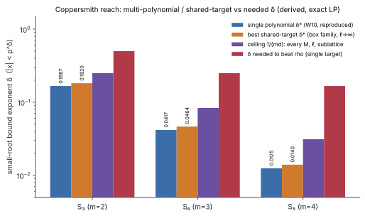
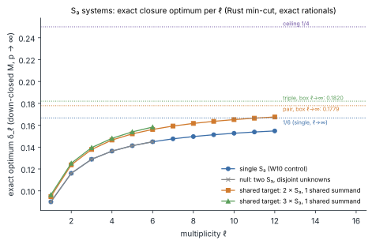
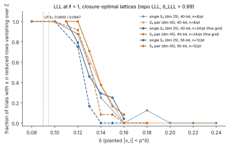

# Item 05: Coppersmith reach with several polynomials and shared targets

**Date.** 2026-10-14. **Campaign.** `research/ic_next10_20261014/` item 5 ("### 5." in
`reports/Index calculus leads next steps.md`). **Protocol.** [`PROTOCOL.md`](PROTOCOL.md), frozen
before any data. **Code.** [`examples/ic_next10_05_multipoly_lattice.rs`](../../../examples/ic_next10_05_multipoly_lattice.rs)
(Rust: the exact min-cut optimiser and the LLL runs), [`milp_multi.py`](milp_multi.py) (MILP over all
monomial sets and all leading vertices), [`asymptotic_box.py`](asymptotic_box.py) (ℓ → ∞ box family),
[`plot_05.py`](plot_05.py). **Run.** [`reports/run-20261014T1905Z/`](reports/run-20261014T1905Z/).

## Verdict: NEGATIVE

None of the variants reaches a δ at which relation collection beats rho.

For `S₅` (arity m = 4), the best variant is three targets sharing two summands. Its asymptotic reach
is **δ\* ≈ 0.01398**, which is 1.12 × the single-polynomial 1/80 = 0.0125. The best two-target
variant reaches 0.01361 (s = 3) and 0.01313 (s = 1).

Every variant whose leading monomials are top corners stays **below the unchanged ceiling 1/32 = 0.03125**.
That ceiling, proved in §3, holds for every monomial set, every multiplicity ℓ and every sublattice.
The report's kill criterion is "an LP δ\* for S₅ below 1/32 in every new family". It is met.

- **Shared targets.** The economics would rule them out even with a perfect oracle. With
  n small unknowns and r equations, relation collection beats rho only when
  `(r − ½)/(n − 1) < δ < 1/4`. At m = 4, every sharing pattern (k ≥ 2 targets, s ≥ 1 shared
  summands) gives `(r − ½)/(n − 1) ≥ 1/4`, so this window is empty. The best such pattern only
  ties rho, with exponent 1/2.
- **Curve equations.** Adding them gives **exactly no gain**. The exact MILP picks the bare
  `S₃` lattice for every leading-vertex choice: 9/100 at ℓ = 1 (8 + 16 choices) and 13/112 at
  ℓ = 2 (8 choices).
- **Semaev chain with large intermediate unknowns.** It gives **no lattice at all** (δ\* = 0).

The one variant with a real reach gain is the shared-target `S₃` pair. At toy size LLL confirms the
gain is small. At 56 bits and δ = 0.13, the pair recovered the root in 7 of 12 trials against 2 of 12
for the single `S₃`. At 40 bits the counts were 17 of 24 against 11 of 24. Fisher p-values are
0.09 and 0.14.

The positive control reproduces W10 exactly:

| `S₃`, ℓ = 1 … 12 | `S₄`, ℓ = 1, 2 | box limits |
|:--|:--|:--|
| 9/100, 13/112, 29/225, 3/22, 90/637, 335/2312, 959/6498, 22/147, 1761/11638, 229/1500, 407/2646, 202/1305 | 1331/70875, 79/3087 | 1/6, 1/24, 1/80 (numeric to 1e-12) |

The null control also behaves as expected: two `S₃` on disjoint unknowns give exactly the
single-`S₃` rational at every ℓ = 1 … 6.

## 1. Question and prior work

W10 (`research/lit2026_w10_s5_coppersmith_20261011/`) solved the exact LP for full-rank triangular
single-polynomial lattices. It found δ\* = 1/6, 1/24, 1/80 for `S₃`, `S₄`, `S₅`, with a family ceiling
of `1/(md)` = 1/4, 1/12, 1/32. W10 §7 left four routes open:

- several polynomials (curve equations, shared unknowns);
- sublattice strategies;
- unravelled linearisation;
- Gröbner-optimal shifts.

Prior-work check: grep over `research/` and `benchmarks/` found nothing beyond W10 (PROTOCOL.md).
`conductor check` failed with connection refused, and the work continued per RULES.md.

## 2. Family and exact optimisers

The unknowns are `x_v` with `|x_v| < p^{λ_v}`, where `λ_v = δ` for a small unknown and `λ_v = 1` for a large one
(a curve `y`, an intermediate Semaev point `t`). The polynomials `f_1..f_r` are taken mod p. Shifts
have the form `p^{ℓ−|k|} x^γ Π f_j^{k_j}`, with leading monomial `β = γ + Σ k_j a_j`. Here `a_j` is a vertex of
`Newt(f_j)`, and all `a_j` are simultaneous unique maxima of one weight, so every product is triangular.
There is one shift per leading monomial, and its support lies in `M`. As p → ∞, success means
`Σ_{β∈M} |k(β)| > Σ_{β∈M} λ·β`. This is the direct generalisation of W10's family `F`, and it reduces to `F` when r = 1.

1. **Rust, exact, down-closed `M` with top-corner leading monomials.** With box supports and top
   corners, every shift at β has support inside the box `[β − dK, β]`. So for down-closed `M` the
   best gain is `k(β) = max{|k| ≤ ℓ : Σ_{j∋v} k_j d_{jv} ≤ β_v}`. The optimum over down-sets is a
   max-weight closure, solved by Dinic on symmetry orbits inside Dinkelbach. Each δ_ℓ is the exact
   rational ratio of the returned `M`. No `M` beats it by `2^-30` or more, because the next
   Dinkelbach solve, just above it, returns an empty closure. The bounding box grows until it no
   longer binds.
2. **MILP over all `M` and all leading vertices** (`milp_multi.py`, HiGHS). Binary `m_β` and `z_{β,k}`
   with `z ≤ m_{β'}` for `β'` in the support, and `Σ_k z_{β,k} ≤ 1`. Every vertex tuple admitting a common
   weight is tried. This covers non-box supports (the curve equation `y² − x³ − ax − b`), non-top
   leading monomials, and non-down-closed `M`.
3. **ℓ → ∞ box family** (`asymptotic_box.py`). In scaled coordinates the gain fraction is
   `g(u) = min(1, min_S u, Σ_i min_{A_i} u)` and `δ = E[g]/(d E[Σu])` over per-group boxes. E[g] is
   computed by 1-D quadrature with an FFT-convolved sum-of-minima law, and the result is checked against
   a closed form to 6e-7. For the single polynomial this gives `2/(m(m+1)d)` to 1e-12. The finite-ℓ
   optima are **non-box** down-sets for the pair, so the box value is a lower bound on the down-set δ\*.
   For the `S₃` pair, the finite-ℓ sequence extrapolates to 0.1808, while the box value is 0.1779.

## 3. Ceiling for every M, every ℓ and every sublattice (top-corner leading monomials)

The leading monomial of `x^γ f^k` is `β = γ + Σ k_j a_j ≥ Σ k_j a_j` componentwise. Hence
`|k(β)| ≤ G(β) := max{|k| : Σ k_j a_j ≤ β}`. If `λ·a_j ≥ 1` for every j, then for every β,
`λ·β ≥ Σ k_j λ·a_j ≥ |k|`, so `Σ_M |k| ≤ Σ_M λ·β` and the lattice fails.

**Sublattices.** The basis is triangular in the monomial coordinates, with scaled diagonal
`D_β = p^{ℓ−k(β)} X^β`. Its k-th exterior power is triangular with diagonal products, and λ₁ of a
lattice is at least its smallest diagonal entry. So any rank-D′ sublattice has determinant at least
the product of the D′ smallest `D_β`. The Howgrave-Graham condition `det^{1/D′} < p^ℓ` therefore again
needs some β with `k(β) > λ·β`. This covers Boneh–Durfee-style sublattices.

**Ceiling.** Success needs **some** polynomial in the system with `λ·a_j < 1`. With only small
unknowns the ceiling is `max_j 1/deg_tot(f_j)`, which is `1/(md)` for every Semaev-based system.
Adding polynomials or sharing unknowns does not raise it. A polynomial that contains a large unknown
in its top corner (curve equation with `y²` leading, chain link with `t²`) can never be the one that
satisfies the condition.

Known-answer control: for Boneh–Durfee, the ceiling is `δ + ½ < 1`, i.e. δ < 1/2, and the
literature value 0.2929 lies under it.

**Not covered by this argument.**

- Non-top leading monomials. These are covered at small ℓ by the MILP (§4).
- Gröbner-optimal shifts that cancel leading terms. With shared variables, `LT(I^j)` can exceed the
  products of leading monomials.
- Unravelled linearisation. A substitution `u = q(x)` with `U ≈ X^{deg q}` leaves the top-vertex
  weight at `32δ` when q has small integer coefficients. This is an argument, not a theorem, and a
  q with large coefficients is not small. W10's `e`-encoding is such a linearisation and does worse.

## 4. Results

### 4.1 Exact finite-ℓ optimum (Rust; [`lp.md`](reports/run-20261014T1905Z/lp.md), `lp.json`)

| system | n small, n large, r | ℓ = 1 | ℓ = 2 | ℓ = 3 | largest ℓ run | vs single at same ℓ |
|:--|:--|--:|--:|--:|:--|:--|
| C1 `S₃` | 2, 0, 1 | 9/100 | 13/112 | 29/225 | 202/1305 = 0.154789 (ℓ=12) | = W10 |
| N1 two `S₃`, disjoint | 4, 0, 2 | 9/100 | 13/112 | 29/225 | 335/2312 (ℓ=6) | **identical** (null) |
| V3 `S₃` pair, s = 1 | 3, 0, 2 | 9/95 = 0.094737 | 13/105 = 0.123810 | 122/885 = 0.137853 | 94/561 = 0.167558 (ℓ=12) | 1.053, 1.067, 1.070, 1.083 |
| V3 `S₃` triple, s = 1 | 4, 0, 3 | 27/280 | 249/1988 | 1776/12727 | 3324/20995 = 0.158323 (ℓ=6) | 1.071 … 1.093 |
| C1 `S₄` | 3, 0, 1 | 1331/70875 = 0.018780 | 79/3087 = 0.025591 | | | = W10 |
| V3 `S₄` pair, s = 1 | 5, 0, 2 | 2662/141645 = 0.018793 | 474/18515 = 0.025601 (box binds: lower bound) | | | 1.0007, 1.0004 |
| V3 `S₄` pair, s = 2 | 4, 0, 2 | 675/33488 = 0.020156 | 326/11737 = 0.027775 | 39/1225 = 0.031837 | | 1.073, 1.085 |
| V2 `S₄` chain `S₃(x₁,x₂,t)`, `S₃(x₃,t)` | 3, 1, 2 | **0** | **0** | **0** | | no lattice |

Least-squares extrapolation `δ_ℓ ≈ δ∞ − c/ℓ + e/ℓ²` over ℓ = 8 … 12 (derived, not exact): single
`S₃` → 0.16668 (true 1/6); `S₃` pair → **0.1808**.

### 4.2 Asymptotic box family (ℓ → ∞; [`asymptotic_box.md`](asymptotic_box.md))

The economics column: with n small unknowns and r equations, the cost is `p^{max(r − (n−1)δ, 2δ)}`.
This beats rho iff `(r − ½)/(n − 1) < δ < 1/4`.

| system | n | r | δ\*_box | × single | ceiling | IC needs δ > | window non-empty? |
|:--|--:|--:|--:|--:|--:|--:|:--|
| single `S₃` | 2 | 1 | 1/6 | 1 | 1/4 | 1/2 | no |
| `S₃` ×2, s=1 | 3 | 2 | 0.177886 | 1.067 | 1/4 | 3/4 | no |
| `S₃` ×3, s=1 | 4 | 3 | 0.182015 | 1.092 | 1/4 | 5/6 | no |
| single `S₄` | 3 | 1 | 1/24 | 1 | 1/12 | 1/4 | no (tie) |
| `S₄` ×2, s=1 / s=2 | 5 / 4 | 2 | 0.044171 / 0.045217 | 1.060 / 1.085 | 1/12 | 3/8 / 1/2 | no |
| `S₄` ×3, s=1 / s=2 | 7 / 5 | 3 | 0.045102 / 0.046427 | 1.082 / 1.114 | 1/12 | 5/12 / 5/8 | no |
| **single `S₅`** | 4 | 1 | **1/80 = 0.0125** | 1 | **1/32** | **1/6** | **yes** (best δ = 1/5, exponent 2/5) |
| `S₅` ×2, s=1 / 2 / 3 | 7 / 6 / 5 | 2 | 0.013134 / 0.013583 / 0.013610 | 1.051 / 1.087 / 1.089 | 1/32 | 1/4 / 3/10 / 3/8 | no (s=1 ties rho at δ = 1/4) |
| `S₅` ×3, s=1 / 2 / 3 | 10 / 8 / 6 | 3 | 0.013370 / **0.013982** / 0.013971 | 1.070 / **1.119** / 1.118 | 1/32 | 5/18 / 5/14 / 1/2 | no |

### 4.3 All monomial sets and all leading vertices (MILP; `milp_*.md`, `milp_*.json`)

| system | ℓ | leading-vertex tuples | best δ_ℓ | note |
|:--|--:|--:|:--|:--|
| C1 `S₃` | 1 | 4 / 4 | 9/100 for every vertex | = W10 (all classes equal) |
| V3 `S₃` pair, all `M` | 1 | 4 of 16 finished | 9/95, the same as the down-closed optimum, for 3 tuples; 1/11 for the constant/constant tuple, where the MILP hit its time limit (lower bound) | the other 12 tuples were stopped for time (§6) |
| V1 `S₃` + curve eq. for x₁ | 1 | 8 / 8 | 9/100 | optimum never uses the curve equation |
| V1 `S₃` + both curve eqs | 1 | 16 / 16 | 9/100 | same |
| V1 `S₃` + curve eq. for x₁ | 2 | 8 / 8 | 13/112 | = single `S₃` at ℓ = 2 (W10); curve equation never used ([`milp_v1_l2.md`](milp_v1_l2.md)) |
| V2 `S₄` chain (t large) | 1 | 16 / 16 | 0 | no `M` has positive gain even at δ = 0 |

For V1 with one curve equation, the "binds" flag comes from the unused coordinate `y₂`, whose
bounding box is `[0, 0]`. It is an artefact of the flag, not a binding box.

### 4.4 LLL at toy size (the only variant with a gain: the `S₃` pair)

Setup: closure-optimal ℓ = 1 lattices. The single `S₃` lattice has dim 25 and LP δ₁ = 0.0900; the
pair lattice has dim 45 and LP δ₁ = 0.0947. Primes: `p = 1099511627563` (40-bit) and `p = 72057594037927931` (56-bit), the largest p ≡ 3 mod 4
below 2^bits; a = −3, b = 31. Planted points have `x < ⌊p^δ⌋`. LLL is the repo's
`lll_reduce` (f64 Gram–Schmidt, used up to dim 30) or `lll_reduce_hp` (above dim 30), with δ_LLL = 0.99.
A trial succeeds when at least n reduced rows vanish over Z at the root. Measured values:

| δ | 40-bit single | 40-bit pair | Fisher p | 56-bit single | 56-bit pair | Fisher p |
|--:|--:|--:|--:|--:|--:|--:|
| 0.12 | 19/24 | 24/24 | 0.05 | 9/12 | 11/12 | 0.59 |
| 0.13 | 11/24 | 17/24 | 0.14 | 2/12 | 7/12 | 0.09 |
| 0.14 | 7/24 | 9/24 | 0.76 | 0/12 | 1/12 | 1.0 |
| 0.15 | 6/24 | 4/24 | 0.72 | 0/12 | 1/12 | — |
| 0.16 | 1/24 | 2/24 | — | 0/12 | 0/12 | — |

Both lattices succeed above their p → ∞ δ₁, which is the finite-p effect W10 also saw. The pair
moves the 50% point by about +0.01 in δ, consistent with the LP's +5%. No configuration recovers
roots at δ ≥ 0.18. A pair ℓ = 2 lattice (dim 224) was not run: at the measured 2–5 s per dim-45 hp
reduction it would take hours per trial on the shared host.

## 5. Interpretation

1. Sharing unknowns does raise the exponent, but only by 5–12%, never by the ≥ 1.5× that would
   trigger a measured probe. The ceiling does not move.
2. Curve equations and chains add unknowns of size p. Every monomial in such a variable costs a whole
   p. The exact optimiser never uses them (V1), and when they are forced in (V2) no lattice exists.
3. For m = 4, the needed δ ≈ 1/5 is 16× above the single-polynomial δ\* and 14.3× above the best
   multi-polynomial δ\* (0.01398). The proved ceiling 1/32 is still 6.4× short. Shared-target
   variants also face an empty economic window.

**Kill criterion (protocol).** S₅ δ\* < 1/32 holds in every new family. **The lattice route to m = 4 is closed
for these families.**

## 6. Deviations from the protocol

- The asymptotic and MILP numbers come from Python (scipy, HiGHS). RULES.md lists these tools, but
  AGENTS.md prefers Rust for results. Where they overlap, they are cross-checked against the exact
  Rust optimiser: C1 = 9/100 and pair = 9/95. The box quadrature also matches its closed form.
- The Rust binary that ran is the 18:12 build of `ic_next10_05_multipoly_lattice.rs` without the later
  `--only`/`--ells` flags. Those flags were added to the source, but the rebuild was blocked for over
  30 minutes behind other items' cargo builds. The output is identical, because the flags only filter cases.
- MILP over all `M` for the `S₃` pair finished 4 of 16 leading-vertex tuples. The constant-vertex tuple
  hit its 400 s time limit. The sweep was stopped to free the CPU for V1/V2.
- MILP at ℓ = 2 for `S₃` alone (box 9×9) did not finish within 25 minutes and was dropped.
- LLL ran at ℓ = 1 only (ℓ = 2 pair dim 224 is infeasible with the BigInt hp LLL here). The 56-bit
  run used 12 trials per point, and the 40-bit fine grid used 24.
- `S₅` systems were not solved at finite ℓ (7 unknowns, ≥ 10⁹ orbit nodes). They are covered by the
  box asymptotics and the proved ceiling.
- The host was shared (load 25 on 4 cores). All timings are informational.

## 7. Reproduce

```bash
cargo build --release --example ic_next10_05_multipoly_lattice
B=target/release/examples/ic_next10_05_multipoly_lattice; R=research/ic_next10_20261014/05-multipoly-lattice
nice prlimit --as=734003200 -- $B --part lp --max-ell 12 --json $R/reports/run-20261014T1905Z/lp.json
nice prlimit --as=734003200 -- $B --part lll --bits 40 --ell 1 --trials 8  --json .../lll40_l1.json
nice prlimit --as=734003200 -- $B --part lll --bits 40 --ell 1 --trials 24 --deltas 0.11,0.12,0.13,0.14,0.15,0.16 --json .../lll40_l1_fine.json
nice prlimit --as=734003200 -- $B --part lll --bits 56 --ell 1 --trials 12 --deltas 0.08,0.10,0.12,0.13,0.14,0.15,0.16,0.18 --json .../lll56_l1.json
cd $R; python3 -I asymptotic_box.py asymptotic_box.json > asymptotic_box.md
python3 -I -u milp_multi.py milp_c1.json c1; python3 -I -u milp_multi.py milp_v1.json v1
python3 -I -u milp_multi.py milp_v2.json v2; python3 -I -u milp_multi.py milp_v3.json v3
python3 -I -u milp_multi.py milp_v1_l2.json v1l2
python3 -I plot_05.py reports/run-20261014T1905Z
```

## 8. Graphs

-  [`reach_vs_family.svg`](reports/run-20261014T1905Z/reach_vs_family.svg):
  single δ\*, best shared-target δ\*, ceiling and needed δ for m = 2, 3, 4 (log scale).
-  [`finite_ell.svg`](reports/run-20261014T1905Z/finite_ell.svg):
  exact δ_ℓ against ℓ for the `S₃` systems, with the null control overlapping the single polynomial.
-  [`lll.svg`](reports/run-20261014T1905Z/lll.svg): LLL success fraction against δ.

Canonical graphs checked and left unchanged: `docs/index-calculus-scoreboard.html`,
`docs/ic/progress-timeline.json`, `docs/performance-gains/`. This is a feasibility negative with no
speed result, so there is no `benchmarks/` copy.
