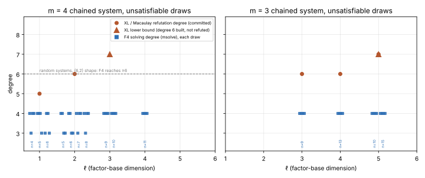
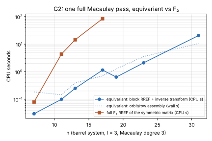

# Item 6: the `m = 4` Weil-descent degree cells, and equivariant F4

Campaign `research/ic_next10_20261014/`, item "### 6." of
`reports/Index calculus leads next steps.md`. The protocol is frozen in
[`PROTOCOL.md`](PROTOCOL.md), written before any main-arm data. Class: **stage
diagnostic**. Nothing here computes an `S` or a rho ratio, and every `n = 131`
figure is an extrapolation.

## Verdict

**POSITIVE (levels off) at `(4, 4)` and at `(15, 5)`. BLOCKED at `(4, 5)`
and `(4, 6)` by the 3 GB memory cap. The kill criterion is not met.**

- **The F4 solving degree does not grow with `ℓ`.** msolve's F4 refutes
  every unsatisfiable draw it finished at a maximum step degree of **4**, and
  some at 3. That covers 56 draws:
  - `m = 4`: `ℓ = 1, 2, 3, 4`, including all four `(n, ℓ) = (11, 4)` draws;
  - `m = 3`: `ℓ = 3, 4, 5`, including the four committed `(15, 5)` draws.
- **The committed rising degrees are XL degrees, not F4 degrees.** Every
  degree committed so far (5, 6, 6–7, 7, ≥7) is the refutation degree of
  bounded Macaulay (XL) linear algebra. F4 reuses its degree falls, and on
  the **same draws** it reads 4 where XL reads 5, 6, 7 and ≥7.
  - The kill criterion was written in those XL degrees: "≥8 at `(4, 4)` and
    ≥8 at `(15, 5)`". On F4 it is far from met, at 4 and 4.
  - Its other half, "≤7 at both `(4, 4)` and `(4, 5)`", holds at `(4, 4)`.
    `(4, 5)` is BLOCKED, so the formal "reopen" condition is half-met.
- **The instrument can read degrees above 4.** On random cubic systems with
  the same shape as the `m = 4` cells, the same instrument reaches degree 6
  at the `(6, 2)` shape and 5 at the `(9, 3)` shape. Those runs were cut
  off at 300 s; the real systems finish at degree ≤4 in 0.1 s.
- **Where the wall is.** At `(13, 4)` (42 unknowns) and `(13, 5)`
  (46 unknowns), msolve exceeds the 3 GB address-space cap and segfaults on
  a failed hash-table enlargement. This happened on six attempts, at
  335–839 s and peak RSS 1.6–1.8 GB, while still in degree-4 rounds. These
  runs are a resource limit, not evidence either way.
  - A satisfiable-draw substitute at `ℓ = 5`, `(10, 5)` with 40 unknowns,
    hit the same wall.
  - `ℓ = 6` was not attempted. Its smallest unsatisfiable-capable `n` gives
    `N ≥ 54`, past the cap.
- **G2 equivariant F4: finished as one complete Macaulay pass.** The pass
  takes block RREF over `F_{2^d}`, applies the inverse transform back to
  `F₂` rows, and recovers the degree-fall rows. Its reduced row echelon form
  is **bit-identical** to the full `F₂` RREF at `n = 7, 11, 13, 17`.
  - The equivariant pass and the full `F₂` pass are timed in the same
    process; §3 gives the times: 44×, 58× and 73× in CPU at n = 11, 13, 17.
  - It is not wired into `koblitz_groebner::reduce_system`, and it is not an
    iterated GB computation. See "What did not get done".



## 1. The degree cells

msolve 0.6.5, `-t 1 -g 2 -v 2`, DRL, characteristic 2, with the field
equations `x_i² + x_i` appended. `D_F4` is the maximum `deg` over all F4
rounds of the run (`run_f4.py` parses the verbose log). The systems are
exported by `examples/ic_next10_06_chain_export.rs`, which replays
`dreg_ladder`'s cell seed, sampling and exact solution count. 48 of the 52
calibration draws are the **committed** draws, matched on `v_basis` and `x_r`
(`runs/c2_identity.txt`). The other four, `m = 3` `(9, 3)` at seed
20260925, are new draws of a committed cell.


Main cells (seed 20261014) and calibration on committed draws:

| m | (n, ℓ) | N | S | XL refutation degree (committed) | F4 degree per draw | GB = [1] | wall s | peak RSS MB | largest F4 matrix |
|--:|---|--:|--:|---|---|---|---|---|---|
| 4 | (4, 1) | 12 | +0 | 5 5 5 5 | 4; 3; 4; 4 | yes | 0.1–0.1 | 12–12 | 171 × 210 |
| 4 | (5, 1) | 14 | +1 | 5 5 5 5 | 4; 4; 4; 3 | yes | 0.1–0.1 | 12–12 | 549 × 590 |
| 4 | (6, 1) | 16 | +2 | 5 5 5 5 | 3; 4; 4; 3 | yes | 0.1–0.1 | 12–12 | 362 × 440 |
| 4 | (5, 2) | 18 | -3 | 6 6 6 6 | 4; 4; 3; 3 | yes | 0.1–0.2 | 12–12 | 2,617 × 2,495 |
| 4 | (6, 2) | 20 | -2 | 6 6 6 6 | 4; 4; 3; 3 | yes | 0.1–0.1 | 12–12 | 2,753 × 2,558 |
| 4 | (7, 2) | 22 | -1 | 6 6 6 6 | 4; 3; 4; 4 | yes | 0.1–0.3 | 12–12 | 4,620 × 4,321 |
| 4 | (8, 2) | 24 | +0 | 6 6 6 6 | 4; 3; 4; 4 | yes | 0.1–0.6 | 12–22 | 7,836 × 8,043 |
| 4 | (9, 3) | 30 | -3 | ≥7 ≥7 ≥7 ≥7 | 4; 4; 4; 4 | yes | 2.0–4.2 | 57–83 | 16,684 × 15,037 |
| 4 | (10, 3) | 32 | -2 | ≥7 ≥7 ≥7 ≥7 | 4; 4; 4; 4 | yes | 9.3–43.4 | 116–249 | 36,249 × 26,375 |
| 4 | (11, 4) | 38 | -5 | not measured | 4; 4; 4; 4 | yes | 386.3–804.8 | 1047–1478 | 84,355 × 66,607 |
| 4 | (13, 4) | 42 | -3 | not measured | u0: cap, deg ≤4 so far; u1: cap, deg ≤4 so far; u0 -u 1: cap, deg ≤4 so far | NO | 369.8–593.0 | 1689–1809 | 92,364 × 102,107 |
| 4 | (13, 5) | 46 | -7 | not measured | u0: cap, deg ≤4 so far; u1: cap, deg ≤4 so far; u0 -u 1: cap, deg ≤4 so far | NO | 335.5–838.5 | 1628–1808 | 105,669 × 149,138 |
| 3 | (9, 3) | 18 | +0 | 6 6 6 6 (other draws) | 4; 4; 4; 4 | yes | 0.1–0.2 | 12–12 | 1,551 × 1,740 |
| 3 | (13, 4) | 25 | +1 | 6 6 6 6 | 4; 4; 4; 4 | yes | 3.5–4.3 | 40–43 | 15,213 × 15,481 |
| 3 | (10, 5) | 25 | -5 | 7 7 7 7 | 4; 4; 4; 4 | yes | 6.9–23.2 | 70–97 | 21,978 × 15,430 |
| 3 | (15, 5) | 30 | +0 | ≥7 ≥7 ≥7 ≥7 | 4; 4; 4; 4 | yes | 56.7–77.3 | 247–322 | 38,902 × 31,658 |

The `(13, ·)` rows are attempts, not measurements: every one crashed at the 3 GB cap (exit −11) while still in degree-4 rounds.

Secondary no-count arm:

- m=4 (n=10, ℓ=5) N=40 draw 0: 3 GB cap hit, GB [1]? False, GB length None, max F4 degree 4, 911 s wall, 1725 MB, largest matrix 67,622 × 77,361

- **Unchanged in `n` and in `ℓ`.** `D_F4` ∈ {3, 4} throughout, with every
  cell's median at 4 or 3.5.
- **The XL degree rises over the same draws:** `m = 4` goes 5, 6, ≥7, and
  `m = 3` goes 6, 6, 7.
- **What does grow is the matrix and the memory.** The largest F4 matrix
  goes from 2.7k × 2.6k at `(6, 2)` to 84k × 67k at `(11, 4)`. That is about
  `C(38, ≤4)` = 82,993 columns, the full degree-4 monomial count.
  - Peak memory goes 12 MB, then 83 MB at `(9, 3)`, then 1.0–1.5 GB at
    `(11, 4)`.
  - The cost is set by the size of the degree-4 Macaulay space, not by a
    rising degree.

### Why XL and F4 differ (mechanism, standard)

- The XL refutation degree `D_XL` asks whether `1` lies in the span of
  `{t · f_i : deg(t · f_i) ≤ D}`, the original equations times monomials.
- F4 at maximum degree `D` multiplies **every** polynomial it has found by
  monomials, including the degree falls. The committed first fall degree is
  3 on every draw. F4 reduces those falls and multiplies them by degree-1
  and degree-2 monomials, so it stays at degree 4.
- XL instead has to reach the same products through the original
  equations, at degree `3 + (D − 3)` plus the multiplier depth.
- So `D_F4 ≤ D_XL` always. On this system the gap is 1–3 degrees, and it
  widens with `ℓ`: it is 1–2 at `ℓ = 1`, 2–3 at `ℓ = 2`, and ≥3 at `ℓ = 3`.
- H2 of the protocol holds on every one of the 48 paired draws.

### Controls

- **C1, the XL positive control.** The repo's frozen instrument,
  `dreg_ladder` (sha256 in `runs/dreg_ladder.sha256`), was rerun on
  committed draws:
  - `m = 4` `(6, 2)` u0–u3 refutes at **6 6 6 6**, as committed;
  - `(9, 3)` u0 reads **≥7** (degree 6 built in full, 1,409 s, 342 MB), as
    committed;
  - files: `runs/c1_xl_*.jsonl`.
- **D, sensitivity.** The random systems keep each template equation's
  term counts per degree, with uniformly random monomials (`gen_random.py`,
  seeds 1–4). Semi-regular `D_reg` is 7 at the `(6, 2)` shape and 8 at the
  `(9, 3)` shape.

- r62-1: max F4 degree reached 6 (timeout at 300 s), largest matrix 134,797 × 138,588, peak 614 MB
- r62-2: max F4 degree reached 6 (timeout at 300 s), largest matrix 143,307 × 144,597, peak 728 MB
- r62-3: max F4 degree reached 6 (timeout at 300 s), largest matrix 134,378 × 137,198, peak 724 MB
- r62-4: max F4 degree reached 6 (timeout at 300 s), largest matrix 140,453 × 144,040, peak 645 MB
- r93-1: max F4 degree reached 5 (timeout at 300 s), largest matrix 161,774 × 286,849, peak 646 MB
- r93-2: max F4 degree reached 5 (timeout at 300 s), largest matrix 159,673 × 284,683, peak 678 MB

- **E, instrument correctness.** On every unsatisfiable draw the reduced GB
  is `[1]`. On every satisfiable draw it is not:

  - m=4 (9,3) draw 3: exact count 12, GB [1]? False, GB length 47, F4 degree 4, 11 s
  - m=4 (10,3) draw 0: exact count 12, GB [1]? False, GB length 49, F4 degree 4, 158 s
  - m=4 (10,3) draw 3: exact count 4, GB [1]? False, GB length 35, F4 degree 4, 114 s
  - m=4 (11,4) draw 0: exact count 154, GB [1]? False, GB length 594, F4 degree 5, 496 s
  - m=4 (11,4) draw 1: exact count 12, GB [1]? False, GB length 56, F4 degree 4, 428 s

  - Pass.
  - A satisfiable `(11, 4)` draw with 154 solutions needs degree **5** to
    finish its full GB. That is a solving degree, not a refutation degree.
    It shows again that the instrument reports more than 4 when the
    computation needs more.

## 2. What it means for the 106-bit spread (derived, not measured)

`cost_d4.py` reruns `examples/descent_degree_cost`'s model (same formulas;
its `D = 6` rows reproduce the committed `2^76.31` / `2^+15.50` and `2^88.05`
exactly) at the degrees F4 shows. The output is `cost_d4-output.txt`.

| `m` | `D` | `w` | best `ℓ` | total | vs rho (`2^60.81`) |
|--:|--:|--:|--:|--:|--:|
| 4 | 4 | 1 | 33 | `2^68.43` | `2^+7.62` |
| 4 | 4 | 2 | 34 | `2^93.91` | `2^+33.10` |
| 4 | 3 | 1 | 31 | `2^66.15` | `2^+5.34` |
| 4 | 6 | 1 | 34 | `2^76.31` | `2^+15.50` (committed row) |
| 3 | 4 | 1 | 40 | `2^82.27` | `2^+21.46` |

- **Under a constant F4 degree of 4, the `m = 4` route sits about 7.6 bits
  above rho at `w = 1`.** That is in unconverted column touches against
  group operations, so `log₂ K` comes off that gap.
  - That is 8 bits below the "levelled at 7" row the report quotes
    (`2^+21.30`), and about 165 bits below the `ℓ + 4` growth row
    (`2^+173.13`).
  - On this evidence the growth model is withdrawn for F4, and the spread
    narrows to "constant degree 4 (measured to `n ≤ 15`, `ℓ ≤ 5`)".
- **This rests on extrapolation.** It assumes the F4 degree stays at 4 from
  `ℓ ≤ 4` (`m = 4`) and `ℓ ≤ 5` (`m = 3`) out to `ℓ ≈ 33` and `n = 131`.
  - It also assumes F4's matrices stay near the full degree-4 column count,
    which they did at `(11, 4)`.
  - It is not measured.
  - At `w = 1` the gap is still positive. So even before `K`, this does
    **not** show the route beating rho.
- **`K` (column touches per GF(2^131) group operation) was not measured.**
  See "What did not get done".

## 3. G2: equivariant F4 as a full Macaulay pass

`examples/ic_next10_06_g2_full_pass.rs` copies `g2_wide_probe`'s barrel
system and block construction and adds four things.

1. **Degree-descending column order inside every block.**
2. **Full RREF of each block:** the trivial block over `F₂` and the
   character blocks over `F_{2^d}`.
3. **The inverse transform.** A reduced trivial-block row `w` maps to
   `u[σ^t c] = w[c]`. A character-block row maps, for each `λ` in an
   `F₂`-basis of `F_{2^d}`, to `u_λ[σ^t c] = Tr(λ · w[c] · ζ^{jt})`.
4. **The agreement checks.** Under `--control`:
   - the full `F₂` RREF of the symmetric matrix is computed under the same
     column order;
   - the RREF of the transformed rows is computed;
   - the two must be bit-identical, which is equivalent to row-space
     equality;
   - the degree-fall row count and the refutation bit must also agree.

| n | d | symmetric matrix | row orbits | block ranks (χ×orbit: rank) | rank | degree-fall rows | assembly s (wall) | blocks RREF + inverse (CPU s) | full F₂ RREF (CPU s) | ratio (CPU, without / with assembly) | RREF identical |
|--:|--:|---|--:|---|--:|--:|--:|--:|--:|---|---|
| 7 | 3 | 5,827 × 10,382 | 889 | χ1×3:624, χ3×3:621 | 4,406 | 489 | 0.18 | 0.03 | 0.08 | 3× / 0× | **yes** |
| 11 | 10 | 17,281 × 34,606 | 1,631 | χ1×10:1232 | 13,595 | 670 | 0.15 | 0.10 | 4.37 | 44× / 18× | **yes** |
| 13 | 12 | 26,404 × 54,752 | 2,092 | χ1×12:1612 | 20,999 | 879 | 0.40 | 0.25 | 14.44 | 58× / 22× | **yes** |
| 17 | 8 | 53,242 × 115,792 | 3,194 | χ1×8:2528, χ3×8:2528 | 43,019 | 1,381 | 0.71 | 1.15 | 84.09 | 73× / 45× | **yes** |
| 19 | 18 | 71,677 × 158,558 | 3,835 | χ1×18:3064 | 58,259 | 1,674 | 1.27 | 0.64 | not run (matrix 1.3 GB > cap) | — | — |
| 23 | 11 | 120,379 × 273,262 | 5,297 | χ1×11:4292, χ5×11:4292 | 98,759 | 2,344 | 3.57 | 2.11 | not run (matrix 3.8 GB > cap) | — | — |
| 31 | 5 | 275,191 × 645,566 | 8,941 | χ1×5:7325, χ3×5:7329, χ5×5:7329, χ7×5:7328, χ11×5:7325, χ15×5:7329 | 227,200 | 8,995 | 10.50 | 20.51 | not run (matrix 20.7 GB > cap) | — | — |

- **Agreement.** At `n = 7, 11, 13, 17` the transformed rows' RREF is
  bit-identical to the full `F₂` RREF of the symmetric Macaulay matrix,
  under the same degree-descending order. The degree-fall row counts agree
  too (489, 670, 879, 1,381). Neither side refutes: the barrel system at
  degree 3 does not contain `1`.
- **Rank identity at the new sizes.** At `n = 19, 23` the ranks equal
  `g2_wide_probe`'s committed full-`F₂` ranks: 58,259 and 98,759.
- **Speed: 44×, 58× and 73× at `n = 11, 13, 17`.** That is CPU time of
  block RREF plus inverse transform against the full `F₂` RREF, in the same
  process.
  - It is 25–45× once the equivariant side's orbit and row assembly is
    charged.
  - The full side includes building its own rows.
  - The ratio grows with `n`, as `RESEARCH_G2_EQUIVARIANT_F4_SCOPE.md`
    predicted.
- **`n = 31` (`d = 5`, six character blocks).** The equivariant pass
  finishes in 10.5 s of assembly plus 20.5 CPU s on a 275,191 × 645,566
  symmetric matrix.
  - The full `F₂` control would need about 21 GB dense, so it is not run.
  - So `n = 31` has a measured equivariant time and no measured ratio.
  - It runs at `l = 3`, degree 3, not the scope note's "dimension 16".
- **What is transformed back differs by mode.** With `--control`
  (`n ≤ 17`) every reduced row is transformed back. Without it (`n ≥ 19`)
  only the degree-fall rows are, which is what a solver consumes. That
  explains the dip at `n = 19` in the figure.
- **Both sides are naive Gauss–Jordan.** The control is a plain bit-packed
  kernel, not M4RI. The blocks use log/antilog tables. This is a
  same-process comparison, not a tuned-engine claim.
- **Scope.** This is G2 as **one complete Macaulay/XL linear-algebra pass**
  on the Frobenius-symmetric barrel system: row space, degree-fall space and
  refutation bit, all recovered blockwise.
  - It is not an iterated F4 with pair selection.
  - It is not wired into `reduce_system`.
  - It does not apply to the random-subspace cells of §1, which have no
    `σ` symmetry. Those cells were run on msolve without G2.



## Deviations from the protocol

- **Four draws at `(4, 4)` only.** `(13, 4)` and `(13, 5)` crashed at the
  3 GB cap on every attempt (two draws each, plus one rerun each with
  msolve `-u 1`). `ℓ = 6` was not attempted. The protocol's BLOCKED rule
  applies.
- **The FGHR arm was not run**, as the protocol stated in advance.
- **The secondary no-count arm** (`--no-count`, satisfiable draws allowed)
  was added after the `ℓ = 5` crashes. Its single run also hit the cap. The
  other three jobs were stopped to free CPU.
- **Wall times come from a machine at load 15–20.** Ten experiments shared
  four cores. Each wall time is a practicality note, and `cpu_secs` is
  recorded where the runner had it.
- **Pilots.** Three msolve runs preceded `PROTOCOL.md`, as disclosed there.
  Their draws are included in the arms, not counted twice. The first arm-D
  run (`r62-1`, about 6 min, killed by hand) is kept as
  `runs/d_pilot_r62-1_killed.log`. The recorded D runs used a fixed 300 s
  cap.
- **The first `e_sat` run used an exporter built before `--sat-ok` reported
  counts.** It is kept as `runs/work/e_sat_oldbinary_nocount.jsonl` and
  superseded by `runs/e_sat.jsonl`.

## What did not get done

- **`(4, 5)`, `(4, 6)`, and `(13, 4)` at `m = 4`.** They need more than
  3 GB for msolve. Rough sizing from `(11, 4)`'s 1.5 GB and its matrix
  growth suggests 4–8 GB per draw. That is a modest host, not the
  128 GB-class host the XL degree-7 runs needed.
- **G2 as a `reduce_system` engine and as an iterated F4.** F4's
  leading-term bookkeeping (a monomial order) is not `σ`-equivariant. The
  pass here produces the row space, the degree-fall space and the
  refutation bit blockwise, and these are what XL and Macaulay steps
  consume. It does not produce an F4 pair-selection loop. No `src/` file
  was touched.
- **`K`, the column touches per GF(2^131) group operation.** Not measured.
- **The `n = 31`, dimension-16 timing against `macaulay_profile`.**
  Replaced by the block-only `n = 31` run above, at `l = 3`. See G2.

## Reproduce

```sh
cd /home/user/crypto
cargo build --release --example ic_next10_06_chain_export --example ic_next10_06_g2_full_pass --example dreg_ladder
D=research/ic_next10_20261014/06-equivariant-f4-m4
# F4 degree, one job per draw: m:n:ell:seed:unsat_index
python3 -I $D/run_f4.py $D/runs/c2_calibration.jsonl 4:6:2:20261006:0 3:15:5:20260928:0   # ...
python3 -I $D/run_f4.py $D/runs/m_main.jsonl 4:11:4:20261014:0 4:11:4:20261014:1 4:11:4:20261014:2 4:11:4:20261014:3
python3 -I $D/run_f4.py $D/runs/e_sat.jsonl 4:9:3:20261006:3:sat 4:11:4:20261014:0:sat
python3 -I $D/gen_random.py $D/runs/rand/template-m4-6-2-u0.ms 1 /tmp/r.ms && F4_TIMEOUT=300 python3 -I $D/run_f4.py out.jsonl rand:/tmp/r.ms:r62-1
# XL positive control
F4_F2_MAX_ROWS=50000000 F4_F2_MAX_COLS=50000000 KIC_SPARSE_DENSE_FINISH=1 KIC_SPARSE_F5=1 KIC_SPARSE_DENSE_BUDGET_MB=2500 \
  target/release/examples/dreg_ladder --m 4 --cells 6:2:8 --ffd-max 5 --seed 20261006 --unsat-index 0
# G2 full pass
target/release/examples/ic_next10_06_g2_full_pass --n 7,11,13,17 --l 3 --degree 3 --control
target/release/examples/ic_next10_06_g2_full_pass --n 19,23,31 --l 3 --degree 3
python3 -I $D/cost_d4.py; python3 -I $D/summarize.py; python3 -I $D/plot.py
```

Every job ran single-threaded under `nice` and `prlimit --as=3000000000`.
The binaries' sha256 values are in `runs/binaries.sha256` and
`runs/dreg_ladder.sha256`.
