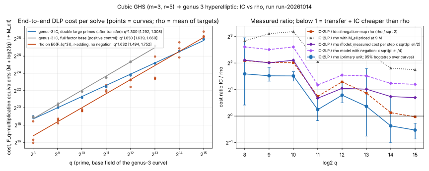

# Item 7: the cubic-GHS to genus-3 transfer, priced end to end against rho

2026-10-14. Campaign `research/ic_next10_20261014/` (rules: [../RULES.md](../RULES.md)).
Design: `reports/Index calculus leads next steps.md`, "### 7.". Protocol, frozen
before data, with amendment A1 (before recorded data) and deviations D1-D2
(after data): [PROTOCOL.md](PROTOCOL.md). Tool: [ghs3.py](ghs3.py) (Python 3,
single-threaded, explicit operation counters). Analysis and plot:
[analyze.py](analyze.py). Records: [results/run-20261014/](results/run-20261014/).

## Verdict

**Hyperelliptic branch (`m = 3, r = 5`): POSITIVE under the frozen decision
rule, at toy scale, with a qualification on the crossover.
Plane-quartic branch (`m = 2`, Diem): BLOCKED** (no class arithmetic on
the plane quartic in the repository; not attempted).

- Complete DLP solves through the transfer: **24/24 correct** for genus-3
  IC with double large primes (q = 2^8 to 2^15, three curves per size),
  18/18 for the full-factor-base control (q <= 2^13), 66/66 for rho on
  `E0(F_{q^3})`, and 72/72 for the random-multiplier rho control. Every
  answer is checked against the planted `k`.
- Fitted cost exponent in `q` (primary unit, all sizes, 95% bootstrap over
  curves): **IC-2LP 1.300 [1.292, 1.308]**; positive control IC-basic
  1.650 [1.639, 1.660]; rho, measured, 1.632 [1.494, 1.752]; rho model
  (measured cost per step times `sqrt(pi ell / 2)`) 1.529.
- **The 1.35 kill line is crossed if only the larger sizes are fitted.** The
  IC fit over q = 2^11 to 2^15 gives **1.377 [1.363, 1.392]**, and the local
  exponents between consecutive sizes rise: 1.08, 1.20, 1.25, 1.35, 1.35,
  1.42, 1.39. The all-size fit is pulled down by fixed costs (transfer,
  walk set-up, factor-base scan) that dominate at q = 2^8 to 2^10. Both fits
  stay separated from rho's 1.5 (their intervals end at 1.39).
- **Measured crossover:** against the rho arm as implemented, IC-2LP is
  cheaper from **q = 2^14** (ratio 0.77 [0.50, 1.65]) and at **q = 2^15**
  (0.69 [0.55, 0.83]). That rho arm walks badly (1.75 sqrt(ell) steps
  against 1.35 sqrt(ell) for independent random multipliers, deviation D2).
  **Against the strongest rho the instrument supports (rho model), IC-2LP
  is still 1.62 times more expensive at q = 2^15**, and 2.29 times against
  an ideal negation-map rho. The crossover against the rho model is an
  extrapolation of fitted lines: q = 2^17.2 (all-size IC fit) to 2^19.2
  (top-five-size fit); against negation-map rho, 2^19.4 to 2^22.5; with
  linear-algebra multiplications mod `ell` priced at 9 `F_q`
  multiplications, about 2^25. No crossover against the rho model is
  measured in this run.

What the result supports: on this structured odd-characteristic class
(`#E0(F_{q^3}) = 0 mod 4`, split arm), the transfer plus genus-3
double-large-prime IC runs end to end and scales with an exponent
between 1.30 and 1.39 in `q`, against 1.5 for rho on `E0`. It does not
support a claim that the transfer beats a well-implemented rho at any size
measured here.



*Left: end-to-end cost per solve in `F_q`-multiplication equivalents
(points are curves; rho points are means over 2-3 targets; lines are the
least-squares fits with 95% bootstrap intervals). Right: IC-2LP / rho per
size, against the measured rho (with bootstrap interval), the rho model
with and without negation, and with `M_ell = 9 M`. Run `run-20261014`,
3 curves per size, `n` per cell in the table below.*

## Per-size results (means; costs in `F_q`-multiplication equivalents)

| log2 q | q | IC-2LP cost | IC-basic cost | rho cost (measured) | rho model | IC/rho measured [95%] | IC/rho model | IC/rho model, negation | IC LA share | FB size | IC walk steps | correct (IC, basic, rho) |
|---|---|---|---|---|---|---|---|---|---|---|---|---|
| 8 | 257 | 5.01e5 | 5.09e5 | 1.67e5 | 1.16e5 | 3.01 [1.33, 7.73] | 4.31 | 6.10 | 0.17 | 81 | 914 | 3/3, 3/3, 9/9 |
| 9 | 521 | 1.08e6 | 1.37e6 | 3.76e5 | 2.68e5 | 2.87 [2.49, 3.57] | 4.02 | 5.69 | 0.25 | 130 | 1,755 | 3/3, 3/3, 9/9 |
| 10 | 1031 | 2.43e6 | 3.90e6 | 8.53e5 | 5.66e5 | 2.85 [2.50, 3.19] | 4.30 | 6.09 | 0.27 | 205 | 3,754 | 3/3, 3/3, 9/9 |
| 11 | 2053 | 5.77e6 | 1.19e7 | 4.87e6 | 3.62e6 | 1.18 [0.89, 1.57] | 1.59 | 2.25 | 0.31 | 324 | 8,285 | 3/3, 3/3, 9/9 |
| 12 | 4099 | 1.46e7 | 4.26e7 | 8.47e6 | 7.09e6 | 1.73 [1.41, 2.49] | 2.06 | 2.92 | 0.37 | 513 | 18,800 | 3/3, 3/3, 9/9 |
| 13 | 8209 | 3.75e7 | 1.52e8 | 2.91e7 | 1.86e7 | 1.29 [0.59, 3.47] | 2.02 | 2.85 | 0.40 | 814 | 43,445 | 3/3, 3/3, 9/9 |
| 14 | 16411 | 9.99e7 | - | 1.29e8 | 6.00e7 | 0.77 [0.50, 1.65] | 1.66 | 2.35 | 0.44 | 1292 | 101,978 | 3/3, -, 9/9 |
| 15 | 32771 | 2.60e8 | - | 3.76e8 | 1.61e8 | 0.69 [0.55, 0.83] | 1.62 | 2.29 | 0.48 | 2049 | 243,240 | 3/3, -, 6/6 |

Rho cost depends on `ell = #E0(K)/c`, and the cofactor `c` varies from 4
to 60 across curves ([instances.csv](results/run-20261014/instances.csv)),
while IC cost does not depend on `c`. That is why the ratio jumps at
q = 2^11, where two of three curves have `c = 4`. Every comparison is per
instance on the same `ell`-part.

Other measured values (from [summary.json](results/run-20261014/summary.json)):

- Rho steps scale as `ell^0.527` (instrument control; expected 0.5).
  Measured rho constant: 1.97 sqrt(ell) over all sizes, 1.75 at q = 2^9 to 2^12.
  With independent random multipliers at the same sizes: 1.35 +- 0.08
  sqrt(ell) (n = 72). Random mapping predicts 1.25.
- Rho cost per step: 74.5 `F_q`-multiplication equivalents (affine
  addition over `F_{q^3}`: one `F_{q^3}` inversion by norm, three
  `F_{q^3}` multiplications by schoolbook).
- IC-2LP group operations scale as q^1.137; its cost exponent exceeds that
  because the smoothness test costs `log q` and the linear-algebra share
  grows from 17% to 48% (Lanczos on the normal equations, row weight from
  large-prime recombination rising slowly with `q`).
- At q = 2^15 an IC-2LP solve takes about 243,000 walk steps,
  2,049 factor-base primes, 81-95 full relations, about 1,600 single- and
  11,500-11,700 double-large-prime relations, and a single Lanczos solve;
  walk restarts at q >= 2^13: one in nine solves.
- All 24 instances pass the transfer checks: `deg h = 7`; `phi(G) != 0`;
  `ell phi(G) = 0`; `#E0(K) phi(G) = 0`; 3/3 random homomorphism checks
  `phi(P+Q) = phi(P) + phi(Q)`. At q <= 2^11, `#Jac(C)(F_q)` from PARI
  `hyperellcharpoly` equals `#E0(K)` from SEA on 12/12.

## What was built

1. **Instances.** `K = F_q[t]/(t^3 - c1 t - c0)`, `q` the next prime above
   2^b. `E0 : y^2 = (x-a)(x-b)(x-r0)(x-r1)`, `r_i = p^{q^i}`, `p` random in
   `K \ F_q`; accepted when `#E0(K) = c ell` with `ell` prime, `c <= 64`.
2. **Genus-3 curve over `F_q`.** `D = C/iota` is the conic
   `Tr_{K/F_q}((r2 - r0) s^2) = 0` in `s in K`, with `X_i = s^{q^i}`.
   Lines through an `F_q`-point `s*` parametrise it; the second line is chosen
   through the `F_q`-point over `x = a`, so the Weierstrass point sits at
   `z = inf` and `C : w^2 = h(z) = (xn - a xd)(xn - b xd)` has degree 7.
3. **Transfer, computed over `K` only.** With
   `R(z) = kappa Delta^2 / ((r0 - r1) X0 X2)` (derived:
   `w = y0 y1 y2 xd/(Q N) = y0 R(z)`), `pi0^*[P]` is the Mumford pair
   `(xn - x_P xd, y_P R mod U)`; `phi(P)` is the Cantor sum of it and its
   two coefficient-wise Frobenius conjugates, and lands in `F_q`. This
   replaces the `F_{q^6}` Zech tables of the earlier build, which limited it
   to q <= 13.
4. **IC-2LP.** r-adding walk (r = 20) on `alpha phi(G) + beta phi(T)`;
   smoothness by `x^q = x mod u`; roots by Cantor-Zassenhaus; factor base the
   `ceil(2 q^{2/3})` degree-1 primes with smallest `x` (kappa = 2 from the
   pilot); large primes eliminated along the spanning tree of the component of
   the large-prime graph that contains the factor-base vertex; singleton
   filtering; Lanczos mod `ell` with `k` as an extra unknown; answer checked as
   `k phi(G) = phi(T)` and against the planted `k`.
5. **Rho.** Single-walk r-adding rho with distinguished points on the short
   Weierstrass model of `E0` over `K`.

## Deviations and limits

- Sizes extended from 2^8 to 2^13 to 2^8 to 2^15 (A1, before recorded data);
  stopped at 2^15 because a 2^16 rho job would hit the 45-minute per-job cap
  (D1). The kill criterion's "q >= 2^9" reach condition is met at every size.
- Rho multipliers by a Fibonacci chain walk about 30% worse than random
  multipliers (D2); the verdict uses the rho model, which removes that
  handicap.
- One instrument on all arms, but not equally tuned: Cantor's generic
  composition (no explicit genus-3 formulas), schoolbook `F_{q^3}`
  multiplication (no Karatsuba), Fermat-priced inversions. Explicit genus-3
  formulas would lower IC's constant; Karatsuba and a negation map would
  lower rho's. The crossover moves by a factor `ratio^{6}` in `q` for a
  constant change `ratio` (exponent gap about 1/6 to 1/4), so it is
  sensitive to these constants: a 1.6x constant is 2^3 to 2^4 in `q`.
- `M_ell` counted as one `F_q` multiplication (one machine word at these
  sizes). With 9, the IC exponent is 1.438 and the crossover moves to about
  2^25.
- Python stands in for native code because the task allows it; costs are
  counted operations, not wall time.
- Only the split arm (`deg h = 7`) is covered; the conjugate arm (`deg h = 8`,
  real model) and the plane-quartic branch are not.

## Reproduce

```bash
cd research/ic_next10_20261014/07-cubic-ghs-genus3
# kappa pilot (q = 257)
for k in 1 2 4; do for c in 0 1 2; do python3 -I ghs3.py --bits 8 --curve $c --arms ic2lp --kappa $k --out results/pilot_kappa_k$k.jsonl; done; done
# recorded run (b = 8..15; PAR = parallel jobs; each job single-threaded, 1 GB cap)
PAR=3 sh run_all.sh results/run-20261014 8 9 10 11 12 13 14 15
# random-multiplier rho control (deviation D2)
for b in 9 10 11 12; do for c in 0 1 2; do RHO_RANDOM_MULT=1 python3 -I ghs3.py --bits $b --curve $c --arms rho --rho-targets 6 --out results/rho-randmult-20261014/rho_b${b}_c${c}.jsonl; done; done
python3 -I analyze.py results/run-20261014
```

Toolchain and hashes: [results/run-20261014/env.txt](results/run-20261014/env.txt)
(`ghs3.py` later gained only the `RHO_RANDOM_MULT` switch, default off).
Per-solve rows: [solves.csv](results/run-20261014/solves.csv).
