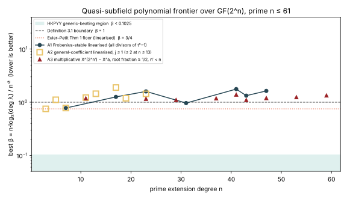
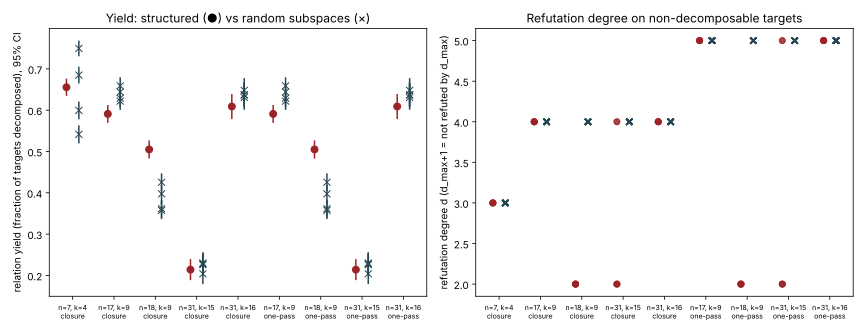

# Item 8: quasi-subfield polynomials at prime extension degree

**Verdict: NEGATIVE.** The kill criterion fires, and the route is closed.

The searches covered:

- every Frobenius-stable linearised candidate at prime `n <= 61`, by enumerating every divisor of `t^n - 1`;
- every general-coefficient linearised candidate with `log2 deg lambda <= 1` at prime `n <= 23`, and with `log2 deg lambda <= 2` at prime `n <= 13`;
- every multiplicative candidate `X^{2^{n'}} - X^a` at prime `n <= 61`, by enumerating every divisor of `2^n - 1`.

None of them gets near the HKPYY generic-beating threshold `beta < 0.1025`. The best non-trivial `beta` at prime `n` is **0.778** (`n = 7`, `n' = 3`, `lambda = X^2 + X`). For `n >= 11` it is **0.964** (`n = 31`, `n' = 15`, Euler–Petit Type 2). Both are 7.6x to 9.4x above the threshold.

In the `m = 2` decomposition system, the two quasi-subfield bases that exist at a usable dimension (`n = 31`, `k = 15, 16`) have the same relation yield as random subspaces of equal dimension. Their refutation degree is no lower either. The one difference seen is a degree-2 refutation on about half of the targets for `k = 15`. It is explained exactly by a trace rule that any subspace inside the trace-zero hyperplane satisfies. It is not a quasi-subfield effect.

Protocol: [`PROTOCOL.md`](PROTOCOL.md), frozen before any data was collected.

## Definitions

A quasi-subfield polynomial (QSP) is `L(X) = X^{2^{n'}} - lambda(X)` with most of its roots in `F_{2^n}`. Its quality is `beta = n * l / n'^2`, where `l = log2 deg lambda` (Euler–Petit). Definition 3.1 of HKPYY requires `beta < 1`.

HKPYY's algorithm beats generic `O(2^{n/2})` only when `beta < 1/(2 kappa) = 0.1025`, with `kappa = 4.876`. That is the threshold the kill criterion uses, and it is the same constraint as `alpha* = 0.1025` in `RESEARCH_QUASI_SUBFIELD.md` §5c. The quantity the task calls "`log(deg lambda)` to `l`" is `l/n'`. Under this threshold it must be below `0.1025 * n'/n`.

## Results



*Figure 1. The best `beta` found per prime `n`, for each class. The shaded band is the region that would beat generic algorithms. Primes with no marker for a class have no candidate in that class: 2 is a primitive root mod `n` (A1), or `2^n - 1` is prime (A3).*

### A1: Frobenius-stable linearised polynomials (`F_2` coefficients), every divisor of `t^n - 1`

- The search enumerated every divisor of `t^n - 1` for every prime `3 <= n <= 127` (context beyond 61). File: `a1_stable_frontier.csv`.
- Positive controls, all recovered:
  - `n = 7`: `n0 = 3`, `l = 1`, `beta = 0.778`; and `n0 = 4`, `l = 2`, `beta = 0.875` (`g = t^4 + t^2 + t + 1`).
  - `n = 31`: `n0 = 15`, `l = 7`, `beta = 0.964`; and `n0 = 16`, `l = 8`, `beta = 0.969` (Euler–Petit Type 2, both `a = 0` and `a != 0`).
  - `n = 73`: `n0 = 9`, `l = 1`, `beta = 0.901`.
- Non-trivial QSP cells (`beta < 1`, `n0` not 1 or `n - 1`) at prime `n <= 61`: exactly four, namely `(7,3)`, `(7,4)`, `(31,15)` and `(31,16)`.
  - The best `beta` per prime is: 7: 0.778; 17: 1.259; 23: 1.597; 31: 0.964; 41: 1.766; 43: 1.329; 47: 1.632.
  - Primes 3, 5, 11, 13, 19, 29, 37, 53, 59 and 61 have no non-trivial stable subspace at all.
- **Below `beta = 0.1025`: none, at any prime `n <= 127`.** This reproduces `RESEARCH_QUASI_SUBFIELD.md` §4 with an independent Python and PARI implementation.

### A2: general-coefficient linearised polynomials (coefficients in `F_{2^n}`), exhaustive

The leading `lambda` coefficient `c_j` is normalised to 1 by the scaling `X -> gamma X`. This loses no generality for prime `n`, because `gcd(2^{n0-j} - 1, 2^n - 1) = 1`. Every remaining coefficient vector was checked by the kernel-dimension test.

| Range | Cells | Vectors examined | QSP cells (`beta < 1`) found |
|---|--:|--:|---|
| `j <= 2`, prime `n <= 13`, all `n0` | 82 | 704,819,973 | `(n,n0,j)` = (3,2,1) `beta` 0.750 (trace hyperplane, trivial); (7,3,1) 0.778; (7,4,2) 0.875 |
| `j <= 1`, `n = 17, 19` | 64 | 10,879,008 | none |
| `j <= 1`, `n = 23` | 42 | 176,160,789 | none |

- Positive controls: the `n = 7` witnesses `X^2 + X` and `X^4 + X^2 + X` are found as unique scaling classes.
- At `n >= 11`, every split polynomial with `j <= 2` has `beta >= 1.19`. Example: `n = 19`, `n0 = 4`, `j = 1`, 38 classes, `beta = 1.1875`.
- No polynomial ever splits below the Euler–Petit floor `beta = 3/4`. This is computational confirmation of their Theorem 1, and of the McGuire–Mueller trinomial bound `n >= d^2 - d + 1`.
- Files: `a2_j2_n3-13.csv`, `a2_j1_n17-19.csv`, `a2_j1_n23.csv`.

### A3: multiplicative QSPs `X^{2^{n'}} - X^a` (Euler–Petit Prop. 6), every divisor of `2^n - 1`

Theorem 1 does not cover this class. The class is kept only when the factor base is a proper one, with `n' < n` and a root fraction `(D+1)/2^{n'} >= 1/2`.

- Positive controls (composite `n`), all recovered: `X^8 - X^3` at `n = 4` (`beta = 0.704`); `n = 6`, `a = 11` (0.830); `n = 8`, `a = 43` (0.886); `n = 8`, `a = 13` (0.822).
- At prime `n <= 61`, the best values are:
  - `n = 43`: `beta = 1.102`, with `n' = 22`, `D = 4188889`, `a = 5415`, root fraction 0.9987;
  - `n = 29`: `beta = 1.104`.
- **No prime `n <= 61` has a multiplicative QSP at all** (`beta < 1`). Primes with prime `2^n - 1` (3, 5, 7, 13, 17, 19, 31, 61) have no candidate.
- A first pass produced degenerate rows with `n' = n + 1` (a "factor base" twice the field). These were excluded as not being factor bases; see Deviations.
- File: `a3_multiplicative.csv`.

**Best ratio achieved, against the threshold.**

| | Best at prime `n <= 61` | Needed |
|---|---|---|
| `beta` overall | 0.778 (`n = 7`) | `< 0.1025` |
| `beta` at `n >= 11` | 0.964 (`n = 31`, `n' = 15`), so `l/n' = 0.467` | `l/n' < 0.1025 * 15/31 = 0.0496` |
| multiplicative | best is 1.102, not a QSP | |

### D: relation yield and refutation degree in the binary pipeline

The instrument is a faithful small reimplementation (`examples/ic_next10_08_qsf_decomp.rs`):

- curve `y^2 + xy = x^3 + 1` over `F_{2^n}`, with `m = 2`;
- the Weil-descended `S3` system built by the repository's `koblitz_groebner::build_decomposition_system`;
- the same field and the same seeded target stream for every base.

Yield is exact per target: sweep `x1` over `V`, solve the quadratic for `x2`, test `x2 in V`. Refutation degree is measured on verified non-decomposable targets in two ways: by the F4 closure (`matrix_f4_f2` run to a fixed point), and by a one-pass Macaulay matrix (`solving_profile`). Each structured base is compared against 4 random subspaces of the same dimension.



*Figure 2. Left: yield, with 95% Wilson intervals; a dot is the structured base, a cross a random one. Right: refutation degree on 6 verified non-decomposable targets per base; `d_max + 1` plotted means not refuted by `d_max`.*

| `n` | `k` | Base | Yield (95% CI) | Random yields (4 bases) | Refutation degree, structured | Refutation degree, random |
|--:|--:|---|---|---|---|---|
| 31 | 15 | **QSP** `g = t^15 + t^7 + t^3 + t + 1` (`beta` 0.964) | 0.214 (0.190–0.240) | 0.204–0.230 | closure: `2 >3 2 >3 2 2`; one-pass: `2 >4 2 >4 2 2` | all `>3` (closure), all `>4` (one-pass) |
| 31 | 16 | **QSP** `g = t^16 + t^8 + t^4 + t^2 + t + 1` (`beta` 0.969) | 0.609 (0.578–0.639) | 0.631–0.648 | all `>3` / all `>4` | all `>3` / all `>4` |
| 17 | 9 | best stable, not QSP (`beta` 1.26) | 0.591 (0.569–0.612) | 0.622–0.659 | 4 (closure), 5 (one-pass), all 6 | identical |
| 18 | 9 | **positive control**: subfield `F_{2^9}` | 0.505 (0.483–0.527) | 0.357–0.425 | **2** (all 6, both instruments) | 4 (closure), 5 (one-pass) |
| 7 | 4 | QSP `X^4 + X^2 + X` | 0.655 (0.634–0.676) | 0.541–0.750 | 3 | 3 |

Full rows, including the word-XOR counts: `decomp_table.md`, `decomp_summary.json`. Raw data: `decomp_*.jsonl` and `onepass_*.jsonl`.

- **Yield.** The QSP bases sit inside the random spread. At `k = 16`, the QSP yield is 0.02–0.04 below the random range; its interval overlaps one random base. This tracks the number of base elements that are curve abscissae (32521 against 32623–32946). The `n = 18` subfield has more yield because all 512 of its elements are abscissae of `F_{2^18}`-points. That is a known property of subfields.
- **Refutation degree.** The positive control works: the instrument separates the subfield (degree 2) from random bases (4 or 5). Of the QSP bases, `k = 16` is identical to random. The `k = 15` base refutes at degree 2 on 4 of 6 targets.
- **Mechanism, checked exactly** (`mechanism.py`, `mechanism.json`). The span of the descended equations is `{Tr(theta * S3)}`. For `b = 1`,

  ```
  Tr(theta * S3) = Tr((sqrt(theta) + theta * X) * x1 * x2)
                 + Tr(sqrt(theta) * X * (x1 + x2))
                 + Tr(theta).
  ```

  A degree-2 refutation is therefore a linear system in `theta`. Solving it for 2,495 targets across 26 bases gives the following rule, with 100% agreement on every target. When `span(V*V)` is the whole field (true for every `n = 31` base), a degree-2 refutation happens **iff `V` lies in the trace-zero hyperplane and `Tr(1/X) = 1`**.
  - The `k = 15` QSP has `(t + 1)` not dividing `g`, so `V` lies in the trace-zero hyperplane. It refutes 50/100 targets.
  - The `k = 16` QSP has `(t + 1) | g`. It refutes 0/94.
  - **Random subspaces drawn inside the trace-zero hyperplane do the same as the QSP:** 48/93, 55/95 and 56/108 at `k = 15`; 44/99 to 53/100 at `k = 16`; about 50% at `n = 17`.
  - The subfield control is in the hyperplane too, since `Tr_{18}` vanishes on `F_{2^9}`.

  So the degree-2 refutations are a one-trace necessary condition. It rejects about half the targets before any algebra, it costs one trace, and every hyperplane-contained base has it. On the remaining targets (`Tr(1/X) = 0`), the QSP base refutes no earlier than random. It is not a QSP effect and it does not change an exponent.

## Kill criterion

- **First clause fires.** No family at any prime `n <= 47` (searched to 61, and A1 to 127) has `log2(deg lambda)/k` below the HKPYY threshold. The best value at `n >= 11` is `beta = 0.964` against `0.1025`. The Euler–Petit restriction is confirmed computationally, both for linearised polynomials (A2: nothing splits below 3/4) and, in this range, for the multiplicative class they had shown can go below 3/4 at composite `n` (A3: nothing below 1 at prime `n`).
- **Second clause, checked anyway.** The two QSP bases that exist at a usable size (`n = 31`) decompose like random subspaces once the trace rule is accounted for.

**The route closes.**

## Deviations from the protocol

1. A3 dropped degenerate rows with `n' >= n`. These are the polynomials `X^{2^{n+1}} - X^{2^n + 1}`, whose "factor base" is all of `F_{2^n}^*`. They were found on the first run and are not factor bases.
2. Arm D at `n = 31`: the degree-4 F4 closure ran out of memory under the 700 MB cap during closure readback, and all 7 jobs that reached it failed. To get a degree-4 verdict at `n = 31` I added two things:
   - the closure was rerun with `d_max = 3`;
   - a one-pass degree-4 Macaulay instrument (`QSF_ONEPASS=1`) was added and run on every arm, with the `n = 17` and `n = 18` controls rerun on it as well.

   Degree 5 at `n = 31` (about 170k by 243k dense) was out of reach, so `>4` is the wall.
3. `mechanism.py` (the exact degree-2 criterion, with random trace-zero subspaces as an extra control) was not in the protocol. It was added after the `k = 15` degree-2 refutations appeared, to explain them. It uses its own field modulus and its own random bases, so it is an independent check rather than a replay of arm D.
4. A2 `j = 2` at `n = 13` took 18 min of wall time on a machine loaded by the other nine items. For `j = 2` at `n = 17` (2^34 vectors per `n0`), and for `j = 1` at `n >= 29`, the estimated cost ran past the 45-minute job limit, so this is where the A2 wall is. Euler–Petit Theorem 1 covers those cells in any case.

## Reproduce

```sh
cd research/ic_next10_20261014/08-quasi-subfield
python3 -I qsf_search.py .                      # A1, A3 (+ search_summary.json)
cargo build --release --example ic_next10_08_qsf_general --example ic_next10_08_qsf_decomp
B=../../../target/release/examples/ic_next10_08_qsf_general
$B 2 3 5 7 11 13 > a2_j2_n3-13.csv; $B 1 17 19 > a2_j1_n17-19.csv; $B 1 23 > a2_j1_n23.csv
./run_decomp.sh                                 # D, F4 closure (n=31 at d_max 3)
QSF_ONEPASS=1 QSF_CFGS="onepass_n31_k15.jsonl 31 15 g=0x808b 1000 6 4
onepass_n31_k16.jsonl 31 16 g=0x10117 1000 6 4
onepass_n18_k9.jsonl 18 9 g=0x201 2000 6 5
onepass_n17_k9.jsonl 17 9 g=0x279 2000 6 5" ./run_decomp.sh
python3 -I mechanism.py .                       # exact degree-2 criterion
python3 -I summarise_decomp.py . > decomp_table.md
python3 -I plots.py .
```

All jobs ran single-threaded under `nice` with `prlimit --as=700000000`.

## Files

- `PROTOCOL.md`: the frozen protocol.
- `qsf_search.py`: A1 and A3.
- `examples/ic_next10_08_qsf_general.rs`: A2.
- `examples/ic_next10_08_qsf_decomp.rs` and `run_decomp.sh`: D.
- `mechanism.py`: the exact degree-2 rule.
- `summarise_decomp.py` and `plots.py`: tables and figures.
- Data:
  - `a1_stable_frontier.csv`, `a2_*.csv`, `a3_multiplicative.csv`, `search_summary.json`, `search_stdout.txt`;
  - `decomp_*.jsonl`, `onepass_*.jsonl`, `decomp_stderr.txt` (partial-yield lines), `decomp_table.md`, `decomp_summary.json`, `mechanism.json`.
- Figures: `fig_beta_frontier.{svg,png}`, `fig_decomposition.{svg,png}`. PDF: `README.pdf`.

Sources:

- Huang, Kosters, Petit, Yeo, Yun, J. Math. Cryptol. 14 (2020).
- Euler, Petit, FFA 75 (2021), arXiv:1909.11326. Theorem 1, Prop. 5 and 6, and Table 1 were read from the arXiv text.
- Prior repository work: `research/notes/index-calculus/RESEARCH_QUASI_SUBFIELD.md` and `src/cryptanalysis/quasi_subfield.rs`.
