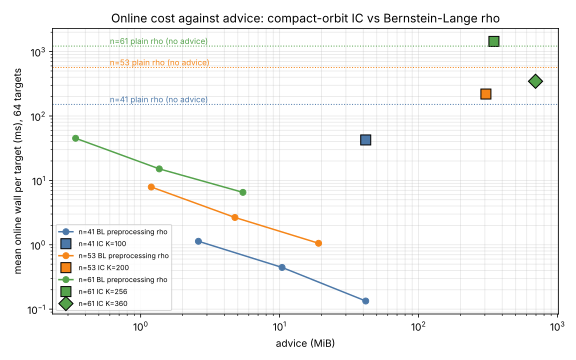
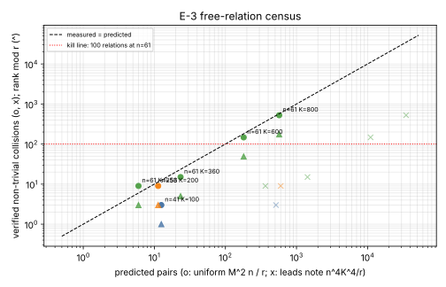

# Item 9: the online IC wins at equal advice, and the free-relation census

**Verdict: POSITIVE for the audit (Lead A).** At the same advice size or less,
Bernstein–Lange preprocessing rho solves a fresh Koblitz target 50–500 times
faster online than compact-orbit index calculus. This holds on every rung that
fits in 1 GiB (n = 41, 53 and 61). In every comparison the 95% interval lies
far above 1.

The online-only IC "wins" (13.9x at n=61, 54.1x at N83) compare IC with a table
against rho with no table. Once rho gets the same advice, they are not wins.
Following the report's kill criterion, this item recommends retiring them as
wins from `docs/ic/LEADERBOARD.md` and landing no new online-only rungs.

**Verdict: NEGATIVE for Lead B (the free-relation lever closes).** The
self-collision census matches the uniform E-3 law `K⁴n³/(4r)`. The leads
note's prediction `n⁴K⁴/r` is too high by a factor of about 60. At n=61,
K=600, there are 147 verified non-trivial collisions, but they span only
**49 independent relations** (rank mod r), against 599 needed. That is below
the 100-relation kill line, so the free-relation lever is closed at the rungs
the repository runs.

Protocol: [PROTOCOL.md](PROTOCOL.md), frozen before data. Raw rows: `data/`.
Analysis: `scripts/analyze.py` → [results.json](results.json).



## Lead A: online cost at equal advice

All arms ran on the same 64 unseen public targets per rung (`data/targets_n*.txt`).
Each target was checked against its held-back scalar (`data/scalars_n*.txt`):
64/64 for every IC and BL arm, and 64/64, 32/32 and 64/64 for plain rho at
n=41, 53 and 61. Every arm ran single-threaded under `nice` and
`prlimit --as=1 GiB`.

The unit is the per-target online wall time in ms. For IC this runs from the
target query to the `[d]G = Q` check. For BL it covers the per-walk `[c]G`,
the walk, the lookups and the check. Native counts are listed beside the times.

Ratios are IC/BL with a paired target bootstrap over 10,000 resamples.

| rung | IC arm (advice) | IC online ms, mean / median | IC probes, mean | BL table (advice) | BL online ms, mean / median | BL steps, mean | **IC / BL, ratio of means [95% CI]** | median ratio [95% CI] |
|---|---|---:|---:|---|---:|---:|---:|---:|
| n=41 | K=100 (43.7 MB) | 42.5 / 32.5 | 19,328 | 2.73 M DPs (**43.7 MB, equal**) | 0.134 / 0.063 | 102 | **317 [137, 739]** | 490 [360, 740] |
| n=53 | K=200 (320 MB) | 219 / 140 | 103,829 | 1.25 M DPs (20.0 MB, **1/16**) | 1.06 / 0.23 | 646 | **208 [103, 630]** | 546 [297, 906] |
| n=61 | K=256 (366 MB) | 1,440 / 830 | 384,349 | 357 k DPs (5.7 MB, **1/64**) | 6.51 / 2.23 | 4,287 | **221 [150, 327]** | 196 [163, 254] |
| n=61 | K=360 (728 MB) | 346 / 222 | 168,331 | same (5.7 MB, **1/128**) | 6.51 / 2.23 | 4,287 | **53 [35, 80]** | 84 [34, 120] |

The BL tables at n=53 and n=61 are smaller than IC's. The online walk is a
deterministic function of the target and the seed, so a superset table can
never take more steps on the same target. BL at equal bytes is therefore at
least this fast. At n=41, where the table is exactly equal, BL is 317x faster.
Even BL's smallest prefixes win at every rung: at 1/1,024 of IC's bytes at
n=61, IC/BL is still 32 [22, 46] for K=256 and 7.7 [5.5, 10.6] for K=360
(`results.json`, `bl_level2`).

The native counts give the same answer without the clock. IC needs 20k–384k
probes (one S3 root solve plus one table lookup each), while BL needs 100–4,300
point additions with canonicalisation. Per operation the two cost about the
same: 4.1–7.5 µs per IC root call and 1.3–2.1 µs per BL step on this
contended host.

**Plain-rho reference (the published comparison, reproduced here).** Strong
rho (rung 3, 32 lanes, no table) against IC gives a rho/IC ratio of means of:

- n=41: 3.56 [2.66, 4.88];
- n=53: 3.61 [2.44, 5.57];
- n=61: 0.85 [0.63, 1.17] at K=256 and 3.52 [2.60, 4.87] at K=360.

So the IC arm shows the same kind of online "win" that the 13.9x row reports
(K=500 there). Against the same rho given a table, BL beats plain rho by
187–1,130x (ratio of means). The table is what makes the difference, not
index calculus.

**Controls.**

- *Positive (BL instrument law).* The log-log slope of BL online steps
  against table size over the three prefixes is −0.66 at n=41, −0.78 at n=53
  and −0.65 at n=61. The law is −1/2 and the window was [−0.75, −0.25], so
  n=53 falls outside it by 0.03. Smaller prefixes reuse the DP density tuned
  for the full table (`2^t` is not re-optimised per prefix), which steepens
  the slope.
- *Null (identical map required).* At n=41 the table was built with one jump
  map and walked online with another (`bl_n41_mismatch`, 170 k DPs). Mean
  online steps were 32,670, against 626 for the matched map with the same
  number of entries: 52x worse. The cost reaches the random-hit level
  `N/T ≈ 39,300`. The preregistered prediction "< 25% solved within 400·2^t
  steps" **failed**: 61/64 solved. The cause is the budget (102,400 steps),
  which was above `N/T`, so random DP hits finish the job. The effect the
  control was built to show, that the table helps only through the identical
  map, is clear.

**Precompute.** This is not part of the claim. It is shown so that the setup
trade is visible:

| rung | IC setup (index + rank stage), s | BL precompute, s (steps) |
|---|---:|---:|
| n=41 | 1.9 + 4.4 | 803 (3.3·10⁸) |
| n=53 | 8.0 + 41.3 | 852 (1.2·10⁹), 1/16 table |
| n=61 | 30.6 + 412.9 (K=256); 37.9 + 158.7 (K=360) | 773 (1.1·10⁹), 1/64 table |

All of these are wall times on a host with load average about 25 on 4 cores.
The BL precompute walks are batched in 256 lanes and sit at about 230 ns per
step of CPU time. About half of all DPs found were duplicates: the tables are
saturated (`T·W² ≈ N`).

### Projection to the published points (not measured)

These are computed from the fitted laws, not from runs.

- **n=61, K=500.** IC's root table alone is 1 GiB; the published mean IC
  online is not in this item. Scaling the K=360 IC online (346 ms) by
  `(360/500)²` gives about 180 ms. BL with the same ≈1.5 GB of advice has
  `√(N/T) ≈ 120` steps, about 260 steps at the measured 2.2x excess, which is
  under 1 ms. That projects IC/BL at a few hundred.
- **N83 K3240.** IC online is 58.9 ms (published mean). BL with 14 GiB holds
  9.4·10⁸ entries, so `√(N/T) ≈ 230` steps, which is about 1 ms. That
  projects IC/BL at about 50–100.

Neither the N83 point nor the n=61 K=500 point fits the 1 GiB cap, and the BL
instrument is written for n ≤ 63 (single-word fields). These projections are
not results.

## Lead B: E-3 free-relation census

`ic_next10_09_equal_advice census` builds the same compact-orbit base as
`construct:<n>:0:<K>` and enumerates every unordered pair state together with
both S3 roots. It sorts the Frobenius-canonical roots and searches every equal
key for a signed four-point identity whose log row is non-zero. It then
computes the rank mod r of all verified rows. A collision is *trivial* only
if every identity it carries has a zero row.

| rung | K | root keys | collision pairs | trivial (= 2K) | **verified non-trivial** | uniform prediction `M²n/r` | leads note `n⁴K⁴/r` | **rank mod r** |
|---|---:|---:|---:|---:|---:|---:|---:|---:|
| n=41 | 100 | 0.41 M | 203 | 200 | 3 | 12.5 | 514 | 1 |
| n=53 | 200 | 2.1 M | 409 | 400 | 9 | 11.3 | 600 | 3 |
| n=61 | 256 | 4.0 M | 521 | 512 | 9 | 6.0 | 365 | 3 |
| n=61 | 360 | 7.9 M | 735 | 720 | 15 | 23.4 | 1,428 | 5 |
| n=61 | **600** | 22.0 M | 1,347 | 1,200 | **147** | 180.6 | 11,016 | **49** |
| n=61 | 800 | 39.0 M | 2,125 | 1,600 | 525 | 570.7 | 34,817 | 175 |



- Every collision verified as a group identity, with 0 verification failures.
- The non-trivial count follows the uniform law, measured/predicted
  0.24–1.5 (0.81 at K=600 and 0.92 at K=800). The leads note is wrong by
  a factor of n.
- Exactly 2K collisions per table are structural trivial ones: the same pair
  orbit is reached twice, so the row is zero.
- The rank is exactly one third of the non-trivial count in every row
  (147 → 49, 525 → 175). The likeliest reason is that each four-point relation
  `P_a+P_b+P_c+P_d = O` shows up once for each of its three pairings, but this
  was not separately checked. Distinct relations therefore come to
  `≈ K⁴n³/(12r)`. Full rank needs that to reach K, which means
  `K ≈ (12r/n³)^{1/3} ≈ 2,050` at n=61: a 3.4·10⁸-state table, more than
  10x the K=600 one.
- **Kill criterion:** 49 independent relations at n=61, K=600 (147 raw
  verified collisions), against the 100 line. The lever is closed.

## Deviations from the protocol

1. **Advice scaled down at n=53 and n=61** (BL at 1/16 and 1/64 of IC's bytes
   instead of equal and 1/4). The cause was host contention: load average
   25–27 on 4 cores from the other nine items, which left this item about 13–25%
   of a core. A 1/4-bytes n=61 precompute was projected to pass the 45-minute
   job cap, and two attempts (1/4, then 1/16) were killed before finishing, so
   no data came from them. Because of per-target monotonicity in table size,
   this makes the comparison more favourable to IC, not less.
2. The null control used 1/16 bytes (it does not need equal advice), and its
   preregistered success-rate prediction failed (see above).
3. The n=53 plain-rho reference used 32 of the 64 targets, as the run script
   set it up before launch. This is a reference arm, not the primary
   comparison.
4. The census instrument was first built returning the first identity found.
   The rebuilt version prefers a non-trivial identity, and the counts above
   come from it. The n=61 K=600 figures came out identical in both versions.
5. **Wall-clock noise.** The jobs ran under heavy, variable contention. IC
   K=256 ran in the busiest window (7.5 µs per root call, against 4.1 µs at
   K=360). The per-target pairing does not remove that. The 50–500x gaps are
   far larger than this noise, and the native counts agree.
6. There are no hardware counters (`perf_event_open` is unavailable), so the
   count unit is native operations, not instructions.

## Reproduce

```bash
cargo build --release --example ic_next10_09_equal_advice \
  --example koblitz_orbit_dlp_fast_online --example koblitz_rho_batch_ks_strong_online
B=target/release/examples; D=research/ic_next10_20261014/09-equal-advice/data
for n in 41 53 61; do $B/ic_next10_09_equal_advice targets $n 0 64 eval-v1 $D/targets_n$n.txt $D/scalars_n$n.txt; done
# IC arm
$B/koblitz_orbit_dlp_fast_online construct:61:0:256 $D/targets_n61.txt 7 $D/ic_n61_K256.jsonl
# BL arm (bytes = IC formula / 64; scripts/ic_bytes.py 256 61)
$B/ic_next10_09_equal_advice bl 61 0 5711008 $D/targets_n61.txt $D/bl_n61_64th.jsonl
# null control
BL_ONLINE_MAP_SEED=mismatch BL_PREFIXES=1 $B/ic_next10_09_equal_advice bl 41 0 2730602 $D/targets_n41.txt $D/bl_n41_mismatch.jsonl
# plain rho, one process per target
KIC_RHO_TARGET_POINT=x,y KIC_RHO_RUNG=3 KIC_RHO_LANES=32 KIC_RHO_DP_BITS=4 $B/koblitz_rho_batch_ks_strong_online 61 0 signed_frobenius 1 610000
# census
$B/ic_next10_09_equal_advice census 61 0 600 $D/census_n61_K600.jsonl
python3 -I research/ic_next10_20261014/09-equal-advice/scripts/analyze.py
```

The full job list is in `scripts/run_stream.sh` (streams `s1`, `s2`), and the
timestamps are in `data/jobs.log`. Every job ran under `nice`,
`prlimit --as=1073741824` and `RAYON_NUM_THREADS=1`.

## Files

- `examples/ic_next10_09_equal_advice.rs`: new example with the `targets`,
  `bl` and `census` modes (no `src/` edits).
- `PROTOCOL.md`, `README.md`, `README.pdf`, `results.json`.
- `fig_online_vs_advice.{svg,png}` and `fig_census.{svg,png}`.
- `scripts/ic_bytes.py`, `scripts/run_stream.sh`, `scripts/analyze.py`.
- `data/`: the targets and scalars, IC/BL/rho/census rows, and `jobs.log`.
