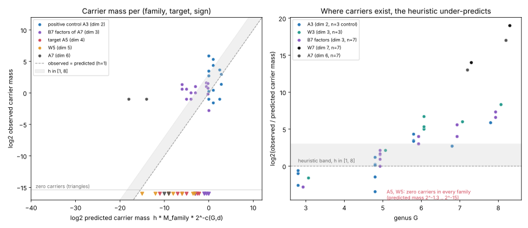

# Item 10: the Torelli rarity heuristic on the n = 5 and n = 7 toy ladder

**Verdict: NEGATIVE at n = 5, but with low power. At n = 7 the literal reopen criterion is met, by a mechanism that n = 131 lacks.**

- **n = 5.** I enumerated every genus-5 curve over F₂: hyperelliptic and trigonal completely, and canonical curves by a uniform sample of 2²¹ nets. No Jacobian among them carries `A_5`, for either sign. The same holds for every smooth plane quintic and every hyperelliptic curve of genus 6, 7 and 8. By the report's kill criterion this "confirms rarity". However, the heuristic itself predicts only about 0.42 classes per sign at genus 5 (h = 1), so a zero is what it expects. This zero tests little.
- **n = 7.** Hyperelliptic curves of genus 7 = dim A + 1 exist whose Jacobian is isogenous to the full Weil restriction `W_7 = Res_{F_128/F_2}(E_a)`, and so carries `A_7`. There are 1,536 models (mass 0.5) for each sign, and more at genus 8. The heuristic predicted 2⁻¹⁴ to 2⁻¹⁸ for these. This meets the literal criterion "more than one carrier at genus ≤ dim A + 2 reopens the route".
  - n = 7 is not a faithful analogue of 131. ord₇(2) = 3, so `t⁷ − 1` has cubic factors over F₂, and `A_7` is not even simple: it splits into two 3-dimensional factors.
  - The genus 7 = 2³ − 1 equals what GHS descent gives with magic number 4. That mechanism needs small factors of `t^n − 1`, and at n = 131 these do not exist. Attributing the genus-7 carriers to GHS is an interpretation; I did not construct the descent.
- **The heuristic as a quantitative predictor.** For the `A_3` control it is right to within 2⁻³·⁵ to 2^{+1.2} at G ≤ 5, which is excess genus G − d ≤ 3. At larger G it under-predicts every structured (Weil-restriction-type) class that occurs: by 2^{2.7} to 2^{8.3} at n = 3 (G = 6–8) and by up to 2¹⁹ at n = 7. Its codimension penalty for the extra genus is not what happens for these classes.
- **What this means for ECC2K-130.** These toys cannot confirm the heuristic. At n = 5, the one faithful rung, it predicts nothing and nothing is seen. Wherever carriers do exist, they come from structure that the dimension count ignores. The ECC2K-130 rarity argument therefore rests on the absence of such structure at n = 131 (no small magic numbers, simple A), not on the codimension number 8128.



*Left: observed against predicted carrier mass for every (family, target, sign). Triangles at the bottom are zero observations. Right: log₂(observed/predicted) for every nonzero observation. This panel is selected on nonzero counts, so it shows where carriers exist, not an unbiased calibration.*

## What was tested

- Targets. `A_n` is the trace-zero part of `Res_{F_{2^n}/F_2}(E_a)` for `E_a : y² + xy = x³ + ax² + 1`, of dimension n − 1, with characteristic polynomial `P_{A_n} = W_n / (T² − tT + 2)`, where `W_n = T^{2n} − s_n T^n + 2^n`.
- Detection. A curve "carries" a target when the target polynomial divides `P_C`. `P_C` comes from point counts over F_{2^k}, k ≤ g.
- PARI/GP structure checks:
  - `P_{A_3}` and `P_{A_5}` are irreducible.
  - `P_{A_7} = B_7 · B'_7`, two degree-6 factors, for each sign.
  - All CM class numbers are h_K = h_K⁺ = 1.
  - [O_K : Z[π]] = 2, 64 and 8 for n = 3, 5 and 7.
- Heuristic (frozen in [PROTOCOL.md](PROTOCOL.md)): the predicted carrier mass is `pred = h · M_family · 2^{−c(G,d)}`, with `c = dG − d(d−1)/2`. This is the codimension in A_G of the locus {A × B}. At G = d = 130 it gives the note's 8128.
- Mass is the number of models divided by the order of the group acting on models. This equals Σ 1/|Aut| over isomorphism classes.

## Families and coverage

| arm | genus | family | models | smooth | group | mass M |
|---|---:|---|---:|---:|---:|---:|
| hyp3 | 3 | hyperelliptic, all | 15,872 | 6,144 | 192 | 32 |
| quartic | 3 | plane quartics, all | 32,768 | 10,920 | 168 | 65 |
| hyp5 | 5 | hyperelliptic, all | 1,040,384 | 393,216 | 768 | 512 |
| trigonal5 | 5 | plane quintics with one δ=1 double point at [0:0:1], all | 262,144 | 67,608 | 24 | 2,817 |
| ci5 | 5 | canonical: smooth intersections of 3 quadrics in P⁴, 2²¹ uniform nets (stage-1); 2¹³ subsample fully counted | 2,097,152 | 1,422 / 8,192 in subsample (17.36% ± 0.42%) | 9,999,360 | 3,635 ± 88 |
| hyp6 | 6 | hyperelliptic, all | 8,355,840 | 3,145,728 | 1,536 | 2,048 |
| quintic | 6 | smooth plane quintics, all | 2,097,152 | 688,128 | 168 | 4,096 |
| hyp7 | 7 | hyperelliptic, all | 66,977,792 | 25,165,824 | 3,072 | 8,192 |
| hyp8 | 8 | hyperelliptic, all | 536,346,624 | 201,326,592 | 6,144 | 32,768 |

- **Genus 5 is complete up to the canonical sample.** Hyperelliptic, trigonal and canonical curves partition M_5, and the total mass is 6,964 ≈ 2^12.8.
  - Sampling cost: each canonical net carries mass 0.0100. A class with |Aut| = a is expected to be hit about 100/a times, so only classes with |Aut| ≳ 30 can be missed with noticeable probability.
- **Genus 6 is partial.** It covers mass 6,144 against dim M_6 = 15, i.e. ≈ 2¹⁵ curves. Missing are trigonal genus 6, the general genus-6 curve on a del Pezzo surface, and the bielliptic locus.
- **Genus 7 and 8 are hyperelliptic only.**

Hyperelliptic models are y² + hy = f with deg h ≤ g + 1 and deg f ≤ 2g + 2. They are reduced modulo y ↦ y + e(x), so each representative stands for 2^{g+1} models.

## Results

Each entry is the number of carrier models, then mass and predicted mass (h = 1) per sign. "a / b" gives E₀ / E₁. "—" means the target dimension exceeds the genus.

| arm | G | A3 (control) | W3 | B7, B'7 (dim 3) | **A5** (dim 4) | W5 (dim 5) | A7 (dim 6) | W7 (dim 7) |
|---|---:|---|---|---|---|---|---|---|
| hyp3 | 3 | 96 / 96 (0.5 each; pred 1) | 0 | 0 | — | — | — | — |
| quartic | 3 | 56 / 224 (0.33 / 1.33; pred 2.0) | 0 / 56 = Klein | E₁ only: 24, 24 (pred 1.0) | — | — | — | — |
| hyp5 | 5 | 896 / 896 (1.17; pred 1) | 0 | 0 | **0** (pred 0.031) | 0 (0.016) | — | — |
| trigonal5 | 5 | 12 / 300 (0.5 / 12.5; pred 5.5) | 0 / 72 | 72 (B'7 E₀), 48 (B'7 E₁) | **0** (pred 0.17) | 0 (0.086) | — | — |
| ci5 | 5 | 1 / 3 of 1,422 sampled (pred 7.1) | sample 0 / 1 | 11–35 hits on 2¹⁸ nets | **0 on 2²¹ nets** (pred 0.22; 95% upper 0.030) | 0 (0.11) | — | — |
| hyp6 | 6 | 16,896 each (11.0; pred 1) | 3,072 each | 768–1,536 | **0** (0.0078) | 0 | 0 (0.00098) | — |
| quintic | 6 | 3,444 / 6,692 (20.5 / 39.8; pred 2) | 840 / 2,184 | 168–336 | **0** (0.016) | 0 | 0 (0.0020) | — |
| hyp7 | 7 | 19,968 each (6.5; pred 1) | 6,144 each | 1,536–4,608 | **0** (0.0020) | 0 | **1,536 each (0.5; pred 6.1e-5)** | **1,536 each (0.5; pred 3.1e-5)** |
| hyp8 | 8 | 358,400 each (58.3; pred 1) | 30,720 each | 9,216–15,360 | **0** (0.00049) | 0 | **3,072 each (0.5; pred 3.8e-6)** | 3,072 each (0.5; pred 9.5e-7) |

Full rows, with family masses, predictions and Poisson zero-probabilities, are in [`results_table.csv`](results_table.csv) and [`results.json`](results.json).

### n = 5: the faithful rung

- **Genus 5.** No `A_5` or `W_5` carrier exists among hyperelliptic or trigonal genus-5 curves (both complete). None occurs among 2,097,152 sampled canonical nets.
  - 91,740 nets passed the (N₁, N₂, N₃) filter and 14,210 the N₄ filter. All were checked fully, with 0 hits.
  - For canonical curves the carrier mass is < 0.030 at 95% (zero events in 2²¹ nets, at 0.0100 mass per net).
- **Genus 6.** None among smooth plane quintics (complete) or hyperelliptic genus-6 curves (complete), and none at genus 7 or 8 among hyperelliptic curves.
- **Predicted counts.**
  - The heuristic predicts a genus-5 carrier mass of 0.42 per sign at h = 1, so 0.85 for both signs. P(0) is 0.43 at h = 1 and 0.001 at h = 8.
  - The ppav count h of `A_5`'s class is not computed. [O_K : Z[π]] = 64 allows several orders, so h could exceed 1. If h ≥ 4, the genus-5 zero is significant at about 3%. That condition is not established.
  - At genus 6, over the covered mass, the prediction is 0.023 per sign, so the zero there is uninformative.
- **Comparison with occurring factors.** In the genus-5 families, 135 (hyp5), 276 (trigonal) and 175 (canonical subsample) distinct simple 4-dimensional factor classes occur, with median mass 0.5–2.6. `A_5` is not among them. I did not count the total number of 4-dimensional isogeny classes over F₂, so no rank or percentile is claimed.

### n = 7: unfaithful rung, literal reopen

- **The curves.** Genus-7 hyperelliptic curves with `P_C = W_7 = T¹⁴ ∓ 13T⁷ + 128` exist for both signs: 6 reduced representatives each, so 1,536 models and mass 0.5.
  - Example for E₀: h = x⁷ + x⁵ + x⁴ + x³ + 1, f = x¹⁵ + x⁶ + x⁴ + 1.
- **Independent check** ([`verify_hits.py`](verify_hits.py), [`n7_carriers_check.json`](n7_carriers_check.json)). A brute-force count of y² + hy = f over F_{2^8}, F_{2^9} and F_{2^10} gives 257, 513 and 1025 points for both examples. This equals the prediction from `W_7`, beyond the k ≤ 7 counts used to build `P_C`.
- **What `A_7` is.** It is `B_7 × B'_7`, and each 3-dimensional factor already occurs at genus 3 (the E₁ factors in plane quartics) and genus 5. With A not simple and ord₇(2) = 3, this rung tests a different situation from n = 131.

### The positive control and the heuristic's calibration

- **Instrument control.** The instrument reproduces the 2026-10-06 ladder exactly:
  - smooth-model counts 768, 6,144 and 393,216;
  - `A_3` hits 96/96 (hyp3), 56/224 (quartic) and 896/896 (hyp5);
  - the Klein quartic, as `W_3(E₁)`, with 56 models;
  - 10,920 smooth quartics, i.e. mass 65 = q⁶ + 1;
  - the hyperelliptic masses q^{2g−1}.
- **Calibration at G ≤ 5.** Observed/predicted for `A_3` lies between 2⁻³·⁵ (trigonal, E₀: 0.5 against 5.5) and 2^{+1.2} (trigonal, E₁: 12.5 against 5.5). So the heuristic is right to within its own h-band and a factor of a few.
- **Under-prediction at G = 6–8.** The ratio is 2^{2.7} to 2^{5.9} for `A_3` and 2^{5} to 2^{8.3} for `W_3`. The prediction falls as 2^{−dG} relative to the family mass, while the observed carrier mass stays flat or grows.
- Every L-polynomial in the complete arms is a valid Weil polynomial: the place counts for k ≤ 2g are non-negative integers.

## Deviations from the protocol

1. **Canonical genus 5 was sampled, not enumerated modulo PGL₅.**
   - The design asked for exhaustive orbit enumeration. I sampled 2²¹ uniform nets instead (mass 0.0100 per net, coverage as above).
   - The `B_7` filter ran on the first 2¹⁸ nets only, and the full-L-polynomial subsample is 2¹³ nets.
   - So the `A_3` control in the canonical arm rests on 4 hits.
2. **Smoothness is a search for singular points over F_{2^k}, not a full check.**
   - k ≤ 6 for plane curves. This is rigorous for irreducible curves of degree ≤ 5. For reducible curves it relies on intersection orbits of size ≤ 6.
   - k ≤ 5 for canonical nets. Of the 1,422 subsample nets accepted as smooth, 9 (0.6%) produced invalid Weil polynomials, so they were singular or not curves. They are excluded from the target counts and inflate the canonical mass by 0.6%.
   - The hyperelliptic gcd criterion is exact.
   - None of this can hide a carrier: a curve wrongly rejected as singular would need a real singular point.
3. **Genus 6–8 are not complete.** Genus 6 covers plane quintics and hyperelliptic curves only; genus 7 and 8 are hyperelliptic only. The n = 7 target "through genus 8" is met for the hyperelliptic locus only. The GHS magic-number-4 cover at n = 5 (genus 7 or 8, expected non-hyperelliptic) lies outside the searched families.
4. **h_A was not computed.** It is reported as a band, h ∈ [1, 8].
5. **The run was slower than planned.** The machine was shared by ten experiments (load 11–29 on 4 cores). The first canonical run was restarted with an N₄ pre-filter. No numbers were lost.

## Reproduce

```sh
cd research/ic_next10_20261014/10-torelli-toy
OMP_NUM_THREADS=1 nice prlimit --as=700000000 -- python3 -I run_arms.py hyp2 hyp3 quartic hyp5 trigonal5 hyp6 hyp7 hyp8 quintic   # ~7 min
OMP_NUM_THREADS=1 nice prlimit --as=700000000 -- python3 -I run_ci.py 21 13 data/g5_ci.json                                          # ~22 min (seed 20261014)
OMP_NUM_THREADS=1 nice prlimit --as=700000000 -- python3 -I analyze.py      # results.json, results_table.csv (needs gp)
python3 -I verify_hits.py                                                    # n7_carriers_check.json
python3 -I plot.py                                                           # torelli_toy.svg / .png
```

Code:
- `gf2k.py`: binary fields.
- `lpoly.py`: L-polynomials and targets.
- `fam_hyper.py`, `fam_plane.py`, `fam_ci.py`: the families.

Raw histograms of (N₁..N_g) per arm are in `data/` (4 MB).
