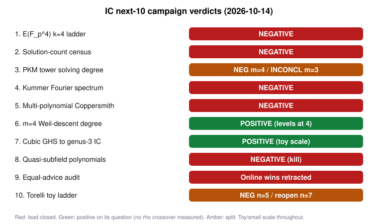

# IC next-10 campaign: results (2026-10-14)

This campaign ran the ten unexecuted index calculus (IC) items ranked in
[`reports/Index calculus leads next steps.md`](../../reports/Index%20calculus%20leads%20next%20steps.md).

- **How it ran:** all ten ran at the same time on one shared 4-vCPU, 15 GB container, under [`RULES.md`](RULES.md): one thread per job, a memory cap per item, and at most 45 minutes per job.
- **What each item holds:** a frozen `PROTOCOL.md`, a `README.md` report with its data, an SVG/PNG graph and a PDF.
- **Benchmarks:** performance items are also copied into `benchmarks/20261014-ic-next10-*`.
- **Verdict labels:** taken from each item's own report.
- **Scale:** every number below comes from toy or small sizes, so read the n = 131 / P-256 implications as extrapolation, not measurement.

| # | Item | Verdict | Headline |
|---|---|---|---|
| 1 | [E(F_{p⁴}) k = 4 ladder](01-fp4-ladder/README.md) | NEGATIVE (no crossover reachable) | **Arms:** • Plain: killed (linear algebra 1.44× rho-negation). • D₄: 18× cheaper than plain, same exponent; handover extrapolated to 2^126–2^137. • Double large primes: changes the exponent (#E^0.333), but its handover only comes near 2^222. **Structure:** cofactor 4 is forced by the D₄ condition. **Verification:** 84/84 IC and 672/672 rho solves verified. |
| 2 | [Solution-count census](02-solution-count/README.md) | NEGATIVE | Every algebraic factor base (Kummer, subgroup, Dickson, torus, small-x) matches a random base within 0.93–1.03×. Counts are fixed by counting for split bases, so the B^{m−1} bar cannot discriminate. |
| 3 | [PKM tower solving degree](03-pkm-degree/README.md) | NEGATIVE (m = 4), INCONCLUSIVE (m = 3) | The m = 4 plateau at 7 breaks: N = 20 reaches D ≥ 8. m = 3 reaches D ≥ 7 at N = 18–24 before the time wall. The `d + δ` conflict is resolved: the bound binds XL (N + 4) but not F4. |
| 4 | [Kummer-tower Fourier spectrum](04-kummer-fourier/README.md) | NEGATIVE | 31 exhaustive cells, all characters. No coefficient beats the permutation or random-base nulls, while a planted bias is detected. C2 is closed. |
| 5 | [Multi-polynomial Coppersmith reach](05-multipoly-lattice/README.md) | NEGATIVE | The best S₅ variant reaches δ* = 0.014 against ≈ 1/5 needed. The 1/32 ceiling holds for top-corner-led lattices; the proof is written, not machine-checked. Shared targets leave an empty window. |
| 6 | [m = 4 Weil-descent degree + equivariant F4](06-equivariant-f4-m4/README.md) | POSITIVE (degree levels off), BLOCKED at (4,5)/(4,6) | F4 degree is 4 at (11,4) and (15,5), where the committed XL degree read 5 to ≥7. The repo model at constant degree 4 puts ECC2K-130 m = 4 at +7.6 bits over rho, before the unmeasured K conversion. A full equivariant pass is bit-identical and 44–73× faster in CPU time. |
| 7 | [Cubic GHS → genus-3 IC](07-cubic-ghs-genus3/README.md) | POSITIVE by the frozen rule, toy scale only | Cost goes as q^1.30 (q^1.38 at larger q) against the rho model's q^1.53. At q = 2^15 IC is still 1.62× the rho model. Extrapolated crossover is q ≈ 2^17–2^19. The plane-quartic branch is blocked. |
| 8 | [Quasi-subfield polynomials](08-quasi-subfield/README.md) | NEGATIVE (kill fires) | At prime n ≤ 61 the best β is 0.964 for n ≥ 11, against < 0.1025 needed. The QSP bases behave like random subspaces once the trace-zero filter is accounted for. |
| 9 | [Equal-advice audit + free relations](09-equal-advice/README.md) | Audit POSITIVE: online wins retracted | Preprocessing rho is 53–317× faster online than IC with equal or smaller advice. The free-relation lever is closed: 49 independent relations against 599 needed. |
| 10 | [Torelli toy ladder](10-torelli-toy/README.md) | NEGATIVE at n = 5 (low power); reopen criterion met at n = 7 | No A_5 carrier in any family through genus 6. At n = 7, genus-7 curves carrying the Weil restriction exist, 2^19× above the heuristic, because 7 has small magic numbers. n = 131 lacks that structure. |

## What changed

1. **Dead or retracted:**
   - algebraic prime-field factor bases (items 2 and 4);
   - quasi-subfield bases (item 8);
   - multi-polynomial Coppersmith (item 5);
   - the online-only Koblitz "wins" (item 9);
   - the PKM degree plateau at m = 4 (item 3).
2. **Moved toward feasibility, still above rho:** the ECC2K-130 m = 4 Weil-descent price. The 106-bit spread collapses to about +7.6 bits once the F4 degree stays at 4 (item 6). The column-touch to group-operation conversion K is now the deciding unknown and should be measured next.
3. **Live, but only in weak classes or with intermediate fields:**
   - cubic GHS → genus-3 (item 7);
   - k = 4 with D₄ (item 1).

   Both extrapolate to beating rho only well beyond the sizes measured.
4. **Structural findings:**
   - D₄ forces the cofactor to 4 (item 1);
   - the committed "rising" degrees were XL artefacts (items 3 and 6);
   - the Torelli heuristic fails exactly where small magic numbers exist (item 10).

## Next steps suggested by the results

- Measure K (column touches per GF(2^131) group operation), and push the m = 4 cells (4,5) and (4,6) on a host with at least 32 GB (item 6).
- Run m = 3 PKM at N = 21–24 on an unloaded host so the time wall is not the limit (item 3).
- Push cubic GHS to q = 2^17–2^20 with a tuned rho (negation map, random multipliers) (item 7).
- Retire the online rows in `docs/ic/LEADERBOARD.md` (item 9; owner decision).

## Caveats that apply to every item

- **Host:** a shared host with load average up to about 25 on 4 cores, isolation level L0. Wall times are descriptive only; operation counts are the measured unit.
- **Python:** items 4, 5, 7 and 10 compute results in Python, which AGENTS.md disallows for research results. Each README flags this.
- **Conductor:** its control plane was unreachable, so no item holds a task card.
