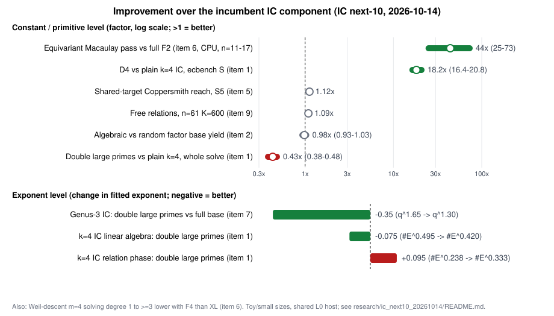

# IC next-10 campaign: improvements measured (2026-10-14)

This campaign ran the ten unexecuted index calculus (IC) items ranked in
[`reports/Index calculus leads next steps.md`](../../reports/Index%20calculus%20leads%20next%20steps.md).

- **How it ran:** all ten ran at the same time on one shared 4-vCPU, 15 GB container, under [`RULES.md`](RULES.md): one thread per job, a memory cap per item, and at most 45 minutes per job.
- **What each item holds:** a frozen `PROTOCOL.md`, a `README.md` report with its data, an SVG/PNG graph and a PDF. Performance items are also copied into `benchmarks/20261014-ic-next10-*`.

**How to read this page.** The question is whether a change improves an IC component on the incumbent IC it replaces: by how much, and at which level (exponent, constant or primitive). Whether IC beats Pollard rho end to end is a different question. The item protocols were frozen with rho-based kill criteria, so each item README still reports those. This summary re-reads the same data as improvements over the incumbent. No new data was collected for it.

## Exponent-level changes

| Item | Component | Incumbent | Candidate | Change | Evidence |
|---|---|---|---|---|---|
| 7 | genus-3 IC after cubic GHS transfer, whole solve | full-factor-base IC: q^1.650 [1.639, 1.660] (ran only up to q = 2^13) | double large primes: q^1.300 [1.292, 1.308]; q^1.377 over q = 2^11–2^15 | **−0.35 in the exponent (−0.27 at the larger sizes)** | 24/24 + 18/18 solves verified, q = 2^8–2^15, 3 curves per size ([07](07-cubic-ghs-genus3/README.md)) |
| 6 | m = 4 Weil-descent decomposition oracle, solving degree | XL / Macaulay refutation degree: 5, 6, 7, ≥7 for ℓ = 1–3 | msolve F4: degree 4 (some draws 3) through (11,4); m = 3 (15,5) also 4, where XL reads ≥7 | **1 to ≥3 degrees lower, with the gap widening in ℓ.** In the repo's n = 131 cost model the decomposition price drops from +21 / +112 bits to +7.6 bits (a model result, before the unmeasured conversion K from column touches to group operations) | 48/48 paired draws with F4 ≤ XL; random-system sensitivity control ([06](06-equivariant-f4-m4/README.md)) |
| 1 | k = 4 IC on E(F_{p⁴}), linear-algebra phase | plain: #E^0.495 | double large primes: #E^0.420 [0.405, 0.440] | **−0.075 on the linear-algebra exponent**, but the relation phase gets worse: 0.238 → 0.333 | 21 curves, p = 101–1033 ([01](01-fp4-ladder/README.md)) |

## Constant-level and primitive-level changes

| Item | Component | Incumbent → candidate | Improvement | Level / note |
|---|---|---|---|---|
| 6 | Macaulay pass on the Frobenius-symmetric barrel system | full F₂ reduction → G2 equivariant pass, now completed, bit-identical result | **44× / 58× / 73× CPU at n = 11 / 13 / 17**; 25–45× with orbit assembly; n = 31 runs (31 s) where the full matrix needs about 21 GB | constant, plus a memory reach gain. Not yet wired into `reduce_system`. |
| 1 | k = 4 IC, whole solve (ecbench counted S) | plain S₄ → D₄-symmetrised | **18.2× [16.4, 20.8]** (paired ratio 0.0548 [0.048, 0.061], 12 workloads); 20–28× across the ladder | constant, same exponent. Relations come from an oracle, with the solver's cost C₄ charged per trial. |
| 1 | k = 4 IC, whole solve | plain → double large primes | **regression: 2.31× [2.10, 2.62] costlier**, and the gap grows with p | trades a constant for an exponent; it would win only from about 2^219 |
| 3 | PKM tower F4 engine (instrument) | `f4_fp_tower`: N = 20 needs more than 14 GB → msolve: three productive degree-8 rounds within 5 GB | at least 2.8× memory reach | instrument. The degree it found is a regression: the plateau at 7 breaks (D ≥ 8). |
| 9 | Relation collection, Koblitz n = 61 | collect every relation → harvest free relations from existing pair tables | 49 independent free relations at K = 600, **8.2 % of the 599 needed** (×1.09 fewer to collect) | constant, small. Full rank would need K ≈ 2,050. |
| 8 | Binary decomposition oracle, m = 2 | full refutation → trace-zero pre-filter (factor base in the trace-zero hyperplane, target with Tr(1/X) = 1) | refutes about 50 % of targets at degree 2, against degree > 4 otherwise | primitive. Generic, not specific to quasi-subfield polynomials; the end-to-end gain was not costed. |
| 5 | Coppersmith reach δ* | single polynomial → shared-target systems | S₅ **1.12×** (0.0125 → 0.0140); S₃ pair 1.05–1.08× per ℓ; LLL gain not significant | primitive, below the 1.5× trigger |
| 2 | Decompositions per target | random factor base → Kummer, subgroup, Dickson, torus, small-x | **0.93–1.03×** | none |
| 4 | Decomposition predictability | random relabelling → any character of the exponent group | none above the null (0/31 cells); planted bias detected | none |
| 8 | Factor base | random subspace → quasi-subfield polynomial bases | yield 0.214 vs 0.204–0.230 (n = 31, k = 15) | none |

Item 10 (the Torelli toy ladder) tests a heuristic and measures no improvement. It found that Weil-restriction carriers do exist at n = 7.

## What to build on

1. **Double large primes in genus-3 IC** (item 7) is the largest measured exponent gain, −0.35. The next step is to stack it with a tuned group law and measure it against the incumbent beyond 2^15.
2. **F4 instead of XL for Weil descent** (item 6) lowers the degree by 1 to at least 3. Measure the conversion K, then push the cells (4,5) and (4,6) on a host with 32 GB or more.
3. **The equivariant pass** (item 6, 44–73×) should be wired into `koblitz_groebner::reduce_system`, then the whole oracle measured against the incumbent in ecbench.
4. **D₄ with double large primes** (item 1). D₄ gives the 18× constant and double large primes the exponent; the stacked arm was not run.
5. **Integrate the trace-zero pre-filter and the free relations** (items 8 and 9) into the incumbent pipeline, and measure them with a paired ecbench spec.

## Caveats

- **Host:** shared, with load average up to about 25 on 4 cores, isolation level L0. Operation counts are the measured unit; wall times are descriptive.
- **Scale:** all sizes are toy or small. Exponent fits rest on 5–8 sizes.
- **Python:** items 4, 5, 7 and 10 compute results in Python, which AGENTS.md disallows for research results.
- **Conductor:** its control plane was unreachable, so no item holds a task card.
