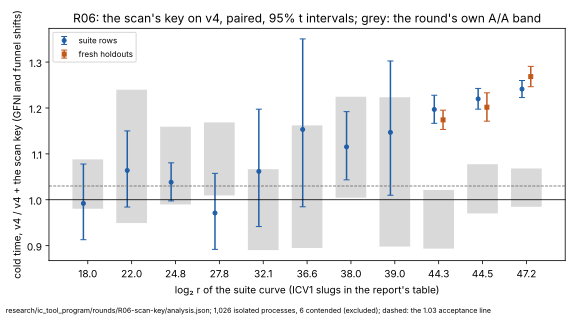

# R06: the scan's canonical key, by GFNI and funnel shifts — results

**Accepted, as baseline v5.** On v4 (main at `92246530`), the scan's key by
GFNI and funnel shifts makes cold time **1.197×, 1.220× and 1.241× faster**
at `2^44.3`, `2^44.5` and `2^47.2` on the suite rows, and **1.174×, 1.202×
and 1.268×** on fresh holdouts no run had seen. Every interval lies above the
declared 1.03, and every figure is above the prediction. The candidate gives
v0's outputs on all 90 pinned rows. The class is **engineering** (AGENTS.md
§3): the keys are identical by construction and by test, so every count is
unchanged and the ratio to the floor is flat. This is the programme's own
lever, the first measured gain over v4.

Declared in [`PROTOCOL.md`](PROTOCOL.md) (2026-10-06), with amendment 1 (the
class, 2026-10-07) and amendment 2 (ported onto v4, 2026-10-16, before any
run).

PDF: [`report/report.pdf`](report/report.pdf). Analysis:
[`analysis.json`](analysis.json) (`icprog analyse r06`).

## What ran

- **Host:** `Intel(R) Xeon(R) Processor @ 2.10GHz` (Emerald Rapids, family 6
  model 207), 4 logical cores, 16 GB, kernel build `6.18.44-fc-v139`, AVX-512
  with BW, VBMI, VBMI2, GFNI and VPCLMULQDQ (R06's class; `icprog host-class
  r06` finds nothing missing). Every timed process `ic price
  --single-target`, isolated on CPU 2 by the native `isolated_bench`,
  `RAYON_NUM_THREADS=1`.
- **Arms:** v4 (`92246530`, SHA-256 `d8daac9a…`) and v4 plus
  [`candidate-v4.patch`](candidate-v4.patch) (SHA-256 `31982fde…`), both
  `rustc 1.97.0` with main's lock.
- **Steps, 2026-10-16 UTC:**

| step | when | processes | contended (re-run) | failed |
|:--|:--|--:|--:|--:|
| the tests (`koblitz_fast`, on the candidate's tree) | 07:47 | 36 passed | — | 0 |
| the pin, untimed: the candidate | 07:50–07:54 | 90 | — | 0 |
| the A/A, v4 against a byte-identical copy | 07:54–08:45 | 223 | 3 | 0 |
| the suite rows, rounds 1–5, and rounds 6–10 at `2^44.5` | 08:45–10:08, 10:51–11:17 | 483 | 3 | 0 |
| the holdouts, rounds 1–5, and rounds 6–10 at `2^44.3` | 10:08–10:51, 10:51–11:17 | 320 | 0 | 0 |

- **One container restart** (about 09:40), on the same CPU model and kernel
  build. The resume wrote `manifest-resumed` (`runs/host-resumed.json`),
  re-read the pin and the A/A from disk, and resumed the suite rows; a
  process the restart cut short left no record and ran again.
- **The extension:** after five rounds the suite rows at `2^44.5` and the
  holdouts at `2^44.3` had half-widths above 3% (3.1% and 3.2%), so they ran
  rounds 6–10, pooled.

## Results

Cold time, base over candidate (above 1, the candidate is faster), the
geometric mean of paired ratios with its 95% t interval; `S` is cold time
in v0's unit.

**The suite rows** (two rows at the eight smaller sizes, eight at the three
target sizes):

| curve | `log₂ r` | rows | cold [95%] | collection stage | rho online | `S` cold, v4 → v5 | the round's A/A, cold |
|:--|--:|--:|--:|--:|--:|--:|--:|
| `icv1-f2m19-tm797-9c54981b` | 18.002 | 2 | 0.992 [0.913, 1.078] | 0.992 | 1.018 | 124.95 → 118.2 | 1.033 [0.98, 1.088] |
| `icv1-f2m23-tm5197-1f85e9e1` | 22.001 | 2 | 1.064 [0.984, 1.15] | 1.062 | 0.997 | 32.48 → 31.93 | 1.085 [0.949, 1.24] |
| `icv1-f2m45-tm6236725-40939294` | 24.803 | 2 | 1.038 [0.998, 1.081] | 1.063 | 1.036 | 19.91 → 19.61 | 1.071 [0.99, 1.159] |
| `icv1-f2m37-tm534059-32aad96b` | 27.781 | 2 | 0.971 [0.892, 1.058] | 1.009 | 0.955 | 9 → 9.02 | 1.086 [1.009, 1.169] |
| `icv1-f2m43-tm998717-e2e742b0` | 32.113 | 2 | 1.062 [0.942, 1.197] | 1.104 | 0.993 | 5.26 → 4.96 | 0.975 [0.89, 1.067] |
| `icv1-f2m47-t22705043-f4e44623` | 36.636 | 2 | 1.153 [0.985, 1.35] | 1.26 | 1.016 | 3.91 → 3.28 | 1.02 [0.895, 1.162] |
| `icv1-f2m57-tm747311035-c1f545af` | 38.002 | 2 | 1.115 [1.043, 1.192] | 1.215 | 0.899 | 4.04 → 3.57 | 1.109 [1.005, 1.225] |
| `icv1-f2m41-tm2308219-7f48b14a` | 39.0 | 2 | 1.147 [1.01, 1.302] | 1.196 | 0.928 | 5.08 → 4.53 | 1.048 [0.898, 1.223] |
| `icv1-f2m53-tm56619371-dac20a85` | 44.259 | 8 | 1.197 [1.167, 1.228] | 1.255 | 1 | 6.34 → 5.28 | 0.955 [0.894, 1.021] |
| `icv1-f2m59-tm943548413-98844ecc` | 44.517 | 8 | 1.22 [1.197, 1.243] | 1.302 | 0.99 | 5.73 → 4.68 | 1.022 [0.97, 1.077] |
| `icv1-f2m61-t158598901-ab42b6c5` | 47.211 | 8 | 1.241 [1.223, 1.26] | 1.283 | 1.027 | 8.33 → 6.77 | 1.026 [0.985, 1.068] |

**The fresh holdouts** (seeds 218–221, `T127`–`T134`, eight rows a size):

| curve | `log₂ r` | rows | pairs | cold [95%] | collection stage | rho online | `S` cold, v4 → v5 |
|:--|--:|--:|--:|--:|--:|--:|--:|
| `icv1-f2m53-tm56619371-dac20a85` | 44.259 | 8 | 80 | 1.174 [1.153, 1.195] | 1.229 | 0.955 | 6.04 → 5.21 |
| `icv1-f2m59-tm943548413-98844ecc` | 44.517 | 8 | 40 | 1.202 [1.171, 1.233] | 1.259 | 1.006 | 5.6 → 4.58 |
| `icv1-f2m61-t158598901-ab42b6c5` | 47.211 | 8 | 40 | 1.268 [1.246, 1.291] | 1.302 | 0.998 | 8.08 → 6.33 |

- **The gain is the collection's.** Collection ran 1.255×, 1.302× and
  1.283× faster at the three target sizes, where it is most of cold time;
  rho's online interval, which the candidate does not touch, reads 0.96–1.03.
- **The smaller sizes** read 0.97–1.15. Below `2^36` the key is a small share
  of cold time and the intervals straddle 1; from `2^38` up they lie above it.
  No size regresses beyond its A/A band.
- **Against the prediction:** 1.08–1.15×, 1.07–1.13× and 1.15–1.22× were
  predicted from the explorations on v3; the round measured more at every
  size. The explorations ran five or six pairs on another kernel build; the
  round's intervals are the record.
- **Runs hours apart differ.** v4's `S` at the target sizes in these runs
  (6.34, 5.73 and 8.33) sits 8–11% above its `S` in R10's runs (5.72, 5.18
  and 7.65). The ratios are paired within a run and are unaffected; `S`
  across rounds is read with that in mind.

## What it decides

- **v5 is v4 plus R06's key** (`baselines.json`, `baseline.meta.json`). On
  hosts without GFNI and VBMI2 v5 runs v4's code; no claim is made there.
- **The distance to matched rho is not re-measured here.** The rule's
  comparison at v3 left rho 13.2×, 12.0× and 21.0× faster cold at the three
  largest sizes, and v4 costs about what v3 costs (R10). A rule run at v5
  re-measures it; dividing the old ratios by R06's gains is not a
  measurement.
- **R08 is next.** It is declared on v3 for this class and changes the scan's
  subtraction; an amendment ports it onto v5 before any run.

## Files

| file | what it holds |
|:--|:--|
| [`PROTOCOL.md`](PROTOCOL.md) | the declaration and amendments 1–2 |
| [`candidate.patch`](candidate.patch), [`candidate-v4.patch`](candidate-v4.patch) | the candidate on v3, and ported onto v4 (the same lines) |
| [`tests.log`](tests.log) | the candidate's tests |
| [`analysis.json`](analysis.json) | `icprog analyse r06` |
| [`run.sh`](run.sh), [`run.log`](run.log) | the driver and its log |
| [`runs.tar.xz`](runs.tar.xz) | every run tree (SHA-256 in `runs.tar.xz.sha256`) |
| [`baseline.meta.json`](baseline.meta.json) | v5's record |
| [`report/`](report/) | the graph (SVG, PNG), its script and the PDF |
| [`holdouts/`](holdouts/) | the fresh holdouts (`SHA256SUMS`) |
