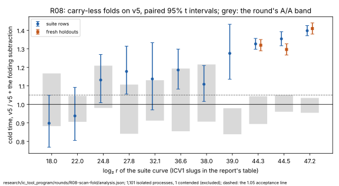

# R08: the scan's subtraction by carry-less folds — results

**Accepted, as baseline v6.** On v5 (v4 plus R06's scan key), reducing the
scan's products by two carry-less folds makes cold time **1.326×, 1.354× and
1.398× faster** at `2^44.3`, `2^44.5` and `2^47.2` on the suite rows, and
**1.319×, 1.296× and 1.409×** on fresh holdouts no run had seen. Every
interval lies above the declared 1.05. The candidate gives v0's outputs on all
90 pinned rows. The class is **engineering** (AGENTS.md §3): the field
elements are identical by construction and by test, so every count is
unchanged and the ratio to the floor is flat. It is the programme's own
lever, the second in a row after R06.

**Chained with R06**, the scan is now 1.59×, 1.65× and 1.73× faster cold than
v4 at the three target sizes: the product of the two rounds' paired ratios,
each measured against its own base. That product is arithmetic on two
measurements, not a third one.

Declared in [`PROTOCOL.md`](PROTOCOL.md) (2026-10-06), with amendment 1
(ported onto v5, 2026-10-16, before any run).

PDF: [`report/report.pdf`](report/report.pdf). Analysis:
[`analysis.json`](analysis.json) (`icprog analyse r08`).

## What ran

- **Host:** the Emerald Rapids of R10 and R06 (`Intel(R) Xeon(R) Processor
  @ 2.10GHz`, family 6 model 207, 4 logical cores, 16 GB, kernel build
  `6.18.44-fc-v139`), in R08's class (`icprog host-class r08` finds nothing
  missing). Every timed process `ic price --single-target`, isolated on CPU 2
  by the native `isolated_bench`, `RAYON_NUM_THREADS=1`.
- **Arms:** v5 (SHA-256 `31982fde…`, the binary R06 measured) and v5 plus
  [`candidate-v5.patch`](candidate-v5.patch) (SHA-256 `4ccb1951…`), both
  `rustc 1.97.0` with main's lock.
- **Steps, 2026-10-16 UTC:**

| step | when | processes | contended (re-run) | failed |
|:--|:--|--:|--:|--:|
| the tests (`koblitz_fast`, `koblitz_index_calculus`, on the candidate's tree) | 11:48 | 206 passed | — | 0 |
| the pin, untimed: the candidate | 11:51–11:54 | 90 | — | 0 |
| the A/A, v5 against a byte-identical copy | 11:54–12:44 | 220 | 0 | 0 |
| the suite rows, rounds 1–5, and rounds 6–10 at `2^44.3` | 12:44–14:05, 14:47–15:25 | 481 | 1 | 0 |
| the holdouts, rounds 1–5, and rounds 6–10 at `2^44.3` and `2^44.5` | 14:05–14:47, 14:47–15:25 | 400 | 0 | 0 |

- **One relaunch** (13:51): the session task running the driver reached its
  two-hour limit. The container did not change; the driver resumed the run
  tree from disk, and a process the stop cut short left no record and ran
  again.
- **The extension:** after five rounds the suite rows at `2^44.3` (half-width
  3.2%) and the holdouts at `2^44.3` and `2^44.5` (3.7% and 4.1%) ran rounds
  6–10, pooled.

## Results

Cold time, base over candidate (above 1, the candidate is faster), the
geometric mean of paired ratios with its 95% t interval; `S` is cold time
in v0's unit.

**The suite rows** (two rows at the eight smaller sizes, eight at the three
target sizes):

| curve | `log₂ r` | rows | cold [95%] | collection stage | rho online | `S` cold, v5 → v6 | the round's A/A, cold |
|:--|--:|--:|--:|--:|--:|--:|--:|
| `icv1-f2m19-tm797-9c54981b` | 18.002 | 2 | 0.898 [0.769, 1.049] | 0.957 | 0.989 | 129.11 → 141.28 | 1.015 [0.883, 1.167] |
| `icv1-f2m23-tm5197-1f85e9e1` | 22.001 | 2 | 0.938 [0.805, 1.092] | 1.011 | 0.963 | 33.64 → 35.74 | 0.973 [0.906, 1.045] |
| `icv1-f2m45-tm6236725-40939294` | 24.803 | 2 | 1.131 [1.009, 1.269] | 1.224 | 1.096 | 24 → 20.75 | 1.089 [0.98, 1.209] |
| `icv1-f2m37-tm534059-32aad96b` | 27.781 | 2 | 1.178 [1.055, 1.314] | 1.228 | 1.087 | 11.31 → 9.12 | 0.965 [0.841, 1.107] |
| `icv1-f2m43-tm998717-e2e742b0` | 32.113 | 2 | 1.137 [0.97, 1.333] | 1.222 | 1.016 | 5.42 → 4.58 | 1.015 [0.912, 1.13] |
| `icv1-f2m47-t22705043-f4e44623` | 36.636 | 2 | 1.185 [1.082, 1.298] | 1.401 | 0.997 | 3.27 → 2.76 | 1.01 [0.855, 1.193] |
| `icv1-f2m57-tm747311035-c1f545af` | 38.002 | 2 | 1.108 [1.016, 1.21] | 1.235 | 1.021 | 3.59 → 3.44 | 1.05 [0.906, 1.215] |
| `icv1-f2m41-tm2308219-7f48b14a` | 39.0 | 2 | 1.275 [1.135, 1.432] | 1.429 | 0.964 | 4.66 → 3.67 | 0.906 [0.838, 0.979] |
| `icv1-f2m53-tm56619371-dac20a85` | 44.259 | 8 | 1.326 [1.297, 1.356] | 1.468 | 1.003 | 5.48 → 4.12 | 0.966 [0.894, 1.044] |
| `icv1-f2m59-tm943548413-98844ecc` | 44.517 | 8 | 1.354 [1.316, 1.392] | 1.529 | 1.027 | 5.19 → 3.9 | 1.004 [0.96, 1.051] |
| `icv1-f2m61-t158598901-ab42b6c5` | 47.211 | 8 | 1.398 [1.37, 1.425] | 1.486 | 1.032 | 7.08 → 5.02 | 0.994 [0.954, 1.034] |

**The fresh holdouts** (seeds 222–225, `T135`–`T142`, eight rows a size):

| curve | `log₂ r` | rows | pairs | cold [95%] | collection stage | rho online | `S` cold, v5 → v6 |
|:--|--:|--:|--:|--:|--:|--:|--:|
| `icv1-f2m53-tm56619371-dac20a85` | 44.259 | 8 | 80 | 1.319 [1.289, 1.35] | 1.486 | 0.964 | 5.25 → 3.94 |
| `icv1-f2m59-tm943548413-98844ecc` | 44.517 | 8 | 80 | 1.296 [1.266, 1.327] | 1.472 | 0.976 | 4.99 → 3.83 |
| `icv1-f2m61-t158598901-ab42b6c5` | 47.211 | 8 | 40 | 1.409 [1.379, 1.44] | 1.497 | 1.013 | 6.92 → 4.96 |

- **The gain is the collection's.** Collection ran 1.47–1.53× faster at the
  three target sizes. Rho's online interval, which the candidate does not
  touch, reads 0.96–1.03.
- **Against the prediction** (1.25–1.33×, 1.16–1.29× and 1.27–1.46×):
  `2^44.3` and `2^47.2` landed inside it, and `2^44.5` above it on the suite
  rows (1.354) and just above it on the holdouts (1.296).
- **The smaller sizes.** From `2^24.8` up every point estimate is above 1
  (1.11–1.28). At `2^18.0` and `2^22.0` the estimates read 0.898 and 0.938, with
  intervals of ±14–15% that reach above 1. Neither regresses beyond the A/A
  rule, whose bands there are 0.883–1.167 and 0.906–1.045. At those sizes
  cold time is mostly the curve's set-up, and a few milliseconds of fixed
  cost would show; this round cannot tell such a cost from noise, and a
  diagnostic there is the next thing to look at.

## What it decides

- **v6 is v5 plus R08's folds** (`baselines.json`, `baseline.meta.json`). On
  hosts without AVX-512F and VPCLMULQDQ, and in fields that do not fold, v6
  runs v5's code; no claim is made there.
- **The distance to matched rho is not re-measured here.** The rule at v3
  left rho 13.2×, 12.0× and 21.0× faster cold at the three largest sizes.
  Since then v4 moved by about 1% (R10), and R06 and R08 together by
  1.59–1.73×. A rule run at v6 is the measurement, and it is the next thing
  the programme owes: dividing the old ratios by these gains is not one.

## Files

| file | what it holds |
|:--|:--|
| [`PROTOCOL.md`](PROTOCOL.md) | the declaration and amendment 1 |
| [`candidate.patch`](candidate.patch), [`candidate-v5.patch`](candidate-v5.patch) | the candidate on R06's candidate over v3, and ported onto v5 (the same lines) |
| [`tests.log`](tests.log) | the candidate's tests |
| [`analysis.json`](analysis.json) | `icprog analyse r08` |
| [`run.sh`](run.sh), [`run.log`](run.log) | the driver and its log |
| [`runs.tar.xz`](runs.tar.xz) | every run tree (SHA-256 in `runs.tar.xz.sha256`) |
| [`baseline.meta.json`](baseline.meta.json) | v6's record |
| [`report/`](report/) | the graph (SVG, PNG), its script and the PDF |
| [`holdouts/`](holdouts/) | the fresh holdouts (`SHA256SUMS`) |
