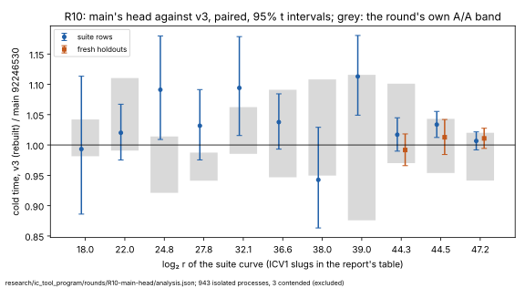

# R10: the programme re-based on main's head, again — results

**Accepted, as baseline v4.** Main's head (`92246530`) gives v0's outputs on
every pinned row, as the rebuilt v3 does, and costs what v3 costs: at the
three target sizes cold time is within about 3% of v3 on the suite rows and
on the fresh holdouts, and no size regresses beyond the round's own A/A band.
The class is **engineering** (by AGENTS.md §3): the counts are identical, so
the ratio to the floor is flat, and nothing here is a lever of the
programme's. Declared in [`PROTOCOL.md`](PROTOCOL.md) (#1948).

PDF: [`report/report.pdf`](report/report.pdf). Analysis:
[`analysis.json`](analysis.json) (`icprog analyse r10`).

## What ran

- **Host:** `Intel(R) Xeon(R) Processor @ 2.10GHz` (Emerald Rapids, family 6
  model 207), 4 logical cores, 16 GB, kernel build `6.18.44-fc-v139`, AVX-512
  with VBMI2, GFNI and VPCLMULQDQ (the reference class); `rustc 1.97.0` for
  both arms. Every timed process `ic price --single-target`, isolated on
  CPU 2 by the native `isolated_bench`, `RAYON_NUM_THREADS=1`.
- **Arms:** v3 rebuilt from `995ea207` (SHA-256 `00cff0b0…`) and main at
  `92246530` (SHA-256 `d8daac9a…`), as declared.
- **Steps, 2026-10-16 UTC:**

| step | when | processes | contended (re-run) | failed |
|:--|:--|--:|--:|--:|
| the tests (`koblitz_fast`, `koblitz_index_calculus`, `semaev_decomp`) | 01:54 | 232 passed | — | 0 |
| the pins, untimed: main, then the rebuilt v3 | 01:58–02:08 | 180 | — | 0 |
| the A/A, the base against a byte-identical copy | 02:08–04:43 | 222 | 2 | 0 |
| the suite rows, rounds 1–5 | 04:43–06:06 | 400 | 0 | 0 |
| the holdouts, rounds 1–5, and rounds 6–10 at `2^44.5` | 06:06–07:02 | 321 | 1 | 0 |
| the callgrind cross-check, untimed | 07:02–07:29 | 4 | — | 0 |

- **Three container restarts** (about 02:30, 03:05 and 04:05), each on the
  same CPU model and kernel build; each resume wrote `manifest-resumed`
  (`runs/host-resumed*.json`) and resumed the run tree. A process a restart
  cut short left no record and ran again. The cause was the container being
  suspended while the session sat idle; from 04:05 the round ran as a
  session-tracked task and the container stayed up.
- **The extension:** after five rounds only the holdouts at
  `icv1-f2m59-tm943548413-98844ecc` had a half-width above 3%, so they alone
  ran rounds 6–10, pooled.

## Results

Cold time, base over candidate (above 1, main is faster), the geometric mean
of paired ratios with its 95% t interval; `S` is cold time in v0's unit.

**The suite rows** (two rows at the eight smaller sizes, eight at the three
target sizes; five rounds):

| curve | `log₂ r` | rows | cold [95%] | collection stage | rho online | `S` cold, v3 → main | the round's A/A, cold |
|:--|--:|--:|--:|--:|--:|--:|--:|
| `icv1-f2m19-tm797-9c54981b` | 18.002 | 2 | 0.993 [0.886, 1.113] | 0.942 | 0.913 | 122.33 → 117.22 | 1.011 [0.981, 1.042] |
| `icv1-f2m23-tm5197-1f85e9e1` | 22.001 | 2 | 1.02 [0.975, 1.067] | 1.009 | 0.945 | 31.86 → 30.68 | 1.049 [0.991, 1.11] |
| `icv1-f2m45-tm6236725-40939294` | 24.803 | 2 | 1.091 [1.009, 1.18] | 1.039 | 1.015 | 20.02 → 18.3 | 0.966 [0.921, 1.014] |
| `icv1-f2m37-tm534059-32aad96b` | 27.781 | 2 | 1.032 [0.975, 1.091] | 0.999 | 1.003 | 9.05 → 8.59 | 0.964 [0.941, 0.987] |
| `icv1-f2m43-tm998717-e2e742b0` | 32.113 | 2 | 1.094 [1.016, 1.179] | 1.067 | 1.067 | 5.16 → 4.92 | 1.023 [0.985, 1.062] |
| `icv1-f2m47-t22705043-f4e44623` | 36.636 | 2 | 1.038 [0.993, 1.084] | 0.998 | 1.01 | 3.46 → 3.32 | 1.016 [0.947, 1.091] |
| `icv1-f2m57-tm747311035-c1f545af` | 38.002 | 2 | 0.943 [0.863, 1.029] | 0.908 | 0.973 | 3.78 → 3.99 | 1.026 [0.95, 1.108] |
| `icv1-f2m41-tm2308219-7f48b14a` | 39.0 | 2 | 1.113 [1.049, 1.181] | 1.098 | 1.043 | 4.94 → 4.55 | 0.989 [0.876, 1.116] |
| `icv1-f2m53-tm56619371-dac20a85` | 44.259 | 8 | 1.017 [0.99, 1.045] | 1.004 | 1.021 | 5.84 → 5.72 | 1.034 [0.97, 1.101] |
| `icv1-f2m59-tm943548413-98844ecc` | 44.517 | 8 | 1.034 [1.012, 1.055] | 1.038 | 1.036 | 5.48 → 5.18 | 0.997 [0.954, 1.043] |
| `icv1-f2m61-t158598901-ab42b6c5` | 47.211 | 8 | 1.007 [0.992, 1.022] | 1.01 | 0.996 | 7.71 → 7.65 | 0.98 [0.941, 1.02] |

**The fresh holdouts** (seeds 230–233, `T151`–`T158`):

| curve | `log₂ r` | rounds | pairs | cold [95%] | collection stage | rho online |
|:--|--:|--:|--:|--:|--:|--:|
| `icv1-f2m53-tm56619371-dac20a85` | 44.259 | 5 | 40 | 0.992 [0.966, 1.018] | 0.987 | 0.996 |
| `icv1-f2m59-tm943548413-98844ecc` | 44.517 | 10 | 80 | 1.013 [0.984, 1.042] | 1.013 | 1.013 |
| `icv1-f2m61-t158598901-ab42b6c5` | 47.211 | 5 | 40 | 1.011 [0.994, 1.028] | 1.016 | 1.021 |

- **No size regresses beyond its A/A band** (`regresses_beyond_aa` is false
  at every size), so the decision holds by the declared rule.
- **The target sizes:** 1.017, 1.034 and 1.007 on the suite rows, 0.992,
  1.013 and 1.011 on the holdouts. Only the suite rows at `2^44.5` have an
  interval wholly above 1, by 1–6%. The diagnostic's 0.95 at `2^47.2` was
  noise.
- **The smaller sizes** read 0.94–1.11 with wider intervals (two rows each);
  `2^24.8`, `2^32.1` and `2^39.0` lie above 1, none below.
- **Distance to rho:** this round prices the index calculus against v3, not
  against rho; the matched-rho distance at v4 is the rule's comparison's
  (plan §5), which a later round re-runs on v4. `S` at the three target sizes
  is 5.72, 5.18 and 7.65 on the suite rows.

**The callgrind cross-check** (`M1-T01` at `2^44.3` and `2^47.2`, untimed,
portable paths, since valgrind hides AVX-512): both arms recover the same
logarithm at both rows (held). Main executes 1.26× and 1.45× fewer
instructions there. The profiles are consistent with two of the drift's
commits: the batched inversion no longer zeroes its scratch (`a8f4bb60`;
`memset` falls from 258.6 M to 113.9 M instructions at `2^44.3`), and the
portable key path keys orbits in lockstep lanes (`a98ba95a`;
`canon_in_place` is among the functions that differ). The timed runs take
the AVX-512 key path, which the second does not touch; the timed ratios are
flat.

## What it decides

- **v4 is main at `92246530`** (`baselines.json`, `baseline.meta.json`),
  beside v3's rebuilt `S` from the same runs.
- **R06 is next:** its amendment ports the candidate onto v4 before any
  run, on this host, which is of its class; R08 follows R06's decision.
- **Scope:** one host, the reference class, one core. No claim for other
  classes; R09's class (AVX-512 without VPCLMULQDQ) is untested at v4.

## Files

| file | what it holds |
|:--|:--|
| `PROTOCOL.md` | the declaration (#1948) |
| `analysis.json` | `icprog analyse r10` |
| `baseline.meta.json` | v4's ledger entry, as appended to `baselines.json` |
| `tests.log` | the tests before any timed step |
| `run.sh`, `run.log` | the driver and its log, with every resume |
| `runs.tar.xz` | every run tree (`runs/`, `base-pin/`), SHA-256 in `runs.tar.xz.sha256` |
| `holdouts/` | the fresh holdouts and their `SHA256SUMS` |
| `report/` | the graph (`cold-ratio.svg`, `.png`, its `plot.py`) and the PDF (`report.typ`, `report.pdf`) |
