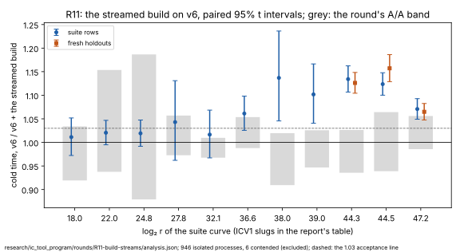

# R11: the pair-table build by partition streams and per-run filters — results

**Accepted, as baseline v7.** On v6, streaming each pair into its partition
and keeping a presence filter per run makes cold time **1.134×, 1.124× and
1.071× faster** at `2^44.3`, `2^44.5` and `2^47.2` on the suite rows. On
fresh holdouts no run had seen it is **1.126×, 1.157× and 1.065×**.
- **Acceptance:** every interval lies above the declared 1.03.
- **The build phase itself is 1.50–1.51× faster.** Collection is unchanged.
- **Outputs:** the candidate gives v0's outputs on all 90 pinned rows.
- **Class: engineering** (AGENTS.md §3). The table is word for word the
  same, by construction and by test, so every count is unchanged and the
  ratio to the floor is flat.

This is the programme's third lever in a row. **Chained with R06 and R08,**
cold time is **1.80×, 1.86× and 1.86× faster than v4** at the three target
sizes. That is the product of three paired ratios, each against its own
base; it is arithmetic, not a fourth measurement.

Declared in [`PROTOCOL.md`](PROTOCOL.md) (2026-10-16), with amendment 1 (the
candidate's binary and tests, before any run).

PDF: [`report/report.pdf`](report/report.pdf). Analysis:
[`analysis.json`](analysis.json) (`icprog analyse r11`).

## What ran

- **Host:** the Emerald Rapids of R10, R06, R08 and the rule at v6
  (`Intel(R) Xeon(R) Processor @ 2.10GHz`, family 6 model 207, 4 logical
  cores, 16 GB, kernel build `6.18.44-fc-v139`), in R11's class.
- **Each timed process:** `ic price --single-target`, isolated on CPU 2 by
  the native `isolated_bench`, `RAYON_NUM_THREADS=1`.
- **Arms:**
  - v6 (SHA-256 `4ccb1951…`, the binary R08 measured);
  - v6 plus [`candidate-v6.patch`](candidate-v6.patch) (SHA-256
    `85116c2a…`).

  Both were built with `rustc 1.97.0` and main's lock.
- **Steps, 2026-10-16 UTC:**

| step | when | processes | contended (re-run) | failed |
|:--|:--|--:|--:|--:|
| the tests (`koblitz_fast`, `koblitz_index_calculus`, on the candidate's tree) | 17:22 | 207 passed | — | 0 |
| the pin, untimed: the candidate | 17:28–17:32 | 90 | — | 0 |
| the A/A, v6 against a byte-identical copy | 17:32–18:24 | 224 | 4 | 0 |
| the suite rows, rounds 1–5 | 18:24–19:49 | 401 | 1 | 0 |
| the holdouts, rounds 1–5, and rounds 6–10 at `2^44.3` | 19:49–20:47 | 321 | 1 | 0 |

- **One relaunch** (19:29). The session task running the driver reached its
  two-hour limit. The container did not change. The driver resumed the run
  tree from disk, and a process the stop cut short left no record and ran
  again.
- **The extension:** after five rounds only the holdouts at `2^44.3` had a
  half-width above 3% (3.3%), so they alone ran rounds 6–10, pooled.

## Results

Cold time, base over candidate (above 1, the candidate is faster): the
geometric mean of paired ratios, with its 95% t interval. `S` is cold time
in v0's unit.

**The suite rows** (two rows at the eight smaller sizes, eight at the three
target sizes):

| curve | `log₂ r` | rows | cold [95%] | collection stage | rho online | `S` cold, v6 → v7 | the round's A/A, cold |
|:--|--:|--:|--:|--:|--:|--:|--:|
| `icv1-f2m19-tm797-9c54981b` | 18.002 | 2 | 1.011 [0.972, 1.052] | 0.795 | 1.341 | 124.09 → 122.43 | 0.975 [0.919, 1.034] |
| `icv1-f2m23-tm5197-1f85e9e1` | 22.001 | 2 | 1.021 [0.995, 1.047] | 1.005 | 1.046 | 32.33 → 31.42 | 1.04 [0.938, 1.154] |
| `icv1-f2m45-tm6236725-40939294` | 24.803 | 2 | 1.019 [0.992, 1.047] | 0.982 | 0.997 | 19.77 → 19.38 | 1.021 [0.879, 1.187] |
| `icv1-f2m37-tm534059-32aad96b` | 27.781 | 2 | 1.043 [0.962, 1.131] | 1.015 | 1.018 | 8.91 → 8.44 | 1.014 [0.973, 1.057] |
| `icv1-f2m43-tm998717-e2e742b0` | 32.113 | 2 | 1.017 [0.967, 1.068] | 0.999 | 0.998 | 4.57 → 4.5 | 0.988 [0.968, 1.01] |
| `icv1-f2m47-t22705043-f4e44623` | 36.636 | 2 | 1.061 [1.026, 1.098] | 1.003 | 1.021 | 2.53 → 2.4 | 1.02 [0.988, 1.054] |
| `icv1-f2m57-tm747311035-c1f545af` | 38.002 | 2 | 1.137 [1.046, 1.236] | 1.049 | 1.148 | 2.91 → 2.62 | 0.963 [0.909, 1.02] |
| `icv1-f2m41-tm2308219-7f48b14a` | 39.0 | 2 | 1.102 [1.041, 1.166] | 0.981 | 1.012 | 3.38 → 3.1 | 0.986 [0.947, 1.026] |
| `icv1-f2m53-tm56619371-dac20a85` | 44.259 | 8 | 1.134 [1.107, 1.162] | 1.014 | 1.03 | 3.87 → 3.48 | 0.98 [0.936, 1.026] |
| `icv1-f2m59-tm943548413-98844ecc` | 44.517 | 8 | 1.124 [1.1, 1.148] | 0.982 | 0.991 | 3.53 → 3.11 | 1 [0.939, 1.064] |
| `icv1-f2m61-t158598901-ab42b6c5` | 47.211 | 8 | 1.071 [1.049, 1.093] | 1.011 | 1 | 4.82 → 4.51 | 1.02 [0.986, 1.056] |

**The fresh holdouts** (seeds 234–237, `T159`–`T166`, eight rows a size):

| curve | `log₂ r` | rows | pairs | cold [95%] | collection stage | rho online | `S` cold, v6 → v7 |
|:--|--:|--:|--:|--:|--:|--:|--:|
| `icv1-f2m53-tm56619371-dac20a85` | 44.259 | 8 | 80 | 1.126 [1.104, 1.148] | 1.002 | 0.986 | 3.83 → 3.38 |
| `icv1-f2m59-tm943548413-98844ecc` | 44.517 | 8 | 40 | 1.157 [1.129, 1.186] | 1.015 | 0.994 | 3.72 → 3.15 |
| `icv1-f2m61-t158598901-ab42b6c5` | 47.211 | 8 | 40 | 1.065 [1.048, 1.083] | 1.003 | 0.993 | 4.57 → 4.26 |

**The build phase**, the median over every repetition of each arm's suite
runs:

| curve | `log₂ r` | v6, ms | v7, ms | faster |
|:--|--:|--:|--:|--:|
| `icv1-f2m53-tm56619371-dac20a85` | 44.3 | 187.1 | 124.5 | 1.50× |
| `icv1-f2m59-tm943548413-98844ecc` | 44.5 | 190.4 | 126.3 | 1.51× |
| `icv1-f2m61-t158598901-ab42b6c5` | 47.2 | 331.1 | 219.0 | 1.51× |

- **The gain is the build's.** The build ran 1.50–1.51× faster at the target
  sizes. Collection reads 0.98–1.02. Rho's online interval, which the
  candidate does not touch, reads 0.99–1.03.
- **Against the prediction** (1.08–1.12×, 1.08–1.12× and 1.04–1.07×):
  - `2^47.2` landed inside it on both sets.
  - `2^44.3` and `2^44.5` landed just above it on the suite rows, and
    `2^44.5` above it on the holdouts (1.157).
  - The build gained a little more than the exploration's 1.40–1.47×.
- **The smaller sizes** read 1.01–1.14. From `2^36.6` up every interval lies
  above 1. No size regresses beyond its A/A band.

## What it decides

- **v7 is v6 plus R11's build** (`baselines.json`, `baseline.meta.json`).
  It needs no CPU feature, so it runs on every host. The claim is made for
  the reference class, where it was measured.
- **The distance to matched rho is not re-measured here.** The rule at v6
  left rho 7.90×, 7.40× and 12.06× faster cold at the three largest sizes.
  A rule run at v7 is the measurement; dividing those ratios by this round's
  gains is not one.

## Files

| file | what it holds |
|:--|:--|
| [`PROTOCOL.md`](PROTOCOL.md) | the declaration and amendment 1 |
| [`candidate-v6.patch`](candidate-v6.patch) | the exploration's build patch, ported onto v6 (the same lines) |
| [`tests.log`](tests.log) | the candidate's tests |
| [`analysis.json`](analysis.json) | `icprog analyse r11` |
| [`run.sh`](run.sh), [`run.log`](run.log) | the driver and its log |
| [`runs.tar.xz`](runs.tar.xz) | every run tree (SHA-256 in `runs.tar.xz.sha256`) |
| [`baseline.meta.json`](baseline.meta.json) | v7's record |
| [`report/`](report/) | the graph (SVG, PNG), its script and the PDF |
| [`holdouts/`](holdouts/) | the fresh holdouts (`SHA256SUMS`) |
