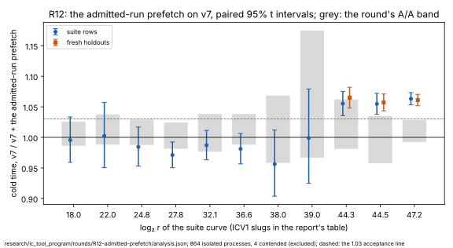

# R12: the collection scan's admitted keys, their runs prefetched — results

**Accepted, as baseline v8.** On v7, a second pass that prefetches each
admitted key's run makes cold time **1.055×, 1.055× and 1.063× faster** at
`2^44.3`, `2^44.5` and `2^47.2` on the suite rows, and **1.065×, 1.057×
and 1.061×** on fresh holdouts.
- **Acceptance:** every interval lies above the declared 1.03.
- **Collection** runs 1.08–1.11× faster at those sizes. The candidate
  gives v0's outputs on all 90 pinned rows.
- **Class: engineering:** no value the scan computes changes.

**It is smaller than predicted, and it costs at the smaller sizes.**
- **Against the prediction** (1.06–1.11×, 1.10–1.17× and 1.06–1.12×):
  `2^44.3` and `2^47.2` landed at the low end, and `2^44.5` below it. The
  exploration's few pairs had overstated the gain.
- **From `2^24.8` to `2^38.0`** the point estimates read 0.956–0.987. At
  `2^27.8` the interval lies wholly below 1: 0.971 [0.950, 0.992].
- **That passes the declared A/A rule:** the interval's upper end, 0.992,
  lies above the A/A band's lower end, 0.981. But it is a real cost. The
  second pass only pays where the table is too large for the cache.
- **The next candidate** gates the pass on the table's size.

**Chained with R06, R08 and R11,** cold time is **1.90×, 1.96× and 1.98×
faster than v4** at the three target sizes. That is a product of paired
ratios, not a measurement.

Declared in [`PROTOCOL.md`](PROTOCOL.md) (2026-10-16), with amendment 1 (the
candidate's binary, tests and holdouts, before any run).

PDF: [`report/report.pdf`](report/report.pdf). Analysis:
[`analysis.json`](analysis.json) (`icprog analyse r12`).

## What ran

- **Host:** the Emerald Rapids of the earlier rounds (family 6 model 207,
  kernel build `6.18.44-fc-v139`), in R12's class.
- **Each timed process:** `ic price --single-target`, isolated on CPU 2,
  `RAYON_NUM_THREADS=1`.
- **Arms:**
  - v7 (SHA-256 `85116c2a…`);
  - v7 plus [`candidate-v7.patch`](candidate-v7.patch) (SHA-256
    `3ba2f765…`).
- **Steps, 2026-10-16/17 UTC:**

| step | when | processes | contended (re-run) | failed |
|:--|:--|--:|--:|--:|
| the tests (on the candidate's tree) | 23:20 | 207 passed | — | 0 |
| the pin, untimed | 23:24–23:27 | 90 | — | 0 |
| the A/A, v7 against a byte-identical copy | 23:27–00:25 | 222 | 2 | 0 |
| the suite rows, rounds 1–5 | 00:25–01:56 | 402 | 2 | 0 |
| the holdouts, rounds 1–5 | 01:56–02:43 | 240 | 0 | 0 |

- **One relaunch** (01:24). The session task reached its two-hour limit on
  the same container, and the run resumed from disk.
- **One disclosed disturbance.** At about 00:20 an untimed rebuild of
  `icprog`, for a CI fix on the pull request, ran on the host during the
  A/A. The isolation gate marked the processes it overlapped as contended,
  and they ran again.
- **No extension:** every target-size set's half-width was within 3% after
  five rounds.

## Results

Cold time, base over candidate (above 1, the candidate is faster): the
geometric mean of paired ratios, with its 95% t interval.

**The suite rows:**

| curve | `log₂ r` | rows | cold [95%] | collection stage | rho online | `S` cold, v7 → v8 | the round's A/A, cold |
|:--|--:|--:|--:|--:|--:|--:|--:|
| `icv1-f2m19-tm797-9c54981b` | 18.002 | 2 | 0.996 [0.959, 1.033] | 1.033 | 0.982 | 119.29 → 121.02 | 1.006 [0.986, 1.026] |
| `icv1-f2m23-tm5197-1f85e9e1` | 22.001 | 2 | 1.002 [0.95, 1.057] | 1.008 | 0.972 | 31.39 → 30.68 | 1.013 [0.988, 1.038] |
| `icv1-f2m45-tm6236725-40939294` | 24.803 | 2 | 0.984 [0.953, 1.017] | 0.971 | 0.979 | 18.5 → 19.28 | 1.008 [0.988, 1.029] |
| `icv1-f2m37-tm534059-32aad96b` | 27.781 | 2 | 0.971 [0.95, 0.992] | 0.976 | 0.959 | 8.31 → 8.41 | 1.003 [0.981, 1.024] |
| `icv1-f2m43-tm998717-e2e742b0` | 32.113 | 2 | 0.987 [0.963, 1.011] | 0.978 | 0.996 | 4.36 → 4.43 | 1.007 [0.977, 1.038] |
| `icv1-f2m47-t22705043-f4e44623` | 36.636 | 2 | 0.981 [0.957, 1.006] | 0.961 | 0.989 | 2.34 → 2.36 | 1.013 [0.988, 1.038] |
| `icv1-f2m57-tm747311035-c1f545af` | 38.002 | 2 | 0.956 [0.904, 1.012] | 0.937 | 0.954 | 2.5 → 2.54 | 1.012 [0.958, 1.068] |
| `icv1-f2m41-tm2308219-7f48b14a` | 39.0 | 2 | 0.999 [0.925, 1.079] | 1.005 | 0.977 | 3.16 → 3.11 | 1.066 [0.967, 1.175] |
| `icv1-f2m53-tm56619371-dac20a85` | 44.259 | 8 | 1.055 [1.036, 1.075] | 1.107 | 0.982 | 3.35 → 3.19 | 1.021 [0.981, 1.062] |
| `icv1-f2m59-tm943548413-98844ecc` | 44.517 | 8 | 1.055 [1.038, 1.072] | 1.093 | 0.998 | 3.01 → 2.87 | 0.995 [0.958, 1.035] |
| `icv1-f2m61-t158598901-ab42b6c5` | 47.211 | 8 | 1.063 [1.053, 1.073] | 1.078 | 0.992 | 4.42 → 4.17 | 1.01 [0.992, 1.028] |

**The fresh holdouts** (seeds 238–241, `T167`–`T174`):

| curve | `log₂ r` | rows | pairs | cold [95%] | collection stage | rho online | `S` cold, v7 → v8 |
|:--|--:|--:|--:|--:|--:|--:|--:|
| `icv1-f2m53-tm56619371-dac20a85` | 44.259 | 8 | 40 | 1.065 [1.048, 1.082] | 1.092 | 0.984 | 3.29 → 3.12 |
| `icv1-f2m59-tm943548413-98844ecc` | 44.517 | 8 | 40 | 1.057 [1.043, 1.071] | 1.096 | 0.985 | 3.04 → 2.89 |
| `icv1-f2m61-t158598901-ab42b6c5` | 47.211 | 8 | 40 | 1.061 [1.052, 1.07] | 1.075 | 0.99 | 4.42 → 4.13 |

## What it decides

- **v8 is v7 plus R12's prefetch** (`baselines.json`,
  `baseline.meta.json`). A prefetch is a hint, so it runs on every x86
  host. The claim is made for the reference class.
- **The smaller sizes' cost is on record.** v8 is 1–5% slower than v7 from
  `2^24.8` to `2^38.0`, inside the A/A rule. A candidate that runs the pass
  only above a table size is the obvious next round.
- **The distance to matched rho is not re-measured here.** The rule at v7
  left rho 7.03×, 6.37× and 11.51× faster cold at the three largest sizes.

## Files

| file | what it holds |
|:--|:--|
| [`PROTOCOL.md`](PROTOCOL.md) | the declaration and amendment 1 |
| [`candidate-v7.patch`](candidate-v7.patch) | the exploration's patch, ported onto v7 (the same lines) |
| [`tests.log`](tests.log) | the candidate's tests |
| [`analysis.json`](analysis.json) | `icprog analyse r12` |
| [`run.sh`](run.sh), [`run.log`](run.log) | the driver and its log |
| [`runs.tar.xz`](runs.tar.xz) | every run tree (SHA-256 in `runs.tar.xz.sha256`) |
| [`baseline.meta.json`](baseline.meta.json) | v8's record |
| [`report/`](report/) | the graph (SVG, PNG), its script and the PDF |
| [`holdouts/`](holdouts/) | the fresh holdouts (`SHA256SUMS`) |
