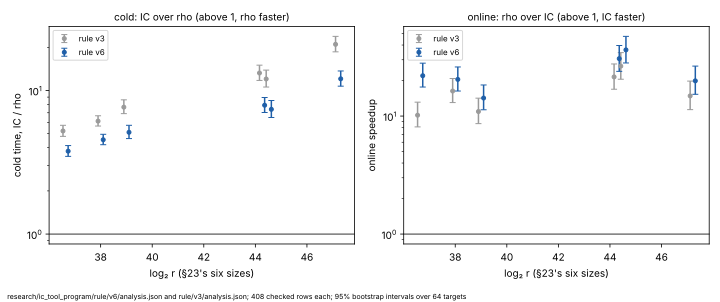

# The rule's comparison at baseline v6: results

**What this is.** The single-target comparison the plan owes at every new
baseline, run once at v6: v4 (main's `92246530`, R10) with R06's scan key
and R08's folding subtraction, under [`PROTOCOL.md`](PROTOCOL.md) and its
amendment 1.
- One unseen public point a process, the index calculus against Pollard rho
  on that same point, online and cold.
- At ledger §23's six sizes, with §23's 64 targets and four A/A repeats a
  size: 408 rows.
- Each row checked, and read against §23 and rule v3.

It ran on 2026-10-16, 15:40–17:09 UTC, on the Emerald Rapids of R10, R06
and R08 (family 6 model 207, kernel build `6.18.44-fc-v139`;
[`runs/host.json`](runs/host.json)).

**The verdict is still §23's, and the distance to rho is about 40% smaller.**
- **Online,** the index calculus is faster than rho on the same point at all
  six sizes, now 14.2–36.4×.
- **Cold,** with its reusable set-up, rho is still faster at all six. By
  AGENTS.md §2 the method is not faster than rho.
- **The distance remaining (CLAUDE.md's success criterion):** rho is
  **3.78–12.06× faster cold**, against 5.23–20.97× at v3. At the three
  largest sizes it is **7.90×, 7.40× and 12.06×**, against 13.24×, 12.03×
  and 20.97×.

PDF: [`report/report.pdf`](report/report.pdf).

## What ran, and what it checked

- **408 rows, 408 checked.** Every row passes the repository's `vs_rho`
  claim check ([`claims/summary.json`](claims/summary.json)), as
  `verified_answer_controlled_wall`.
- **Every logarithm is §23's.** At every size, all 68 rows recovered the
  logarithms §23's rows did, for both arms, on the same targets.
- **The pin held:** v6's outputs on `T01` at each size equal §23's
  ([`runs/pin/`](runs/pin/)).
- **The reference check is admissible at every size.** The comparison's rho
  runs at 0.70–0.85 times the strong walk's time a step (v6's own
  `koblitz_rho_fixture strong`, 140–159 ns a step;
  [`runs/reference/`](runs/reference/)).
- **Four rows ran again.** Their first attempt was contended: the isolation
  tool saw other processes on the host, among them a compression check run
  during the comparison. Each re-ran clean, and only the clean attempt
  counts. No row failed.

**Two tools needed fixing after the rows ran** (amendment 1). No row was
re-timed.
- `icprog`'s claim writer lacked five `vs_rho` fields the ledger has
  required since 2026-10-13. It now writes them from each run's own record.
- `koblitz_rho_fixture`'s size gate, re-imported by a merge, refused
  `n = 47, 57, 59`. It now takes the single-word walk's whole range. The
  refused attempts stay in
  [`runs/reference-refused-size-gate/`](runs/reference-refused-size-gate/).

## Results

**Cold** is set-up plus online, index calculus over rho: above 1, rho is
faster. **Online speedup** is mean rho online over mean index-calculus
online. Both carry a 95% bootstrap interval over the 64 targets.
**Break-even** is the number of targets at which one set-up and its
descents cost as much as that many one-target rho runs. **Narrowed** is
rule v3's cold ratio over rule v6's.

| curve | `log₂ r` | cold, IC over rho, v6 [95%] | v3 | narrowed | online speedup, v6 [95%] | v3 | break-even, v6 | v3 | rho over strong walk |
|:--|--:|:--|--:|--:|:--|--:|--:|--:|--:|
| `icv1-f2m47-t22705043-f4e44623` | 36.64 | **3.78×** [3.48, 4.13] | 5.23× | 1.38 | **21.97×** [17.62, 28.07] | 10.17× | 5.12 | 7.39 | 0.76 |
| `icv1-f2m57-tm747311035-c1f545af` | 38.0 | **4.54×** [4.19, 4.95] | 6.12× | 1.35 | **20.45×** [16.3, 26.08] | 16.3× | 6.33 | 8.76 | 0.85 |
| `icv1-f2m41-tm2308219-7f48b14a` | 39.0 | **5.12×** [4.63, 5.72] | 7.66× | 1.5 | **14.22×** [11.3, 18.34] | 10.93× | 6.02 | 9.22 | 0.75 |
| `icv1-f2m53-tm56619371-dac20a85` | 44.26 | **7.9×** [7.03, 8.94] | 13.24× | 1.68 | **30.66×** [23.92, 39.61] | 21.47× | 8.46 | 14.36 | 0.83 |
| `icv1-f2m59-tm943548413-98844ecc` | 44.52 | **7.4×** [6.49, 8.52] | 12.03× | 1.63 | **36.37×** [28.18, 47.37] | 26.5× | 7.97 | 13.04 | 0.7 |
| `icv1-f2m61-t158598901-ab42b6c5` | 47.21 | **12.06×** [10.72, 13.69] | 20.97× | 1.74 | **19.88×** [15.29, 26.51] | 14.82× | 12.9 | 22.82 | 0.72 |

- **Where the narrowing comes from.** At the three largest sizes the cold
  ratio narrowed 1.63–1.74×. That is consistent with the set-up gain the
  rounds measured on their own suite: R06 and R08 together made cold time
  1.59–1.73× faster than v4. It is not proved by it, because the host also
  changed between the two rules.
- **The online speedup is larger too**, 1.25–2.16× against v3. Nothing here
  attributes that: the host changed between the two rules, and whether the
  descent gains from R06's and R08's kernels was not measured.
- **The gap still grows with the group,** but more slowly. The cold ratio
  rises as `r^0.142` [0.105, 0.178] (rule v3: `r^0.176` [0.137, 0.214]).
- **Against the prediction** (about 8×, 7× and 12× at the three largest
  sizes): 7.90×, 7.40× and 12.06×.

## How the arms are priced (AGENTS.md §5a)

Both arms are timed in one process on one isolated core, and the figures
above are wall time over wall time. Every native operation either arm
performs is inside its own time:
- rho's canonicalisations, partition hashes and distinguished-point table;
- the index calculus's keys, filters, sorts and linear algebra.

No counter is left unpriced on either arm, so the band at 0, 0.1 and 1
group-addition equivalent per native operation gives one figure. Each
claim's `operation_accounting` keeps the two arms' native counters
distinct, the descent's trials and rho's walk steps, and states no
operation ratio. The rule's counted-unit readings stay lower bounds and
rank nothing:
- rho priced at the canonical step;
- the Bernstein–Lange model.

## What it decides

- **The scoreboard's §23 row moves to v6.** Rho is still faster cold at
  every size, now by 3.78–12.06×.
- **The next question is where the remaining 7–12× sits.** R06 and R08 both
  sped up collection. How v6's set-up now divides between collection, the
  build and the linear algebra has not been measured. A stage diagnostic at
  v6 is the next step, before the next lever is chosen.

## Files

| file | what it holds |
|:--|:--|
| [`PROTOCOL.md`](PROTOCOL.md) | the declaration and amendment 1 |
| [`analysis.json`](analysis.json) | `icprog rule analyse --comparison v6` |
| [`claims/`](claims/) | each row's checked claim and replay, and `summary.json` |
| [`manifests/`](manifests/) | the candidate, workload and rho manifests |
| [`runs/`](runs/) | every row, the pin, the reference walks, the isolation receipts |
| [`run.sh`](run.sh) | the driver |
| [`report/`](report/) | the graph (SVG, PNG), its script and the PDF |

The run tree is committed loose, as rule v3's was, and not archived: every
claim names its run record by path (`report`), and the ledger's replay
pointers must resolve.
