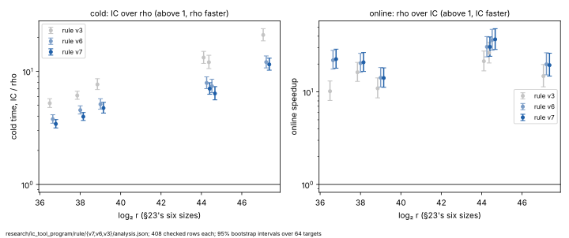

# The rule's comparison at baseline v7: results

**What this is.** The single-target comparison the plan owes at every new
baseline, run at v7 (v6 plus R11's streamed pair-table build) under
[`PROTOCOL.md`](PROTOCOL.md):
- one unseen public point a process, the index calculus against Pollard rho
  on that same point, online and cold;
- at ledger §23's six sizes, with §23's 64 targets and four A/A repeats a
  size: 408 rows, each checked, read against §23, rule v6 and rule v3.

It ran on 2026-10-16, 21:04–22:34 UTC, on the Emerald Rapids of the rule at
v6 (family 6 model 207, kernel build `6.18.44-fc-v139`;
[`runs/host.json`](runs/host.json)).

**The verdict is still §23's, and rho's lead is smaller again.**
- **Online,** the index calculus is faster than rho on the same point at
  all six sizes: 14.1–37.0×.
- **Cold,** with its reusable set-up, rho is still faster at all six. By
  AGENTS.md §2 the method is not faster than rho.
- **The distance remaining (CLAUDE.md's success criterion):** rho is
  **3.43–11.51× faster cold**, against 3.78–12.06× at v6 and 5.23–20.97× at
  v3. At the three largest sizes it is **7.03×, 6.37× and 11.51×**, against
  7.90×, 7.40× and 12.06× at v6 and 13.24×, 12.03× and 20.97× at v3.

PDF: [`report/report.pdf`](report/report.pdf).

## What ran, and what it checked

- **408 rows, 408 checked.** Every row passes the repository's `vs_rho`
  claim check ([`claims/summary.json`](claims/summary.json)), as
  `verified_answer_controlled_wall`.
- **Every logarithm is §23's.** At every size, all 68 rows recovered the
  logarithms §23's rows did, for both arms, on the same targets.
- **The pin held:** v7's outputs on `T01` at each size equal §23's
  ([`runs/pin/`](runs/pin/)).
- **The reference check is admissible at every size.** The comparison's rho
  runs at 0.57–0.78 times the strong walk's time a step, using v7's own
  `koblitz_rho_fixture strong`, which takes 140–208 ns a step
  ([`runs/reference/`](runs/reference/)).
- **Five rows ran again:** their first attempt was contended, and each
  re-ran clean; only the clean attempt counts. No row failed.

## Results

**Cold** is set-up plus online, index calculus over rho: above 1, rho is
faster. **Online speedup** is mean rho online over mean index-calculus
online. Both carry 95% bootstrap intervals over the 64 targets.
**Narrowed** is rule v6's cold ratio over rule v7's.

| curve | `log₂ r` | cold, IC over rho, v7 [95%] | v6 | v3 | narrowed since v6 | online speedup, v7 [95%] | v6 | break-even, v7 | rho over strong walk |
|:--|--:|:--|--:|--:|--:|:--|--:|--:|--:|
| `icv1-f2m47-t22705043-f4e44623` | 36.64 | **3.43×** [3.16, 3.75] | 3.78× | 5.23× | 1.1 | **22.59×** [18.02, 28.98] | 21.97× | 4.65 | 0.78 |
| `icv1-f2m57-tm747311035-c1f545af` | 38.0 | **3.97×** [3.68, 4.33] | 4.54× | 6.12× | 1.14 | **20.87×** [16.64, 26.65] | 20.45× | 5.58 | 0.57 |
| `icv1-f2m41-tm2308219-7f48b14a` | 39.0 | **4.74×** [4.27, 5.32] | 5.12× | 7.66× | 1.08 | **14.13×** [11.22, 18.19] | 14.22× | 5.57 | 0.76 |
| `icv1-f2m53-tm56619371-dac20a85` | 44.26 | **7.03×** [6.27, 7.93] | 7.9× | 13.24× | 1.12 | **30.66×** [24.27, 39.23] | 30.66× | 7.54 | 0.72 |
| `icv1-f2m59-tm943548413-98844ecc` | 44.52 | **6.37×** [5.6, 7.33] | 7.4× | 12.03× | 1.16 | **36.97×** [28.72, 48.23] | 36.37× | 6.86 | 0.73 |
| `icv1-f2m61-t158598901-ab42b6c5` | 47.21 | **11.51×** [10.24, 13.06] | 12.06× | 20.97× | 1.05 | **19.46×** [14.82, 26.14] | 19.88× | 12.32 | 0.73 |

- **The narrowing is R11's.** At the three largest sizes the cold ratio
  narrowed 1.12×, 1.16× and 1.05× since v6. R11 measured 1.134×, 1.124× and
  1.071× in cold time on its own suite, and the online speedup did not
  move (R11 changed only the set-up). The prediction was about 7.0×, 6.6×
  and 11.3×.
- **Since v3,** rho's cold lead has narrowed 1.52–1.89× at every size, and
  1.88×, 1.89× and 1.82× at the three largest sizes.
- **The gap still grows with the group,** as `r^0.144` [0.092, 0.196]
  (rule v6: `r^0.142`; rule v3: `r^0.176`).

## How the arms are priced (AGENTS.md §5a)

As at v6:
- **Both arms are timed in one process on one isolated core.** Every native
  operation either arm performs is inside its own time, so no counter is
  left unpriced on either arm. The band at 0, 0.1 and 1 group-addition
  equivalent per native operation gives one figure.
- **Each claim's `operation_accounting`** keeps the two arms' native
  counters distinct (the descent's trials and rho's walk steps) and states
  no operation ratio.
- **The counted-unit readings stay lower bounds.**

## Files

| file | what it holds |
|:--|:--|
| [`PROTOCOL.md`](PROTOCOL.md) | the declaration |
| [`analysis.json`](analysis.json) | `icprog rule analyse --comparison v7` |
| [`claims/`](claims/) | each row's checked claim and replay, and `summary.json` |
| [`manifests/`](manifests/) | the candidate, workload and rho manifests |
| [`runs/`](runs/) | every row, the pin, the reference walks, the isolation receipts |
| [`run.sh`](run.sh) | the driver |
| [`report/`](report/) | the graph (SVG, PNG), its script and the PDF |

The run tree is committed loose, as rule v3's and v6's were: every claim
names its run record by path.
