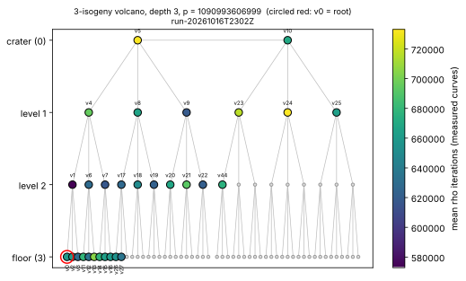
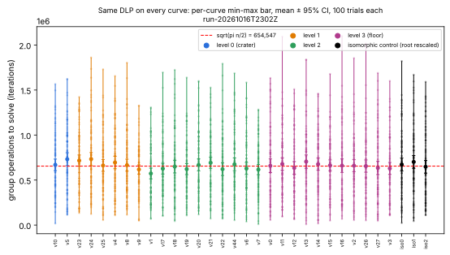
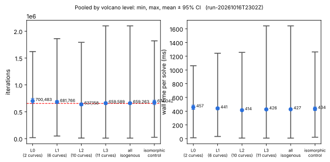

# Pollard rho across the strata of an isogeny volcano

**Question.** Take one ECDLP instance, carry it by explicit isogenies to
every level of an ℓ-isogeny volcano, and run Pollard rho on each curve:
does the level (crater → floor), or the particular curve, change how fast
rho solves it? Report min, max and mean.

**Answer (measured, run `run-20261016T2302Z`).** No measurable effect. All
29 isogenous curves and 3 isomorphic controls took the same work to within
sampling noise. Pooled over the 2,900 isogenous solves: min 8,477, mean
659,263 ± 12,422 (95 % CI), max 2,099,707 group operations, against
√(πn/2) = 654,547. Every level's 95 % CI includes or touches that value, and
per-step cost is flat (641–661 ns/op on every curve). That is what theory
predicts: isogenous curves over F_p have the same group order, and generic
rho depends only on the order of ⟨P⟩. The spread *between* curves (per-curve
means 572,846 – 733,141) matches the spread of 100-trial means of a
quantity whose single-solve sd is about 341,000 (sd of a mean ≈ 34,000).

## Method

`volcano-rho` (`src/bin/volcano_rho.rs`, native Rust, all statistics computed
there; `plot.py` only lays out recorded values):

1. **Curve search.** Random curves `y² = x³ + ax + b` over random 40-bit
   primes `p ≡ 3 (mod 4)`, point count by baby-step giant-step, until
   `D = t² − 4p = f²·D_K` has `v₃(f) = 3` (a 3-volcano with three levels
   below the crater) and `#E = h·n` with `n` prime, `h ≤ 64`.
2. **Walk.** Breadth-first over 3-isogenies. Each edge's kernel is a rational
   root `x₀` of the 3-division polynomial `ψ₃ = 3x⁴ + 6ax² + 12bx − a²`,
   and the map is Vélu's, applied explicitly to points. Vertices are keyed
   by j-invariant. A vertex's level is `depth − dist(v, floor)`, the floor
   being the vertices with exactly one rational 3-kernel; the tool asserts
   that no edge skips a level.
3. **One problem everywhere.** `P` of order `n` and `Q = kP` on the root
   curve are pushed along the BFS tree to every curve. Each edge is checked:
   images lie on the codomain, `φ(P+Q) = φ(P) + φ(Q)`, and `n·φ(P) = O`
   with `φ(P) ≠ O` (3 ∤ n, so every map is injective on ⟨P⟩). Every rho solve
   on every curve returned the same `k`.
4. **Rho.** Single walker, 32-adding walk (Teske), distinguished points with
   θ = 2⁻⁸, no negation map; restarts on a DP-free run longer than 40/θ.
   Trial seed `s` uses the same walk constants on every curve (the
   partition hashes `x`, so walks differ). Measured unit: group additions
   to the solve; also wall time per solve.
5. **Control.** Three random isomorphic re-scalings of the root,
   `(u⁴a, u⁶b)`, `(x, y) ↦ (u²x, u³y)`: the same curve in new coordinates,
   showing the spread that a pure change of representation produces.
6. All 3,200 (arm, seed) jobs shuffled and run on 4 threads.

## The instance

| | |
|:--|:--|
| p | 1090993606999 (40 bits) |
| root E | a = 690282649366, b = 1050606678233 |
| #E | 1090993806052 = 4 · n, n = 272748451513 (prime, 38 bits) |
| trace t | −199052 |
| D = t² − 4p | −4324352729292 = 54² · (−1482974187); v₃(f) = 3 |
| crater | D_K ≡ 0 (mod 3): ramified, 2 crater vertices joined by one edge |
| k | 49631396114 (Q = kP) |
| volcano | 80 curves = 2 + 6 + 18 + 54 (crater, L1, L2, floor), 79 edges, all verified |

## Results (iterations = group operations; time on a shared 4-vCPU VM)

Pooled by level:

| level | curves | solves | min | mean ± 95 % CI | median | max | mean ms ± CI |
|:--|--:|--:|--:|--:|--:|--:|--:|
| 0 crater | 2 | 200 | 17,415 | 700,483 ± 47,849 | 662,463 | 1,621,252 | 456.9 ± 32.0 |
| 1 | 6 | 600 | 48,186 | 681,766 ± 26,525 | 656,746 | 1,861,764 | 440.7 ± 17.6 |
| 2 | 10 | 1,000 | 9,649 | 637,158 ± 20,410 | 598,424 | 1,792,889 | 414.4 ± 13.6 |
| 3 floor | 11 | 1,100 | 8,477 | 659,589 ± 20,993 | 620,458 | 2,099,707 | 426.0 ± 13.9 |
| all isogenous | 29 | 2,900 | 8,477 | 659,263 ± 12,422 | 622,386 | 2,099,707 | 427.1 ± 8.2 |
| isomorphic control | 3 | 300 | 23,698 | 674,042 ± 40,816 | 628,245 | 1,820,972 | 434.0 ± 27.0 |

Reference: √(πn/2) = 654,547 (+ about 2⁸ for the distinguished-point tail).

Per curve (100 solves each), iterations:

| curve | level | min | mean | max | | curve | level | min | mean | max |
|:--|--:|--:|--:|--:|:-:|:--|--:|--:|--:|--:|
| v5 | 0 | 113,746 | 732,044 | 1,621,252 | | v18 | 2 | 44,056 | 649,444 | 1,724,073 |
| v10 | 0 | 17,415 | 668,921 | 1,565,882 | | v19 | 2 | 106,910 | 621,995 | 1,638,981 |
| v4 | 1 | 108,640 | 695,082 | 1,655,814 | | v20 | 2 | 117,650 | 667,890 | 1,600,331 |
| v8 | 1 | 115,038 | 665,553 | 1,802,980 | | v21 | 2 | 72,048 | 692,313 | 1,527,838 |
| v9 | 1 | 48,186 | 618,080 | 1,325,879 | | v22 | 2 | 71,551 | 620,647 | 1,792,889 |
| v23 | 1 | 134,281 | 716,324 | 1,422,523 | | v44 | 2 | 54,056 | 674,911 | 1,686,754 |
| v24 | 1 | 123,525 | 733,141 | 1,861,764 | | v0 (root) | 3 | 55,979 | 658,723 | 1,634,032 |
| v25 | 1 | 55,435 | 662,413 | 1,730,218 | | v2 | 3 | 54,631 | 659,817 | 1,854,099 |
| v1 | 2 | 69,112 | 572,846 | 1,308,207 | | v3 | 3 | 107,168 | 629,575 | 1,601,367 |
| v6 | 2 | 38,512 | 628,345 | 1,584,239 | | v11 | 3 | 94,240 | 678,053 | 2,094,241 |
| v7 | 2 | 9,649 | 616,240 | 1,283,603 | | v12 | 3 | 64,211 | 634,612 | 1,509,154 |
| v17 | 2 | 100,833 | 626,950 | 1,696,010 | | v13 | 3 | 8,477 | 704,738 | 1,838,374 |
| iso0 | ctrl | 23,698 | 672,888 | 1,820,972 | | v14 | 3 | 17,758 | 676,654 | 1,460,561 |
| iso1 | ctrl | 44,112 | 701,414 | 1,670,056 | | v15 | 3 | 49,801 | 663,488 | 1,678,869 |
| iso2 | ctrl | 109,711 | 647,822 | 1,591,405 | | v16 | 3 | 68,503 | 659,946 | 2,099,707 |
| | | | | | | v26 | 3 | 51,815 | 655,015 | 2,017,181 |
| | | | | | | v27 | 3 | 46,289 | 634,861 | 1,689,685 |

Full per-curve rows (with times, ns/op, medians, p10/p90) are in
`runs/run-20261016T2302Z/results.json`; every solve is a row of `trials.csv`.





## Reading it

- **Observed:** level means differ by at most 63,000 iterations (L0 vs L2), and
  the 95 % CIs of L0 and L2 overlap. The CIs of L0, L2 and L3 contain
  √(πn/2); L1's lower bound (655,241) sits 700 above it, with four level
  intervals and no correction for multiple comparisons. Single solves range over ~250× (8,477 to
  2,099,707) on every level and on the control, so min and max are the
  extremes of a wide distribution and say little about a curve. The mean is
  the meaningful statistic.
- **Interpretation (derived, not measured):** an ℓ-isogeny with ℓ ∤ n is a
  group isomorphism ⟨P⟩ → ⟨φ(P)⟩, so generic rho sees the same group of
  order n on every stratum; what changes between levels is the endomorphism
  ring, which generic rho does not use. The per-curve differences are what
  re-drawing the walk's random partition gives, as the isomorphic control
  (same curve, new coordinates) shows. Walking the volcano is not a way to
  make this generic DLP cheaper.
- **Gap to matched rho:** this *is* rho on every arm; no index-calculus
  arm is involved, so there is no IC baseline to improve and no §5a band
  to rank across.

## Limits

- One instance, one 40-bit prime, one volcano (ℓ = 3, depth 3, ramified
  crater). The crater has 2 vertices, so L0 has only 200 solves.
- Not an ecbench session: the counted unit is this tool's group-addition
  count; no isolation (shared 4-vCPU VM, 4 threads, jobs interleaved), so
  wall times are indicative only. Per-op time includes affine inversion by
  `i128` extended Euclid.
- 29 of the 80 curves measured (root plus up to 10 per level in BFS order).
- No negation map and no endomorphism-accelerated rho; a curve at the
  crater with a larger endomorphism ring would only help an algorithm that
  uses that ring (GLV-style speedups exist only for tiny |D_K|, and this
  D_K = −1482974187 is not tiny).

## Reproduce

```sh
cargo build --release --bin volcano-rho
./target/release/volcano-rho --bits 40 --ell 3 --depth 3 --seed 20261016 \
    --trials 100 --per-level 10 --controls 3 --out OUT
python plot.py OUT     # matplotlib, plotting only
```

The curve, volcano, instance and every solve's iteration count are a
deterministic function of `--seed`; wall times are not. Run from the
then-uncommitted `src/bin/volcano_rho.rs` on top of `9b09d308e` (committed in this PR
with formatting and lint-only changes), Intel Xeon @
2.80 GHz, 4 threads, 342.5 s for the rho phase.

**Replay.** The committed binary (formatting and lint fixes only) re-run
with `--trials 5` reproduces 160/160 iteration counts of the first five
seeds of every arm exactly.

Report PDF: [`report.pdf`](report.pdf).
