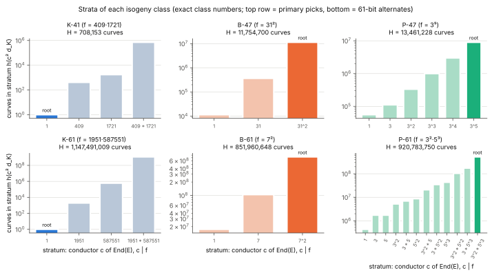
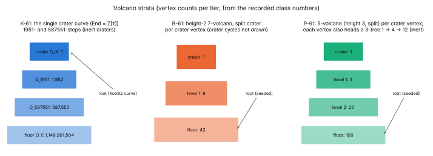
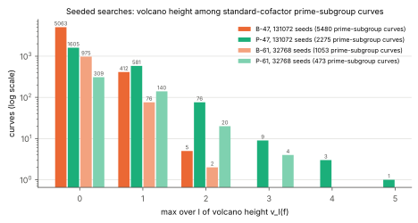

# Isogeny-class trio: three 41–64-bit roots for a whole-class experiment

Date: 2026-10-17. Protocol: [`PROTOCOL.md`](PROTOCOL.md), frozen before the B
and P searches. PDF: [`REPORT.pdf`](REPORT.pdf). Data: [`data/`](data/).
Tool: [`selector/`](selector/) (native Rust, no dependencies) and
[`identity/`](identity/) (the repository's native ICV1 producer).

## Question

The user asked for three curves, one binary, one Koblitz and one prime-field,
between 41 and about 66 bits (preferably above 45), with shapes that
emulate standardized curves. Each should have Frobenius conductor `f > 1`, so
that its isogeny class has volcanoes with more than one level, as the root of
an experiment that iterates over every curve in the isogeny class.

## Picks

| | Koblitz (K-shape) | Binary (B-shape) | Prime (P-shape) |
|:--|:--|:--|:--|
| ICV1 slug | `icv1-f2m41-tm2308219-7f48b14a` | `icv1-f2m47-t4276051-826c5755` | `icv1-fp47-tm8785349-43e36ce5` |
| Emulates | K-233/283/409/571 (`a = 0`, cofactor 4) | B-163…B-571 (`a = 1`, seeded `b`, cofactor 2) | P-192…P-521 (`a = −3`, seeded `b`, prime order) |
| Field | `GF(2^41)`, `x^41 + x^3 + 1` | `GF(2^47)`, `x^47 + x^5 + 1` | `GF(p)`, `p = 2^47 − 115` |
| Model | `y^2 + xy = x^3 + 1` | `y^2 + xy = x^3 + x^2 + b`, `b = 0x52e3db551eb3` | `y^2 = x^3 − 3x + b`, `b = 0xda8a554f2ba` |
| Seed | — (fixed by the family) | `isogeny-class-trio/2026-10-17/B-47/b/28948` | `isogeny-class-trio/2026-10-17/P-47/b/117828` |
| `#E` | `4 · 549756390943` | `2 · 70368742039639` | `140737497140563` (prime) |
| Prime subgroup | 40 bits | 46 bits | 48 bits |
| Trace `t` | −2308219 | 4276051 | −8785349 |
| `d_K` | −7 | −589770391 | −8226516899 |
| Conductor `f` | `409 · 1721` | `31^2` | `3^5` |
| Volcanoes | `l = 409`: height 1, inert; `l = 1721`: height 1, inert | `l = 31`: height 2, inert crater | `l = 3`: height 5, split crater |
| Strata (`c \| f`) | 4 | 3 | 6 |
| Class size `H` | **708,153** | **11,754,700** | **13,461,228** |
| Root's position | crater (`End = Z[τ] = O_K`) | floor (`End = Z[π]`, conductor 961) | floor (`End = Z[π]`, conductor 243) |
| Generator | `(0x1deeba21c88, 0x17ccbb7d40e)` (registry, `EC1N41Ce0he09550ab560a`) | `(0xd6dc0d063d1, 0x23397c1623ca)` | `(0x4548698c68b3, 0x2b74b4fbfbc3)` (`EC1P47Cfph7e9290c297bc`) |

Stratum sizes (curves with `End = O_c`, exact):

- K-41: `c = 1`: 1; `409`: 410; `1721`: 1,722; `409·1721`: 706,020.
- B-47: `c = 1`: 11,468; `31`: 366,976; `31^2`: 11,376,256.
- P-47: `c = 1`: 55,396; `3`: 110,792; `9`: 332,376; `27`: 997,128;
  `81`: 2,991,384; `243`: 8,974,152.





### 61-bit alternates (for a trio entirely above 45 bits)

| | K-61 | B-61 | P-61 |
|:--|:--|:--|:--|
| ICV1 slug | `icv1-f2m61-t158598901-ab42b6c5` | `icv1-f2m61-tm2657393969-b9ff0fb0` | `icv1-fp61-tm813574577-a3b71255` |
| Field | `x^61 + x^5 + x^2 + x + 1` | same | `p = 2^61 − 1` (as P-521 = `2^521 − 1`) |
| Model | `a = 0`, `b = 1` | `a = 1`, `b = 0x9c60f836d06fc8` (seed index 12079) | `a = −3`, `b = 0x54aa66b458b77ec` (seed index 11526) |
| Cofactor, subgroup | 14156, 48 bits | 2, 61 bits | 1, 62 bits |
| `f` | `1951 · 587551` | `7^2` (split crater) | `3^2 · 5^3` (3 inert, 5 split) |
| Strata, `H` | 4, 1,147,491,009 | 3, 851,960,648 | 12, 920,783,750 |
| Root | crater | floor | floor of both volcanoes |

## Findings

1. **No prime-degree Koblitz curve has the standard cofactor between 2^42
   and 2^66** (derived, exhaustive). The prime degrees in range are 41, 43,
   47, 53, 59 and 61; of the 12 curves only `K_0` over `GF(2^41)` has
   `#E = 4r` with `r` prime ([`data/koblitz.jsonl`](data/koblitz.jsonl),
   [figure](figures/koblitz-table.svg)). The K pick is therefore 41 bits,
   below the "preferably above 45" preference. Above 45 bits the best
   prime-degree option is `K_0` over `GF(2^61)` (cofactor 14156, 48-bit
   subgroup), listed as the alternate.
2. **A prime-degree Koblitz class has height-1 volcanoes at large `l`
   only** (derived; classical). `f = |U_m|`, the Lucas sequence of
   `τ^2 − μτ + 2`. For prime `m ≠ 7` every prime `l | U_m` has rank of
   apparition `m`, so `l ≡ ±1 (mod m)` and `l ≥ 2m − 1`; the table bears
   this out (409, 1721 ≡ −1, −1 mod 41; 1951, 587551 ≡ −1, −1 mod 61). The
   Koblitz curve is the only curve in its class with `End = O_K`
   (`h(−7) = 1`), so for every small `l` its isogeny graph is one vertex
   with loops: **the rest of the class is reachable only through the
   vertical steps of degree `l | f`.** For K-41 those are degree 409 and
   1721, with kernel x-coordinates in `F_{q^204}` and `F_{q^215}`
   (computed: the order of `±t/2` in `F_l^*/±1`). For K-61 the second step
   has degree 587551 and kernel field `F_{q^58755}`, which is why K-61 is
   only the alternate.
3. **Binary curves over odd-degree fields have conductor primes
   `l ≡ ±1 (mod 8)` only** (derived; confirmed by the search). `l | f`
   needs `t^2 ≡ 2^(m+2) (mod l)`, i.e. 2 a square mod `l`. So 3- and
   5-volcanoes never occur for B- or K-shape curves; the smallest possible
   vertical degree is 7. In the B-47 search every conductor prime was in
   {7, 17, 23, 31, 41, 47, 71, …} ([`data/tally-B47.json`](data/tally-B47.json)).
   For the same reason only 5 of 5,480 standard-cofactor curves have a
   height-2 volcano, against 89 of 2,275 for P-47.
4. **Both seeded roots sit on the floor** (proved by the tests below), as
   most curves do: the floor holds 96.8% of B-47's class and 66.7% of
   P-47's. Their crater representatives are 2 (B-47) and 5 (P-47)
   ascending isogenies away.



## Method

- **Koblitz.** `#E(GF(2^m)) = 2^m + 1 − V_m` and `f = |U_m|` from the Lucas
  sequences of `τ`. The selector asserts `t^2 − 2^(m+2) = −7 U_m^2` for every
  row. The orders of K-41 and K-61 match their registry entries
  (`icv1-f2m41-tm2308219-7f48b14a`, `icv1-f2m61-t158598901-ab42b6c5`), and the native ICV1 producer reproduces their slugs.
- **B and P searches.** Coefficients come from SHA-256 of public seed
  strings, as in X9.62/FIPS 186 seeding. The selector counts points by BSGS
  over the Hasse window on seeded points, using `#E ≡ 2 (mod 4)` for B.
  A curve is kept only when the match is unique and `r = #E/h` is prime.
  `r > 4√q` then makes `#E` the only multiple of `r` in the window, so each
  kept order is proved. Not one count was ambiguous across the 327,680
  curves.
- **Selection rule (frozen).** `f > 1`, `f` 61-smooth, a volcano of height
  ≥ 2. Rank by height, then number of strata, then lowest seed index.
- **Class invariants.** `Δ = t^2 − 4q` is factored to `f^2 d_K`.
  `h(d_K)` is computed exactly by counting reduced forms (`O(√|d_K|)`;
  cross-checked against brute force for every fundamental `|D| < 4000`).
  Each stratum's `h(c^2 d_K)` comes from the conductor formula, and
  `H = Σ_{c|f} h(c^2 d_K)` (Schoof 1987, Thm 4.6).
- **Root levels.**
  - **K:** `τ ∈ End(E)` gives `End = O_K` (crater).
  - **B:** for odd `l | f`, above the floor `π` acts on `E[l]` as the
    scalar `t/2`, so all `(l^2 − 1)/2` x-coordinates of `E[l]` lie in
    `F_{q^k}`, with `k` the order of `±t/2` in `F_l^*/±1`. On the floor
    `π − t/2` is a non-zero nilpotent, so only the eigenline's `(l − 1)/2`
    x-coordinates do. The test is therefore
    `deg gcd(ψ_l, x^(q^k) − x)` using characteristic-2 division
    polynomials. B-47 gives 15 of 480 (floor). Control: over `GF(2^7)`
    the Koblitz class has `f = 7`, and the test flags exactly the Koblitz
    curve as above the floor and the other 7 class members as floor
    (`floor_test_control_koblitz_m7`).
  - **P:** a 3-isogeny BFS (roots of `ψ_3`, Vélu) finds that the root has
    exactly one rational 3-isogeny. The repository walker independently
    agrees: `src/bin/isogeny_walk.rs`, with the same trace, `Δ`, a 3-volcano
    of depth 5, and one kernel-certified 3-edge from the root
    ([`data/walker-class-P47.txt`](data/walker-class-P47.txt)). For P-61
    the walker records one 3-edge and one 5-edge from the root, so the root
    is on both floors.
- **Tests.** `cargo test --release` in `selector/` runs 15 tests:
  - BSGS against naive counts, in both characteristics;
  - characteristic-2 3-isogenies against brute-force orders, plus their
    duals;
  - division polynomials against rational torsion;
  - class numbers against brute force;
  - SHA-256 vectors;
  - the floor-test control.

## Status of each statement

| Statement | Status |
|:--|:--|
| Orders, traces, `f`, `d_K` of all six curves | computed (native); order proved by `r > 4√q` (B, P) or exact formula (K) |
| `h(d_K)` and stratum sizes, `H` | computed exactly (native form count); formula classical |
| Root levels | B, P: proved by the tests above; P cross-checked by the walker; K: theorem |
| No standard-cofactor prime-degree Koblitz in 42–66 | exhaustive enumeration |
| `l ≡ ±1 (mod m)` for Koblitz, `±1 (mod 8)` for binary | classical arguments, written above; consistent with all data |
| Seeded picks are optimal under the rule | within the frozen seed ranges only |

No theorem in this report is new, so there is no Lean obligation (AGENTS.md,
"Mathematical results should include Lean proofs"). Every structural fact
used is classical and its argument is written out above.

## What the whole-class experiment will need (not done here)

- **P-47** (13.5 M curves): the repository walker supports this field and
  all odd `l`, but it holds about 87 KB per curve (about 1.2 TB for this
  class). A full pass needs a compact class-group enumeration such as
  `p61_class` segments.
- **B-47** (11.8 M curves): there is no binary isogeny walker
  (`docs/isogeny-walk/README.md`: "Prime fields and odd l only").
  - It needs characteristic-2 `l`-isogenies: degree 31 for the vertical
    steps, and split primes (`(d_K/l) = 1`) for horizontal steps.
  - This selector already has `ψ_l` and 3-isogeny Vélu in characteristic 2.
  - 2-isogenies are horizontal here (2 splits, since `d_K ≡ 1 mod 8`).
- **K-41** (708 k curves): vertical isogenies of degree 409 and 1721
  computed from kernels over `F_{q^204}` and `F_{q^215}` (or by evaluating
  `Φ_l`), then horizontal walks inside each stratum.

## Reproduce

```sh
cd research/isogeny_class_trio_20261017/selector
cargo test --release && cargo build --release
B=target/release/isogeny-class-trio-selector
$B koblitz --min 41 --max 64                       > ../data/koblitz.jsonl
$B binary --m 47 --count 131072 --threads 4        > ../data/search-B47.jsonl 2> ../data/search-B47.summary.json
$B prime --bits 47 --count 131072 --threads 4      > ../data/search-P47.jsonl 2> ../data/search-P47.summary.json
$B binary --m 61 --count 32768 --threads 4         > ../data/search-B61.jsonl 2> ../data/search-B61.summary.json
$B prime --bits 61 --count 32768 --threads 4       > ../data/search-P61.jsonl 2> ../data/search-P61.summary.json
$B analyze-binary --m 41 --a2 0 --b 1 --koblitz    > ../data/pick-K41.json
$B analyze-binary --m 47 --a2 1 --b 0x52e3db551eb3 --seed isogeny-class-trio/2026-10-17/B-47/b/28948 > ../data/pick-B47.json
$B analyze-prime --p 140737488355213 --b 0xda8a554f2ba --seed isogeny-class-trio/2026-10-17/P-47/b/117828 > ../data/pick-P47.json
$B tally --in ../data/search-B47.jsonl             > ../data/tally-B47.json
```

Wall time on the 4-core session host: B-47 search 1 m 59 s, P-47 search 4 m 18 s,
analyses under 5 s each. Figures: `python3 figures/plot.py` (plots recorded
values only). The curves are registered in `docs/curves/registry.json` from
[`curves.json`](curves.json).
