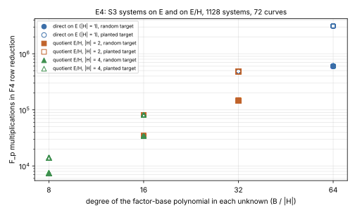

# Round 3: two-torsion summation polynomials, and the combined descent audited

**Date.** 2026-10-11.  **Status.**
- E4 is measured: 1,128 F4 systems over `F_p` on 72 certified curves.
- E5 is measured in two audited `ecbench` sessions (16 records, all
  verified, every replay reproduced).

**Result class.**
- E4 is a *stage diagnostic* of the decomposition step.  It makes no
  whole-method or rho comparison.
- E5 is *engineering*: an audit of round 1's negative result.

No deployed-curve claim, no key recovery.  The protocol
([`PROTOCOL.md`](PROTOCOL.md)) was frozen before either lead ran.  PDF of
this note: [`report.pdf`](report.pdf).

| file | what it is |
|:--|:--|
| [`PROTOCOL.md`](PROTOCOL.md) | leads, derivation, predictions, stop rules |
| [`TABLES.md`](TABLES.md), `tables.json` | every figure below, from `examples/isogeny_gap_round3_tables.rs` |
| `e4/` | E4 records (`records.jsonl`, one line per system), run log, start and finish times |
| `specs/`, `sessions/`, `run_sessions.sh` | the E5 specs, audited sessions and run order |
| `reports/run-*/` | one run report per run, with graphs and a PDF |
| `examples/isogeny_gap_two_torsion_f4.rs` | the E4 runner |

Rounds 1 and 2:
[`../isogeny_conductor_gap_ic_20261010/`](../isogeny_conductor_gap_ic_20261010/README.md),
[`../isogeny_conductor_gap_round2_20261011/`](../isogeny_conductor_gap_round2_20261011/README.md).

## Findings

1. **Two-torsion symmetrisation is a quotient isogeny, and it pays as
   predicted.**
   - Writing the `S₃` decomposition system for an `H`-stable factor base on
     `E/H` (Vélu) divides the factor-base polynomial's degree by `|H|`.
   - At a matched base of 32 or 64 abscissae on `E`, the F4 solving degree
     falls 1.9–3.7× and row-reduction work 4.1–4.3× for `|H| = 2` and
     17.6–19.6× for `|H| = 4`.
   - F4's cost on these systems is a function of the base-polynomial degree
     alone: solving degree `deg + 2`, the same widest matrix on every curve.
2. **The crater's richer 2-torsion changes nothing at matched `|H|`.**
   - On 12 pairs the crater has rational `E[2] ≅ (Z/2)²` and the floor has
     rank-1 2-torsion.  That covers every D = −7 pair and the ℓ = 2 pairs of
     D = −11 and D = −3.
   - The floor and its model have a cyclic `C4` instead.
   - At `|H| = 4` all three solve at the same degree and widest matrix.
     Their work agrees within 6 multiplications of 34,158 at `B = 64`.
   - The gap changes which subgroups exist, not what a subgroup of a given
     order costs.  That is the third time this study has found it, after
     round 2's partial fibers and automorphism folds.
3. **Round 1's combined Weil descent is negative, now in audited
   sessions.**
   - Adjoining the fiber polynomial to one Weil-descended system verifies
     in 4 of 4 runs on 2 targets.
   - Each run takes 324 to 613 s online, against 0.9 to 2.0 s for the blind
     descent and under 0.01 s for rho.  Peak memory is 0.64 to 0.99 GB
     against 15 MB.
   - The maximum solving degree is 4 against 3, and F4 does 234 to 529× the
     blind arm's work, paired by run.
   - Round 1's unaudited 629 and 654× are not reproduced as a range, so the
     600–700× prediction fails.  The negative verdict stands.

## E4. Two-torsion quotients of the `S₃` system

**What was run.**  Every round-1 prime pair with even cofactor, 24 pairs
at 22 and 26 bits, each with crater, floor and isomorphic floor model.
- Factor bases of `B = 32` and `64` abscissae, the smallest on the curve,
  taken with their `H`-orbits.
- `H` = `1` (the direct system on `E`), `C2`, `C4`, and `E[2]` where it is
  rational.
- Two random targets and one planted target `R = P_i + P_j` per case.
- The repository's degree-bounded F4 over `F_p` (`cryptanalysis::f4_fp`),
  grevlex.

Correctness:
- 1,128 of 1,128 systems completed, none timed out.
- On every system, F4's consistency verdict matches a direct enumeration
  of the base pairs.
- Every planted solution annihilates its basis.
- The Vélu map passed 32 random-sum checks `S₃'(X(P₁), X(P₂), X(P₁+P₂)) = 0`
  per curve and subgroup.

Run report: [`reports/run-20261011T1714Z/`](reports/run-20261011T1714Z/README.md).

| base-polynomial degree | solving degree | widest matrix (cols) | row-reduction mults, random target | planted target |
|--:|--:|--:|--:|--:|
| 8 | 10 | 45 | 7,408–7,414 | 13,903–13,929 |
| 16 | 18 | 93 | 34,152–34,158 | 81,128–81,178 |
| 32 | 34 | 189 | 145,630 | 483,552–483,561 |
| 64 | 66 | 381 | 600,510 | 3,123,348–3,123,354 |

The range is over every curve, role and target with that degree, from
`TABLES.md`.  The base-polynomial degree is `B/|H|`.



**Against the predictions.**
- **P-E4a, gain: holds.**  At matched `B`, direct ÷ quotient is:
  - solving degree 1.89 and 1.94 for `|H| = 2`, and 3.40 and 3.67 for
    `|H| = 4` (the `+2` keeps it below `|H|`);
  - row-reduction work 4.12 to 4.26 and 17.6 to 19.6, at or above `|H|²`.
- **P-E4b, gap: holds.**  On each of the 12 pairs whose crater has rational
  `E[2]`, the crater's `E[2]`, the floor's `C4` and the model's `C4` give
  the same solving degree (10 at `B = 32`, 18 at `B = 64`) and the same
  widest matrix.  Work is equal or within 0.1 percent.  On the D = −7
  pairs the crater also has a `C4`, with the same figures.
- **P-E4c, correctness: holds**, as above.

![Crater E[2] against floor and floor-model C4 at B = 64](reports/run-20261011T1714Z/e4_gap_b64.svg)

**What the protocol got wrong.**
- It said rational `E[2]` on the crater and not the floor is what "a ℓ = 2
  volcano gives".  The run found it on every D = −7 pair as well, whatever
  ℓ.
- Those pairs' floors have Frobenius conductors divisible by 2 (round 1
  recorded 686 = 2·7³ on the h = 1568 floor), so they also sit lower on the
  2-volcano.
- The prediction did not depend on this.

**Why this is not a hardness difference.**
- The symmetrised system *is* the `S₃` system on the isogenous curve
  `E/H`.  A rank-1 floor reaches a quotient of the same order through its
  cyclic `C4`, or by walking the 2-volcano.
- What a quotient by `|H|` buys, a base `|H|` times smaller in degree, is
  the algebraic form of round 2's partial fiber: both trade relations
  modulo `H` for a smaller search.

**Scope and limits.**
- Two summands (`S₃`), bivariate systems, and factor bases given as split
  polynomials.  F4's behaviour on such systems is fully determined by the
  degree.
- The comparison says nothing about higher `m`, where the summation
  polynomial's own degree grows and the quotient's `S'` could differ in
  sparsity.  That is untested.
- Wall times were recorded on an unisolated container and are not reported
  as measurements.

## E5. Round 1's combined Weil descent, audited

**What was run.**  Round 1's A3 arms, unchanged, on the a = 1 Koblitz curve
over F_2^17 (`icv1-f2m17-tm101-00378d4e`, `h = 2`):
- rho;
- the blind F4 descent;
- the F4 descent over all lifts;
- the combined descent (the target abscissa free, the fiber polynomial
  adjoined).

Every IC arm uses `binary-subspace:dimension=8` with `f4-f2`.  There were
two sessions of one target each, with no warm-up and two measured rounds,
so each fits between host reboots.

| session | target | records | audit | isolation earned | run report |
|:--|:--|--:|:--|:--|:--|
| `e5_combined_n17_t0` (`ECBS1h05f404b1f89b`) | index 0 of seed 20261010, round 1's first target | 8 | ok, 8 of 8 replays reproduced | L1 × 6, L2 × 2 | [`run-20261011T1727Z`](reports/run-20261011T1727Z/README.md) |
| `e5_combined_n17_t1` (`ECBS1he4c2c379c257`) | index 0 of seed 20261011 | 8 | ok, 8 of 8 replays reproduced | L1 × 6, L2 × 2 | [`run-20261011T1758Z`](reports/run-20261011T1758Z/README.md) |

Per run, measured (each round has its own algorithm seed, which every arm
of that round shares):

| session, round | blind: wall, F4 ops | combined: wall, F4 ops | combined ÷ blind ops | combined max degree | combined peak RSS |
|:--|:--|:--|--:|--:|--:|
| t0, 0 | 0.9 s, 65,072,207 | 324.5 s, 32,012,560,285 | 492 | 4 | 0.66 GB |
| t0, 1 | 1.8 s, 133,408,080 | 613.2 s, 70,613,284,746 | 529 | 4 | 0.64 GB |
| t1, 0 | 2.0 s, 164,172,136 | 453.5 s, 38,387,092,945 | 234 | 4 | 0.65 GB |
| t1, 1 | 1.3 s, 84,877,444 | 464.5 s, 34,853,985,256 | 411 | 4 | 0.99 GB |

- The lifts arm is 0.7 to 1.6× the blind arm's work, at maximum degree 3.
- Rho verifies in under 0.01 s per target.
- `S` is 1.6 to 1.8 for rho and 5.1 to 6.5 for the IC arms (`TABLES.md`).
  For the combined arm it is a loose lower bound: the session leaves the
  solver's XORs unpriced, which is where nearly all of its work is.

**Against the predictions.**
- **Verifies, maximum degree 4: holds.**
- **Work 600 to 700× blind: fails.**  The four paired ratios are 234 to 529.
  Round 1's unaudited 629 and 654 lie above them.
- **"A repeat of round 1's per-target counts where the same target recurs":
  wrong premise.**  Target 0 recurs in `t0`, but the counts differ, 32.0
  and 70.6 billion against round 1's 59.9 billion.  The solver's work
  depends on the run's algorithm seed as well as the target.  Round 1's
  two identical counts came from two warm-up runs that drew the same
  seed (2971899802087539350).  Different seeds here give different
  relation searches.

**Verdict.**  The audited sessions confirm round 1's negative result on
the Koblitz curve.
- The combined system costs two to three orders of magnitude more solver
  work and 227 to 360× the online wall of the blind descent, paired by run.
- It yields at most `h = 2` times the relations.
- The `h = 6` random binary curve, where round 1's combined runs timed out
  at 3,600 s, was not rerun.  That remains unaudited.

## Graphs checked

- **Scoreboard** (`docs/index-calculus-scoreboard.html`): a round-3 panel was added, and round 1's combined-descent row now cites the audited figures (234–529× blind, paired).  The panel index and lab browser were regenerated; the leaderboard is unchanged.
- **Progress timeline** (`docs/ic/progress-timeline.json`): unchanged.  E4
  makes no rho comparison, and E5's cells are on a curve round 1 already
  plotted.
- **Round-1 and round-2 study figures:** none exist besides the scoreboard
  panels.

## Reproduce

```bash
cargo build --release --bin ecbench --example isogeny_gap_two_torsion_f4 --example isogeny_gap_round3_tables
./target/release/examples/isogeny_gap_two_torsion_f4 \
  --pairs research/isogeny_conductor_gap_ic_20261010/pairs/prime_pairs.json \
  --out research/isogeny_conductor_gap_round3_20261011/e4/records.jsonl --sizes 32,64 --budget-ms 20000
research/isogeny_conductor_gap_round3_20261011/run_sessions.sh
./target/release/examples/isogeny_gap_round3_tables --dir research/isogeny_conductor_gap_round3_20261011 \
  --out research/isogeny_conductor_gap_round3_20261011/TABLES.md \
  --json research/isogeny_conductor_gap_round3_20261011/tables.json
```

This round is built on the round-2 head (`75b95656a`), not on main.  Main at
`1613b90fe` does not compile: union-merge damage in
`src/cryptanalysis/koblitz_index_calculus.rs` and
`src/cryptanalysis/koblitz_factor_base_search.rs`.  The round touches
neither file.
