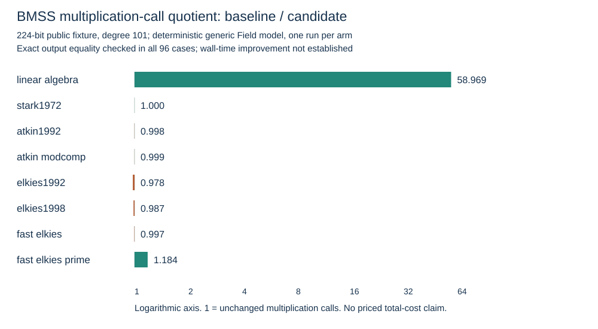
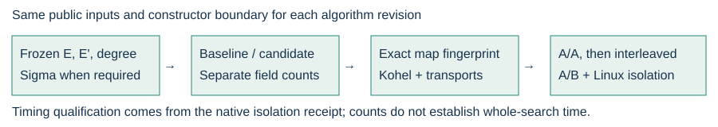

# Native isogeny performance: first verified optimization series

All eight BMSS methods passed 96 exact-output comparisons at each of three
successive optimization rungs: 192/224/256/511-bit public supersingular fixtures,
prime degrees 7/31/101. The retained baseline predates all arithmetic edits.
Each case includes complete inputs, binary and output SHA256 identities,
generic field-call counts, independent Kohel agreement and four public point
transports. These are field-width fixtures, not the named NIST models.

The final 224-bit/degree-101 cell illustrates the individual changes:

| Method | Baseline multiplication calls | Final calls | Baseline / final calls | Baseline inversions | Final inversions |
|---|---:|---:|---:|---:|---:|
| Linear algebra | 273,659,435 | 4,640,748 | 58.969 | 611 | 209 |
| Stark 1972 | 10,853,630 | 10,856,762 | 1.000 | 1,151 | 109 |
| Atkin 1992 | 547,470 | 548,379 | 0.998 | 409 | 109 |
| Atkin modular composition | 627,414 | 628,032 | 0.999 | 417 | 213 |
| Elkies 1992 | 20,109 | 20,565 | 0.978 | 255 | 106 |
| Elkies 1998 | 11,127 | 11,277 | 0.987 | 249 | 200 |
| fastElkies | 46,958 | 47,108 | 0.997 | 108 | 59 |
| fastElkies prime | 1,073,345 | 906,695 | 1.184 | 110 | 110 |

These are **operation-call quotients**, not elapsed-time speedups. Inversion
internals are opaque, and the generic counting wrapper does not price native
specialized convolution or assembly instructions. The rise in multiplication
calls from batching is retained beside the inversion reduction. Setup,
preparing sigma, reference construction and verification are outside the
constructor boundary. No whole-search/replay improvement has been measured.

Rung 1 moves row-independent series products into a column loop. Its linear
algebra multiplication quotient was 48.526 at this cell. Rung 2 batches fixed
Weierstrass and Newton denominators, preserving direct division below the
small-size thresholds. Rung 3 changes Gauss–Jordan to forward elimination and
back substitution; it improves linear algebra and fastElkies-prime further.
Separate receipts and source/binary archives retain each rung.

The final native Apple M4 Pro campaign executed five A/A pairs and five
interleaved A/B pairs: **20/20 valid runs, all exact outputs equal, counts
repeatable per binary**. Each run covers 64 cases at degrees 7/31, for 1,280
constructor case records. This shared macOS host has no reserved Linux core;
**zero wall samples are qualified**, and the summary sets
`wall_speedup_eligible: false`.

The implemented GitHub matrix will measure Linux x86-64, Linux ARM64, Apple
ARM64 and Intel macOS. Linux runs use the existing native isolation tool;
failed admission, interference and timeouts remain censored. It also launches
24 legacy benchmark groups as exploratory family baselines on Linux. Those
rows lack exact output fingerprints and cannot establish an optimization gain.
Actual remote receipts must be collected before those CPU measurements are
credited. The complete inventory and remaining series are in [INVENTORY.md](INVENTORY.md).

The native performance binary is packaged by the existing ReleaseMe isogeny
archive workflow. Publication is implemented, not yet verified as an actual
downloadable release asset. Users run `isogeny-perf` directly; Cargo is a
maintainer build step. [COMMANDS.md](COMMANDS.md) gives reproducible local paths.

Validation: the unfiltered root release library gate passed **4,083 tests**,
with zero failures and 117 existing ignored tests. The standalone release
library, binary, integration and example tests passed; strict all-target
Clippy, formatting and workflow lint passed. The native CLI's three correctness
and receipt-parser tests passed. [VALIDATION.md](VALIDATION.md) links the logs.
Storage and sparse-checkout failures remain in [ATTEMPTS.md](ATTEMPTS.md).

The local constructor series is verified. The requested multi-CPU timing
comparison, the remaining algorithm families, named P192/P224 whole-process
costs, release publication and the earlier 2,000-additional-map search remain
open. This PR does not replace those requirements with the 96-case series.

Source-linked [results PDF](report-rung3/REPORT.pdf),
[run PDF](report-rung3/RUN_REPORT.pdf),
[native comparison](evidence/rung3/COMPARISON.json),
[incremental comparison](evidence/rung3/INCREMENTAL_COMPARISON.json), and
[repeated-run receipt](evidence/apple-m4-final-repeats/SUMMARY.json).

Canonical charts checked: `docs/index-calculus-scoreboard.html`,
`docs/ic/progress-timeline.json`, `docs/performance-gains/data.json` and
`comparisons.csv`, `docs/curves/`, and `figures/`. Those charts describe DLP/rho,
other specialization work or curve edges; this constructor-only count result
changes none of their records. The new graph and its 150-dpi render are copied
into `benchmarks/20261014-isogeny-performance/` with a matching index entry.

## Kernel baseline added on 2026-10-15

The native `isogeny-perf kernels` adapter now measures seven additional
constructors: affine/cyclic Vélu, two x-only variants, two square-root variants,
and supplied-kernel Kohel. Two complete 84-case runs at source
`5521605f86ae444a9f4a433ca9b2f80d541e8470` cover 192/224/256/511 field bits and
degrees 7/31/101. All paired point-transport fingerprints agree, and all four
operation counters repeat exactly in every cell. Both native shells exited 0.

At 224 bits/degree 101, affine Vélu records 454 multiplication calls and 50
inversions; fast x-only Vélu records 1,044 and 1. These are baseline counts of
existing methods. Input boundaries are distinct. Kohel constructs all rational
map coefficients; other rows store compact evaluation representations. Their
build counts include different output materialization work, and admit no
cross-boundary end-to-end ratio.

The controls compare degree, codomain and full transports at `2*ell+1` distinct
non-kernel abscissae against both Kohel and point-enumerating Vélu. Counted and
native outputs agree. This check differs from the BMSS coefficient comparison.
The same shared Apple M4 Pro supplied these counts, with zero timing samples
requested or qualified. Other physical CPU baselines and kernel optimization
rounds remain open. The field-width fixtures remain separate from named NIST
searches and the additional-map requirement.

Read [the protocol](KERNEL_BASELINE_PROTOCOL.md),
[source-linked report](kernel-report-20261015/REPORT.md),
[visually inspected PDF](kernel-report-20261015/REPORT.pdf),
[graph data](kernel-report-20261015/COUNTS.csv), and
[extraction/provenance](kernel-baseline-20261015/README.md).
`KERNEL_BASELINE_RUNS.tar.gz` retains both raw runs, comparison, executable,
source and validation logs. A fresh extraction passed all 14 byte/SHA256
records. Matching PDF/SVG/150-dpi PNG copies and the index row are in
`benchmarks/20261015-isogeny-kernel-baselines/`. The previously listed canonical
DLP/rho and curve graphs receive no new value from these constructor counts.
