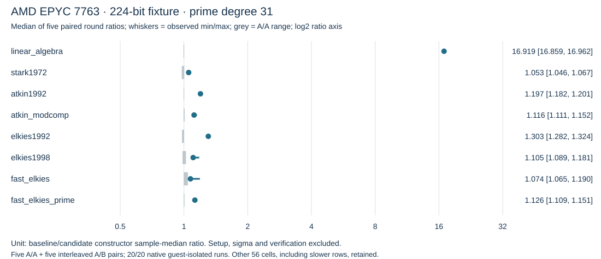
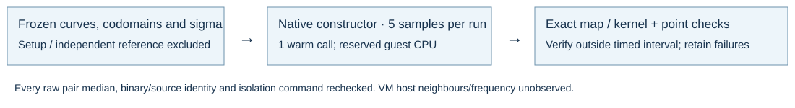

# First native CPU campaign

2026-10-15. GitHub run [38766895864](https://github.com/aburan28/crypto/actions/runs/38766895864), baseline `79006eb85a400474e83f6a76fac0dca6b60a8b5d`, candidate `a21306ca20418a4c4bfcc8448de9b8851b8449ed` (first three BMSS rungs). Native compiler receipts and actual processors are retained.

| Platform / recorded CPU | Full output matrix | Repeated valid runs | Qualified wall runs |
|---|---:|---:|---:|
| Linux x86-64 / AMD EPYC 7763 | 96/96 | 20/20 | 20/20 |
| Linux ARM64 / implementer 0x41, part 0xd49 | 96/96 | 19/20 | CENSORED |
| macOS ARM64 / Apple M1 (Virtual) | 96/96 | 20/20 | 0 |
| macOS x86-64 / Intel Core i7-8700B | 96/96 | 20/20 | 0 |

## Admitted AMD 224-bit / degree-31 ratios

Median of five baseline/candidate paired round ratios. Each arm's round median uses five constructor samples.

| Method | Paired median ratio | Five-round range | Observed A/A range |
|---|---:|---:|---:|
| linear_algebra | 16.9189 | 16.8594–16.9618 | 0.9947–1.0025 |
| stark1972 | 1.0527 | 1.0462–1.0668 | 0.9768–1.0034 |
| atkin1992 | 1.1966 | 1.1818–1.2006 | 0.9962–0.9984 |
| atkin_modcomp | 1.1161 | 1.1109–1.1525 | 0.9959–1.0070 |
| elkies1992 | 1.3033 | 1.2820–1.3244 | 0.9788–1.0021 |
| elkies1998 | 1.1053 | 1.0889–1.1807 | 0.9848–1.0225 |
| fast_elkies | 1.0736 | 1.0652–1.1897 | 0.9975–1.0439 |
| fast_elkies_prime | 1.1263 | 1.1092–1.1511 | 0.9973–1.0053 |

Constructor-only measurements on synthetic supersingular field-width fixtures. Preparing sigma, fixture/reference generation, fingerprints and verification are excluded. These are not named P192/P224 whole-search or replay speedups. The AMD guest has four logical CPUs; the timed child is reserved and pinned by the native tool. Guest contention checks pass for all twenty commands. VM host neighbours and frequency remain unobserved. A/A envelopes and min/max ranges are descriptive, not confidence intervals.

All 64 cells remain in RESULTS.csv and the raw analysis. At 256 bits/degree 7, Atkin 1992 has a paired median ratio 0.984707 and Atkin modular composition 0.970765; their A/A ranges are 0.994689–1.001896 and 0.993324–1.016337. These slower rows are retained. Several other small-case changes are inside the observed A/A envelope. No blanket per-method or cross-CPU win is inferred.

The ARM first A/A run was refused before execution: runner housekeeping consumed 0.29 CPU-seconds in a two-second settling window (limit 0.20), with PSI below its limit. The producer completed nineteen subsequent admitted runs. The requested complete campaign remains censored; no partial ARM timing ratio is promoted. Both macOS profiles have exact repeated counts and outputs but no admitted wall samples.

The native artifact auditor checks actual retained binary hashes, supplied source revisions, complete input/output matrices, repeated counts, isolation command/argument binding and every admitted sample median. It writes separate recheck records; originals are unchanged. The analysis SHA256 is `c483b4b738910f7a62b436b155acc140d76d82c0f7e1f39bcc34b55169be2c4b`. Linux legacy-family outputs remain exploratory: they lack complete result fingerprints and A/A controls, and keep every verification flag.
