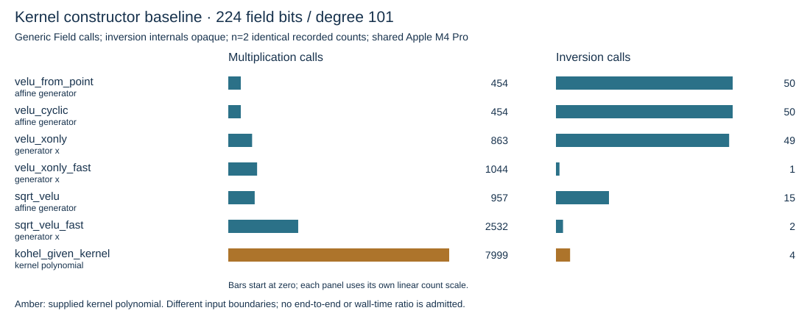
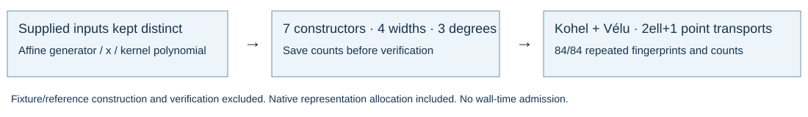

# Seven kernel constructor baselines

2026-10-15. Source `5521605f86ae444a9f4a433ca9b2f80d541e8470`. Two complete 84-case runs: seven methods, four field widths (192/224/256/511), degrees 7/31/101. The native reader accepted both runs and 84 paired output fingerprints. All four counted operations repeat exactly in every cell.

## Selected measured counts

224 field bits, degree 101; generic Field API calls per construction, inversion internals opaque.

| Method | Supplied input | Multiplication calls | Inversion calls |
|---|---|---:|---:|
| velu_from_point | affine generator | 454 | 50 |
| velu_cyclic | affine generator | 454 | 50 |
| velu_xonly | generator x | 863 | 49 |
| velu_xonly_fast | generator x | 1044 | 1 |
| sqrt_velu | affine generator | 957 | 15 |
| sqrt_velu_fast | generator x | 2532 | 2 |
| kohel_given_kernel | kernel polynomial | 7999 | 4 |

These are baseline counts, not optimization gains. Supplied-kernel and supplied-generator rows have distinct boundaries. Field/fixture generation, references, fingerprints and verification are excluded. Owned result allocation is included in the constructor.

Correctness: degree, codomain and full point transports at 2*ell+1 distinct non-kernel abscissae agree with both Kohel and point-enumerating Vélu. Counted/native outputs agree. These fixture fingerprints are distinct from the BMSS series' full coefficient comparison. The curves are synthetic field-width fixtures, not named NIST models.

Shared Apple M4 Pro, macOS ARM64, 14 logical CPUs, 48 GiB. No timing samples requested; zero qualified wall samples. Other physical CPU baselines and kernel optimization rounds remain open.

Binary SHA256: `e22a305acbd0ab58be40a7fe387867f10598255b3cf5ec03532d98fbb1b50c6e`. Comparison SHA256: `80dc2ebcf465fade24a71e55c47f366feed3ab200f1136196572b7ee8034c496`. Full raw runs, source and executable are retained in the neighboring evidence archive; see KERNEL_BASELINE_PROTOCOL.md.

Kohel's result contains all rational-map coefficients. The other constructor results store compact evaluation representations. Their build counts include different output materialization costs.
