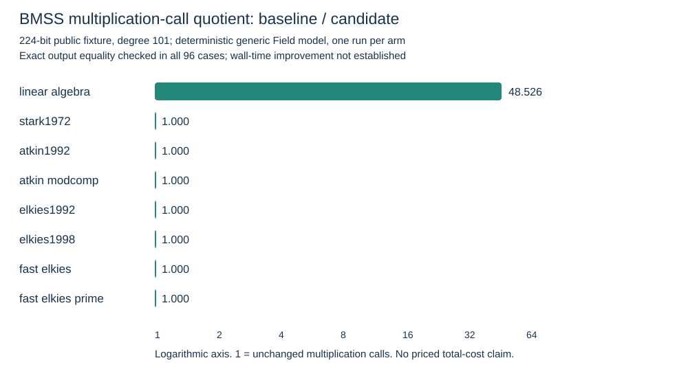

# BMSS constructor optimization — 2026-10-14

Measured generic Field calls, synthetic 224-bit fixtures, prime degree 101. Counts exclude fixture preparation and verification. Inversions are opaque; this is not an instruction or wall-time ratio.

| Algorithm | Baseline mul calls | Candidate mul calls | Call quotient | Baseline inv calls | Candidate inv calls |
|---|---:|---:|---:|---:|---:|
| linear_algebra | 273659435 | 5639435 | 48.526 | 611 | 611 |
| stark1972 | 10853630 | 10853630 | 1.000 | 1151 | 1151 |
| atkin1992 | 547470 | 547470 | 1.000 | 409 | 409 |
| atkin_modcomp | 627414 | 627414 | 1.000 | 417 | 417 |
| elkies1992 | 20109 | 20109 | 1.000 | 255 | 255 |
| elkies1998 | 11127 | 11127 | 1.000 | 249 | 249 |
| fast_elkies | 46958 | 46958 | 1.000 | 108 | 108 |
| fast_elkies_prime | 1073345 | 1073345 | 1.000 | 110 | 110 |

Source: comparison SHA256 `7f5cadad4bc607b456d15fcf60c4363a9243ab28732e44546ad309d883ba42bf`; baseline run SHA256 `8f18f33a0c688125bcdce22ad134dc1f25a38f8b2e9b8d84dbc904ffbf84d64e`; candidate run SHA256 `798a637961309efa2fea2fb6a7055ca505d46d32f1ac8f18d3c9087241c582fc`.

The linear-algebra rung moves row-independent series products into a column loop, without retaining an extra polynomial cache. The second rung batches fixed series/Newton denominators above their small-size thresholds. Separate rung receipts distinguish them. A rise in multiplications for batching is reported beside the decrease in inversions.

Native macOS runs used an Apple M4 Pro (14 logical cores, 48 GiB); this shared host had unrelated CPU jobs. No native wall samples were collected or promoted. The four-architecture GitHub matrix is implemented; its receipts must be examined before any other CPU measurement is credited.

Remaining requirements: qualified per-CPU A/A and interleaved A/B timings, additional constructors/finders/path families in INVENTORY.md, named P192/P224 whole-search/replay totals, and actual ReleaseMe asset publication. The earlier 2,000-map search requirement remains open.

Canonical graphs reviewed: docs/index-calculus-scoreboard.html, docs/ic/progress-timeline.json, docs/performance-gains/data.json and comparisons.csv, docs/curves/ and figures/. They describe DLP/rho, unrelated polynomial specialization or curve edges; this constructor operation-count result changes none of those records. It appears in the study graph and benchmarks index.

