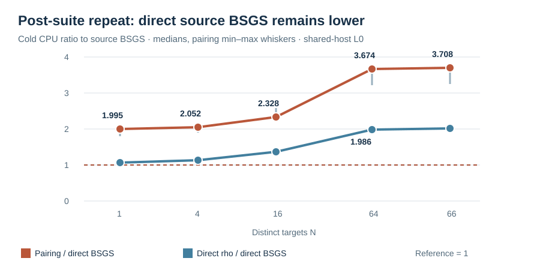

# Isogeny and torsion fiber next gates: native results

This report joins the bounded 2026-10-15 executions requested after the
[exact two-cell pairing result](pairing_transfer_20261015/RESULTS.md). Each
experiment has its own frozen protocol, native Rust source, public input,
raw receipts, independent arithmetic replay, run report, graph and PDF.
All recovered scalars below came from executable solver stages and passed
separate arithmetic replay. **Custody correction:** the χ V1/V2 runner
read the fixture's answer scalar for the framework's final equality
assertion, although its oracle and relation collector did not receive it.
The different-j and pairing solvers used public files without answer
scalars. A [separately frozen public-only χ repeat](chi_polynomial_20261015/PUBLIC_ONLY_PROTOCOL_V3.md)
is being implemented to close the whole-process input gap; the V1/V2
records remain unchanged. All timing is shared-host L0 on
Darwin arm64, macOS 26.6. The canonical counted-operation frontier remains
unchanged because these custom runners do not yet price every primitive in
ecbench's `S` unit or supply isolated, independent-host performance replay.
The run-source hashes in the frozen specs match committed snapshots
`4e15217f8` (χ), `c9ff8d1ab` (different-j audit) and `ab6142559`
(V6/V6B pairing). A later `rustfmt` pass changed only the text of the
different-j and pairing examples; the historical run source remains
reconstructible from those commits.

## What completed

| Gate | Exact bounded result | Evidence |
| --- | --- | --- |
| Nonfactorable χ polynomial decomposition | Cleared pair equations checked against exhaustive enumeration on 22/22 cases; 12/12 χ relation solves, with the same relation counts, rank and query trials as projected-pair control; 99 scalar records independently replayed across nine arms. | [χ exact check](chi_polynomial_20261015/reports/run-20261015T1635Z/REPORT.md), [χ full relation run](chi_polynomial_20261015/reports/run-20261015T1651Z/REPORT.md) |
| Direct source `S3` and quotient polynomial roots | Both returned the independent signed-pair sets on 22/22 smallest-cell targets; each solved 12/12 paired relation rounds at the same relation count, rank and trials as projected pairs. Across 11 arms, 123/132 scalars replayed and nine raw-pair rows capped. | [root exactness](chi_polynomial_20261015/reports/run-20261015T1827Z/REPORT.md), [paired solve](chi_polynomial_20261015/reports/run-20261015T1828Z/REPORT.md), [partial proof map](chi_polynomial_20261015/PROOF_MAP_ROOTS_V2.md) |
| Different-j explicit degree-three isogeny | `p=67`, source `j=7`, destination `j=11`, order-61 subgroup: source, image and direct-destination relation arms reached rank nine and recovered scalar 41 in each of three rounds. The independent checker verified 15/15 arm-round scalars on source and destination. | [paired solve](different_j_20261015/reports/run-20261015T1713Z/REPORT.md) |
| Rational torsion fibers and transport | The map sends 4575 source points onto 1525 destination points with exactly three preimages each. Its 61 subgroup images are distinct; all 3721 ordered subgroup-pair homomorphism checks passed. | [fiber audit](different_j_20261015/reports/run-20261015T1738Z/REPORT.md), [partial proof map](different_j_20261015/PROOF_MAP.md) |
| Reused pairing input and finite-field table | The added order-67 `F_401` subgroup supplies 66 distinct nonidentity public targets; V4/V5/V6/V6B/V7/V7B independently replayed 198/396/594/594/594/594 scalar records. V7/V7B add a direct source-group BSGS table with identical target order and cold setup. | [V3/V4](pairing_batch_20261015/reports/run-20261015T1725Z/REPORT.md), [V5](pairing_batch_20261015/reports/run-20261015T1729Z/REPORT.md), [V6](pairing_batch_20261015/reports/run-20261015T1740Z/REPORT.md), [V6B](pairing_batch_20261015/reports/run-20261015T1752Z/REPORT.md), [V7](pairing_batch_20261015/reports/run-20261015T1805Z/REPORT.md), [V7B](pairing_batch_20261015/reports/run-20261015T1822Z/REPORT.md) |

The different `j` values rule out a base-field or extension-field curve
isomorphism for the named pair. The exact three-point rational fibers do
not multiply order-61 target-subgroup images: the map is injective there.
That explains why paired source and image projected relation rows had
identical `(trials,relations)` in each round: `(22,19)`, `(11,11)`,
`(19,17)`. This is an exact bounded mechanism result, not a general
statement about all isogenies or factor bases. The local Lean module proves
the conditional order-61 kernel-to-injectivity implication and its arithmetic
prerequisites; its [proof map](different_j_20261015/PROOF_MAP.md) names the
unformalized concrete curve and Vélu bridge.

## Whole-method CPU at 64 distinct order-67 targets

The fixed generic reference is same-target, direct `F_401` negation rho.
For repeated targets, the cheaper complete direct source-group BSGS arm is
the applicable local multi-target reference. The V7B table uses the same
public inputs and one current-thread CPU unit. It includes
input parsing and subgroup validation, setup, H search, finite-field BSGS
table, all target solves and scalar checks for pairing, and all rho restarts
and checks, plus the cold direct source BSGS table and all lookups. Values
are medians of three rotated-order V7B rounds after the controlled release
test suite exited with 4,083 passed, zero failed and 117 ignored. Paired
ratios are calculated per round before taking their median.

| Variant | Median cold CPU (ms) | Paired candidate/direct-BSGS ratio at N=64 |
| --- | ---: | ---: |
| Direct prime-field BSGS, 9-entry reusable table | 0.378 | 1.000 |
| Direct prime-field rho | 0.938 | 1.986 |
| Pairing with reused H and finite-field table | 1.219 | 3.674 |

The direct source BSGS arm had lower whole CPU in every V7B round at every
prefix. At `N=64`, paired pairing/BSGS ratios were 3.224, 3.696 and 3.674;
rho/BSGS ratios were 2.482, 1.930 and 1.986. The quotient of displayed
medians is not used as a paired ratio. In the separate post-test V6B run,
which had no BSGS arm, pairing/direct-rho ratios were 1.944, 2.470 and
1.992; pairing/extension-rho ratios were 0.880, 0.823 and 0.745. The
earlier V5 pairing/extension-rho median ratio was 0.889, an
implementation-specific comparison with the weaker field representation.
The concurrent-test V7 median pairing/BSGS ratio was 5.190 at `N=64`;
the difference from V7B is shared-host timing variation, not an isolated
effect attribution. The V7B graph and raw files are in its
[run report](pairing_batch_20261015/reports/run-20261015T1822Z/REPORT.md).

The χ experiment's measured pipeline `S_cpu` equivalents were 29.64, 26.29,
89.42 and 142.80 times negation rho on the four frozen sizes. `S_cpu` is
a calibrated CPU equivalent; the recorded `s_counted_median` excludes the
χ polynomial primitive and is not a method cost. The different-j relation
arm median current-thread CPU was 151.541 µs on source and 178.958 µs after
transport, versus 75.709 µs for negation rho. These are separate workloads
and units from the order-67 batch; they are not pooled into the table.

The separately frozen direct-root V2 run found paired source-`S3`/rho
CPU ratios of 15.474, 6.014, 14.669 and 30.631; quotient-root/rho ratios
were 14.943, 8.328, 17.690 and 30.441. Every projected, χ finite-scan,
source-root and quotient-root arm shared its relation count, useful rank
and trials in each of 12 paired rounds. The V2 `S_cpu` covers the per-arm
pipeline but excludes common input parsing and calibration. Its
[single-unit table](chi_polynomial_20261015/reports/run-20261015T1828Z/REPORT.md)
includes all 11 arms and leaves the raw-pair cap rows censored.
The paired χ finite-scan/source-root pipeline CPU ratio medians were
2.124, 2.030, 3.848 and 7.234; this is a bounded implementation lead
with unchanged relation support, and rho remained lower in the same unit.

## Status and next discriminating work

- **Complete for the frozen cells:** χ equation enumeration, direct source
  `S3` and quotient polynomial roots and paired relation recovery;
  explicit different-j map, paired relation solve and scalar
  replay; exhaustive rational-fiber audit; 66-target pairing reuse with
  direct prime-field rho and source-group BSGS controls, post-suite same-input
  repeat and independent replay.
- **Partial formalization:** a pinned Lean 4 arithmetic and conditional
  kernel-to-injectivity module builds, using only standard `propext` and
  `Quot.sound` foundations. The direct-root
  [proof map](chi_polynomial_20261015/PROOF_MAP_ROOTS_V2.md) adds a checked
  conditional image-relation theorem for all four subgroup orders. Faithful
  formalizations of the concrete curves, Vélu maps, rational fibers and
  third-polynomial criterion remain open.
- **Unimplemented control:** a direct resultant/root implementation of the
  χ-coordinate pair equation. The earlier χ oracle enumerates polynomial
  candidates by a native finite-field scan; the V2 direct `S3` solver
  instead roots an abscissa quadratic, with a mapped quotient arm.
- **Measurement gap:** a portable full `S` conversion for the χ equation,
  map/table and finite-field primitives; isolated interleaved ecbench runs
  at increasing subgroup sizes; second-host exact replay. The local CPU
  receipts include the charged method phases; the root pipeline excludes
  common fixture parsing and calibration. None prove an
  asymptotic or general crossover. The same-input V6B timing repeat was
  [pre-registered](pairing_batch_20261015/REPEAT_V6B.md) and executed
  after the concurrent release test suite exited. V7 added a cold direct
  source-group BSGS arm under a separate
  [frozen protocol](pairing_batch_20261015/RUN_SPEC_V7.json), then V7B
  repeated the same input after the suite under its
  [frozen repeat](pairing_batch_20261015/REPEAT_V7B.md); all versions
  remain separate.

The [versioned next-gate protocol](NEXT_GATE_20261015.md) retains the
remaining controls. Its direct source `S3` and quotient-root subgates
are now executed; a χ-coordinate resultant and portable counted
primitive pricing remain. For the isogeny lead, compare a
factor base designed on the full 1525-point destination image with the
projected base, while charging image construction, lookup and rank; the
existing 61-point subgroup injection predicts no free threefold relation
gain from preimage multiplicity alone. For pairing, measure in the
portable counted unit on an isolated runner before interpreting the
observed ratios beyond this cell. Charge direct source BSGS alongside
rho on every repeated-target cell.
