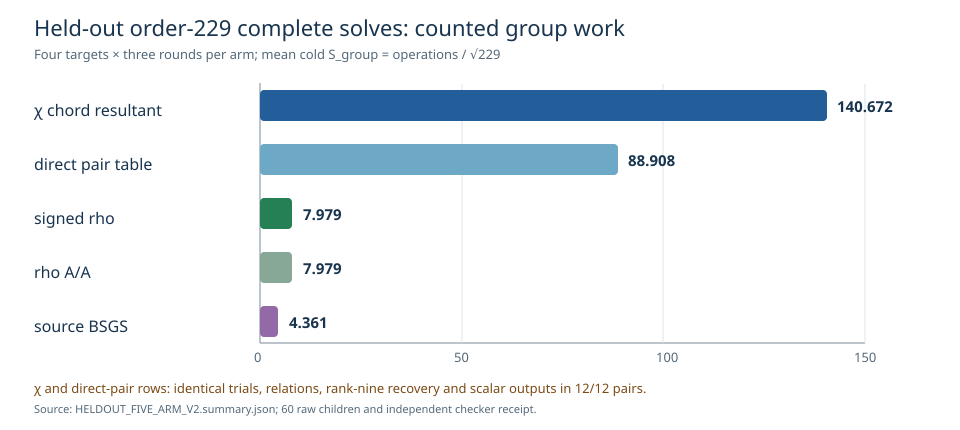

# Held-out χ resultant solves: five-arm native subset

**Status:** the V2 five-arm panel completed 60/60 same-target cold solves
on four held-out order-229 targets across three rotated rounds. A separate
Rust field/curve checker verified all 60 scalars on both different-`j`
curves, replayed both relation random streams, ranks and all 332 relation
witnesses, and checked BSGS and rho returned scalars and caps. The full
eight-arm Gate 2 and complete portable price remain open.

The [frozen public input](FOUR_TARGET_PUBLIC_V1.json) has SHA-256
`e1969305462131722556dead399593b77a919a8017f0e035e3019986b645958e`;
the separate [checker input](FOUR_TARGET_CHECKER_V1.json) binds the scalar
answers. [V2 run spec](HELDOUT_FIVE_ARM_SPEC_V2.json), [60 child records](heldout_five_arm_v2/),
[hash manifest](HELDOUT_FIVE_ARM_V2.artifacts.sha256),
[independent receipt](HELDOUT_FIVE_ARM_V2.check.json), and
[derived group summary](HELDOUT_FIVE_ARM_V2.summary.json) and
[whole-child meter summary](HELDOUT_FIVE_ARM_V2.meter_summary.json) give
the audit trail.
Each child was limited to 300 seconds and checked against 512 MiB observed
peak RSS. Darwin rejected both `RLIMIT_AS` and `RLIMIT_DATA` with
`EINVAL`, so this host could not enforce that memory limit in advance.
The two failed meter attempts are retained as
`METER_FAILED_RLIMIT_AS_V1.*` and `METER_FAILED_RLIMIT_DATA_V1.*`.

The generic two-class collision floor is `S_group=√(π/4)=0.886227`.
The reference here is same-target signed rho; all cells below use the
complete cold child counted-group tally divided by `√229`.
Field multiplications and inversions are the repository's `Fp` counters;
those counters include group arithmetic but omit some base-field square-root
internals, so they are a vector rather than a complete portable price.

| arm | verified children | mean cold `S_group` |
| --- | ---: | ---: |
| χ chord resultant | 12/12 | 140.672 |
| direct pair table | 12/12 | 88.908 |
| signed rho | 12/12 | 7.979 |
| rho A/A | 12/12 | 7.979 |
| source BSGS | 12/12 | 4.361 |

**Observed paired support:** χ and direct-pair had identical random
trials, relation witnesses, useful rank, and returned scalars in every
one of their 12 paired rows. The χ arm used 17.629 times rho's
counted-group work and 1.582 times direct pair's counted-group work.
Mean whole-child CPU, including startup and I/O, was 14.304 ms for
χ, 6.538 ms for direct pair, 6.428 ms for rho, 6.405 ms for rho A/A
and 5.899 ms for BSGS. The χ/rho and χ/direct whole-child CPU
ratios were 2.225 and 2.188. Inside the solver thread alone, the
corresponding ratios were 45.879 and 19.824; those exclude
process startup and I/O and are phase diagnostics. Whole-child
CPU is a descriptive L0 observation without isolation or
uncertainty admission. The direct-pair table setup is charged
in its child; neither CPU nor this operation vector is a
complete portable `S`.

**Preserved correction:** V1 also solved and independently checked
60/60 rows, but its rho and BSGS children needlessly constructed
the factor base, and direct-pair constructed the χ polynomial.
That V1 cost comparison is invalid. Its raw records, spec,
summary and [manifest](HELDOUT_FIVE_ARM_V1.artifacts.sha256)
remain available; V2 charges setup only where used.

The source and quotient `S_3`, direct inverse-Vélu and full-image arms
specified by [the eight-arm protocol](FOUR_TARGET_PROTOCOL_V1.md) are
unexecuted on these four held-out targets. The complete portable `S`
and isolated wall comparison are unset. The earlier χ-index and
`S_3` plots concern other fixtures and were left unchanged; this
graph is specific to the checked held-out panel.
