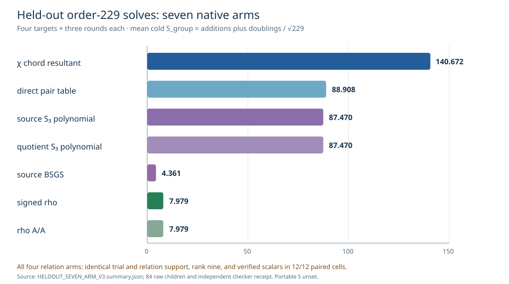

# Exhaustive S3 decomposition and seven-arm held-out solves

**Status.** The source and quotient S3 quadratic oracles returned exactly
the independently enumerated pair sets for every one of the 229 subgroup
points on each curve. The seven-arm panel then completed 84/84 cold solves
over four held-out order-229 targets and three rotated rounds. A separate
Rust checker replayed all 84 recovered scalars on both different-`j` curves,
every relation stream and 664 witnesses, row ranks, BSGS, and rho outputs.
The direct inverse-Vélu and full-image relation controls, complete portable
primitive price, and admitted isolated wall comparison remain open.

The [exhaustive spec](S3_EXHAUSTIVE_SPEC_V2.json),
[229 case rows and summary](S3_EXHAUSTIVE_V2.jsonl), and
[independent pair checker](S3_EXHAUSTIVE_V2.check.json) bind the first gate.
Each curve had 136 unordered signed-base pairs and 130 zero-pair cases;
the source and quotient pair sets matched one another in every case.
Each oracle executed 3,648 quadratics, inspected 7,264 roots, performed
1,096 exact checks, rejected 720 false candidates, recorded 32 degenerate
and one infinity case. The earlier summary-only V1 is preserved.

The [seven-arm protocol](HELDOUT_SEVEN_ARM_PROTOCOL_V3.md),
[frozen spec](HELDOUT_SEVEN_ARM_SPEC_V3.json),
[public input](FOUR_TARGET_PUBLIC_V1.json),
[separate scalar checker input](FOUR_TARGET_CHECKER_V1.json),
[84 child records](heldout_seven_arm_v3/),
[independent receipt](HELDOUT_SEVEN_ARM_V3.check.json),
[native summary](HELDOUT_SEVEN_ARM_V3.summary.json), and
[artifact hashes](HELDOUT_SEVEN_ARM_V3.artifacts.sha256) are the audit trail.
The public input SHA-256 is
`e1969305462131722556dead399593b77a919a8017f0e035e3019986b645958e`.
All children exited within 300 seconds and had observed peak RSS below
512 MiB. Darwin rejected the attempted address-space and data-size hard
limits in the earlier V2 meter checks; the memory ceiling here is observed.

The prespecified generic two-class floor is `S_group=√(π/4)=0.886227`.
The reference is same-target signed rho. The single table uses cold
counted-group additions plus doublings, including setup and final scalar
verification, divided by `√229`. Scalar multiplication increments its
add/double counters and is not charged again. This is a lower-bound
operation view: the reported field counts overlap group work, omit
base-field square-root internals, and leave allocation and I/O unconverted.

| arm | verified children | mean cold `S_group` |
| --- | ---: | ---: |
| χ chord resultant | 12/12 | 140.672 |
| direct pair table | 12/12 | 88.908 |
| source S3 polynomial | 12/12 | 87.470 |
| quotient S3 polynomial | 12/12 | 87.470 |
| source BSGS | 12/12 | 4.361 |
| signed rho | 12/12 | 7.979 |
| rho A/A | 12/12 | 7.979 |

**Observed relation effect.** All four relation arms used identical
trial counts, relation counts, rank-nine solves, and recovered scalars
in all 12 paired round-target cells. Each relation arm averaged 33.583
trials and 13.833 witnesses. The χ/rho counted-group ratio is 17.629,
the source and quotient S3/rho ratio is 10.962, and χ/direct-pair is
1.582. Under this factor base and target set, neither polynomial
oracle changed relation support.

**Whole-child CPU diagnostic.** Mean process CPU including startup and
I/O was 13.378 ms for χ, 6.596 ms for direct pair, 5.824 ms for
source S3, 6.013 ms for quotient S3, 5.972 ms for BSGS, 5.791 ms for
rho, and 6.129 ms for rho A/A. The χ/rho ratio was 2.310; source
S3/rho was 1.006 and quotient S3/rho was 1.038. Rho A/A differed by
1.058, and the shared Darwin L0 host was not isolated. These CPU and
wall observations are descriptive and are not an admitted wall result
or a portable `S` crossover. The S3/rho group ratio remains 10.962.

The [five-arm V2 report](HELDOUT_RESULTS_V2.md) is retained as a
historical run. Its source code and checker were frozen in that spec;
`FROZEN_HELDOUT_CHECKER_V2.rs` preserves the byte-identical checker
source before the V3 extension. The earlier χ-index and S3 plots
concern other fixtures and were left unchanged. This V3 graph is
specific to the matched held-out comparison.
