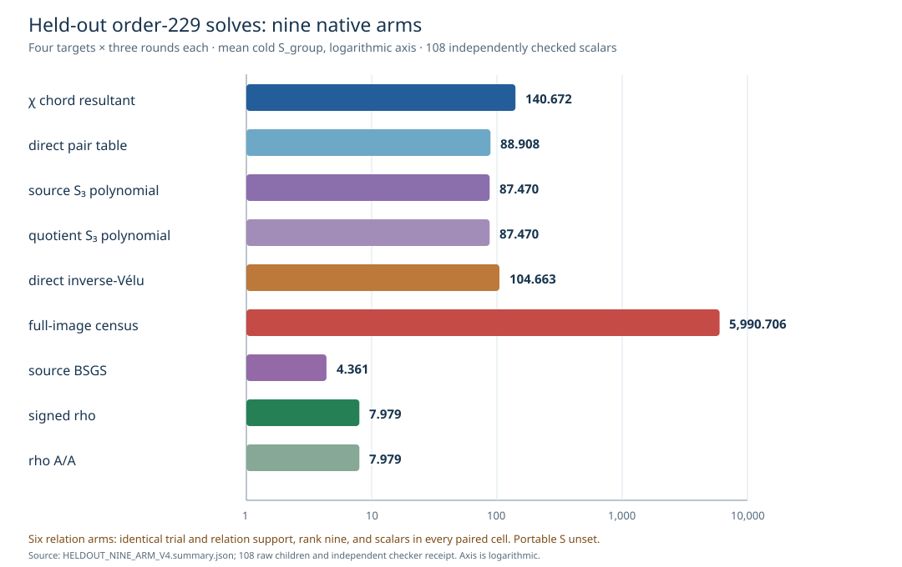

# Nine-arm held-out fiber comparison

**Status.** All nine prespecified arms completed 108/108 cold same-target
solves over four held-out order-229 targets in three rotated rounds. The
separate Rust checker independently replayed every scalar on the source
and different-`j` quotient, all six relation-arm random streams and
996 relation witnesses, every row rank, BSGS output, and rho result.
The native reducer confirmed identical trial counts, relation counts,
rank-nine outcomes, and scalars in all 12 round-target cells for χ,
direct pair, source S3, quotient S3, direct inverse-Vélu, and full-image.

The [V4 protocol](HELDOUT_NINE_ARM_PROTOCOL_V4.md),
[frozen binary/source spec](HELDOUT_NINE_ARM_SPEC_V4.json),
[public input](FOUR_TARGET_PUBLIC_V1.json),
[separate scalar checker input](FOUR_TARGET_CHECKER_V1.json),
[108 child records](heldout_nine_arm_v4/),
[independent receipt](HELDOUT_NINE_ARM_V4.check.json),
[native summary](HELDOUT_NINE_ARM_V4.summary.json), and
[hash manifest](HELDOUT_NINE_ARM_V4.artifacts.sha256) bind the result.
The public SHA-256 is
`e1969305462131722556dead399593b77a919a8017f0e035e3019986b645958e`.
The [V3 exhaustive source/quotient S3 receipt](S3_EXHAUSTIVE_V2.check.json)
and [V1 χ resultant receipt](RESULTS_V1.md) establish pair-set
exactness over their stated 229- and 231-case domains, respectively.

**Factor-base construction.** The direct inverse oracle inspected 27
destination points, made 27 cubic calls, rejected six points without
a rational root, made 23 split attempts, and accepted 21 image points
before selecting the eight published columns. The full-image arm
enumerated all 44,655 source group points and 14,885 image points.
Each cold child performed the construction independently. Both arms
asserted exact equality with the frozen projected eight-column base;
public preimage witnesses were not used to construct it.

The prespecified generic two-class floor is `S_group=√(π/4)=0.886227`.
The reference is same-target signed rho. Every row below is the cold
child's complete counted-group additions plus doublings, including
setup, queries, row solve's group work, and final scalar verification,
divided by `√229`. Scalar multiplication increments those add/double
counters and is not charged again. This is a lower-bound operation
view: the field counters overlap group work, omit some square-root
internals, and leave allocation and process I/O unconverted.

| arm | verified children | mean cold `S_group` |
| --- | ---: | ---: |
| χ chord resultant | 12/12 | 140.672 |
| direct pair table | 12/12 | 88.908 |
| source S3 polynomial | 12/12 | 87.470 |
| quotient S3 polynomial | 12/12 | 87.470 |
| direct inverse-Vélu | 12/12 | 104.663 |
| full-image census | 12/12 | 5,990.706 |
| source BSGS | 12/12 | 4.361 |
| signed rho | 12/12 | 7.979 |
| rho A/A | 12/12 | 7.979 |

The counted-group inverse/full-image ratio is 57.238; inverse/rho is
13.117, and full-image/rho is 750.773. Source and quotient S3/rho
are each 10.962, direct-pair/rho is 11.142, and χ/rho is 17.629.
The identical relation support means the new construction affected
setup cost, not relation yield, on this frozen cell.

**Whole-child CPU diagnostic.** Mean process CPU including startup
and I/O was 12.764 ms for χ, 5.358 ms for direct pair, 5.727 ms
for source S3, 5.697 ms for quotient S3, 6.700 ms for inverse,
58.728 ms for full image, 5.432 ms for BSGS, 5.704 ms for rho,
and 5.675 ms for rho A/A. The full/inverse CPU ratio is 8.766;
inverse/rho is 1.175. Rho A/A/rho is 0.995. Darwin L0 was shared,
so CPU and wall remain descriptive. All children stayed under the
300-second hard wall cap and observed 512 MiB RSS ceiling. Darwin's
address-space and data-size hard memory limits had failed with
`EINVAL` in the preserved V2 meter attempts.

The nine-arm relation comparison and independent row recovery gate
is complete at this order and these four targets. Complete portable
primitive `S`, independent Linux replay, L2 isolated wall admission,
and full-image feasibility at the four larger orders remain open.
The historical V1/V2/V3 reports and graphs remain unchanged and
specific to their frozen source and run versions. The new V4 graph
is the canonical chart for the nine-arm held-out comparison.
