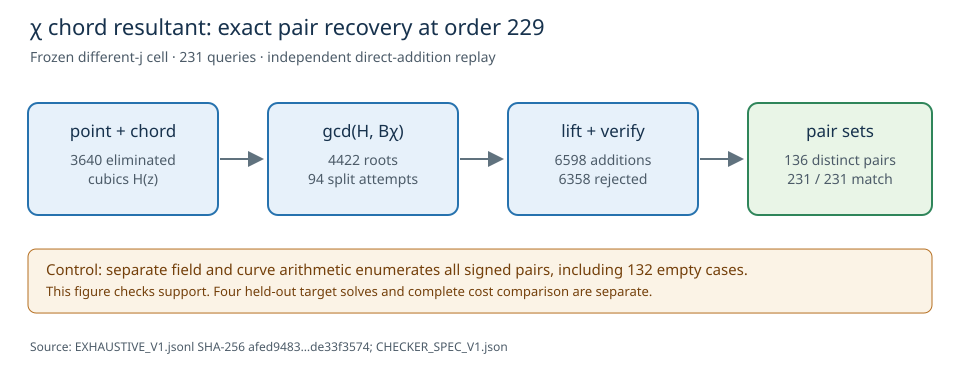

# Direct χ chord resultant: exhaustive different-`j` pair control

**Status:** the frozen exactness gate passed on the order-229
different-`j` source cell. A separately implemented field/curve checker
recomputed every returned unordered pair set. The four-target
relation solve and complete price comparison remain open.

The [frozen spec](RUN_SPEC_V1.json), [native resultant source](../../../../examples/different_j_chi_resultant.rs),
[231 raw case rows](EXHAUSTIVE_V1.jsonl), [independent checker spec](CHECKER_SPEC_V1.json),
and [checker receipt](EXHAUSTIVE_V1.check.json) bind this run. The raw
SHA-256 is `afed9483298b47d07cc2a7e548ff56724925f2520f199d4401861d4de33f3574`.
The independent checker used separate base-field and point formulas,
rebuilt the cofactor-projected signed base, enumerated all 136 valid
unordered pairs from direct group addition, and matched every reported
set. It checked all 229 subgroup points and `±(3,1)`, including **132**
zero-decomposition cases.

## Algebra and implementation

For finite `z=(y+1)/(y-1)`, set `d=z-1`, `n=z+1`. On the frozen source
`E:y²=x³−21x+37`, the point constraint is
`d²(x³−21x+37)−n²=0`. For a signed base point
`P=(x₁,y₁)` and query `R`, the line through `P` and `−R` has slope
`m` on the generic branch. Eliminating the second abscissa from the
line and point equation gives the cubic in `z₂`

`H(z₂)=L³−21m²d²L+37m³d³−m³dn²`, where
`L=mx₁d+n−y₁d`.

The oracle computes `gcd(H,Bχ)` with the degree-16 signed-base χ
polynomial, extracts all rational roots, recovers every matching base
index and checks each candidate by full source addition. Infinity,
vertical, tangent, horizontal and exceptional χ branches are handled
separately. Repeated roots are counted. A unit test checks that `H`
vanishes on an independent group-sum witness; another checks the
degree-three splitter. This is a direct eliminated polynomial oracle;
it has no precomputed pair-sum table.

| exactness / work axis | observed value |
| --- | ---: |
| subgroup plus torsion queries | 231 |
| zero-decomposition queries | 132 |
| distinct valid unordered pairs | 136 |
| chord resultants / polynomial gcds | 3,640 / 7,410 |
| extracted roots / signed-point lift scans | 4,422 / 71,136 |
| full candidate additions / rejected candidates | 6,598 / 6,358 |
| deterministic split attempts / exhaustive fallback evaluations | 94 / 0 |
| multiple-resultant-root observations | 34 |
| base-field multiplications / inversions (overlapping group work) | 7,279,901 / 304,601 |

The metered repeat used the same committed source and public input,
and matched every case and count after removing the nondeterministic
`wall_ns` summary field. Its independently replayed peak RSS was
**7,094,272 bytes**, below the frozen 512 MiB ceiling. The first
meter attempt exited 1 because macOS denied `sysctl kern.clockrate`
inside the sandbox; its stdout and stderr are retained as
[`EXHAUSTIVE_V1_METERED.*`](EXHAUSTIVE_V1_METERED.stderr).
The escalated meter run exited zero. Its 0.39-second real time is an
L0 shared-host correctness-run observation, with no cross-method
speed interpretation.

## Proof and next gate

The readable identity above follows by substituting
`L=mdx₂`, `n=dy₂` into `H`, then factoring
`m³d³(x₂³−21x₂+37−y₂²)`. The [proof map](PROOF_MAP_V1.md)
records the Lean declaration and its exact conditional scope.
The full finite-field root-completeness and exception theorem remains
unformalized; the 231-case exhaustive run checks only this fixed cell.

An exact oracle over the same factor base cannot alter which pairs
exist. The next complete solve therefore tests whether this
root procedure reaches useful rank at a different complete cost.
Four held-out public targets and the matched controls are required by
the [four-gate protocol](../../portable_order_trend_20261015/inverse_velu/FOUR_GATE_PROTOCOL_V1.md).
The earlier χ-index and S3 charts concern other cells, so they are
left unchanged; this report adds a cell-specific explanatory graph.
