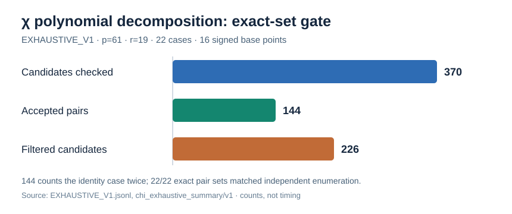

# Exhaustive chi-polynomial decomposition check, 2026-10-15

**Run ID:** `EXHAUSTIVE_V1`. **Status:** correctness gate passed for the exact
enumerated cases. This run did not measure a DLP solve or algorithm speed.

The frozen source was `E:y²=x³+1` over `F_(61²)=F_61[s]/(s²-2)`, source
identity `ICV1:fpk-61-2-a1837261:74:3648:0,0:unk:unk:r:a80f34705d92`,
subgroup order 19 and the 16 signed projected base points in the
[public fixture](../../../extension_field_20261014/FIXTURES.jsonl). Fixture
SHA-256: `1a63cc22a22e0fe27d44359325d502038d26d3ac616374fc5558c041939218b7`.
The native source was [`examples/chi_polynomial_decomposition.rs`](../../../../../examples/chi_polynomial_decomposition.rs)
at commit `8cde58c74`, SHA-256
`8591945b8085e300caad38f5bfabaa7db5ba676826558761089b4559a0cf7e9e`.
Host: shared Darwin machine, isolation L0. The run's compile time was 9m27s;
it is build overhead, not an algorithm timing.

Exact command from the worktree root:

```sh
cargo run --example chi_polynomial_decomposition -- exhaustive-chi research/isogeny_torsion_fibers_20261012/extension_field_20261014/FIXTURES.jsonl > research/isogeny_torsion_fibers_20261012/chi_polynomial_20261015/EXHAUSTIVE_V1.jsonl 2> research/isogeny_torsion_fibers_20261012/chi_polynomial_20261015/EXHAUSTIVE_V1.stderr
```

The polynomial solver built a degree-16 product of canonical chi roots, checked
the cleared cubic coordinate equation, translated each representative back by
its recorded order-three torsion correction, evaluated the cleared chord or
tangent equation, and checked candidate sums by full source-curve addition.
It held no pair-sum table. The reference enumerated all 136 unordered signed
base pairs independently for each queried point. Both returned **exactly the
same pair set** for each of 19 subgroup points and for separate `O,T,2T`
queries: 22/22 case equalities. `O` appears twice by design, once as
`subgroup/0` and once as `special/0`; the 144 accepted pair appearances thus
contain 136 across subgroup points plus 8 in the repeated `O` check.

The raw [case records](../../EXHAUSTIVE_V1.jsonl) report 352 base-polynomial
evaluations, 2,992 pair equations, 370 candidates sent to exact group addition,
144 accepted pair appearances, and 226 rejected candidates. Ten canonical
chi-key collisions occurred among the 16 signed points; the solver retained
the original lift and correction for each entry. These collisions and rejected
candidates are measured overhead, not extra relations. The diagram below uses
the candidate counts from the raw summary. The [stderr](../../EXHAUSTIVE_V1.stderr)
retains the native command and build output. The raw JSONL SHA-256 is
`b10720711ccb95e62797a464017a55cf345f0c43cef4b44ae9476f4b9e873638`.



The gate validates this **enumerative** polynomial solver on the smallest
frozen subgroup. It does not validate a fast resultant or root-finding
implementation, the larger three cells, relation rank and recovery, or a
complete-cost advantage. Those remain the paired-run obligations in
[`PROTOCOL.md`](../../PROTOCOL.md). No canonical performance graph or
scoreboard changed because this correctness run has no speed result.
