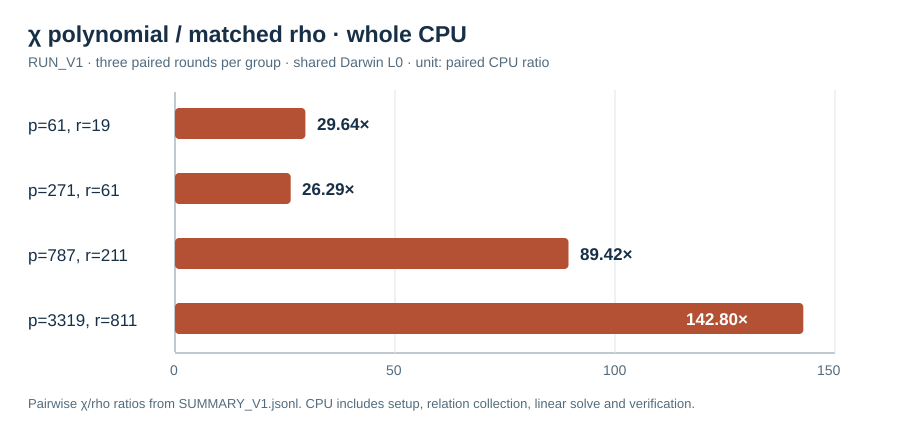

# χ polynomial paired relation run V1

Run start: 2026-10-15 16:51 UTC. Host: Darwin arm64, macOS 26.6, shared
host L0. Source and input hashes are frozen in [`RUN_SPEC_V1.json`](../../RUN_SPEC_V1.json).
The native `chi_polynomial_decomposition` example ran three rounds on each
frozen `(p,r)` cell `(61,19), (271,61), (787,211), (3319,811)` with nine
arms: raw pair, projected pair, χ orbit index, χ polynomial, isogeny image,
isomorphism image, negation rho, A/A negation rho and six-class rho. The
same public generator and Q, trial cap, and round seed were used per cell.

The χ polynomial arm evaluated cleared χ-coordinate pair equations without
a precomputed pair-sum table, filtered every polynomial candidate by exact
curve addition, and recovered an independently replayed scalar in all 12
runs. Its relation count, useful rank and query trial count matched the
projected-pair arm in each paired round. The raw-pair arm exhausted in nine
of its 12 slots; these are retained, not imputed as solves. The native
independent replay checked 99 scalar rows and identified the nine exhausted
raw controls among 108 slots.

| `(p,r)` | χ polynomial median `S_cpu` | projected pair median `S_cpu` | negation rho median `S_cpu` | paired χ/rho CPU ratio |
| --- | ---: | ---: | ---: | ---: |
| `(61,19)` | 717.54 | 248.45 | 22.04 | 29.64 |
| `(271,61)` | 293.97 | 142.92 | 12.48 | 26.29 |
| `(787,211)` | 880.07 | 208.16 | 10.80 | 89.42 |
| `(3319,811)` | 1441.84 | 214.26 | 10.10 | 142.80 |

Each value is the median of three rounds. `S_cpu` divides measured
whole-pipeline current-thread CPU ns by a calibrated source-curve-add CPU ns
and by `sqrt(r)`. It is a descriptive CPU equivalent, not the formal counted
unit `S`: the χ pair-equation primitive has no complete group-addition
conversion. The source summary file also contains a `s_counted_median`
field; that field **omits the priced χ polynomial primitive** and is not
used as a method cost or floor ratio. Shared-host wall times are retained
but do not establish an isolated speed comparison. A direct resultant/root
oracle and direct `S_3`/quotient polynomial controls remain unimplemented.

Raw and audit records: [`RUN_V1.jsonl`](../../RUN_V1.jsonl), SHA-256
`1032c1a29c70d93b18b39dd73c4a305292348f04ed2cbcb39c3df5ca21683ec6`;
[`SUMMARY_V1.jsonl`](../../SUMMARY_V1.jsonl);
[`REPLAY_V1.json`](../../REPLAY_V1.json), SHA-256
`3aab4f0066ed4bc287dcccda926054f953ca16fa3aa99206a85131dfb6c68d9c`.
The graph transcribes the four paired ratios in that summary. No canonical
scoreboard graph was changed: the run is L0, its counted χ cost is incomplete,
and it supplies no qualified ECDLP performance claim.
