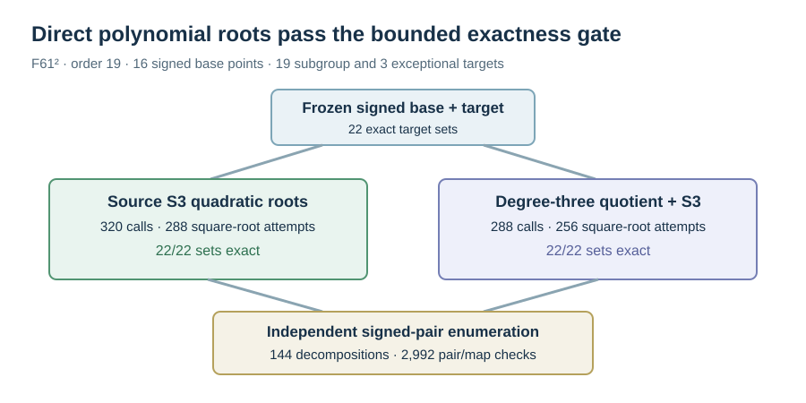

# Direct Semaev root and quotient exactness gate

Run: 2026-10-15 18:27 UTC, Darwin arm64, native Rust. The
[frozen V2 spec](../../RUN_SPEC_V2.json) pins the source, binary,
public fixture and [protocol](../../DIRECT_ROOT_PROTOCOL_V1.md). The
direct source arm treats the third summation polynomial as a quadratic
in the second signed-base abscissa. The quotient arm applies the
degree-three map to the base and target first and solves the same
polynomial on destination abscissae. Both match roots back to signed
base indices and check each candidate by exact source addition.

For `y²=x³+Ax+B`, the implemented polynomial is

`S3(x,u,z)=(x-u)²z²-2[(x+u)(xu+A)+2B]z+(xu-A)²-4B(x+u)`.

The discriminant/square-root path handles quadratic, linear and
all-root cases; infinity, vertical chords, repeated summands and
degree-three kernel points are explicit branches. A root is checked by
polynomial substitution before it is used. Exact source addition
resolves the sign ambiguity of abscissae. The rejected candidates below
are polynomial-root matches with the other sign, not false returned
decompositions.

On the frozen `p=61,r=19` cell, each arm's returned unordered signed-pair
set matched independent pair enumeration for **22/22 targets**: the 19
subgroup points and three exceptional points. There were 144 matching
decompositions in total, 16 signed base points, and 2,992 independently
computed source-pair additions plus quotient homomorphism checks. The
source arm used 320 polynomial calls and 288 square-root attempts; the
quotient arm used 288 calls and 256 square-root attempts. Exact candidate
checks were 544 and 592, respectively. Neither hit the 10⁷-call cap.

This is exhaustive on the stated signed base and target set. It is not
an exhaustive search over arbitrary extension fields or arbitrary factor
bases. The [raw per-target record](../../EXHAUSTIVE_ROOTS_V2.jsonl) has
SHA-256 `571a6774214064b531a1dad7a50ae969b6bb3c2c4103c87d893acf4bbdbb58a5`;
stderr is retained beside it. The subsequent paired relation run has
its own [report](../run-20261015T1828Z/REPORT.md).
