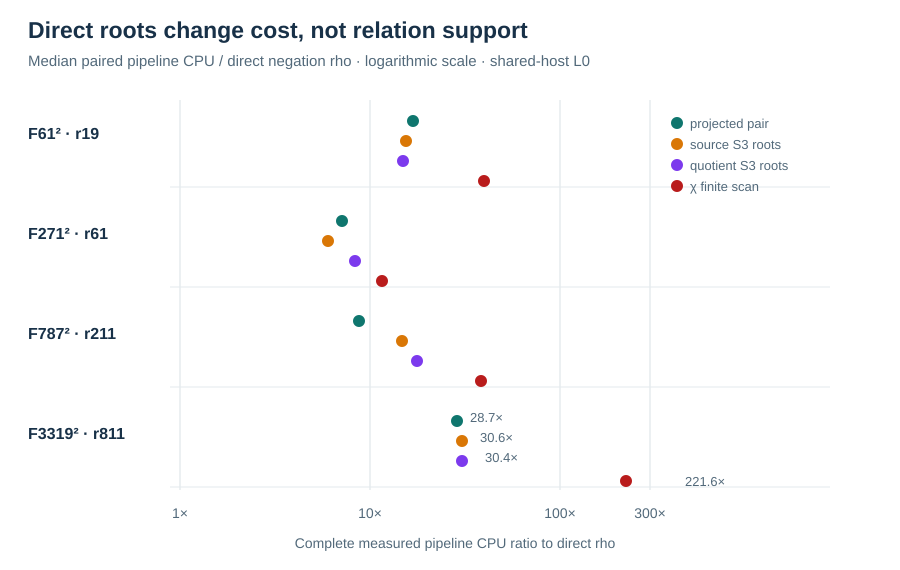

# Direct Semaev and quotient polynomial relation solve

Run: 2026-10-15 18:28 UTC, Darwin arm64, macOS 26.6, shared L0.
The [V2 run spec](../../RUN_SPEC_V2.json), committed before execution,
pins the native source and binary hashes, four fixed `F_(p²)` fixtures,
three seeds, relation caps, arm order and memory limit. The
[exactness gate](../run-20261015T1827Z/REPORT.md) passed before this
run. The direct source and quotient arms solve `S3` as a quadratic in a
signed-base abscissa, then verify each candidate by exact source
addition; neither uses a precomputed pair-sum table.

**Answer custody:** the V2 runner read each fixture's planted scalar for
the framework's final assertion; neither root oracle nor the relation
collector received it. Its separate arithmetic replay checks the
reported answers. A [public-only V3 protocol](../../PUBLIC_ONLY_PROTOCOL_V3.md)
keeps the same targets and moves answer access entirely to the checker.

Both new arms returned the correct scalar in **12/12** paired rounds
each. An independent `u128` field and curve checker replayed **123/132**
arm-round scalar outputs across all 11 arms; the other nine slots are
the raw-pair arm's recorded trial-cap exhaustions at the three larger
cells. The new arms had zero cap hits. In every cell and round, both
new arms, the χ finite-scan and the projected-pair control had identical
relation counts, useful rank and query trials. By round these were:

| `p,r` | Relations and rank, rounds 0/1/2 | Trials, rounds 0/1/2 |
| --- | ---: | ---: |
| 61,19 | 8 / 7 / 9 | 8 / 10 / 11 |
| 271,61 | 8 / 7 / 7 | 8 / 8 / 7 |
| 787,211 | 14 / 12 / 13 | 16 / 13 / 14 |
| 3319,811 | 9 / 16 / 9 | 14 / 16 / 9 |

The table's single cost unit is `S_cpu`: measured per-arm pipeline
current-thread CPU divided by the independently calibrated source
addition CPU and `sqrt(r)`. It includes factor-base construction,
polynomial/map setup and calls, failed candidates, relation collection,
rank/linear solve, target recovery and scalar verification. It excludes
common fixture reading, calibration measurement and process startup.
These are complete *measured pipeline* costs, not portable counted-`S`
or isolated wall-time costs. A cap row has no completed-method `S_cpu`.
Each displayed value is the median of three rotated-order rounds;
the direct negation rho row is the same-target reference.

| Arm | `r=19` S_cpu | `r=61` | `r=211` | `r=811` |
| --- | ---: | ---: | ---: | ---: |
| Direct negation rho | 16.8 | 23.5 | 18.4 | 6.8 |
| Direct negation rho A/A | 16.0 | 11.9 | 16.9 | 6.0 |
| Six-class rho | 22.5 | 18.5 | 20.3 | 7.8 |
| Raw-pair baseline | 337.7 | cap | cap | cap |
| Projected-pair baseline | 281.7 | 132.2 | 141.1 | 200.9 |
| χ orbit index | 496.9 | 187.6 | 178.3 | 277.0 |
| χ finite-scan polynomial | 666.2 | 263.2 | 626.5 | 2067.0 |
| Direct source `S3` roots | 267.5 | 131.2 | 174.6 | 196.1 |
| Direct quotient `S3` roots | 265.2 | 242.4 | 174.5 | 202.6 |
| Isogeny-image projected pair | 194.2 | 274.6 | 250.1 | 198.0 |
| Scaling-isomorphism projected pair | 202.2 | 189.2 | 222.4 | 201.3 |

The paired source-root/negation-rho CPU ratio medians were 15.474,
6.014, 14.669 and 30.631 at increasing `p`; quotient-root medians
were 14.943, 8.328, 17.690 and 30.441. The source-root/projected-pair
paired ratios at `p=3319` were 1.422, 0.640 and 0.752 (median 0.752):
the two methods' relation outcomes were identical, and the three
timings vary too much to attribute a stable implementation advantage.
At `p=271`, the rho A/A median paired ratio to rho was 0.522, another
direct indication of L0 noise. Root construction does remove the
signed-base pair scan; its polynomial field work and root extraction
are fully reflected in the local CPU record and primitive counters.
Against the earlier χ *finite scan* arm on the exact same V2 rounds,
the paired finite-scan/source-root CPU ratio medians were **2.124,
2.030, 3.848 and 7.234** across the four cells. This is a measured
pipeline implementation improvement within the polynomial approach,
while relation outcomes stayed fixed and direct rho remained lower.

The polynomial arm remains slower than direct rho on every frozen cell
by this measured CPU unit. No relation-yield gain from the quotient
appeared with the projected base. No increasing-order, isolated
wall-time, portable counted-`S`, or second-host claim follows.
The canonical frontier is unchanged. A full-image destination factor
base is a separate preregistered gate.

[Raw 136-line record](../../RUN_ROOTS_V2.jsonl), SHA-256
`4f0c090af106be03d39dac2379bc0c4c968e095a0e7b472a814dcbca0569c0fc`;
[independent replay](../../REPLAY_ROOTS_V2.json), SHA-256
`bbe6ad66572b0741a646c051662f4501319f1dfc61f4fd100717d80adc3af608`;
[native summary](../../SUMMARY_ROOTS_V2.jsonl), SHA-256
`554e078ea16fcda6c1e35b3e73e6fd6d388fce8f96116f2e4b8935e5948a0b9c`.
All stdout and stderr are retained beside these files.
