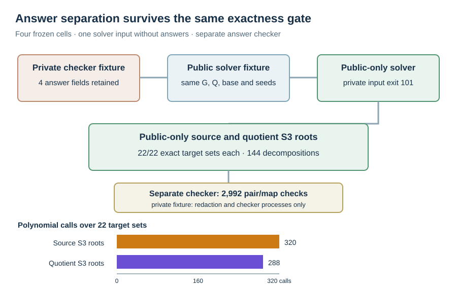

# Public-only χ root input and exactness gate

Run: 2026-10-15 18:50 UTC, native Rust on Darwin arm64. The
[V3 protocol](../../PUBLIC_ONLY_PROTOCOL_V3.md) and
[hash-pinned spec](../../RUN_SPEC_V3.json) keep the V2 target points,
factor bases, seeds and arms. The new
[public fixture](../../PUBLIC_FIXTURES_V3.jsonl), SHA-256
`bfe512594006202477845574a1778b6b41a7b9acfddae1ca45a0478756fb2a4e`,
was generated by native code removing exactly four `answer_scalar`
fields. The [freeze receipt](../../PUBLIC_FREEZE_V3.json) records the
private input hash and public hash. No answer scalar is present in the
solver's file. A separate checker later compared the public and
private JSON objects field by field after that removal.

As a fail-closed input test, the public-only executable was passed the
private fixture and exited **101** before timing or relation collection;
its [stderr](../../PRIVATE_INPUT_REJECTION_V3.stderr) says `public input
contains answer scalar`. The public-only exactness command then used
only the redacted file. Direct source `S3` roots and quotient `S3`
roots each returned the independent signed-pair set on **22/22**
smallest-cell targets: 19 subgroup points and three exceptional points.
There were 144 decompositions and 2,992 independent pair-addition and
quotient-homomorphism checks. Neither arm hit the polynomial-call cap.
The source and quotient arms made 320 and 288 polynomial calls,
respectively, across the same 22 target sets.

This is a public-input custody and bounded exactness result for the
stated four fixtures and the 16-point signed base at `p=61`. It does
not prove the full summation-polynomial criterion over arbitrary curves.
The [public exactness raw](../../EXHAUSTIVE_PUBLIC_V3.jsonl) has SHA-256
`e899f9ebc015f8f051b4b0a0919c032b8542601cfc06977629b19a98e53b5110`.
The [paired public-only relation report](../run-20261015T1851Z/REPORT.md)
records scalar replay and cost. The native redaction process read the
private fixture to create the public input; the independent checker read
it again after the run. The solver process did not read it. This corrects
the overly narrow custody sentence in the frozen
[V3 protocol](../../PUBLIC_ONLY_PROTOCOL_V3.md); the
[versioned correction](../../PUBLIC_ONLY_PROTOCOL_V3_CORRECTION.md)
describes the actual process boundary.
