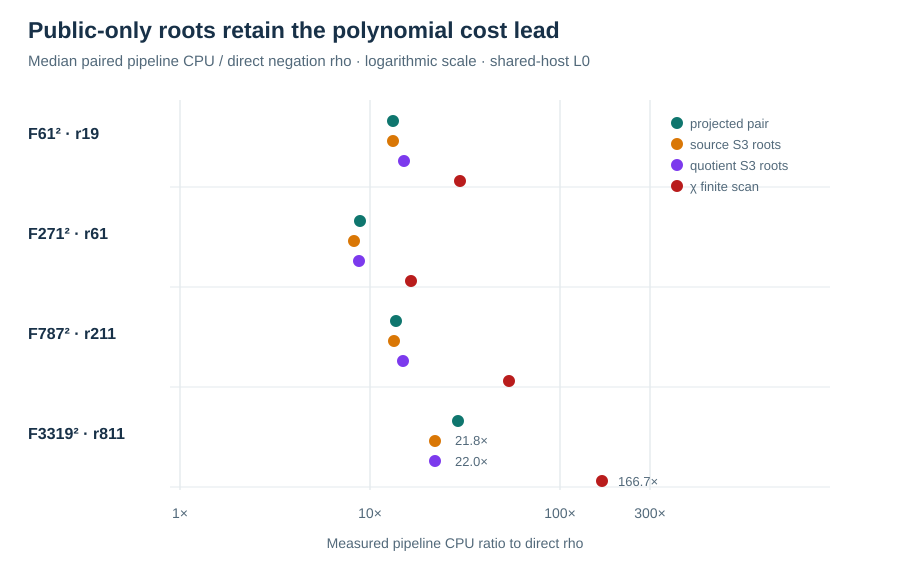

# Public-only direct Semaev and quotient relation solve

Run: 2026-10-15 18:51 UTC, Darwin arm64, macOS 26.6, shared L0.
The committed [V3 spec](../../RUN_SPEC_V3.json) pins source, framework
and binary hashes and the [redacted solver input](../../PUBLIC_FIXTURES_V3.jsonl).
The public-only solver rejected an answer-bearing fixture before this
run; its [exactness and custody report](../run-20261015T1850Z/REPORT.md)
records 22/22 source and quotient decomposition sets, 144
decompositions and 2,992 independent pair/map checks.

The V3 solver process read no answer fixture and received no planted
scalar in the framework. The framework still required `[k]G=Q` for each
`verified` result. In a separate process, the checker confirmed that
the public input differed from the private fixture only by four removed
answer fields and independently replayed **123/132** arm-round scalars
with its own `u128` field/curve arithmetic. The other nine slots were
the raw-pair control's inherited cap exhaustions. Direct source `S3`
and quotient `S3` each recovered the scalar in **12/12** paired rounds,
without a polynomial cap hit. The χ finite-scan and projected-pair
controls also solved 12/12. For all 132 arm-round rows, the ordered
tuple `(p,round,arm,recovered,relations,trials,rank,status)` matched V2
byte for byte after extracting those fields from both raw JSONL files;
the normalized 132-line streams shared SHA-256
`a81d276795eaba025a424c91b42145c09bd7b69f51ba43a9c4fd949ef798ae0d`.
The extraction command is `jq -c 'select(.kind=="run") |
[.p,.round,.arm,.result.recovered,.result.decomposition.relations_found,
.result.decomposition.targets_tried,.result.linear_algebra.rank,.extra.status]'`.
V2 and V3 timing values are separate shared-host observations, not a
paired before/after speed estimate.

The single table unit is `S_cpu`: measured per-arm pipeline
current-thread CPU divided by calibrated source-addition CPU and
`sqrt(r)`. It includes factor-base construction, polynomial/map setup
and calls, failed candidates, relations, rank/linear solve, recovery
and scalar verification. It excludes common input parsing, calibration
measurement and process startup. Each value is the median of three
rotated-order rounds; `cap` means no completed-method `S_cpu`.

| Arm | `r=19` S_cpu | `r=61` | `r=211` | `r=811` |
| --- | ---: | ---: | ---: | ---: |
| Direct negation rho | 18.1 | 14.8 | 28.2 | 5.0 |
| Direct negation rho A/A | 14.7 | 11.2 | 20.3 | 4.4 |
| Six-class rho | 19.7 | 14.6 | 24.6 | 6.7 |
| Raw-pair baseline | 142.3 | cap | cap | cap |
| Projected-pair baseline | 238.4 | 148.6 | 231.5 | 148.0 |
| χ orbit index | 211.9 | 149.7 | 264.8 | 246.5 |
| χ finite-scan polynomial | 491.9 | 264.6 | 1032.6 | 1255.4 |
| Direct source `S3` roots | 233.4 | 135.5 | 294.4 | 150.3 |
| Direct quotient `S3` roots | 238.2 | 146.2 | 227.8 | 156.5 |
| Isogeny-image projected pair | 180.7 | 232.8 | 250.8 | 218.6 |
| Scaling-isomorphism projected pair | 250.0 | 129.9 | 214.7 | 174.0 |

The paired source-root/negation-rho CPU ratio medians were **13.237,
8.254, 13.427, 21.844** at the four cells. Paired χ finite-scan /
source-root medians were **2.125, 1.988, 3.864, 7.571**: direct root
extraction retains the bounded implementation improvement within this
polynomial route. Relation counts, useful rank and query trials were
identical for the finite-scan, source-root, quotient-root and projected
arms in every round. Direct rho remained lower than either root arm in
the measured pipeline unit at every cell. V3 source-root/projected-pair
paired ratios were 0.979, 0.993, 1.082 and 0.934; the round spread and
rho A/A variation do not isolate a stable advantage over indexing.

This is an answer-separated correctness and local-cost result on four
fixed groups. It does not establish portable counted `S`, isolated wall
speed, increasing-order scaling, or an independent-host performance
replay. The complete input and process-startup cost is also outside the
IC pipeline timer, so no fully priced method crossover is claimed.
The canonical frontier remains unchanged. The direct χ-coordinate
resultant and a destination full-image factor base remain separate
experiments.

[Public-only raw record](../../RUN_PUBLIC_V3.jsonl), SHA-256
`8a63b7c543392d3dcad9225cf33c0fe1e4adb36b6235dcc8747a697214b1fd55`;
[custody and independent replay](../../REPLAY_PUBLIC_V3.jsonl), SHA-256
`024674afd5d78674f807b4a7f20eeed796ed34181fe5e7c2786b08d4b4ef95da`;
[native summary](../../SUMMARY_PUBLIC_V3.jsonl), SHA-256
`7e1060755c03fb47711bce7b563cda09c2371e769d3893474874c9b8846c701c`.
All stderr and the private-input rejection status are retained beside
these files.
