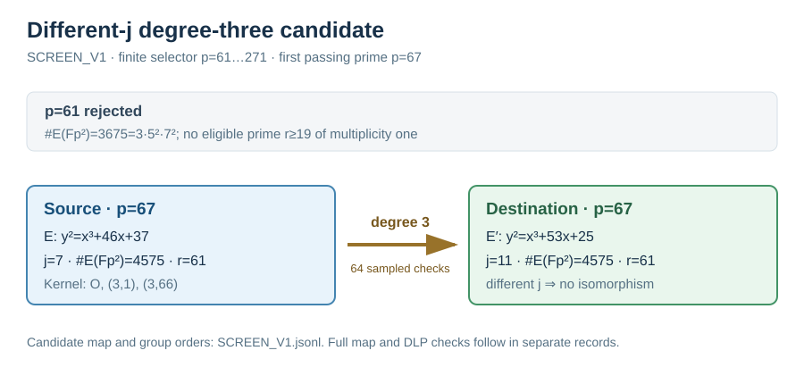

# Different-j degree-three candidate screen, 2026-10-15

**Run ID:** `SCREEN_V1`. **Status:** first candidate satisfying the frozen
selector was found at `p=67`. This is a candidate screen, before fixture
freeze or paired relation solves.

The [protocol](../../PROTOCOL.md) fixed `E:y²=x³−21x+37`, rational
`T=(3,1)` of order three, ascending primes `61≤p≤271` with `p=1 mod 3`,
and a prime-order subgroup `r≥19` occurring once in `#E(F_(p²))`. The native
[screen source](../../../../../examples/nonisomorphic_extension_isogeny.rs)
at commit `8cde58c74` had SHA-256
`6e6a6138178b79eb1aa5f3920518d52c436c5cce48d6913494780552ff396085`.
Host: shared Darwin machine, isolation L0. The command was:

```sh
cargo run --example nonisomorphic_extension_isogeny -- screen > research/isogeny_torsion_fibers_20261012/different_j_20261015/SCREEN_V1.jsonl 2> research/isogeny_torsion_fibers_20261012/different_j_20261015/SCREEN_V1.stderr
```

At `p=61`, `#E(F_(p²))=3675=3·5²·7²`; the first selector rejected it because
there was no qualifying prime factor. At `p=67`, the source and destination
each had `#E(F_p)=75` and `#E(F_(p²))=4575=3·5²·61`, with `r=61` and
cofactor 75. Modulo 67 the source coefficients were `(a,b)=(46,37)`, the
destination coefficients `(53,25)`, and their computed j-values were 7 and
11. The kernel was `{O,(3,1),(3,66)}`. The implemented Vélu sum map passed
64 sampled on-curve and homomorphism checks. Differing j-values rule out an
isomorphism over the base field for these nonsingular models; see the
[MIT 18.783 lecture on j](https://math.mit.edu/classes/18.783/2022/LectureSlides13.pdf).
The diagram marks the sampling status rather than a proof of the general map.



The compact [raw records](../../SCREEN_V1.jsonl), SHA-256
`be2094594f2ca0e7ec49d221a8d9865b5d5ecf640922cd0541520f414ac29707`,
and [stderr](../../SCREEN_V1.stderr) retain both evaluated candidates and
the build command. The candidate's full curve identity, frozen public target,
all-point map check, paired source/destination relation recovery, and
independent source-scalar replay remained pending after this screen. The
canonical performance graphs were checked and left unchanged because this
run measured no DLP speed.
