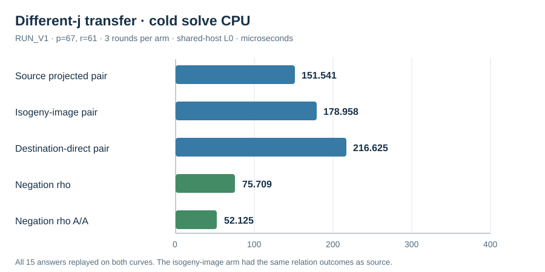

# Different-j paired relation solve V1

Run start: 2026-10-15 17:13 UTC. Host: Darwin arm64, macOS 26.6,
shared-host L0. The [frozen run spec](../../RUN_SPEC_V1.json) fixes source
and public input hashes, three round seeds, eight columns, trial cap 1220,
and charged negation-rho retries. The solver read
[`PUBLIC_V1.json`](../../PUBLIC_V1.json), which has no answer scalar; the
post-solve fixture was opened only by the independent replay process.

Over `F_(67²)` with `s²=2`, the source is `y²=x³+46x+37`, `j=7`,
ICV1 `ICV1:fpk-67-2-4083a0ca:-85:4575:7,0:unk:unk:r:653aff0a31ca`.
The explicit degree-three Vélu map with kernel `{O,(3,1),(3,66)}` reaches
`y²=x³+53x+25`, `j=11`, ICV1
`ICV1:fpk-67-2-4083a0ca:-85:4575:11,0:unk:unk:r:3dc527efd80b`.
Differing j-values exclude a field isomorphism between these nonsingular
curves. Both have 4575 rational points, `r=61`, cofactor 75.

Every source, isogeny-image and independently scanned destination-direct
relation arm attained rank nine, recovered scalar 41, and checked it on
both curves. Source and image arms had exactly matching `(trials,relations)`
per round: `(22,19)`, `(11,11)`, `(19,17)`. The destination-direct arm used
`15,11,21` trials. Both rho arms recovered the same scalar. The separate
checker used its own field and group formulas, checked 15 of 15 arm-round
records and tested both source and destination scalar equalities.

| Arm | Median whole CPU (µs) | Range (µs) | Verified rounds |
| --- | ---: | ---: | ---: |
| Source projected pair | 151.541 | 122.500–159.500 | 3/3 |
| Isogeny-image projected pair | 178.958 | 169.500–388.250 | 3/3 |
| Destination-direct projected pair | 216.625 | 117.625–309.125 | 3/3 |
| Negation rho | 75.709 | 52.500–88.417 | 3/3 |
| Negation rho A/A | 52.125 | 52.125–61.083 | 3/3 |

All CPU values include cold factor-base construction, map evaluation where
used, pair-table setup, failed queries, exact relation checks, linear
algebra, target recovery and scalar verification; rho rows include charged
attempts. The ranking is descriptive L0 only. The runs use a native custom
harness, not a sealed ecbench session, and no counted-unit conversion covers
all map and table primitives. The [fiber audit](../run-20261015T1738Z/REPORT.md)
checks the exact three-to-one rational fibers and order-61 injection.

Raw records: [`RUN_V1.jsonl`](../../RUN_V1.jsonl), SHA-256
`3e25b3f278977662a33dea7ac932ee49f6de512cec781febd5e43f759c9d0ef2`;
[`REPLAY_V1.json`](../../REPLAY_V1.json). Individual arm-round JSONL and
stderr files preserve run order and any error. The graph transcribes the
five median CPU values above. No canonical ECDLP graph was changed because
the run is an L0 small-group comparison and does not establish a new cost
boundary.
