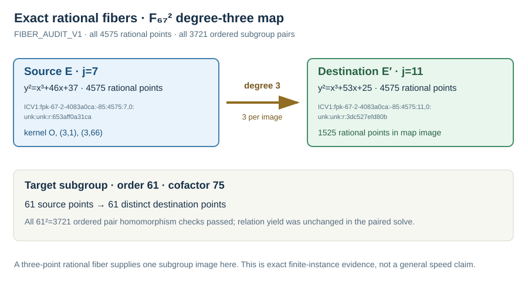

# Exhaustive rational-fiber audit on the different-j map

Run start: 2026-10-15 17:38 UTC. Host: Darwin arm64, macOS 26.6,
shared-host L0. The [frozen audit spec](../../FIBER_AUDIT_SPEC_V1.json) pins
the native source and public input hashes. Its command was
`target/release/examples/nonisomorphic_extension_isogeny audit-fibers PUBLIC_V1.json`.

The explicit degree-three map from
`ICV1:fpk-67-2-4083a0ca:-85:4575:7,0:unk:unk:r:653aff0a31ca` to
`ICV1:fpk-67-2-4083a0ca:-85:4575:11,0:unk:unk:r:3dc527efd80b`
was evaluated on every one of the 4575 source points over `F_(67²)`,
including identity. All images were on the destination curve. Exactly 1525
distinct destination points appeared, and each had exactly three rational
source preimages. The kernel points are `{O,(3,1),(3,66)}`. The rational
image therefore occupies one third of the 4575-point destination group.

On the frozen order-61 subgroup, the 61 images were distinct. Every one of
the 3721 ordered subgroup point pairs passed the source sum, destination
sum and mapped-sum checks. This is exact finite-instance evidence for
injective target-subgroup transport. It explains why the [paired source and
isogeny-image relation runs](../run-20261015T1713Z/REPORT.md) had identical
relation counts, rank and trials on the same projected factor base: the
three-point rational fiber does not create three distinct order-61 images.
The earlier conditional quotient-support Lean result is mapped in
[`torsion_orbit_20261013/PROOF_MAP.md`](../../../torsion_orbit_20261013/PROOF_MAP.md);
the [local proof map](../../PROOF_MAP.md) states the missing concrete-curve
formalization. This finite audit is not a universal theorem about all
degree-three isogenies.

Raw record: [`FIBER_AUDIT_V1.json`](../../FIBER_AUDIT_V1.json), SHA-256
`1f193f5ec8bb90f2fb7c742fd6d82cd131410a0fcde688b8f61df5df03d94004`.
It records 24,142 group additions, 243 doublings, 691,290 base-field
multiplications, 28,387 inversions, 5,425,167 current-thread CPU ns and
6,733,824 bytes peak RSS for the exhaustive audit. These are correctness
audit costs, not charged to the target DLP method. No performance scoreboard
graph changed; this adds exact structural evidence for one frozen map.
