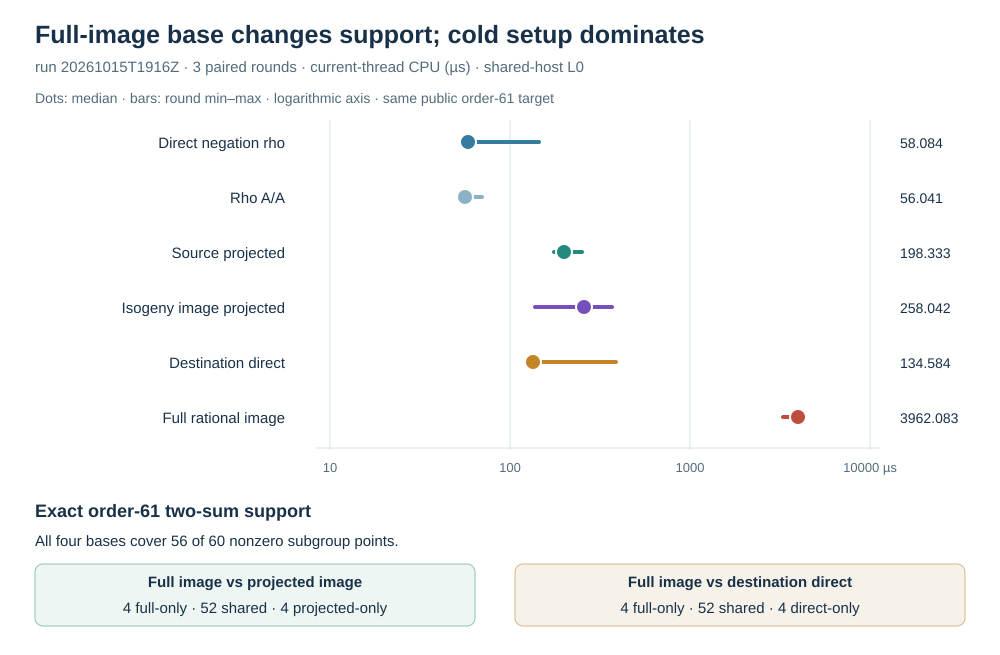

# Full rational-image factor base: exact support and complete local solve

Run start: 2026-10-15 19:16 UTC. Host: Darwin arm64, macOS 26.6,
shared L0. The [protocol](../../PROTOCOL_V1.md) was committed as
`c8fabd428` before implementation; the
[V2 run spec](../../RUN_SPEC_V2.json) pinned source SHA-256
`3e7452d3d7c0cbb421c60da6d90b2ba42cddeea7e1cb90d51423511d9f33f28e`,
binary SHA-256
`54254777a50c0d86ab1a87a25b6941426595d28e5872b5797f0a13364ac5c294`,
[public solver input](../../PUBLIC_V2.json) SHA-256
`75fded656d5fba32418e8a6231fb81e46412b8ae088b496dc4a1427e9fd14967`,
and [run script](../../run_v2.zsh) before relation measurement. The
native source is [nonisomorphic_extension_isogeny.rs](../../../../../examples/nonisomorphic_extension_isogeny.rs).

The same public order-61 source target over `F_(67²)` was transported
through the explicit degree-three map from `j=7` to `j=11`. The native
full-image constructor enumerated 4,575 source points, verified 1,525
distinct rational image points with three preimages each, and selected
eight projected sign orbits after 21 destination candidates in sorted
key order. It stored eight source preimage witnesses in the answer-free
input. The four relation arms were source projected, isogeny-image
projected, destination-direct and full-image destination; same-target
negation rho and rho A/A were rerun in three rotated rounds. Every
relation arm used the inherited 1,220-trial cap and reached rank nine.
All 18 arm-round rows recovered scalar **41** and passed their own source
and destination checks. No arm hit its cap or 512 MiB RSS ceiling.

The separate [Rust replay](../../REPLAY_V2.jsonl) checked all **18/18**
scalars with its own field and point-add formulas, the eight selected
preimage/map/projection witnesses, all **178** reported relation
witnesses, and every arm's exact pair-sum support count. A
[separate native subgroup-coordinate census](../../SUPPORT_V2.json) found exactly 56 of
60 nonzero sums for each base. Source and isogeny-image projected
support sets were identical. Full-image support shared **52** points
with projected-image support and had four points absent from that set;
the projected image likewise had four absent from full-image support.
Full-image versus destination-direct also shared 52 with four unique
points on each side. Thus equal support *counts* concealed different
support *sets*. Full-image relation `(trials,relations)` were
`(11,10)`, `(23,19)`, `(11,11)`; destination-direct had `(15,14)`,
`(11,11)`, `(21,19)`. Source and isogeny-image each had `(22,19)`,
`(11,11)`, `(19,17)`.
The [Lean finite-support proof map](../../PROOF_MAP.md) verifies these
residue-set comparisons for the frozen scalar-coordinate lists with no
axioms. A curve-level proof of the point-to-scalar coordinates and Vélu
map is still open; the native replay checks the bounded instance.

The one comparison unit below is **microseconds of current-thread CPU**.
Each entry is the median of three rounds. The timer covers cold base
construction, complete rational-image enumeration and Vélu maps in the
full-image arm, pair table, failed query attempts, rank and linear solve,
recovery and final checks; rho includes its charged retries and checks.
The common JSON read, source/destination model construction and process
startup precede the timer. Setup is included in total, and rho did not
separate it into a phase field.

| Arm | Median total CPU (µs) | Median setup CPU (µs) |
| --- | ---: | ---: |
| Direct negation rho | 58.084 | — |
| Direct negation rho A/A | 56.041 | — |
| Source projected | 198.333 | 110.458 |
| Isogeny-image projected | 258.042 | 94.542 |
| Destination direct | 134.584 | 81.666 |
| Full rational image | 3,962.083 | 3,842.500 |

The paired full-image/rho CPU ratios were **73.826, 70.281 and 22.743**;
their median was **70.281**. Paired full-image/destination-direct ratios
were **31.862, 29.959 and 8.510**, median **29.959**. The full-image
setup occupied 98.872%, 96.982% and 98.532% of its total CPU by round;
the median was **98.532%**. In each round that setup counted 9,343
group additions, 126 doubles, 21 scalar multiplications, 390,029
extension-field multiplications and 13,819 inversions. The direct
destination setup counted 136 additions, 7,434 field multiplications
and 299 inversions. Peak full-image RSS was 7,077,888 bytes. The
[native summary](../../SUMMARY_V2.json) retains all round values and
phase fields.

These are complete **local timer-interval** costs for one target on a
shared host. They do not supply a portable ecbench counted `S`, an
isolated wall comparison, an increasing-order trend or an independent
host cost replay. The selected full-image base changed exact support
membership without increasing its cardinality or lowering this cold
cost. The setup share makes a separately frozen multi-target reuse
experiment a direct next test; that experiment must compare direct
source BSGS as well as rho and keep the one-time image construction in
the cold total.

[Raw 18-row run](../../RUN_V2.jsonl) SHA-256
`796c1f517166c30f20ba159b024324b1e1c5c3212260aaccac71bbc1efe4b480`;
[independent replay](../../REPLAY_V2.jsonl) SHA-256
`e13759864f7184571bcd7e24f404d6e3a6914f8cbc469f50c0be6c8ee6441cc7`;
[native summary](../../SUMMARY_V2.json) SHA-256
`0d24be28ef6a645527ce347c868b09cdb20365c9ec18f323d4cdfacd77f5b2ba`;
[support census](../../SUPPORT_V2.json) SHA-256
`5c3acdd3147578e22226b2ac927403f171caccb046c7550d14d45dc41b0ef8c0`.
All per-arm stdout, stderr, exit codes and the initial compile failure
are retained under the [study directory](../..).
