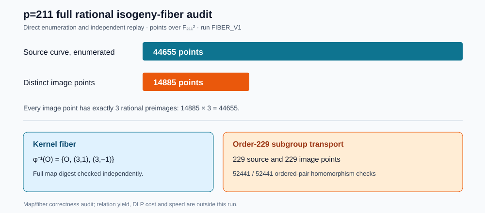

# Full rational-fiber audit: selected order-229 pair

**Run:** `FIBER_V1`; 2026-10-15; native Rust on Darwin arm64, macOS
26.6 build 25G70, shared L0 host. The [protocol](FIBER_PROTOCOL_V1.md)
and [source/binary/script-hash spec](FIBER_SPEC_V1.json) were committed
before execution. This run audited an explicit isogeny map and subgroup
transport. Its measured quantities are counts of points and checks;
it was not an ECDLP cost run.

The selected field is `F_211[s]/(s²−2)`. The source curve is
`y²=x³−21x+37`, the degree-three Vélu destination is
`y²=x³−81x−243`, and the rational kernel is
`{O,(3,1),(3,−1)}`. Their modular `j` values are 77 and 160, so
the models are non-isomorphic. The source and destination each have
44,655 points over the quadratic field; `44,655=195·229`.

| Audit quantity | Native runner | Independent checker |
| --- | ---: | ---: |
| Enumerated source points | 44,655 | 44,655 |
| Distinct isogeny image points | 14,885 | 14,885 |
| Rational preimages per image point | exactly 3 for all 14,885 | exactly 3 for all 14,885 |
| Source/image order-229 subgroup points | 229 each | 229 each |
| Ordered subgroup homomorphism pairs | 52,441 / 52,441 | 52,441 / 52,441 |
| Peak RSS, bytes | 22,315,008 | 21,102,592 |

The identity fiber is exactly `{O,(3,1),(3,-1)}`. The deterministic
cofactor rule chose source generator `G=((170,0),(0,109))`; its image
is `G'=((76,0),(0,69))`. The runner checked exact order 229 for both,
enumerated 229 distinct elements on each side, and checked the explicit
map homomorphism on all `229²=52,441` ordered pairs. The separate
[checker](../../../examples/different_j_order_fiber_check.rs) recomputed
the entire point enumeration, map, fibers, generators, hashes and pair
checks using independent field and group formulas. Its
[receipt](FIBER_REPLAY_V1.json) says `pass`; the runner's
[receipt](FIBER_V1.json) says all checks passed. Both processes exited
zero within the frozen 120-second and 512 MiB limits, with empty stderr.



The [native summary generator](../../../examples/different_j_fiber_summary.rs)
derives the [graph data](FIBER_SUMMARY_V1.json) and SVG from the two
receipts. The [150-dpi PNG](FIBER_GRAPH_V1.png),
[Typst source](FIBER_REPORT.typ) and [PDF](FIBER_REPORT.pdf) render the
same checked values. Full-map SHA-256 is
`7abd68e5b21e76ec046408cf02eab68b91e845d99628baa3e1e7c9ae07f3fa55`;
the order-229 subgroup-map SHA-256 is
`1287b41a3eb687c1e1e587335176d3244942c84394ba89458ee83c00c6b8e3ed`.
The independent checker reproduced both digests.

To replay the visual derivation from the checkout root, build the example
in release mode and run (the generator refuses to overwrite its recorded
outputs):

```sh
cargo build --release --example different_j_fiber_summary
study=research/isogeny_torsion_fibers_20261012/different_j_order_screen_20261015
target/release/examples/different_j_fiber_summary "$study/FIBER_V1.json" "$study/FIBER_REPLAY_V1.json" /private/tmp/FIBER_SUMMARY_REPLAY.json /private/tmp/FIBER_GRAPH_REPLAY.svg
typst compile --format png --ppi 150 "$study/FIBER_GRAPH_RENDER_V1.typ" /private/tmp/FIBER_GRAPH_REPLAY.png
typst compile "$study/FIBER_REPORT.typ" /private/tmp/FIBER_REPORT_REPLAY.pdf
```

The committed summary source SHA-256 is
`35052112bb3622c620b0fa6aa055a1fa86a52d7c89d48d22551e4169a801ef2f`;
the executed binary SHA-256 is
`4aff828994debe32334f6947b6e86ba5bbdc5205e3bd0482f514a25a7613527b`.
The summary JSON and SVG SHA-256 values are
`973d8ae7d6d311e84880b6cef96a5faca4f8e96fd527bec5b86d171ff4062d42`
and `d9ed7cc467958b42f96deba3b0dd7d1ea3c41895800d116923aa28a3ad2769e0`.
An independent fresh-output invocation reproduced both bytes exactly.
The PDF was opened and its table, figure, labels, and evidence references
were visually inspected.

The [runner source](../../../examples/different_j_order_fiber.rs),
[checker source](../../../examples/different_j_order_fiber_check.rs),
[exact run script](run_fiber_v1.zsh), [stdout/stderr](FIBER_RUN_V1.stdout)
and [exit receipts](FIBER_V1.exit) are preserved. The runner receipt
SHA-256 is `286dd1ef375ee218c9645b6ef3ca007fe911f1c3f23ef04ed96d245fb59eb143`;
the checker receipt SHA-256 is
`58594c96480195ff73909125764e1a450635c89d535511b70bbb54b4591d87b6`.
The pre-run [screen](RESULTS.md) and [direct point census](CENSUS_V1.jsonl)
remain separate records.

**Scope and next gate.** This finite audit verifies the stated map and
fiber counts for this one field and pair. It does not establish a
general curve-family theorem, a relation-yield change, recovered
unknown scalars at order 229, or a method-cost ratio. The next
[64-distinct-target comparison](NEXT_GATE.md) must run complete relation
solves and direct BSGS/rho controls with independent scalar replay and
full cost accounting. The direct χ-coordinate resultant remains a
separate open gate. No algorithm timing or speedup is reported here, so
no `benchmarks/` mirror is applicable. The canonical frontier and IC
scoreboard were checked and left unchanged because no admitted DLP
cost finding arose.
