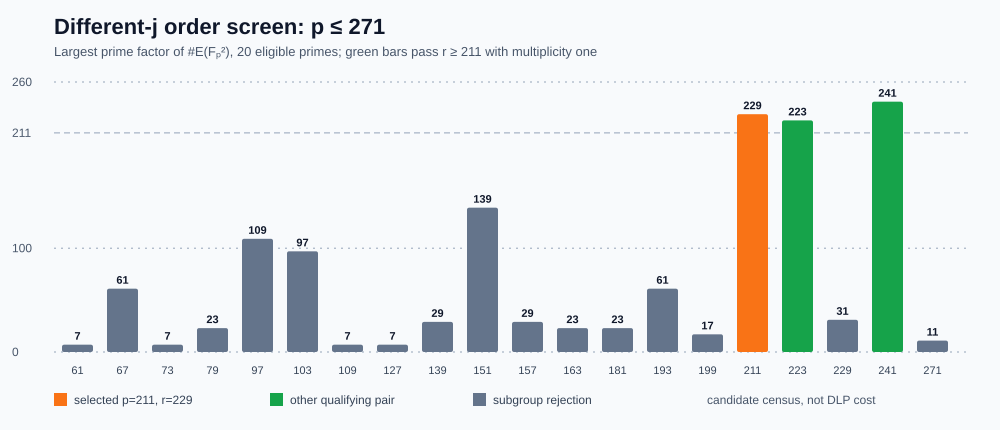

# Bounded larger-order different-j isogeny screen

**Status:** the preregistered `61<=p<=271`, `p=1 (mod 3)` native
construction screen completed. The [protocol](PROTOCOL_V1.md) was
committed before implementation, the [run spec](RUN_SPEC_V1.json) pinned
source, binary and script hashes before execution, and the
[raw 20-row census](RAW_V1.jsonl) is preserved. The separate
[Rust checker](../../../examples/different_j_order_check.rs)
recomputed eligibility, curve coefficients and `j` values, subgroup
factorization, selection, and all **192/192** recorded map witnesses;
its [replay receipt](REPLAY_V1.json) passed. A later
[direct quadratic-field census](CENSUS_V1.jsonl), separately
[hash-pinned](CENSUS_SPEC_V1.json), counted points on both models of
each accepted pair rather than relying only on the trace formula.

| Prime `p` | `#E(Fp²)` on each model | Prime `r` | Cofactor | Source `j` | Destination `j` | Selection |
| ---: | ---: | ---: | ---: | ---: | ---: | --- |
| **211** | **44,655** | **229** | **195** | **77** | **160** | First qualifying prime; selected |
| 223 | 50,175 | 223 | 225 | 183 | 222 | Qualifying later pair |
| 241 | 58,563 | 241 | 243 | 33 | 164 | Qualifying later pair |

The source family is `y²=x³−21x+37`; the explicit rational order-three
kernel uses `T=(3,1)`. Its Vélu destination is
`y²=x³−81x−243`, with coefficients reduced modulo `p`. In the selected
cell, `44,655=3·5·13·229`. Different `j` values certify that the two
nonsingular curves are not isomorphic even over the quadratic field.
There are 228 distinct nonidentity points in the order-229 subgroup,
so the planned 64-distinct-target batch is feasible. The screen's
map checks are 64 sampled point pairs per accepted prime. A separately
preregistered [full pointwise audit](FIBER_REPORT.md) subsequently
checked the selected cell, all 44,655 source points, every three-point
fiber, and 52,441 subgroup pairs by two native implementations.
The integer coefficient substitutions, six modular `j` arithmetic
certificates, three factorizations, capacity inequality, and the
selected audit's finite count equalities have
[axiom-free checked Lean proofs](PROOF_MAP.md). That proof map identifies
the missing curve-level formalization; the map evidence remains the
bounded native replay.

All **20** eligible primes were emitted in ascending order after the
selector found its first pair. Three passed every predicate and 17
failed only the `r>=211` multiplicity-one subgroup criterion. The
independent checker validated the exact first-pass selection
`(p,r)=(211,229)` and 192 relation-free map homomorphism witnesses.
The direct `F_(p²)` point census matched the trace-derived group order
for both source and destination at `p=211,223,241`: `44,655`, `50,175`
and `58,563`, respectively. All screen, replay and census processes
exited zero; their [stdout/stderr/exit receipts](RUN_V1.exit) and
[summary](SUMMARY_V1.json) are versioned.

This is a **construction and eligibility result**, followed by a
separate [finite map/fiber correctness result](FIBER_REPORT.md). Neither
measures relation yield, recovers an unknown scalar in the order-229
subgroup, or prices an end-to-end method against direct BSGS or rho. A full
same-target seven-arm batch, independent scalar replay, complete cold
counted `S` conversion, isolation and second-host performance replay
remain [pending](NEXT_GATE.md). The direct χ-coordinate resultant is a
separate [open gate](../different_j_reuse_20261015/NEXT_GATE.md).
The canonical `docs/bounds/frontier.json` and IC scoreboard are left
unchanged because this screen supplies no admitted DLP cost result.

## Reproduction and custody

- The [screen runner](../../../examples/different_j_order_screen.rs),
  [checker](../../../examples/different_j_order_check.rs),
  [summary generator](../../../examples/different_j_order_summary.rs),
  and [direct point census](../../../examples/different_j_order_census.rs)
  are native Rust. Their source/binary hashes and exact commands are
  pinned in [screen](RUN_SPEC_V1.json), [summary](SUMMARY_SPEC_V1.json)
  and [census](CENSUS_SPEC_V1.json) specs. The run and census scripts
  refuse overwrite and have 120-second wall ceilings.
- [RAW_V1.jsonl](RAW_V1.jsonl) SHA-256
  `31238914df3663805efb88c3c89c420b4ca42b875668da0cfc954cd1084171b4`;
  [REPLAY_V1.json](REPLAY_V1.json) SHA-256
  `ac2c13d5496755d57947b977db0e4c9829267615120b3fdb05fa906e89e73fd4`;
  [CENSUS_V1.jsonl](CENSUS_V1.jsonl) SHA-256
  `50f2b79d9811c72ccdacc316edf53b657b0d3a7911a332b64cc70749d315b925`.
- The source-linked [visual report PDF](REPORT.pdf) and its
  [Typst source](REPORT.typ), [native SVG](GRAPH_V1.svg) and
  [150-dpi PNG](GRAPH_V1.png) describe all accepted and rejected
  candidates. The [run receipt](RUN_SCRIPT_V1.stderr),
  [replay stderr](REPLAY_V1.stderr) and
  [census stderr](CENSUS_V1.stderr) are empty; the separate exit files
  record zero. This was a shared-host construction run, with no
  wall-time advantage or portable method-cost ratio claimed.
