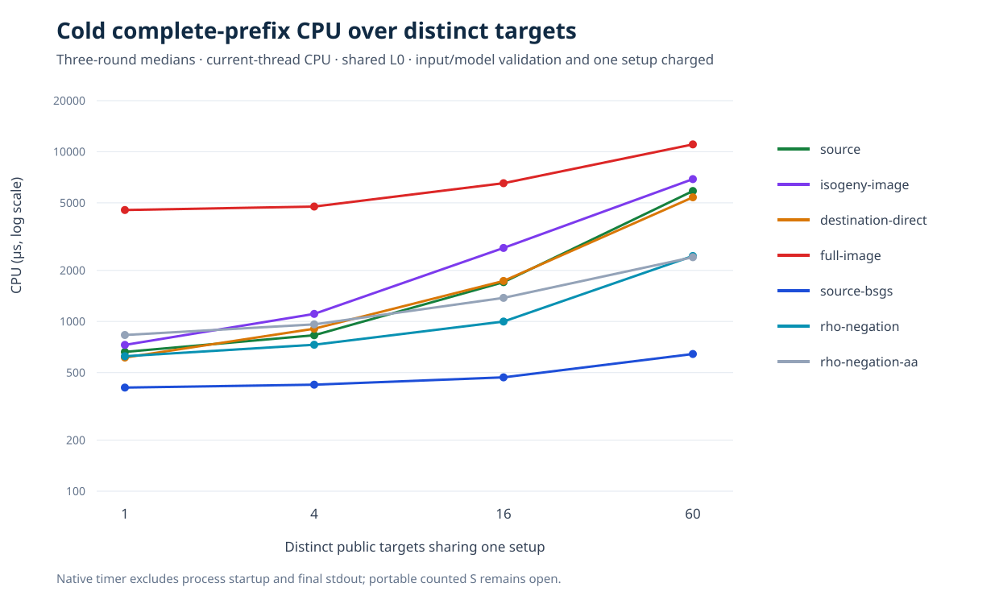
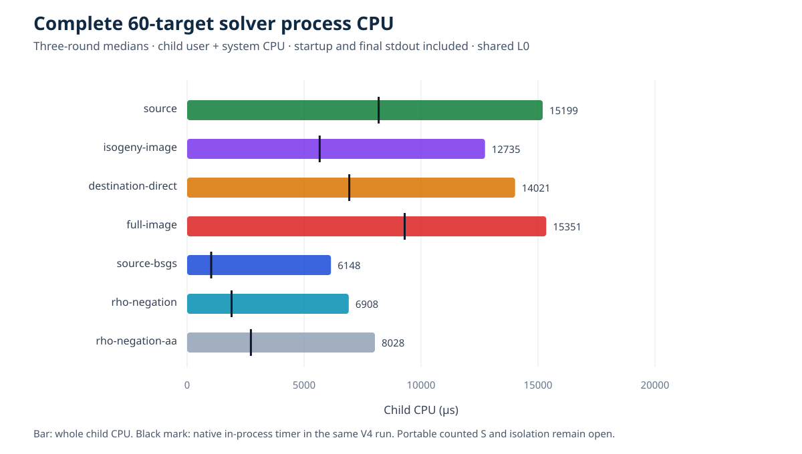

# Different-j 60-target reuse: result and next decision

**Status:** the corrected answer-free 60-target panel, three rounds of
seven arms, V3 native prefix accounting and V4 whole-process accounting
are complete for the frozen `F_(67²)`, order-61 pair. The
[source-linked run report](reports/run-20261015T1955Z/REPORT.md),
[two-page visual PDF](reports/run-20261015T1955Z/REPORT.pdf),
[V3 raw run](RUN_V3.jsonl), [V4 raw run](RUN_V4.jsonl),
[V4 process meters](METERS_V4.jsonl), and
[independent V3](REPLAY_V3.jsonl) and
[V4](REPLAY_V4.jsonl) replays are the evidence. The original
[V1 target-order leak](TARGET_ORDER_CORRECTION_V1B.md) and
[V2 wrapper failure](RUN_V2_FAILURE.md) remain visible. This work is
stacked on PR #1921.

| Requested gate | Status | Evidence and limit |
| --- | --- | --- |
| Sixty distinct public targets and setup reuse | Verified for this pair | Every nonidentity order-61 source point appeared once; all 60 mapped points and eight selected full-image preimages passed separate arithmetic checks. Four relation arms reused their own base and pair table; BSGS reused its baby table. |
| Paired recovery and replay | Verified for this panel | All 21 arm-round processes recovered all 60 scalars in V3 and V4. Each separate replay checked 1,260/1,260 scalar rows and 10,960 relation witnesses; all raw child exit codes were zero. |
| Native cold prefix accounting | Measured at shared-host L0 | V3 median current-thread CPU at N=60 was 11,049.667 µs full-image, 643.208 µs BSGS and 2,431.542 µs rho. Paired full-image/BSGS and full-image/rho medians were 18.103 and 5.284. Input/model validation and one setup are included; startup and final output are outside this timer. |
| Whole-process cost | Measured at shared-host L0 for N=60 | V4 median child user+system CPU was 15,351 µs full-image, 6,148 µs BSGS and 6,908 µs rho. Paired full-image/BSGS and full-image/rho medians were 2.483 and 2.222. Startup and final stdout are included. Smaller prefixes lack a whole-process receipt. |
| Portable method cost and scaling | Open | No ecbench counted `S`, isolation, independent-host performance replay or increasing-order panel. Only this public synthetic group and base selection are measured. |

The bounded mechanism did what it was designed to test: the expensive
1,525-point rational-image construction was charged once, then used
for 60 distinct solves. The V3 full-image cold total divided by
target count fell from 4,538.750 µs at `N=1` to 184.161 µs at
`N=60`. Direct BSGS reached 10.720 µs per target at `N=60`, so
setup reuse did not reverse their ranking on this complete target
capacity. Full-image relation trials were 1,145, 987 and 976 over
the three 60-target rounds; source projected used 1,022, 972 and
915. The earlier full-image support difference remains an exact
coordinate fact, while these paired rounds show no complete cost
crossover.

The process meter materially changed the **ratio**, from 18.103 in
the V3 native timer to 2.483 in V4 child CPU against BSGS, because
V4 includes startup, final serialization and output for every arm.
Those are different cost scopes and separate runs, so the ratio change
is an accounting observation, not an algorithmic improvement. The
V4 meter also records wall and RSS, but shared-host wall differences
are not an isolated result. The full seven-arm, one-unit table and
per-phase ledgers are in the [run report](reports/run-20261015T1955Z/REPORT.md)
and [native summaries](SUMMARY_V3.json) and [V4 summary](SUMMARY_V4.json).

The next discriminating test is a **larger-order, different-j native
panel** with a frozen curve and subgroup screen, a public-point-hash
target order, full-image and projected controls, direct source BSGS
and rho, complete process receipts, independent scalar replay, and a
counted `S` conversion. The direct χ-coordinate resultant remains a
separate implementation and correctness obligation. The
[next-gate plan](NEXT_GATE.md) keeps these tracks separate. The
canonical frontier in `docs/bounds/frontier.json` and the IC
scoreboard were checked and left unchanged because this run supplies
no admitted counted-`S` crossover; the two graphs above are its
quantitative visual record.

The new visual record is copied into
[`benchmarks/20261015-different-j-reuse/`](../../../benchmarks/20261015-different-j-reuse/).
Its shared `benchmarks/README.md` row is prepared there but awaits
Conductor task T-15's release of that exclusive index path. The
controlled release library suite completed with exit zero: 4,083
passed, zero failed and 117 ignored in 1,017.42 seconds. Its exact
[stdout](VALIDATION_LIB.stdout) and [stderr](VALIDATION_LIB.stderr)
have SHA-256 `e2727e1b6e3ec6a8c14ada08298362ec26c27e60ddcfeca91153cc3a6b906444`
and `8080e57368cb131b80e02068fa774fa064230ba1982df6dff44acc353bed2440`.
The touched-example and lint receipts are recorded in
[validation](VALIDATION.md).
