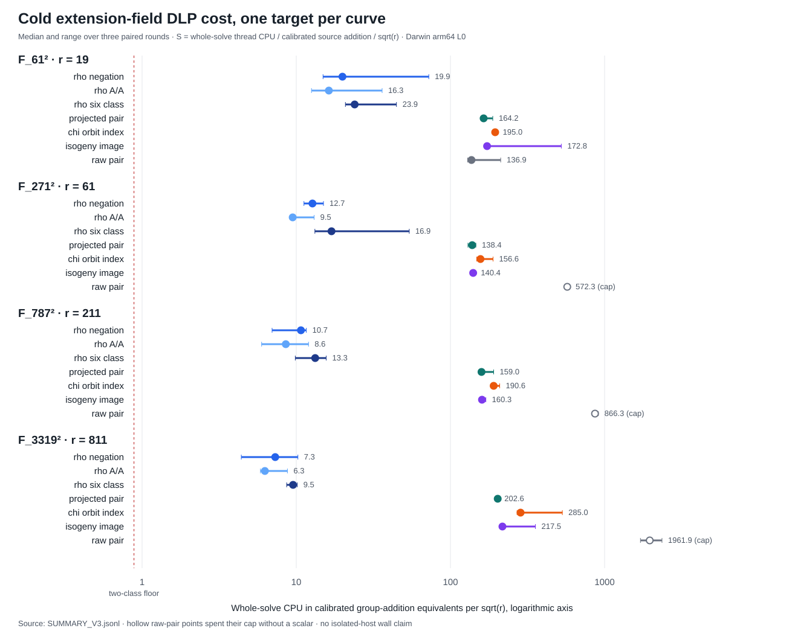

# Quadratic-extension torsion fiber DLP: run receipt

Run date: 2026-10-14. Host: Darwin 25.6.0 arm64, shared/L0; Rust and Cargo 1.93.1 (Homebrew). Four public known-answer instances over `F_(p²)` and three paired rounds. The study's [full analysis](../../REPORT.md) and [visual](../../GRAPH.svg) interpret the result; this receipt preserves execution and verification boundaries.

## Frozen inputs and source

- [Protocol](../../PROTOCOL.md), [pre-run amended arm scope](../../AMENDMENT_V3.md), and [run specification](../../RUN_SPEC.json), SHA-256 `acab50556e889563b7352799647f027f9554985673504169101196c126021f82`.
- [Fixtures](../../FIXTURES.jsonl), SHA-256 `1a63cc22a22e0fe27d44359325d502038d26d3ac616374fc5558c041939218b7`.
- V3 solver source at `4596c3ab59:examples/isogeny_torsion_extension.rs`, SHA-256 `034c05398c4652453f74e2a1eb675dee9c474e496582a0be339dcc9e35608500`. The later code adds support census, summary, plotting, EC1 records and formatting; it does not alter the V3 raw record.
- Base project revision before V3 run: `4596c3ab59`; [run bytes](../../RUN_V3.jsonl), SHA-256 `ca9a0ec7e31de59c58a78ae5c269350b37963b62ff9de815c805c36c2ec26693`.

## Execution and independent check

Native entry points are in `examples/isogeny_torsion_extension.rs`:

```sh
cargo build --release --example isogeny_torsion_extension
target/release/examples/isogeny_torsion_extension solve research/isogeny_torsion_fibers_20261012/extension_field_20261014/FIXTURES.jsonl > RUN_V3.jsonl
target/release/examples/isogeny_torsion_extension verify RUN_V3.jsonl research/isogeny_torsion_fibers_20261012/extension_field_20261014/FIXTURES.jsonl > REPLAY_V3.json
target/release/examples/isogeny_torsion_extension verify-independent RUN_V3.jsonl research/isogeny_torsion_fibers_20261012/extension_field_20261014/FIXTURES.jsonl > REPLAY_INDEPENDENT_V4.json
target/release/examples/isogeny_torsion_extension support research/isogeny_torsion_fibers_20261012/extension_field_20261014/FIXTURES.jsonl > SUPPORT.jsonl
target/release/examples/isogeny_torsion_extension summarize RUN_V3.jsonl > SUMMARY_V3.jsonl
target/release/examples/isogeny_torsion_extension plot SUMMARY_V3.jsonl > GRAPH.svg
```

The relative output names above are illustrative when rerunning from the repository root; use a fresh output directory and compare hashes, preserving these frozen files. The actual V3 run and original second-process replay exited zero; [stderr files](../../RUN_V3.stderr) and [original replay stderr](../../REPLAY_V3.stderr) are empty. That first replay reused the run's curve arithmetic. The later [independent replay protocol](../../INDEPENDENT_REPLAY_PROTOCOL.md) was committed before its execution. Its separate native `u128` coefficient arithmetic, field inversion, chord/tangent law and scalar routine checked all 75 recovered scalars, nine exhausted rows, 84 unique frozen slots, and expected seeds: [receipt](../../REPLAY_INDEPENDENT_V4.json), SHA-256 `785c5e615a18742302f05f6c2a219b260d48d5e2b63e984cec945222bd51ac5c`. The first independent arithmetic receipt [V3](../../REPLAY_INDEPENDENT_V3.json) lacked a fixed-hash assertion and remains preserved. V4 adds both fixed-hash assertions; a one-byte modified copy of the V3 run failed with exit 101 and [the expected hash mismatch](../../REPLAY_HASH_NEGATIVE.stderr). This arithmetic checker does not reimplement the relation collector. The support census and native summary exited zero and are separately hashed in [the artifact manifest](../../ARTIFACTS.sha256).

## Measurements and limits

The 84 rows cover seven arms × four sizes × three rounds. Cold CPU intervals end before report serialization. The per-field addition calibrations in V3 are `169.76625`, `147.45333`, `162.66167`, `156.87292 ns`. The primary ratio unit is current-thread CPU divided by that local calibration and by `√r`; direct counted-operation results are retained within every solver row. Per-arm peak RSS, L2 isolation, independent-host replay, the direct Semaev oracle, and the χ polynomial oracle are absent. The paired table and support census describe the fixed instances only.

The first run [V1](../../RUN_V1.jsonl) preserved complete output but `/usr/bin/time -l` exited 1 from sandboxed `sysctl`; [V2](../../RUN_V2.jsonl) exited zero but included JSON serialization inside the measured interval. Neither version supplies the published CPU comparison. The [timing correction](../../CORRECTION_V4.md) and V3 source revision record exactly what changed. The initial [v1 selector](../../SCREEN_V1.jsonl) remains alongside its preregistered v2 amendment and [final screen](../../SCREEN_V2.jsonl).


