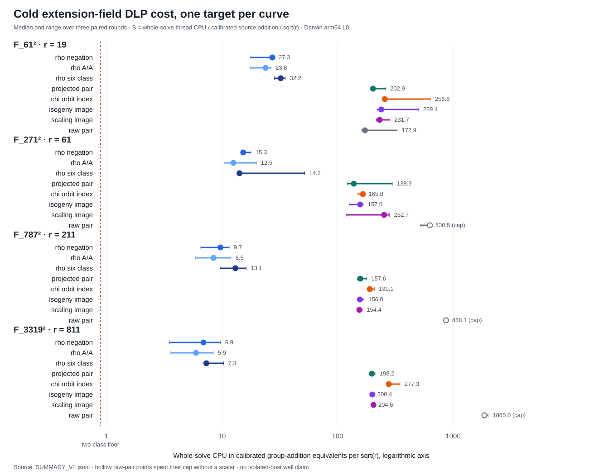

# Eight-arm quadratic-extension DLP comparison: run receipt

Run: 2026-10-14, approximately 16:17 UTC. Darwin 25.6.0 arm64, shared/L0. Rust and Cargo 1.93.1 (Homebrew). The [results report](../../REPORT.md) and [V4 visual](../../GRAPH_V4.svg) contain the interpretation; this receipt names the frozen bytes and verification steps.

## Frozen inputs and executable

- Four public [fixture records](../../FIXTURES.jsonl), SHA-256 `1a63cc22a22e0fe27d44359325d502038d26d3ac616374fc5558c041939218b7`.
- [Isomorphism protocol](../../ISOMORPHISM_PROTOCOL.md) committed before the [exact scaling check](../../ISO_CHECK.jsonl), SHA-256 `702da686eb5e8891c3ea60c9fb7719333e45b44634be836d53e13e1ce6f7a3aa`.
- [Eight-arm V4 run spec](../../RUN_SPEC_V4.json), SHA-256 `70734d89113dc887a4687560b80f160f1142a5b0cbcd76718190e9b85c01392a`; committed before the run.
- Runner source at `c68835edc4d112e3f8f5da3e606060141ad55143:examples/isogeny_torsion_extension.rs`, SHA-256 `04ee96dc1af8f40410a550fd36849e54e5d81ea3700c61c81355471118d315e5`.

## Execution and replay

The native release example's exact modes and input arguments were:

```sh
cargo run --release --example isogeny_torsion_extension -- solve-v4 research/isogeny_torsion_fibers_20261012/extension_field_20261014/FIXTURES.jsonl
target/release/examples/isogeny_torsion_extension verify-independent-v4 research/isogeny_torsion_fibers_20261012/extension_field_20261014/RUN_V4.jsonl research/isogeny_torsion_fibers_20261012/extension_field_20261014/FIXTURES.jsonl
target/release/examples/isogeny_torsion_extension summarize research/isogeny_torsion_fibers_20261012/extension_field_20261014/RUN_V4.jsonl
target/release/examples/isogeny_torsion_extension audit-v4 research/isogeny_torsion_fibers_20261012/extension_field_20261014/RUN_V4.jsonl
target/release/examples/isogeny_torsion_extension plot-v4 research/isogeny_torsion_fibers_20261012/extension_field_20261014/SUMMARY_V4.jsonl
```

Outputs were redirected to the linked, write-once study files. The [V4 raw record](../../RUN_V4.jsonl) exited zero, SHA-256 `71a0e8f7d96f630d372299f64a407d398b68dc21b9a8fa04de5c11c8c3b67b6a`. It contains four calibration rows and 96 arm rows. Three interleaved rounds per field use the same frozen source `G,Q,r`, seed and caps in all eight arms. Cold CPU intervals stop before JSON serialization. Each relation table verifies source-group equality before elimination; the framework compares the recovered scalar with the planted value only after recovery.

The [independent arithmetic receipt](../../REPLAY_RUN_V4.json), SHA-256 `59913f5b52e0a54ccb417ee67c57ae8de4aebe91338f470d2aa9a36900c22cb0`, pins the raw and fixture byte hashes, checks unique coverage and expected seeds for all 96 slots, and independently recomputes `[k]G=Q` using separate `u128` `F_(p²)` and elliptic-curve routines. It checked 87 recovered scalars and nine cap-exhausted raw-pair rows. It does not independently reconstruct relation matrices. The [paired outcome audit](../../PAIRED_AUDIT_V4.jsonl), SHA-256 `a893756ed866e8dd3927e8fb0e94bbd9806e5e0e6099804de8600869ee53c408`, confirms identical relation counts, trial counts, rank and scalar for the projected, χ-index, isogeny and scaling arms in each of twelve size/round cells.

The [native summary](../../SUMMARY_V4.jsonl), SHA-256 `91ef4e63ecc87e8bc60c5d2e777763ae15163ef167fa5bd1c42b48f97ac841f6`, reports all 32 three-round arm summaries, the local CPU-equivalent `S`, per-arm ranges and paired rho ratios. The new [graph](../../GRAPH_V4.svg) and [PNG](../../GRAPH_V4.png) use that summary. The run report and graph are also rendered in the accompanying PDF. The seven-arm [V3 record](../../RUN_V3.jsonl) and its report/PDF remain intact.

## Limits

The timed setup includes ascending discovery of the public scaling `u`; its implementation is specific to these small fields. The shared host provides an L0 timing observation, with A/A controls and substantial round variation. Peak RSS was not captured, so an equal-memory or portable counted-`S` comparison is open. The χ *polynomial-system* oracle, direct Semaev and quotient polynomial controls, pairing transfer and multiplicative-field DLP were not run.


