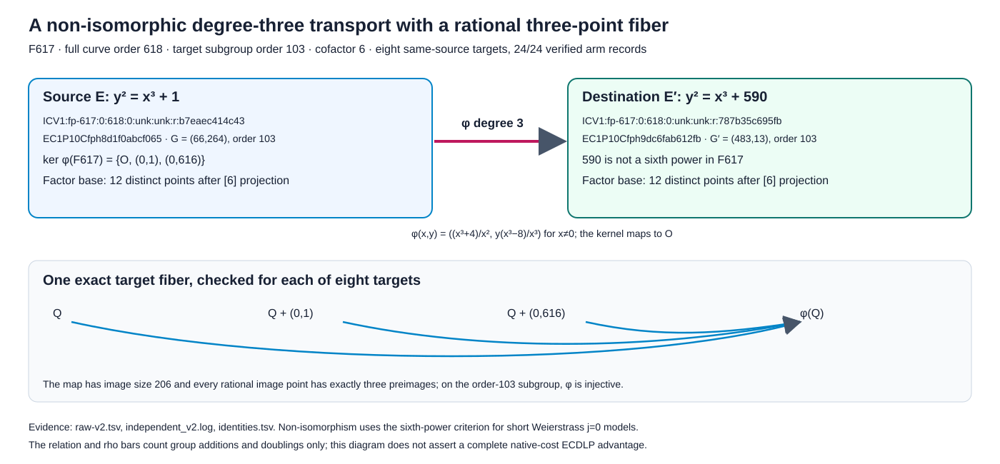
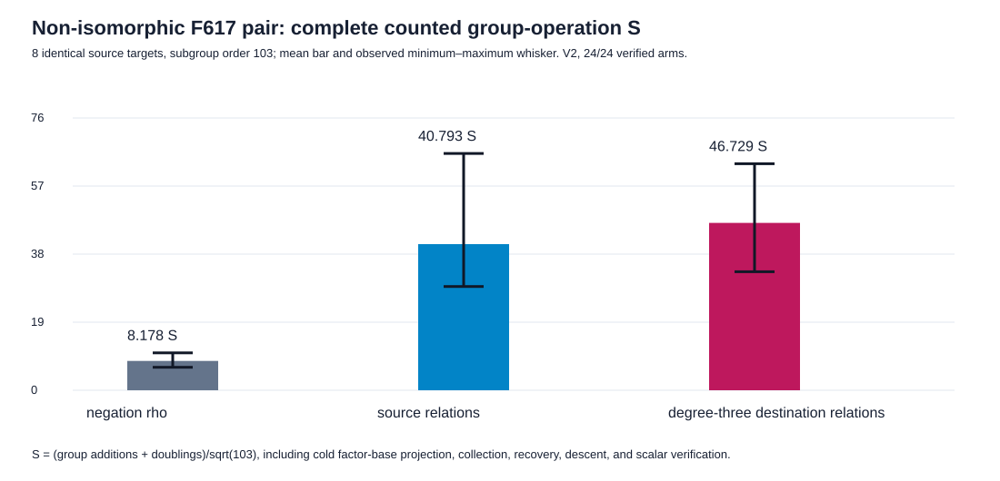

# Non-isomorphic isogeny transport and rational three-point fibers

**Date:** 2026-10-13 local. **Conductor:** T-2405. **Status:** one bounded
same-target native control, eight public source targets and 24/24
independently verified arm records. The result is a measured group-operation
diagnostic at subgroup order 103, not an admitted complete native-cost or
scaling comparison.

## Frozen question and exact identities

The [pre-run protocol](PROTOCOL.md) selected the first prime pair
`p=6r−1`, `r≥101`: `p=617`, `r=103`, with cofactor 6. Its candidate and
selection predicate were committed at `70b119bfab` before execution. The
[v2 remediation](REMEDIATION_V2.md) was committed at `fa1a6d4dee` before
the clean direct run; it changed only the execution wrapper. The exact
ICV1 and EC1 identities were generated by [native identity code](identity.rs)
and are retained in [identities.tsv](identities.tsv):

| role | field/model, order | exact ICV1 | EC1 representation and generator |
|:--|:--|:--|:--|
| source | `F617: y²=x³+1`, `#E=618` | `ICV1:fp-617:0:618:0:unk:unk:r:b7eaec414c43` | `EC1P10Cfph8d1f0abcf065`; `G=(66,264)`, order 103 |
| destination | `F617: y²=x³+590`, `#E'=618` | `ICV1:fp-617:0:618:0:unk:unk:r:787b35c695fb` | `EC1P10Cfph9dc6fab612fb`; `G'=(483,13)`, order 103 |

The map is `φ(O)=O`, `φ(0,±1)=O`, and
`φ(x,y)=((x³+4)/x², y(x³−8)/x³)` for `x≠0`.
The [independent checker](verify.rs) enumerated both 618-point rational
groups, checked the map on all **381,924 ordered source pairs**, and found
every rational image point to have exactly three preimages. The rational
kernel is `{O,(0,1),(0,616)}`, the image size is 206, and for each of the
eight tested targets `φ⁻¹(φ(Q))={Q,Q+(0,1),Q+(0,616)}`; their exact
coordinates are in [fibers-v2.tsv](fibers-v2.tsv). Since the kernel
has order 3 and the target subgroup has order 103, the map is injective on
that subgroup. The source and destination are **not base-field isomorphic**:
an isomorphism between these short Weierstrass `j=0` models in
characteristic 617 would require a field element `u` with
`u⁶·1=590 mod 617`; none exists. The finite sixth-power exclusion is
checked by [Lean](../lean/Nonisomorphic617.lean) and independently by native
enumeration. The full classification of curve isomorphisms and the concrete
group law are not formalized in that Lean module.

## Paired relation and rho result

The [release Rust runner](../../../examples/isogeny_fiber_nonisomorphic_20261013.rs)
chose eight distinct source targets from the frozen SplitMix64 lifted-point
stream, projecting each by `[6]`. For each target it built cold source and
destination factor bases from the first twelve distinct nonidentity
`[6]`-projected lifted points. Both relation arms used the same pair-table
construction, rank-12 modular elimination, collection/descent streams and
caps. Each relation arm recovered and verified a factor-base log vector,
then descended and verified the target scalar. The destination arm also
checked its recovered scalar against the original source `(G,Q)`. Matched
negation rho used the same source target. There is no rational order-three
automorphism to charge here: `F617` has no nontrivial cube root of unity.

The unit is `S = (group additions + doublings)/sqrt(103)`. It counts cold
factor-base cofactor projection and pair-table setup, collection, descent,
factor-base and target scalar verification, the destination source
cross-check, and rho's group work. The reference is the exact-target
negation rho arm; `sqrt(pi/4)=0.886227` is a two-class walk-step floor,
not a lower bound for this complete native pipeline. Ranges below are
observed minima–maxima over eight targets, not confidence intervals.

| arm | verified | total group ops | mean `S` (range) | total / matched rho | mean `S` / two-class floor |
|:--|--:|--:|--:|--:|--:|
| negation rho | 8/8 | 664 | 8.178 (6.405–10.444) | 1.000 | 9.228 |
| source relations | 8/8 | 3,312 | 40.793 (28.969–66.116) | 4.988 | 46.030 |
| degree-three destination relations | 8/8 | 3,794 | 46.729 (33.107–63.258) | 5.714 | 52.728 |

The measured destination/source counted-total ratio is
`3,794/3,312 = 1.145531`; source and destination collection used **231
and 290 trials** across the same eight targets, respectively. Destination
relations used more group operations on five targets and fewer on three;
the [paired table](paired_summary-v2.tsv) preserves every target, including
the destination/source range **0.542474–2.183673**. The group-operation
difference of 482 decomposes as setup `−24`, collection `+408`, descent
`−1`, and verification `+99`. The destination verification phase includes
the explicit source cross-check. The [phase totals](phase_summary-v2.tsv)
also retain row operations and lift counts; the source/destination factor
bases scanned 22/29 abscissae per cold solve.

## Replays, proof map, and limitations

The first execution's native child produced all 24 verified rows, but its
outer `/usr/bin/time -l` wrapper returned exit 1 on a restricted-host
`sysctl kern.clockrate` denial. Its [raw TSV](raw-v1.tsv),
[stderr](run-v1.log), and [run report](reports/run-20261013T1743Z/README.md)
remain preserved; it provides no admitted wall-time result. The direct v2
execution returned exit 0. Its [raw TSV](raw-v2.tsv), [log](run-v2.log),
[replay TSV](replay-v2.tsv), and [replay log](replay-v2.log) compare byte for
byte; v1 and v2 stdout also compare byte for byte. The independent
[receipt](independent_v2.log) confirms 24 answers, eight exact source target
fibers with the [coordinate certificate](fibers-v2.tsv), both group orders,
kernel and image, target subgroup, factor-base
selection, and phase totals. It also independently reconstructed all
**16 relation rows' factor bases, collection ranks, factor-base logs,
descent trials, and recovered scalars** with its separate group law. The
[v2 run report](reports/run-20261013T1744Z/README.md)
contains commands, source/binary hashes and status. Full validation is in
[validation/README.md](validation/README.md); the visual [PDF](report.pdf)
and [artifact manifest](ARTIFACTS.sha256) are part of this record.

| mathematical statement | Lean declaration | status and exact scope |
|:--|:--|:--|
| no canonical residue modulo 617 has sixth power 590 | `Nonisomorphic617.ratioNotSixthPower` | compiled by `lake build`, no axioms; finite modular statement |
| target order 103 is coprime to kernel order 3 | `Nonisomorphic617.targetCoprimeKernel` | compiled, no axioms |
| a scalar in the order-103 ring killed by 3 vanishes | `Nonisomorphic617.kernelScalarVanishes` | compiled using only standard `propext`; finite implication used for subgroup injectivity once the concrete kernel bridge is supplied |
| rational-kernel order divides the cofactor under the earlier hypotheses | `FiberCofactor.rationalKernelOrderDvdCofactor` | previously compiled conditional theorem |
| the concrete map has kernel size 3, fibers of size 3, and acts injectively on the order-103 subgroup | no concrete Lean elliptic-curve group-law declaration | independently checked exhaustively in native Rust; full Lean bridge remains open |

The tested destination model has no degree-one base-field scaling from the
source. This removes the specific isomorphism confound of the preceding
`F13/F199` round. The bounded observation is that the destination relation
arm used **1.145531×** the source arm's counted group operations on these
eight targets; it does not establish a distributional or asymptotic effect.
The host was shared Darwin arm64, L0, and replay was on the same host. The
diagram and graph from the earlier isomorphic-pair round were checked and
left unchanged because they depict different frozen models and target sets.

Every destination workload also paid two map evaluations, recorded as
`10M + 4S + 2I`, while the source arm paid none. The raw file separately
counts prime group field operations, factor-base lifts, table probes,
modular row work, rho steps and distinguished points. Square-root cost,
lookup/hash cost, row-operation conversion, memory, curve-specific map
discovery, and exhaustive preflight are not priced in a common native unit.
The cold construction cost and independent-host cost replay therefore remain
open. A complete ECDLP speed comparison additionally needs larger orders,
four growing sizes, five interleaved rounds, calibrated rho and resource
intervals; this one order supplies a correctness and mechanism control.
The [open problem](../../../problems/nonrational-isogeny-fiber-dlp-cost-gap.md)
keeps the full performance obligation visible.

| requested element | status | evidence or remaining gap |
|:--|:--|:--|
| explicit base-field non-isomorphic source/destination pair | verified complete for this pair | two exact identities, Lean sixth-power certificate, native curve/map census |
| nontrivial rational torsion fiber | verified complete for this pair | kernel size 3, all image fibers size 3, eight exact target fibers checked |
| paired source/destination relation solves and recovery | verified complete on eight frozen targets | 16 relation rows, rank and factor-base checks, source/destination scalar checks |
| matched rho and exact replay | verified complete for the fixed negation arm | eight rho rows, clean v2 exit and byte-identical replay |
| full native-cost speed and scaling comparison | partial | unpriced native operations, one small order, shared host, same-host replay |
